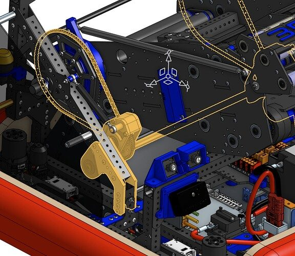
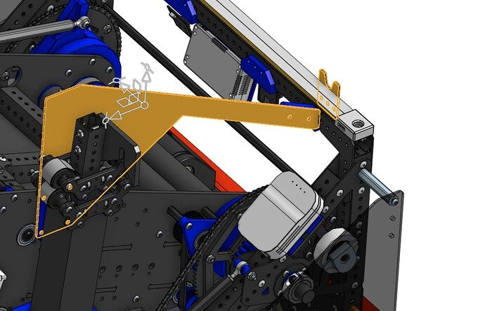
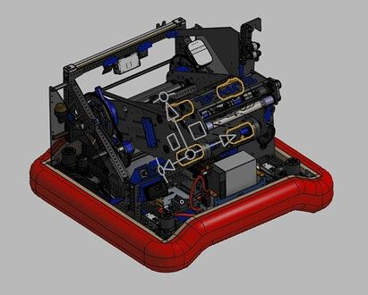
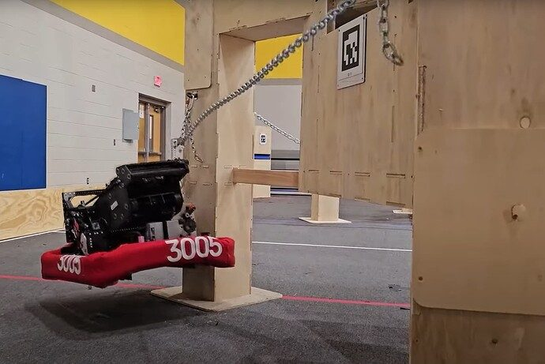
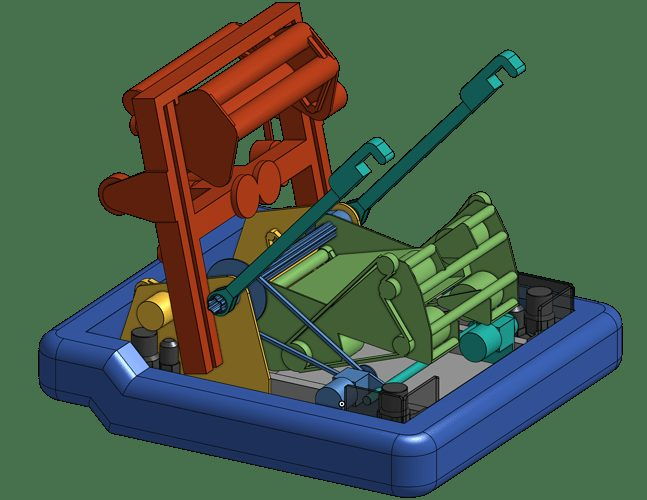
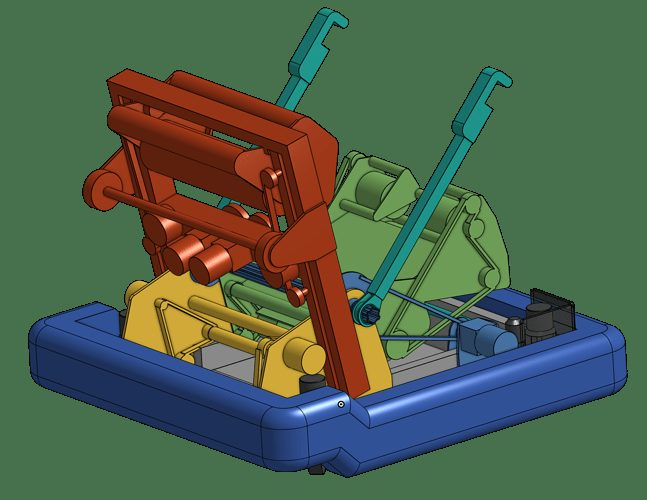
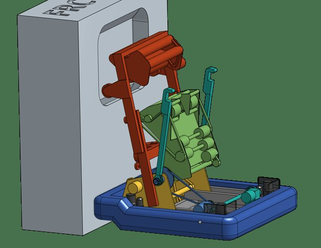

# 2024 · 3005 RoboChargers — Surge

EPA rank 3, snapshot EPA 54.85. Provisional reference dossier.

Two-sided intake, transfer pivot and powerful launcher, with compact spring-deployed chain climber.

## Drivetrain

REV modules with Vortex drive and custom TPU tread; team reports frequent wheel replacement.

Coverage: documented synopsis.

## Intake

Front/rear pickup feeds a central path; sensors stop the note and a low-friction plate supports it.

Coverage: documented synopsis.

## Transfer

Pivoting transfer preserves vertical compression into the launcher.

Coverage: documented synopsis.

## Scoring

Four Vortex-powered wheel groups and adjustable launch pivot; tested contact and compression govern geometry.

Coverage: documented synopsis.

## Endgame

Constant-force-spring deployment, powered retrieval and magnetic hook retention; side approach leaves harmony room.

Coverage: documented synopsis.

## Controls

AprilTag/odometry localization and shot lookup tables support scoring or passing into the protected amp-side area.

Coverage: documented synopsis.

## Changes and versions

- Approximately eleven launcher iterations reported. TPU wheels replaced stock tread; hook magnet addressed inconsistent chain engagement.

## Strategic interpretation — analyst inference

Their role flexibility depended on deliberate pass landing zones, not merely being able to throw a note far. Wheel performance also carried a substantial consumable/service requirement.

## Limits

- Configuration description is tied to the cited interview; not a claim that every unreported shop revision is known.

Bounded source review; exhaustive intermediate-version history not certified

## Reviewed primary source bundle

- https://youtu.be/rmW-vyC5Gdo

## Season context

Read [the full 2024 game/context chapter](../docs/game_2024.md) before transferring this architecture to another role or season.

## Technical image references

Images are source-associated technical figures or robot views, not dimensionally certified drawings. Follow each source for version and figure context.

2024 team 3005 — source image from post 3 (2024-04-15). Context tags identify the discussion, not a verified component label. [Original source](https://www.chiefdelphi.com/t/462933/3). Source-linked extraction; mechanism identity not individually visually audited

2024 team 3005 — source image from post 3 (2024-04-15). Context tags identify the discussion, not a verified component label. [Original source](https://www.chiefdelphi.com/t/462933/3). Source-linked extraction; mechanism identity not individually visually audited

2024 team 3005 — source image from post 8 (2024-04-16). Context tags identify the discussion, not a verified component label. [Original source](https://www.chiefdelphi.com/t/462933/8). Source-linked extraction; mechanism identity not individually visually audited

2024 team 3005 — source image from post 19 (2024-04-28). Context tags identify the discussion, not a verified component label. [Original source](https://www.chiefdelphi.com/t/456489/19). Source-linked extraction; mechanism identity not individually visually audited

2024 team 3005 — source image from post 9 (2024-09-01). Context tags identify the discussion, not a verified component label. [Original source](https://www.chiefdelphi.com/t/470483/9). Source-linked extraction; mechanism identity not individually visually audited

2024 team 3005 — source image from post 9 (2024-09-01). Context tags identify the discussion, not a verified component label. [Original source](https://www.chiefdelphi.com/t/470483/9). Source-linked extraction; mechanism identity not individually visually audited

2024 team 3005 — source image from post 9 (2024-09-01). Context tags identify the discussion, not a verified component label. [Original source](https://www.chiefdelphi.com/t/470483/9). Source-linked extraction; mechanism identity not individually visually audited

## Dated research locators — navigation, not reviewed claims

A tag describes words in the source, not a validated engineering fact. Discussion replies may concern comparison robots.

- 2024-02-28 · AutumnCast · [post 1](https://www.chiefdelphi.com/t/456489/1) · intake, launcher
- 2024-02-28 · Alex_Y · [post 2](https://www.chiefdelphi.com/t/456489/2) · shooter
- 2024-02-28 · unident · [post 3](https://www.chiefdelphi.com/t/456489/3) · shooter
- 2024-02-28 · Frugez · [post 4](https://www.chiefdelphi.com/t/456489/4) · climb
- 2024-02-28 · cadandcookies · [post 5](https://www.chiefdelphi.com/t/456489/5) · climb
- 2024-02-28 · its.presto · [post 6](https://www.chiefdelphi.com/t/456489/6) · intake
- 2024-02-28 · Rocky_S · [post 14](https://www.chiefdelphi.com/t/456489/14) · intake
- 2024-04-15 · AutumnCast · [post 1](https://www.chiefdelphi.com/t/462933/1) · cad
- 2024-04-15 · AmitSucher · [post 5](https://www.chiefdelphi.com/t/462933/5) · shooter
- 2024-04-16 · Orion.DeYoe · [post 6](https://www.chiefdelphi.com/t/462933/6) · intake, launcher
- 2024-04-16 · AutumnCast · [post 7](https://www.chiefdelphi.com/t/462933/7) · launcher
- 2024-04-16 · moore_ryan · [post 8](https://www.chiefdelphi.com/t/462933/8) · shooter
- 2024-04-23 · AutumnCast · [post 10](https://www.chiefdelphi.com/t/462933/10) · launcher
- 2024-04-25 · mconine · [post 14](https://www.chiefdelphi.com/t/462933/14) · shooter
- 2024-04-26 · Will_Toth · [post 15](https://www.chiefdelphi.com/t/462933/15) · code, encoder, shooter
- 2024-08-30 · Orion.DeYoe · [post 1](https://www.chiefdelphi.com/t/470483/1) · cad
- 2024-08-30 · Nick_Coussens · [post 2](https://www.chiefdelphi.com/t/470483/2) · cad
- 2024-08-30 · Torrance · [post 3](https://www.chiefdelphi.com/t/470483/3) · cad
- 2024-08-30 · Nick_Coussens · [post 4](https://www.chiefdelphi.com/t/470483/4) · rebuild
- 2024-08-30 · JesseK · [post 6](https://www.chiefdelphi.com/t/470483/6) · cad, code
- 2024-08-30 · sokoloff · [post 7](https://www.chiefdelphi.com/t/470483/7) · cad
- 2024-09-01 · Eliot · [post 8](https://www.chiefdelphi.com/t/470483/8) · cad
- 2024-09-01 · Eliot · [post 9](https://www.chiefdelphi.com/t/470483/9) · cad, climb, elevator, intake, pivot, shooter
- 2024-09-02 · howlongismyname · [post 10](https://www.chiefdelphi.com/t/470483/10) · cad
- 2024-09-02 · machinaeexdeo · [post 11](https://www.chiefdelphi.com/t/470483/11) · cad
- 2024-09-02 · howlongismyname · [post 12](https://www.chiefdelphi.com/t/470483/12) · cad
- 2024-10-28 · arjunorsmth · [post 14](https://www.chiefdelphi.com/t/470483/14) · cad

## Integrated focused technical study

[Construction, reasoning, failure modes and limits](../docs/research_continuation/2024-3005.md). This supplement is a focused interview/source-bundle study, not an exhaustive binder or competition-version certification.
