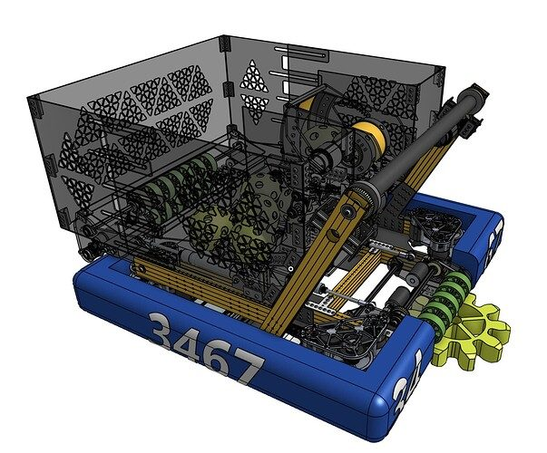
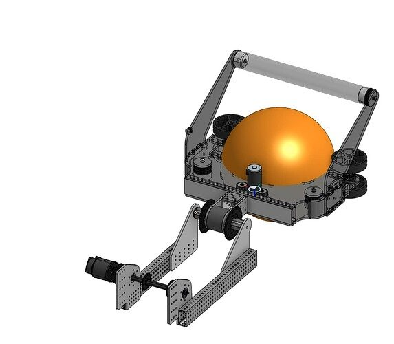

# 2024 · 3467 Windham Windup — Nocturne

EPA rank 18, snapshot EPA 47.63. Provisional reference dossier.

Protected acquisition and a shared shooter/amp/climb pivot with later blower-assisted trap development.

## Drivetrain

Compact swerve platform.

Coverage: documented synopsis.

## Intake

Under-bumper flexible-wheel intake with passive low-friction centering wedges.

Coverage: documented synopsis.

## Transfer

Powered staging rollers accelerate and retain the note.

Coverage: documented synopsis.

## Scoring

Single arm pivot supported by four chain runs; adjustable wheel-speed/angle shots.

Coverage: documented synopsis.

## Endgame

Hooks on the scoring arm provide fast chain lift; blower trap solution researched after primary scoring worked.

Coverage: documented synopsis.

## Controls

Tag-based pose, note pickup assistance, moving shots and PathPlanner routines.

Coverage: documented synopsis.

## Changes and versions

- Early over-bumper, fixed subwoofer shooter replaced. Active centering abandoned for power demand. Blower shown as a plan/test in the interview; later release governs its fielded status.

## Strategic interpretation — analyst inference

A clean priority sequence: first improve acquisition robustness and scoring range, then pursue trap. Keep the blower's legal mechanism and successful field configuration tied to dated evidence.

## Evidence and limits

- Intermediate undocumented changes are not inferred; specifications and plans retain their source context.

Bounded source review; exhaustive intermediate-version history not certified

## Reviewed source bundle

- https://youtu.be/tmRQ12MZrVo
- https://www.chiefdelphi.com/t/460678
- https://www.chiefdelphi.com/uploads/short-url/ih64E84mBXtAJg7fKLBo7rgi5xM.pdf

## Season context

Read [the full 2024 game/context chapter](../docs/game_2024.md) before transferring this architecture to another role or season.

## Technical image references

Images are source-associated technical figures or robot views, not dimensionally certified drawings. Follow each source for version and figure context.

2024 team 3467 — source image from post 1 (2023-12-05). Context tags identify the discussion, not a verified component label. [Original source](https://www.chiefdelphi.com/t/445350/1). Source-linked extraction; mechanism identity not individually visually audited

2024 team 3467 — source image from post 1 (2023-12-05). Context tags identify the discussion, not a verified component label. [Original source](https://www.chiefdelphi.com/t/445350/1). Source-linked extraction; mechanism identity not individually visually audited

## Dated research locators — navigation, not reviewed claims

A tag describes words in the source, not a validated engineering fact. Discussion replies may concern comparison robots.

- 2023-12-05 · Kevin_Leonard · [post 1](https://www.chiefdelphi.com/t/445350/1) · autonomous, cad, code, intake, launcher
- 2023-12-05 · Akash_Rastogi · [post 4](https://www.chiefdelphi.com/t/445350/4) · code
- 2023-12-12 · Kevin_Leonard · [post 8](https://www.chiefdelphi.com/t/445350/8) · intake
- 2024-01-05 · BrendanB · [post 9](https://www.chiefdelphi.com/t/445350/9) · code, prototype
- 2024-01-07 · Kevin_Leonard · [post 13](https://www.chiefdelphi.com/t/445350/13) · cad
- 2024-01-09 · Kevin_Leonard · [post 20](https://www.chiefdelphi.com/t/445350/20) · chain, climb
- 2024-01-10 · Ben_Martin · [post 21](https://www.chiefdelphi.com/t/445350/21) · chain
- 2024-01-10 · Kevin_Leonard · [post 22](https://www.chiefdelphi.com/t/445350/22) · intake, shooter, vision
- 2024-01-11 · Kevin_Leonard · [post 23](https://www.chiefdelphi.com/t/445350/23) · cad, intake, shooter
- 2024-01-12 · Teddy · [post 24](https://www.chiefdelphi.com/t/445350/24) · intake, shooter
- 2024-01-12 · credard · [post 25](https://www.chiefdelphi.com/t/445350/25) · intake, shooter
- 2024-01-13 · Kevin_Leonard · [post 26](https://www.chiefdelphi.com/t/445350/26) · cad, intake, shooter
- 2024-01-17 · Kevin_Leonard · [post 27](https://www.chiefdelphi.com/t/445350/27) · intake, shooter
- 2024-01-17 · jtrv · [post 29](https://www.chiefdelphi.com/t/445350/29) · pivot
- 2024-01-17 · Akash_Rastogi · [post 30](https://www.chiefdelphi.com/t/445350/30) · intake
- 2024-01-17 · JamesCH95 · [post 32](https://www.chiefdelphi.com/t/445350/32) · intake
- 2024-01-18 · Kevin_Leonard · [post 33](https://www.chiefdelphi.com/t/445350/33) · intake
- 2024-01-18 · brennan-macaig · [post 34](https://www.chiefdelphi.com/t/445350/34) · intake
- 2024-01-19 · Kevin_Leonard · [post 37](https://www.chiefdelphi.com/t/445350/37) · arm, intake, shooter
- 2024-01-22 · Yigit · [post 38](https://www.chiefdelphi.com/t/445350/38) · shooter
- 2024-01-22 · Kevin_Leonard · [post 39](https://www.chiefdelphi.com/t/445350/39) · arm, cad, climb, encoder, intake, prototype, shooter
- 2024-01-23 · Kevin_Leonard · [post 42](https://www.chiefdelphi.com/t/445350/42) · arm
- 2024-01-23 · Toby · [post 43](https://www.chiefdelphi.com/t/445350/43) · arm, chain
- 2024-01-24 · Kevin_Leonard · [post 44](https://www.chiefdelphi.com/t/445350/44) · arm
- 2024-01-25 · Kevin_Leonard · [post 46](https://www.chiefdelphi.com/t/445350/46) · autonomous, chain, climb, code
- 2024-01-28 · Kevin_Leonard · [post 47](https://www.chiefdelphi.com/t/445350/47) · intake, prototype
- 2024-01-29 · BrendanB · [post 48](https://www.chiefdelphi.com/t/445350/48) · arm, bearing, intake, shooter
- 2024-01-31 · Kevin_Leonard · [post 51](https://www.chiefdelphi.com/t/445350/51) · intake, prototype, shooter
- 2024-02-04 · BrendanB · [post 52](https://www.chiefdelphi.com/t/445350/52) · arm, code, shooter
- 2024-02-05 · credard · [post 54](https://www.chiefdelphi.com/t/445350/54) · arm, cad, intake, vision
- 2024-02-05 · JohnFogarty · [post 56](https://www.chiefdelphi.com/t/445350/56) · code
- 2024-02-08 · Kevin_Leonard · [post 57](https://www.chiefdelphi.com/t/445350/57) · arm, shooter
- 2024-02-14 · Kevin_Leonard · [post 59](https://www.chiefdelphi.com/t/445350/59) · autonomous, prototype
- 2024-02-14 · Wilk · [post 60](https://www.chiefdelphi.com/t/445350/60) · arm, code, intake, shooter, vision
- 2024-02-16 · Bryson_Halsey · [post 62](https://www.chiefdelphi.com/t/445350/62) · autonomous, camera, code, vision
- 2024-02-20 · J.F · [post 63](https://www.chiefdelphi.com/t/445350/63) · encoder
- 2024-02-20 · credard · [post 64](https://www.chiefdelphi.com/t/445350/64) · arm, encoder
- 2024-02-20 · Kevin_Leonard · [post 65](https://www.chiefdelphi.com/t/445350/65) · arm, autonomous, belt, chain, climb, intake, pivot, shooter
- 2024-02-20 · Kevin_Leonard · [post 67](https://www.chiefdelphi.com/t/445350/67) · arm, shooter
- 2024-02-20 · BrendanB · [post 68](https://www.chiefdelphi.com/t/445350/68) · shooter
- 2024-02-21 · Kevin_Leonard · [post 70](https://www.chiefdelphi.com/t/445350/70) · intake
- 2024-02-23 · J.F · [post 71](https://www.chiefdelphi.com/t/445350/71) · shooter
- 2024-02-23 · credard · [post 73](https://www.chiefdelphi.com/t/445350/73) · arm, intake, shooter
- 2024-02-25 · Kevin_Leonard · [post 76](https://www.chiefdelphi.com/t/445350/76) · autonomous, encoder, intake, vision
- 2024-02-25 · Kevin_Leonard · [post 77](https://www.chiefdelphi.com/t/445350/77) · intake
- 2024-02-27 · Kevin_Leonard · [post 78](https://www.chiefdelphi.com/t/445350/78) · code, intake, shooter
- 2024-02-27 · Wilk · [post 80](https://www.chiefdelphi.com/t/445350/80) · camera, vision
- 2024-03-04 · Kevin_Leonard · [post 82](https://www.chiefdelphi.com/t/445350/82) · arm, autonomous, climb, code, intake, vision
- 2024-03-04 · ASmith1675 · [post 83](https://www.chiefdelphi.com/t/445350/83) · intake
- 2024-03-04 · Akash_Rastogi · [post 86](https://www.chiefdelphi.com/t/445350/86) · vision
- 2024-03-04 · Drew_B · [post 90](https://www.chiefdelphi.com/t/445350/90) · vision
- 2024-03-08 · Kevin_Leonard · [post 92](https://www.chiefdelphi.com/t/445350/92) · vision
- 2024-03-08 · bcon · [post 94](https://www.chiefdelphi.com/t/445350/94) · arm, intake
- 2024-03-15 · Kevin_Leonard · [post 95](https://www.chiefdelphi.com/t/445350/95) · arm, autonomous, intake, vision
- 2024-03-18 · Kevin_Leonard · [post 96](https://www.chiefdelphi.com/t/445350/96) · autonomous, climb, intake, vision
- 2024-03-18 · credard · [post 98](https://www.chiefdelphi.com/t/445350/98) · camera
- 2024-03-25 · Kevin_Leonard · [post 99](https://www.chiefdelphi.com/t/445350/99) · arm, autonomous, camera, chain, climb
- 2024-03-30 · credard · [post 1](https://www.chiefdelphi.com/t/460678/1) · arm, shooter
- 2024-03-31 · Kevin_Leonard · [post 102](https://www.chiefdelphi.com/t/445350/102) · autonomous
- 2024-03-31 · joemost · [post 9](https://www.chiefdelphi.com/t/460678/9) · shooter
- 2024-03-31 · Pato4635 · [post 15](https://www.chiefdelphi.com/t/460678/15) · cad
- 2024-04-01 · Wilk · [post 107](https://www.chiefdelphi.com/t/445350/107) · code
- 2024-04-03 · credard · [post 19](https://www.chiefdelphi.com/t/460678/19) · cad
- 2024-04-03 · Kevin_Leonard · [post 109](https://www.chiefdelphi.com/t/445350/109) · cad, chain, climb
- 2024-04-09 · Kevin_Leonard · [post 110](https://www.chiefdelphi.com/t/445350/110) · arm, intake, shooter
- 2024-04-15 · Kevin_Leonard · [post 113](https://www.chiefdelphi.com/t/445350/113) · intake, shooter
- 2024-04-26 · Lilly_7072_FRC_FTC · [post 114](https://www.chiefdelphi.com/t/445350/114) · cad
- 2024-05-01 · pixelpunk · [post 115](https://www.chiefdelphi.com/t/445350/115) · intake
- 2024-05-02 · Kevin_Leonard · [post 116](https://www.chiefdelphi.com/t/445350/116) · arm, autonomous, climb, intake, shooter
- 2024-06-23 · BrendanB · [post 121](https://www.chiefdelphi.com/t/445350/121) · cad

# 2024-3467: technical mechanisms, design reasoning and revision boundaries

These notes distinguish published construction from team-stated intent and original engineering inference. Selected numerical values are reported source data, not independently reproduced measurements. The recommended tests have not been performed. A binder snapshot does not certify every competition version.

## NOCTURNE: passive centering trades motor count for geometry

Version: NOCTURNE at Granite State. [PDF p10](https://www.chiefdelphi.com/uploads/short-url/ih64E84mBXtAJg7fKLBo7rgi5xM.pdf#page=10) · [Team explanation](https://www.chiefdelphi.com/t/445350/82) · [Team explanation](https://www.chiefdelphi.com/t/445350/95)

**Published construction:** Fast under-bumper rollers with passive wedges replacing an active-centering beta design.

**Team-stated reason or evidence boundary:** Reduce current while retaining useful acquisition.

**Engineering analysis — original inference:** A passive wedge can convert forward motion into centering without another motor, but requires the right approach velocity, contact friction and space for the note to move laterally. If a note is pinched against the wedge before it is captured, a faster roller can make the jam worse. The source represents the Granite State configuration, and a later team account describes impact failures and difficult repairs. The observed update is therefore part of the technical recommendation: a pickup can satisfy its contact objective while losing event value through poor service access.

**Proposed validation — not a completed test:** Test wide and oblique capture, then time a damaged roller replacement and verify alignment after repair.

**Limits:** The binder is a published configuration snapshot, not an independent durability or match-rate test.

## NOCTURNE: reuse a familiar joint and simplify the architecture

Version: NOCTURNE at Granite State. [PDF p3](https://www.chiefdelphi.com/uploads/short-url/ih64E84mBXtAJg7fKLBo7rgi5xM.pdf#page=3) · [PDF p6](https://www.chiefdelphi.com/uploads/short-url/ih64E84mBXtAJg7fKLBo7rgi5xM.pdf#page=6) · [PDF p7](https://www.chiefdelphi.com/uploads/short-url/ih64E84mBXtAJg7fKLBo7rgi5xM.pdf#page=7)

**Published construction:** Single-joint arm, paired planetary drives, chain final reduction and output-angle sensing.

**Team-stated reason or evidence boundary:** Reuse 2023 experience and preserve time before week 1.

**Engineering analysis — original inference:** A familiar joint can reduce the number of new mechanical and software problems, which matters when experienced students have graduated. It still needs a force-path and backlash review for its new payload. Multiple chain runs can distribute load but require matched tension so one does not carry nearly everything. A hard-stop shot gives a mechanically referenced fallback when vision or arm control fails, but repeated impact into the stop can change alignment. Schedule feasibility is a legitimate architecture criterion alongside reach and nominal speed.

**Proposed validation — not a completed test:** Measure output repeatability under reversing load and after repeated hard-stop approaches; test the documented fallback with vision disabled.

**Limits:** The binder is a published configuration snapshot, not an independent durability or match-rate test.

## NOCTURNE: stage the note before launch while minimizing distal mass

Version: NOCTURNE at Granite State. [PDF p8](https://www.chiefdelphi.com/uploads/short-url/ih64E84mBXtAJg7fKLBo7rgi5xM.pdf#page=8) · [PDF p9](https://www.chiefdelphi.com/uploads/short-url/ih64E84mBXtAJg7fKLBo7rgi5xM.pdf#page=9)

**Published construction:** Eight launch wheels; lightweight staging rollers and low-friction guides integrated with the scorer.

**Team-stated reason or evidence boundary:** Hold and preaccelerate without another storage mechanism.

**Engineering analysis — original inference:** A staging section can establish a repeatable note entry and prevent an uncontrolled piece from touching the flywheels prematurely. Using a smaller motor reduces moving mass only if it still supplies enough capture and feed force. The structure must resist both wheel vibration and arm acceleration; a flexible mount changes the launch angle even with correct encoder readings. A grippy stage and low-friction guides serve different purposes: one supplies drive while the other avoids wasting that effort. Test the full transfer at operating speed rather than assuming more grip everywhere is better.

**Proposed validation — not a completed test:** Measure note-entry timing, launch dispersion and structure vibration with new and worn notes while the arm is moving.

**Limits:** The binder is a published configuration snapshot, not an independent durability or match-rate test.

## NOCTURNE: the real field exposed calibration and fallback needs

Version: NOCTURNE at Granite State. [PDF p12](https://www.chiefdelphi.com/uploads/short-url/ih64E84mBXtAJg7fKLBo7rgi5xM.pdf#page=12) · [PDF p13](https://www.chiefdelphi.com/uploads/short-url/ih64E84mBXtAJg7fKLBo7rgi5xM.pdf#page=13) · [Team explanation](https://www.chiefdelphi.com/t/445350/82) · [Team explanation](https://www.chiefdelphi.com/t/445350/95)

**Published construction:** Pose-based shot map, motion lookahead and automatic intake stop after note detection.

**Team-stated reason or evidence boundary:** Aim through brief vision loss and avoid accidental extra possession.

**Engineering analysis — original inference:** A consistent pose estimate can still be systematically wrong if the practice target or camera geometry is wrong. Calibrating a lookup table against an inaccurate practice field can make reliable local shots fail at an event. A safe fallback should use a mechanically repeatable pose with a validated close shot, rather than trusting the same mistaken distance model. The fixed under-bumper intake also creates a possession-control requirement because it cannot simply retract away from a second piece. Mechanical geometry and sensor timing must be verified together.

**Proposed validation — not a completed test:** Validate against measured field geometry, remove expected vision input, and test closely spaced notes for unintended second-piece capture.

**Limits:** The binder is a published configuration snapshot, not an independent durability or match-rate test.

## Selected published parameters

| Component | Source parameter | Locator |
|---|---|---|
| Base | 26.875×31-in; 6.12:1 L3; 18-ft/s free | [Source p5](https://www.chiefdelphi.com/uploads/short-url/ih64E84mBXtAJg7fKLBo7rgi5xM.pdf#page=5) |
| Arm | two 49:1 planetaries; 16:64 final sprockets | [Source p7](https://www.chiefdelphi.com/uploads/short-url/ih64E84mBXtAJg7fKLBo7rgi5xM.pdf#page=7) |
| Shooter | eight 4-in wheels; 1:1.625 source ratio | [Source p8](https://www.chiefdelphi.com/uploads/short-url/ih64E84mBXtAJg7fKLBo7rgi5xM.pdf#page=8) |
| Stage | 1.125-in rollers; 3:1 BAG drive | [Source p9](https://www.chiefdelphi.com/uploads/short-url/ih64E84mBXtAJg7fKLBo7rgi5xM.pdf#page=9) |
| Intake | 1.5:1; passive 6-in centering wedges | [Source p10](https://www.chiefdelphi.com/uploads/short-url/ih64E84mBXtAJg7fKLBo7rgi5xM.pdf#page=10) |

Ratios preserve source notation; verify driver/driven order, complete geometry and the actual version in CAD before fabrication. Figure records retain PDF page and crop bounds in `data/mechanism_images.jsonl`. Images may include rejected prototypes or whole-robot photographs; their captions preserve that distinction.
