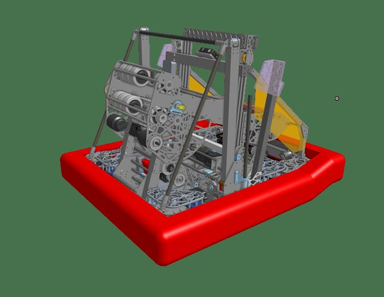
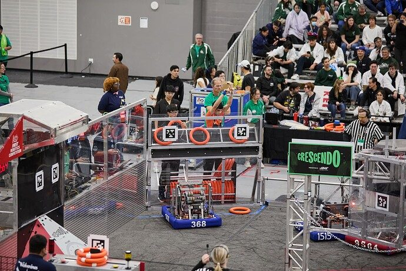

# 2024 · 368 Team Kika Mana — Team Kika Mana 2024

EPA rank 21, snapshot EPA 47.22. Provisional reference dossier.

Under-bumper acquisition, rack-pivot shooter and telescopic chain/trap architecture.

## Drivetrain

31.5-by-26-inch frame; Falcon SDS L4 swerve.

Coverage: documented synopsis.

## Intake

Silicone/flex-wheel pickup with passive centering.

Coverage: documented synopsis.

## Transfer

Three small taped rollers and lateral precompression rollers prepare notes for launch.

Coverage: documented synopsis.

## Scoring

Asymmetric Colson placement adds spin; dual Falcons and rack-based pivot cover bumper-to-wing shots.

Coverage: documented synopsis.

## Endgame

Independent rope-driven sides, shooter-actuated ratchet and delayed reaction-bar deployment; two-stage extrusion elevator.

Coverage: documented synopsis.

## Controls

Automatic ranging, alignment and trap sequencing.

Coverage: documented synopsis.

## Changes and versions

- After LA: predeployed hooks and faster climb target, second shooter motor, more autonomous modes and reinforced front structure/bumpers.

## Strategic interpretation — analyst inference

The team documents an integrated trap cycle rather than treating chain engagement and note delivery separately. Their quoted sub-three-second target should not be converted into an established success statistic.

## Evidence and limits

- Intermediate undocumented changes are not inferred; specifications and plans retain their source context.

Bounded source review; exhaustive intermediate-version history not certified

## Reviewed source bundle

- https://www.chiefdelphi.com/uploads/short-url/f88CQDlOmk8KBTSeom6DQOruSVt.pdf
- https://www.chiefdelphi.com/t/460883

## Season context

Read [the full 2024 game/context chapter](../docs/game_2024.md) before transferring this architecture to another role or season.

## Technical image references

Images are source-associated technical figures or robot views, not dimensionally certified drawings. Follow each source for version and figure context.

2024 team 368 — source image from post 1 (2024-04-01). Context tags identify the discussion, not a verified component label. [Original source](https://www.chiefdelphi.com/t/460883/1). Source-linked extraction; mechanism identity not individually visually audited

2024 team 368 — source image from post 3 (2024-04-01). Context tags identify the discussion, not a verified component label. [Original source](https://www.chiefdelphi.com/t/460883/3). Source-linked extraction; mechanism identity not individually visually audited

## Dated research locators — navigation, not reviewed claims

A tag describes words in the source, not a validated engineering fact. Discussion replies may concern comparison robots.

- 2024-04-01 · jun · [post 3](https://www.chiefdelphi.com/t/460883/3) · autonomous, intake, shooter
- 2024-04-03 · chiyo · [post 9](https://www.chiefdelphi.com/t/460883/9) · intake

# 2024-368: technical mechanisms, design reasoning and revision boundaries

These notes distinguish published construction from team-stated intent and original engineering inference. Selected numerical values are reported source data, not independently reproduced measurements. The recommended tests have not been performed. A binder snapshot does not certify every competition version.

## Team Kika Mana: technical sheet supports construction, not a complete design history

Version: Team Kika Mana 2024. [PDF p1](https://www.chiefdelphi.com/uploads/short-url/f88CQDlOmk8KBTSeom6DQOruSVt.pdf#page=1)

**Published construction:** Asymmetric 3-inch Colson shooter; side-compression feed; rack hood; elevator-mounted scoring package.

**Team-stated reason or evidence boundary:** The sheet attributes spin to shot accuracy; broader selection reasoning is not documented.

**Engineering analysis — original inference:** This source is useful for geometry and component identification but should not be promoted to a full engineering binder. Different wheel count or speed across the note can create spin; compression controls the contact state and must remain consistent through the feed. A moving scorer adds position and angle errors that require joint calibration. The exact tolerance, rejected alternatives and event-by-event revision history are not established by one illustrated sheet. The agent should use it to locate a mechanism family and then seek CAD, interviews or team replies before claiming why every dimension was selected.

**Proposed validation — not a completed test:** Validate wheel arrangement and compression in CAD, then test dispersion and elevator deflection across the intended scoring range.

**Limits:** One-page technical sheet only. Complete trade studies, final reductions and season revision history remain unverified.

## Selected published parameters

| Component | Source parameter | Locator |
|---|---|---|
| Source sheet | 31.5×26-in base; L4 SDS; 3-in Colsons; 1.67× speed-up; 18.75:1 climb | [Source p1](https://www.chiefdelphi.com/uploads/short-url/f88CQDlOmk8KBTSeom6DQOruSVt.pdf#page=1) |

Ratios preserve source notation; verify driver/driven order, complete geometry and the actual version in CAD before fabrication. Figure records retain PDF page and crop bounds in `data/mechanism_images.jsonl`. Images may include rejected prototypes or whole-robot photographs; their captions preserve that distinction.
