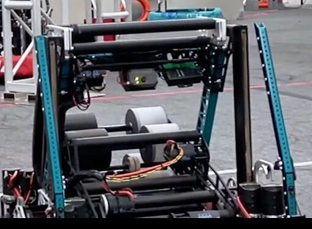
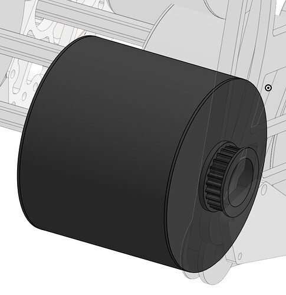
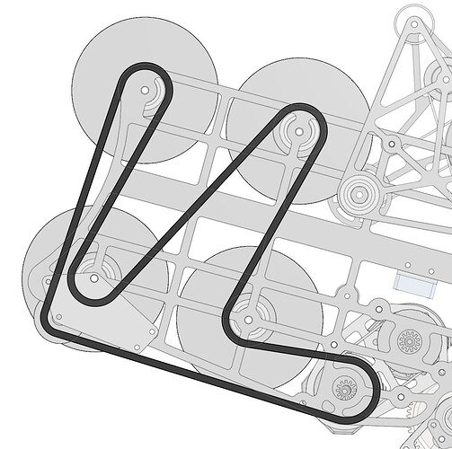

# 2024 · 4414 HighTide — TIDEPOD

EPA rank 14, snapshot EPA 49.49. Provisional reference dossier.

Rebuilt compact fixed-heading shooter with rack elevator and integrated chain/trap system.

## Drivetrain

Rebuild uses 26-by-27.5-inch base, deeper rails and thicker belly pan.

Coverage: documented synopsis.

## Intake

Protected intake with titanium rollers; dead-axle feeder preserves a short path.

Coverage: documented synopsis.

## Transfer

Direct shot path; reverse shooter feed and kicker transfer to amp elevator.

Coverage: documented synopsis.

## Scoring

Four-motor differential-speed launcher optimized for short time-to-shoot and long-range shots.

Coverage: documented synopsis.

## Endgame

Rack-and-pinion amp/trap elevator; individual hooks and passive stage-reaction forks.

Coverage: documented synopsis.

## Controls

Multiple Limelight lenses cover distant/near targets, note detection and climb alignment; one-driver controls.

Coverage: documented synopsis.

## Changes and versions

- Original larger, maximum-weight turret robot replaced between Weeks 2 and 5. Team cited poor intake performance and inadequate long-range shot; rebuilt without turret.

## Strategic interpretation — analyst inference

A crucial counterexample to assuming the most capable-looking architecture wins: their rebuild deliberately surrendered turret freedom to improve acquisition, launch speed, weight and range.

## Limits

- Only source-established configurations and changes are described; intermediate revisions may remain unresolved.

Bounded source review; exhaustive intermediate-version history not certified

## Reviewed primary source bundle

- https://youtu.be/bmybbP0aJqo

## Season context

Read [the full 2024 game/context chapter](../docs/game_2024.md) before transferring this architecture to another role or season.

## Technical image references

Images are source-associated technical figures or robot views, not dimensionally certified drawings. Follow each source for version and figure context.

2024 team 4414 — source image from post 24 (2024-03-26). Context tags identify the discussion, not a verified component label. [Original source](https://www.chiefdelphi.com/t/460154/24). Source-linked extraction; mechanism identity not individually visually audited

2024 team 4414 — source image from post 43 (2024-05-03). Context tags identify the discussion, not a verified component label. [Original source](https://www.chiefdelphi.com/t/460154/43). Source-linked extraction; mechanism identity not individually visually audited

2024 team 4414 — source image from post 43 (2024-05-03). Context tags identify the discussion, not a verified component label. [Original source](https://www.chiefdelphi.com/t/460154/43). Source-linked extraction; mechanism identity not individually visually audited

## Dated research locators — navigation, not reviewed claims

A tag describes words in the source, not a validated engineering fact. Discussion replies may concern comparison robots.

- 2024-02-04 · jedgar6 · [post 14](https://www.chiefdelphi.com/t/453179/14) · intake
- 2024-02-05 · Owen_Busler · [post 17](https://www.chiefdelphi.com/t/453179/17) · intake, shooter
- 2024-02-05 · AMoser1259 · [post 18](https://www.chiefdelphi.com/t/453179/18) · intake
- 2024-03-26 · Pizzatc · [post 11](https://www.chiefdelphi.com/t/460154/11) · rebuild
- 2024-03-26 · dirtbikerxz · [post 12](https://www.chiefdelphi.com/t/460154/12) · code
- 2024-03-26 · UnofficialForth · [post 22](https://www.chiefdelphi.com/t/460154/22) · code
- 2024-03-26 · HarbringerOfAuroras · [post 24](https://www.chiefdelphi.com/t/460154/24) · elevator, intake, shooter
- 2024-03-26 · banjogates · [post 25](https://www.chiefdelphi.com/t/460154/25) · shooter
- 2024-03-26 · e172 · [post 26](https://www.chiefdelphi.com/t/460154/26) · climb
- 2024-03-27 · UnofficialForth · [post 38](https://www.chiefdelphi.com/t/460154/38) · autonomous, pivot
- 2024-03-29 · adam.kaza4590 · [post 40](https://www.chiefdelphi.com/t/460154/40) · shooter
- 2024-05-03 · ElliotS · [post 41](https://www.chiefdelphi.com/t/460154/41) · shooter
- 2024-05-03 · jjsessa · [post 43](https://www.chiefdelphi.com/t/460154/43) · belt, shooter
- 2024-05-03 · jjsessa · [post 44](https://www.chiefdelphi.com/t/460154/44) · intake
- 2024-05-03 · jlr · [post 45](https://www.chiefdelphi.com/t/460154/45) · belt
- 2024-05-03 · jjsessa · [post 46](https://www.chiefdelphi.com/t/460154/46) · belt
- 2024-05-03 · ghiggins · [post 47](https://www.chiefdelphi.com/t/460154/47) · elevator, intake
- 2024-05-03 · waxton · [post 49](https://www.chiefdelphi.com/t/460154/49) · pivot, shooter
- 2024-05-03 · ghiggins · [post 50](https://www.chiefdelphi.com/t/460154/50) · rebuild
- 2024-05-03 · Aaron_Li · [post 51](https://www.chiefdelphi.com/t/460154/51) · shooter
- 2024-05-05 · Bpk9p4 · [post 52](https://www.chiefdelphi.com/t/460154/52) · belt
- 2024-05-05 · jjsessa · [post 53](https://www.chiefdelphi.com/t/460154/53) · belt, elevator, encoder, intake, shooter
- 2024-05-05 · ZCam_4415 · [post 54](https://www.chiefdelphi.com/t/460154/54) · elevator
- 2024-05-05 · pranavkt · [post 55](https://www.chiefdelphi.com/t/460154/55) · encoder
- 2024-05-06 · dirtbikerxz · [post 56](https://www.chiefdelphi.com/t/460154/56) · encoder
- 2024-05-06 · ghiggins · [post 57](https://www.chiefdelphi.com/t/460154/57) · encoder, pivot, shooter
- 2024-05-07 · Jdymkowski · [post 58](https://www.chiefdelphi.com/t/460154/58) · shooter
- 2024-05-17 · adam.kaza4590 · [post 61](https://www.chiefdelphi.com/t/460154/61) · cad
- 2024-05-22 · Fallenseaker193 · [post 62](https://www.chiefdelphi.com/t/460154/62) · bearing
- 2024-05-22 · jjsessa · [post 64](https://www.chiefdelphi.com/t/460154/64) · bearing
- 2024-05-23 · CelestialMaelstrom · [post 65](https://www.chiefdelphi.com/t/460154/65) · elevator
- 2024-08-29 · JOEL340 · [post 66](https://www.chiefdelphi.com/t/460154/66) · belt, shooter
- 2024-08-29 · AdamHeard · [post 67](https://www.chiefdelphi.com/t/460154/67) · belt
- 2024-08-29 · jjsessa · [post 68](https://www.chiefdelphi.com/t/460154/68) · belt
- 2024-08-29 · jedgar6 · [post 69](https://www.chiefdelphi.com/t/460154/69) · belt
- 2024-09-01 · Duckleny · [post 70](https://www.chiefdelphi.com/t/460154/70) · belt, chain, shooter
- 2024-09-02 · AdamHeard · [post 71](https://www.chiefdelphi.com/t/460154/71) · belt
- 2024-09-02 · jedgar6 · [post 72](https://www.chiefdelphi.com/t/460154/72) · belt
- 2024-09-03 · Eliot · [post 73](https://www.chiefdelphi.com/t/460154/73) · belt, cad, chain
- 2024-09-09 · bdon · [post 74](https://www.chiefdelphi.com/t/460154/74) · bearing
- 2024-10-08 · s-neff · [post 75](https://www.chiefdelphi.com/t/460154/75) · bearing, chain, pivot

## Integrated focused technical study

[Construction, reasoning, failure modes and limits](../docs/research_continuation/2024-4414.md). This supplement is a focused interview/source-bundle study, not an exhaustive binder or competition-version certification.
