# 2024 · 5940 BREAD — Roti

EPA rank 15, snapshot EPA 49.23. Provisional reference dossier.

Shooter-on-elevator architecture combines under-stage travel, elevated shots and shared climbing/scoring actuation.

## Drivetrain

WCP Swerve X inverted modules with Krakens; footprint extended by the intake.

Coverage: documented synopsis.

## Intake

Full-width under-bumper rollers and four centering wheels.

Coverage: documented synopsis.

## Transfer

Conical/mecanum feed spreads and positions the note; passive rollers reduce friction.

Coverage: documented synopsis.

## Scoring

Differential-speed launcher on a counterbalanced pivot; elevator supplies speaker/amp/trap height.

Coverage: documented synopsis.

## Endgame

Elevator hooks pull onto chain; lower passive hooks take the load so elevator can rise again for trap.

Coverage: documented synopsis.

## Controls

Direct pivot CANcoder and damping gas springs improve control; software details need the separate code release.

Coverage: documented synopsis.

## Changes and versions

- Binder updated April 27 describes competition architecture. Full intermediate revision sequence is not separately enumerated.

## Strategic interpretation — analyst inference

A particularly clear functional reuse: the elevator first lifts the robot, then transfers the load to passive hooks and becomes a scoring elevator again. Stage clearance and shot-over-defense height coexist.

## Evidence and limits

- Intermediate undocumented changes are not inferred; specifications and plans retain their source context.

Bounded source review; exhaustive intermediate-version history not certified

## Reviewed source bundle

- https://drive.google.com/file/d/1JueptXU9TRB6N2dDGX-fZ-d9fCz3nMKs/view

## Season context

Read [the full 2024 game/context chapter](../docs/game_2024.md) before transferring this architecture to another role or season.

## Technical image references

Images are source-associated technical figures or robot views, not dimensionally certified drawings. Follow each source for version and figure context.

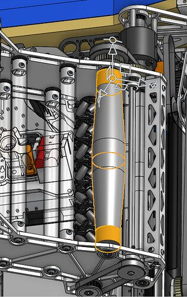

2024 team 5940 — source image from post 9 (2024-05-22). Context tags identify the discussion, not a verified component label. [Original source](https://www.chiefdelphi.com/t/466729/9). Source-linked extraction; mechanism identity not individually visually audited

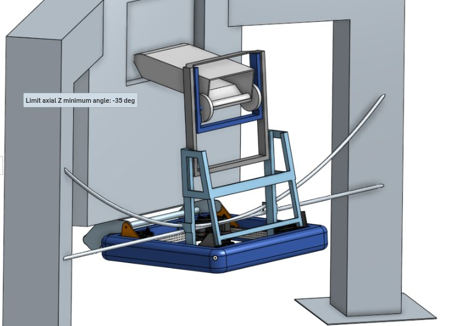

2024 team 5940 — embedded figure from technical binder, PDF page 5. Page discusses elevator, shooter. Figure identity requires the surrounding source page. [Original source](https://drive.google.com/file/d/1JueptXU9TRB6N2dDGX-fZ-d9fCz3nMKs/view). Individual embedded figure extracted; contextual page tags, not a visually verified engineering drawing

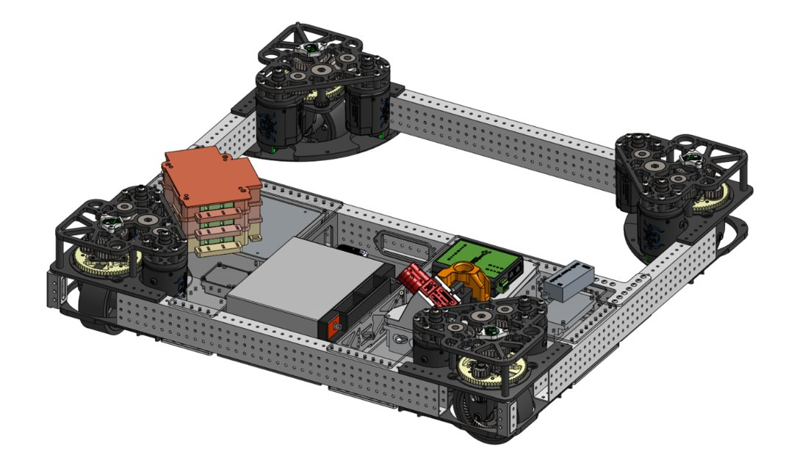

2024 team 5940 — embedded figure from technical binder, PDF page 6. Page discusses intake. Figure identity requires the surrounding source page. [Original source](https://drive.google.com/file/d/1JueptXU9TRB6N2dDGX-fZ-d9fCz3nMKs/view). Individual embedded figure extracted; contextual page tags, not a visually verified engineering drawing

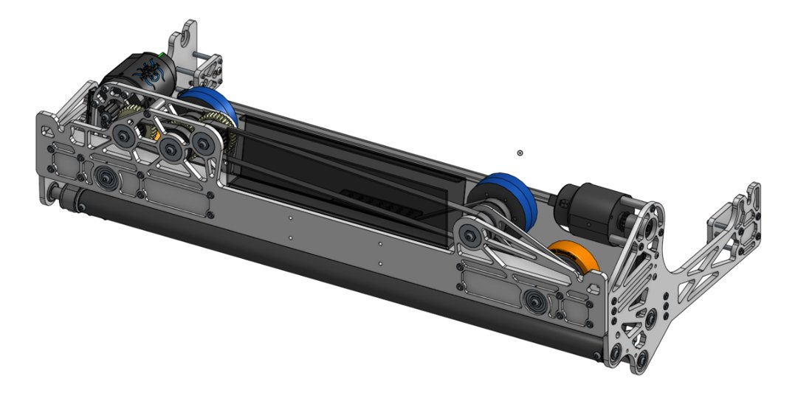

2024 team 5940 — embedded figure from technical binder, PDF page 7. Page discusses intake, shooter. Figure identity requires the surrounding source page. [Original source](https://drive.google.com/file/d/1JueptXU9TRB6N2dDGX-fZ-d9fCz3nMKs/view). Individual embedded figure extracted; contextual page tags, not a visually verified engineering drawing

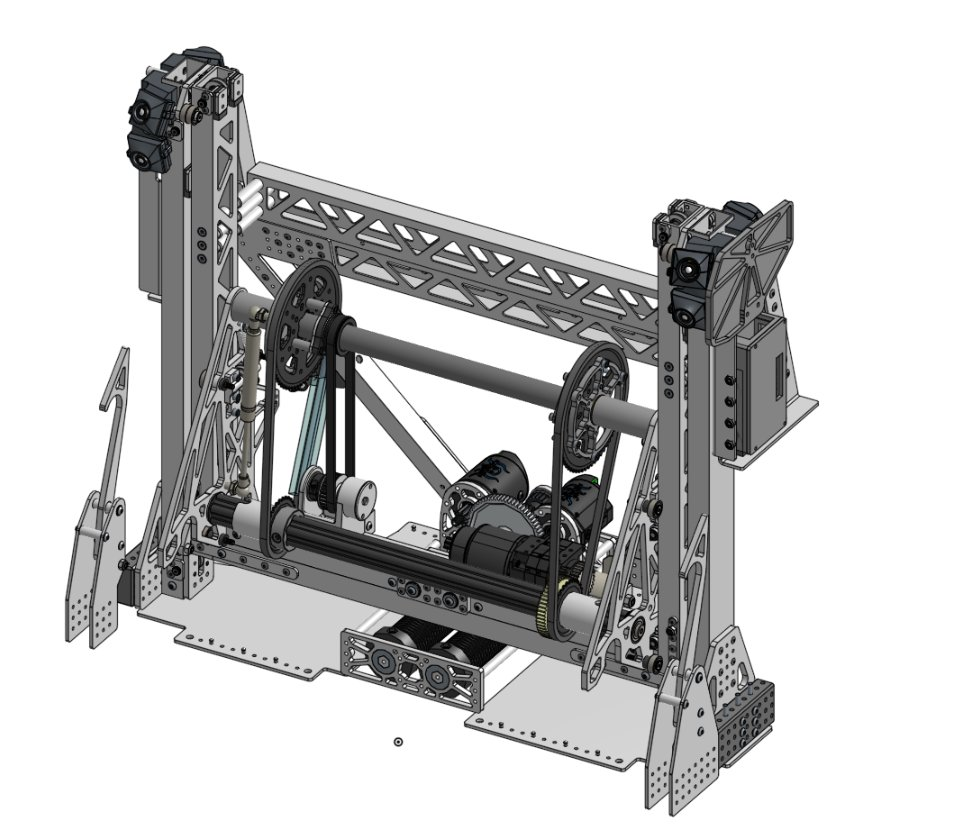

2024 team 5940 — embedded figure from technical binder, PDF page 8. Page discusses elevator, shooter. Figure identity requires the surrounding source page. [Original source](https://drive.google.com/file/d/1JueptXU9TRB6N2dDGX-fZ-d9fCz3nMKs/view). Individual embedded figure extracted; contextual page tags, not a visually verified engineering drawing

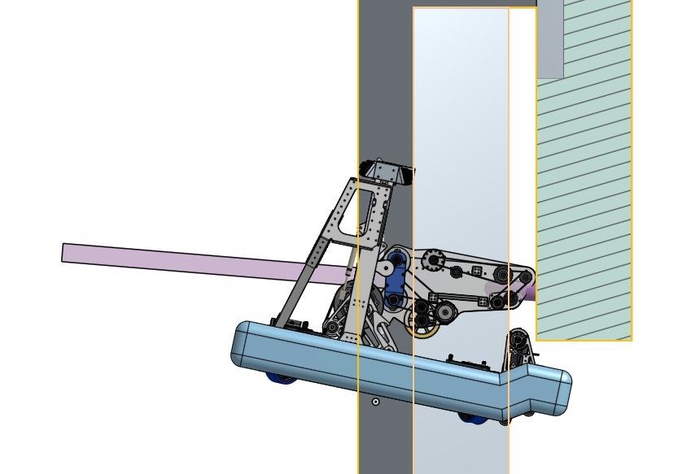

2024 team 5940 — embedded figure from technical binder, PDF page 9. Page discusses climb, elevator. Figure identity requires the surrounding source page. [Original source](https://drive.google.com/file/d/1JueptXU9TRB6N2dDGX-fZ-d9fCz3nMKs/view). Individual embedded figure extracted; contextual page tags, not a visually verified engineering drawing

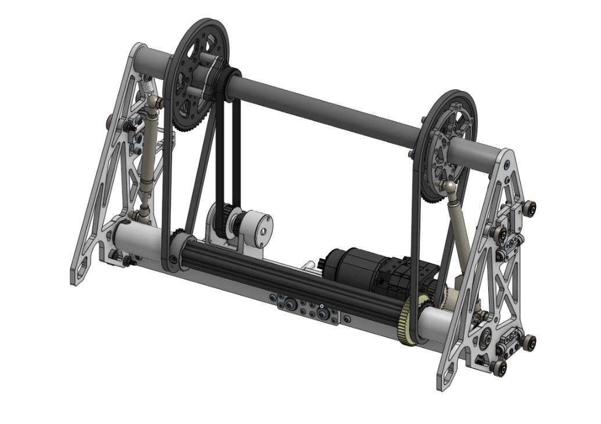

2024 team 5940 — embedded figure from technical binder, PDF page 10. Page discusses climb, elevator, pivot, shooter. Figure identity requires the surrounding source page. [Original source](https://drive.google.com/file/d/1JueptXU9TRB6N2dDGX-fZ-d9fCz3nMKs/view). Individual embedded figure extracted; contextual page tags, not a visually verified engineering drawing

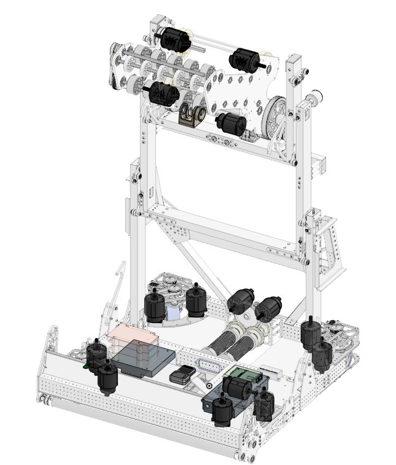

2024 team 5940 — embedded figure from technical binder, PDF page 2. Page discusses intake, pivot, shooter. Figure identity requires the surrounding source page. [Original source](https://drive.google.com/file/d/1zfYqLdwT_1B9t92o7QsDoBC2Qs8EvY-t/view?usp=sharing). Individual embedded figure extracted; contextual page tags, not a visually verified engineering drawing

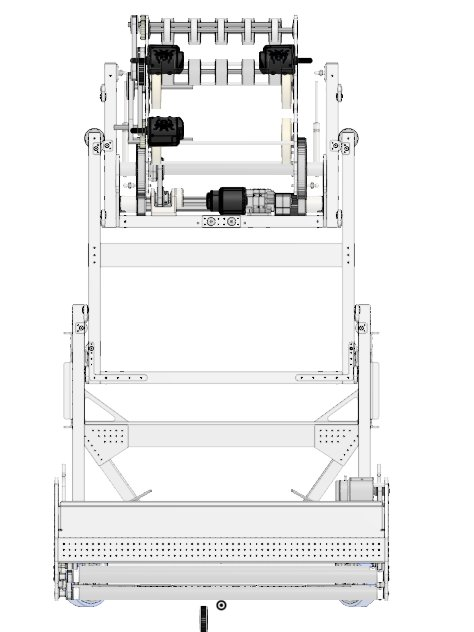

2024 team 5940 — embedded figure from technical binder, PDF page 3. Page discusses intake, pivot, shooter. Figure identity requires the surrounding source page. [Original source](https://drive.google.com/file/d/1zfYqLdwT_1B9t92o7QsDoBC2Qs8EvY-t/view?usp=sharing). Individual embedded figure extracted; contextual page tags, not a visually verified engineering drawing

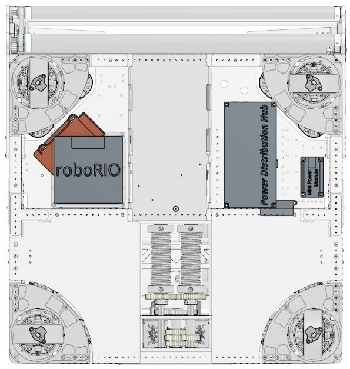

2024 team 5940 — embedded figure from technical binder, PDF page 4. Page discusses intake, pivot, shooter. Figure identity requires the surrounding source page. [Original source](https://drive.google.com/file/d/1zfYqLdwT_1B9t92o7QsDoBC2Qs8EvY-t/view?usp=sharing). Individual embedded figure extracted; contextual page tags, not a visually verified engineering drawing

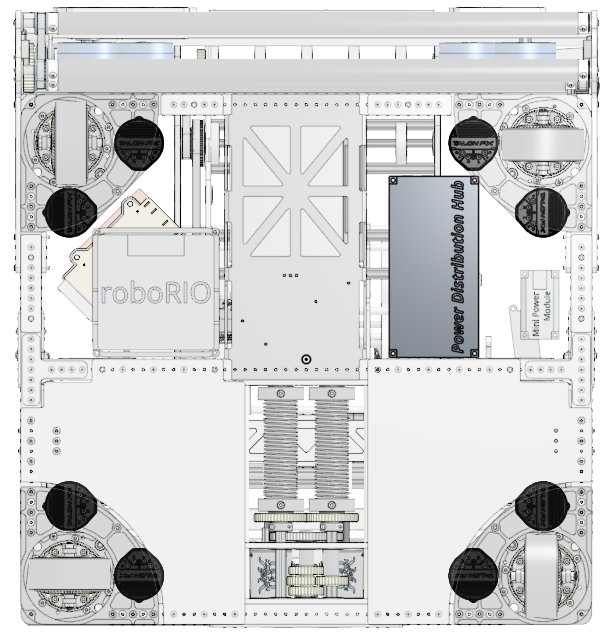

2024 team 5940 — embedded figure from technical binder, PDF page 5. Page discusses intake, pivot, shooter. Figure identity requires the surrounding source page. [Original source](https://drive.google.com/file/d/1zfYqLdwT_1B9t92o7QsDoBC2Qs8EvY-t/view?usp=sharing). Individual embedded figure extracted; contextual page tags, not a visually verified engineering drawing

## Dated research locators — navigation, not reviewed claims

A tag describes words in the source, not a validated engineering fact. Discussion replies may concern comparison robots.

- 2024-05-22 · ianh · [post 1](https://www.chiefdelphi.com/t/466729/1) · cad, code
- 2024-05-22 · dwwright · [post 7](https://www.chiefdelphi.com/t/466729/7) · pivot, shooter
- 2024-05-22 · CooperSurma · [post 8](https://www.chiefdelphi.com/t/466729/8) · elevator
- 2024-05-22 · Britt · [post 9](https://www.chiefdelphi.com/t/466729/9) · shooter
- 2024-05-23 · RomanTechPlus · [post 10](https://www.chiefdelphi.com/t/466729/10) · code
- 2024-05-23 · thevedantin · [post 11](https://www.chiefdelphi.com/t/466729/11) · chain
- 2024-05-23 · trevor_h · [post 13](https://www.chiefdelphi.com/t/466729/13) · intake, shooter
- 2024-05-23 · Shiloh_Robinson · [post 14](https://www.chiefdelphi.com/t/466729/14) · camera, chain, elevator, pivot, shooter
- 2024-12-01 · sjcbulldog · [post 27](https://www.chiefdelphi.com/t/466729/27) · code, vision
- 2024-12-02 · 10fps · [post 28](https://www.chiefdelphi.com/t/466729/28) · pivot, shooter

# 2024-5940: technical mechanisms, design reasoning and revision boundaries

These notes distinguish published construction from team-stated intent and original engineering inference. Selected numerical values are reported source data, not independently reproduced measurements. The recommended tests have not been performed. A binder snapshot does not certify every competition version.

## ROTI: under-bumper pickup feeds a movable shooter

Version: ROTI. [PDF p7](https://drive.google.com/file/d/1JueptXU9TRB6N2dDGX-fZ-d9fCz3nMKs/view#page=7)

**Published construction:** Full-width intake with pickup rollers and centering wheels.

**Team-stated reason or evidence boundary:** Center notes before they enter the shooter.

**Engineering analysis — original inference:** The collector has to supply a consistent location and shape to a scorer whose height and angle can change. Centering at the floor reduces the uncertainty the moving receiver must handle. A shallow pickup can preserve chassis protection but needs clearance around module and frame structure. Surface speed should capture a note without throwing it past the receiving contact. The effective system includes the handoff state that determines when the elevator may move away.

**Proposed validation — not a completed test:** Test off-center acquisition and interrupted handoff while varying the receiver’s initial height and angle.

**Limits:** The binder is a published configuration snapshot, not an independent durability or match-rate test.

## ROTI: one lift creates scoring height and endgame capability

Version: ROTI. [PDF p5](https://drive.google.com/file/d/1JueptXU9TRB6N2dDGX-fZ-d9fCz3nMKs/view#page=5) · [PDF p8](https://drive.google.com/file/d/1JueptXU9TRB6N2dDGX-fZ-d9fCz3nMKs/view#page=8) · [PDF p9](https://drive.google.com/file/d/1JueptXU9TRB6N2dDGX-fZ-d9fCz3nMKs/view#page=9)

**Published construction:** Continuous rope lift with overextending carriage; passive lower hooks retain the chain after initial lift.

**Team-stated reason or evidence boundary:** Use one shooter for speaker, amp and trap.

**Engineering analysis — original inference:** Moving the shooter upward changes its release geometry and can improve defended shot access, while stowing preserves travel routes under the stage. That broad capability costs raised mass and a multi-state handoff. The passive lower hooks are central to the climb: they take over the suspension load so the elevator can extend again for trap scoring. Without that load transfer, the same actuator cannot independently hold the robot and reposition the scorer. This is an architectural sequence rather than an elevator plus an unrelated climber.

**Proposed validation — not a completed test:** Verify passive-hook engagement before re-extension; test full-height stability and stowed route clearance with the actual scorer mass.

**Limits:** The binder is a published configuration snapshot, not an independent durability or match-rate test.

## ROTI: counterbalanced pivot and shaped note feed

Version: ROTI. [PDF p10](https://drive.google.com/file/d/1JueptXU9TRB6N2dDGX-fZ-d9fCz3nMKs/view#page=10) · [PDF p11](https://drive.google.com/file/d/1JueptXU9TRB6N2dDGX-fZ-d9fCz3nMKs/view#page=11)

**Published construction:** Gas-spring counterbalance; output-angle sensing; asymmetric launch speeds; conical/mecanum feeder contacts.

**Team-stated reason or evidence boundary:** One shooter serves several release geometries.

**Engineering analysis — original inference:** A counterbalance reduces gravitational torque but changes the motor’s required effort across the angular range. Sensing the output helps distinguish gearbox motion from actual scorer angle. Conical and mecanum feed contacts can shape and spread the note before launch; their useful effect depends on how the flexible ring deforms. The front roller angle also affects trap delivery, so optimizing only speaker shots may degrade another required mode. A recommendation needs the complete scoring envelope and mode transition tests.

**Proposed validation — not a completed test:** Measure output-angle hysteresis and shot dispersion in every scoring mode, with both new and damaged notes.

**Limits:** The binder is a published configuration snapshot, not an independent durability or match-rate test.

## Selected published parameters

| Component | Source parameter | Locator |
|---|---|---|
| Intake | 1.3:1 pickup; 19.6-ft/s surface; 4.8:1 centering | [Source p7](https://drive.google.com/file/d/1JueptXU9TRB6N2dDGX-fZ-d9fCz3nMKs/view#page=7) |
| Lift | 10.37:1; two X60s; 1.5-in spool | [Source p8](https://drive.google.com/file/d/1JueptXU9TRB6N2dDGX-fZ-d9fCz3nMKs/view#page=8) |
| Pivot | 114.58:1; two 50-lbf gas springs | [Source p10](https://drive.google.com/file/d/1JueptXU9TRB6N2dDGX-fZ-d9fCz3nMKs/view#page=10) |
| Shooter | 4-in wheels; 2:1 upduction source notation | [Source p11](https://drive.google.com/file/d/1JueptXU9TRB6N2dDGX-fZ-d9fCz3nMKs/view#page=11) |

Ratios preserve source notation; verify driver/driven order, complete geometry and the actual version in CAD before fabrication. Figure records retain PDF page and crop bounds in `data/mechanism_images.jsonl`. Images may include rejected prototypes or whole-robot photographs; their captions preserve that distinction.
