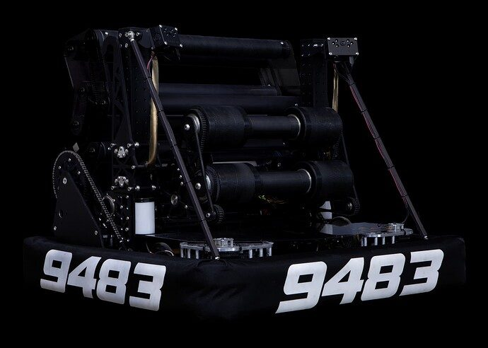

# 2024 · 9483 Overcharge — Snapfire

EPA rank 19, snapshot EPA 47.62. Provisional reference dossier.

Light articulated intake and adjustable shooter, with one-shot ratcheting chain engagement.

## Drivetrain

Low-central electrical packaging intended to protect center of gravity and resist note trapping.

Coverage: documented synopsis.

## Intake

Multi-roller polycarbonate collector with grip tape and reinforcing shafts.

Coverage: documented synopsis.

## Transfer

Bent note path feeds the launcher; sensors select amp versus shooter routing.

Coverage: documented synopsis.

## Scoring

Adjustable launcher, automatic angle/speed selection; interview reports roughly 17–65-degree motion.

Coverage: documented synopsis.

## Endgame

Ratcheting hooks deploy and latch in a one-shot action; cannot simply reset on field.

Coverage: documented synopsis.

## Controls

Angled Limelights/MegaTag2, gyro and module odometry; automatic pickup, aim and amp alignment.

Coverage: documented synopsis.

## Changes and versions

- Interview describes competition package; detailed sequence of earlier builds is not given.

## Strategic interpretation — analyst inference

A one-shot endgame can reduce driver actions while losing recovery flexibility. That tradeoff belongs in architecture selection and reliability assessment.

## Limits

- Intermediate undocumented changes are not inferred; specifications and plans retain their source context.

Bounded source review; exhaustive intermediate-version history not certified

## Reviewed primary source bundle

- https://youtu.be/GaLm00wcnVE

## Season context

Read [the full 2024 game/context chapter](../docs/game_2024.md) before transferring this architecture to another role or season.

## Technical image references

Images are source-associated technical figures or robot views, not dimensionally certified drawings. Follow each source for version and figure context.

2024 team 9483 — source image from post 1 (2024-03-07). Context tags identify the discussion, not a verified component label. [Original source](https://www.chiefdelphi.com/t/457771/1). Source-linked extraction; mechanism identity not individually visually audited

## Dated research locators — navigation, not reviewed claims

A tag describes words in the source, not a validated engineering fact. Discussion replies may concern comparison robots.

- 2024-04-22 · Michael_Corsetto · [post 10](https://www.chiefdelphi.com/t/457771/10) · intake
- 2024-04-25 · jlr · [post 12](https://www.chiefdelphi.com/t/457771/12) · intake
- 2024-04-25 · Chase1699 · [post 13](https://www.chiefdelphi.com/t/457771/13) · intake, shooter
- 2024-04-26 · oguzozgur · [post 14](https://www.chiefdelphi.com/t/457771/14) · cad
- 2024-05-18 · AmitSucher · [post 16](https://www.chiefdelphi.com/t/457771/16) · camera

## Integrated focused technical study

[Construction, reasoning, failure modes and limits](../docs/research_continuation/2024-9483.md). This supplement is a focused interview/source-bundle study, not an exhaustive binder or competition-version certification.
