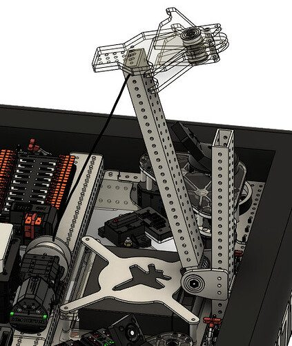
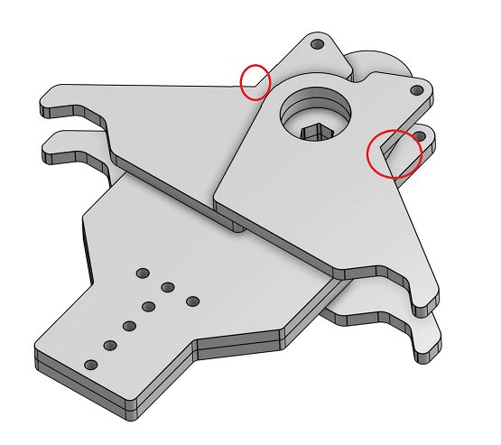

# 2025 · 118 Robonauts — Firefly

EPA rank 6, snapshot EPA 104.75. Provisional reference dossier.

Low-powered arm/lift with distinct coral and algae sides and actively oriented floor pickup.

## Drivetrain

Swerve; low-mounted transmission hardware emphasizes CG control.

Coverage: documented synopsis.

## Intake

Added a twisted vertical belt after perpendicular coral caused driver difficulty; grip tape and separately driven roller groups control orientation.

Coverage: documented synopsis.

## Transfer

Remote motors and split shafts transmit independent effector power through a narrow arm package.

Coverage: documented synopsis.

## Scoring

Custom cycloidal arm reductions; lift raises primarily for L4. Opposed coral/algae effectors use different torque ratios.

Coverage: documented synopsis.

## Endgame

Central rotating cage capture evolved from driver-aligned fingers to intake wheels, magnets, switches and automated latches.

Coverage: documented synopsis.

## Controls

Custom power-distribution electronics permit individual device resets; sensed latches and visual cues support automated climb.

Coverage: documented synopsis.

## Changes and versions

- Reveal lacked later perpendicular-coral belt.
- Climber geometry, magnets, sensing and automation changed substantially throughout season.

## Strategic interpretation — analyst inference

This is a reference for moving power away from an elevated manipulator and refining intake orientation locally. It also shows that an initially manual deep climb can evolve through sensing and capture geometry rather than complete replacement.

## Evidence and limits

- Only the reviewed published configurations are established; intermediate changes may be undocumented.

Bounded source review; exhaustive intermediate-version history not certified

## Reviewed source bundle

- https://youtu.be/UQoFvZiMdpA
- https://www.chiefdelphi.com/uploads/short-url/5VYfconlxrh4QdiOcvuLGWunsv1.pdf

## Season context

Read [the full 2025 game/context chapter](../docs/game_2025.md) before transferring this architecture to another role or season.

## Technical image references

Images are source-associated technical figures or robot views, not dimensionally certified drawings. Follow each source for version and figure context.

2025 team 118 — source image from post 69 (2025-01-27). Context tags identify the discussion, not a verified component label. [Original source](https://www.chiefdelphi.com/t/478987/69). Source-linked extraction; mechanism identity not individually visually audited

2025 team 118 — source image from post 73 (2025-01-28). Context tags identify the discussion, not a verified component label. [Original source](https://www.chiefdelphi.com/t/478987/73). Source-linked extraction; mechanism identity not individually visually audited

## Dated research locators — navigation, not reviewed claims

A tag describes words in the source, not a validated engineering fact. Discussion replies may concern comparison robots.

- 2025-01-05 · Jennakay · [post 1](https://www.chiefdelphi.com/t/478987/1) · cad, climb, code
- 2025-01-06 · Jennakay · [post 2](https://www.chiefdelphi.com/t/478987/2) · climb
- 2025-01-11 · Manish_R · [post 6](https://www.chiefdelphi.com/t/478987/6) · climb
- 2025-01-14 · TFM110 · [post 28](https://www.chiefdelphi.com/t/478987/28) · climb
- 2025-01-15 · Sidoti · [post 33](https://www.chiefdelphi.com/t/478987/33) · cad, code
- 2025-01-15 · 1712ControlSystemGuy · [post 40](https://www.chiefdelphi.com/t/478987/40) · climb
- 2025-01-15 · ElliotS · [post 41](https://www.chiefdelphi.com/t/478987/41) · intake, pivot, shooter
- 2025-01-16 · Silas_Askew · [post 48](https://www.chiefdelphi.com/t/478987/48) · climb
- 2025-01-16 · Sidoti · [post 50](https://www.chiefdelphi.com/t/478987/50) · cad
- 2025-01-17 · braidensullivan5828 · [post 53](https://www.chiefdelphi.com/t/478987/53) · cad
- 2025-01-17 · kmelanco16 · [post 54](https://www.chiefdelphi.com/t/478987/54) · chain
- 2025-01-17 · Sidoti · [post 57](https://www.chiefdelphi.com/t/478987/57) · cad
- 2025-01-17 · Sidoti · [post 58](https://www.chiefdelphi.com/t/478987/58) · arm, bearing, chain, intake
- 2025-01-17 · Sidoti · [post 60](https://www.chiefdelphi.com/t/478987/60) · climb
- 2025-01-19 · yapple · [post 62](https://www.chiefdelphi.com/t/478987/62) · code
- 2025-01-21 · Sidoti · [post 63](https://www.chiefdelphi.com/t/478987/63) · arm, cad, climb, intake
- 2025-01-21 · yapple · [post 64](https://www.chiefdelphi.com/t/478987/64) · code
- 2025-01-21 · Akash_Rastogi · [post 65](https://www.chiefdelphi.com/t/478987/65) · arm, climb, intake
- 2025-01-21 · yapple · [post 66](https://www.chiefdelphi.com/t/478987/66) · cad, intake, pivot
- 2025-01-27 · Liamthebuildgoon · [post 69](https://www.chiefdelphi.com/t/478987/69) · belt
- 2025-01-28 · dfacc45 · [post 72](https://www.chiefdelphi.com/t/478987/72) · climb
- 2025-01-28 · Sidoti · [post 74](https://www.chiefdelphi.com/t/478987/74) · cad
- 2025-01-28 · Sidoti · [post 75](https://www.chiefdelphi.com/t/478987/75) · climb
- 2025-02-01 · JoshuaJ1710 · [post 78](https://www.chiefdelphi.com/t/478987/78) · bearing, cad
- 2025-02-01 · Rubicon · [post 81](https://www.chiefdelphi.com/t/478987/81) · climb
- 2025-02-01 · Aaron_Li · [post 82](https://www.chiefdelphi.com/t/478987/82) · climb
- 2025-02-02 · D3Hydr4t3d · [post 85](https://www.chiefdelphi.com/t/478987/85) · arm
- 2025-02-24 · bcon · [post 92](https://www.chiefdelphi.com/t/478987/92) · chain
- 2025-03-04 · Sidoti · [post 95](https://www.chiefdelphi.com/t/478987/95) · arm, intake
- 2025-03-09 · Lolfrags8567 · [post 99](https://www.chiefdelphi.com/t/478987/99) · climb

# 2025-118: technical mechanisms, design reasoning and revision boundaries

These notes distinguish published construction from team-stated intent and original engineering inference. Selected numerical values are reported source data, not independently reproduced measurements. The recommended tests have not been performed. A binder snapshot does not certify every competition version.

## FIREFLY: wheel stiffness is part of end-effector accuracy

Version: FIREFLY. [PDF p10](https://www.chiefdelphi.com/uploads/short-url/5VYfconlxrh4QdiOcvuLGWunsv1.pdf#page=10) · [PDF p11](https://www.chiefdelphi.com/uploads/short-url/5VYfconlxrh4QdiOcvuLGWunsv1.pdf#page=11) · [Team explanation](https://www.chiefdelphi.com/t/502317/5)

**Published construction:** Custom Grip Lock hubs, lowered Mk4-C base and later lower drive gearing.

**Team-stated reason or evidence boundary:** Reduce tire flex and preserve a stiff floor-to-tool reference.

**Engineering analysis — original inference:** Wheel compliance permits the chassis to rotate relative to the carpet even when the frame and elevator are stiff. The resulting angular error becomes a larger displacement at an elevated tool, so a tire-hub change can improve L4 placement without changing the wrist. A low frame and ballast distribution address another component of the same stability problem. The gearing revision also changes acceleration and braking behavior; it needs drive retuning with the real mechanism load. Do not treat a module model or a free speed as a complete explanation of placement repeatability.

**Proposed validation — not a completed test:** Measure tool-tip displacement under known lateral load and during stopping, separating tire deflection from lift deflection.

**Limits:** The binder is a published configuration snapshot, not an independent durability or match-rate test.

## FIREFLY: short lift and low-mounted carriage actuators

Version: FIREFLY. [PDF p8](https://www.chiefdelphi.com/uploads/short-url/5VYfconlxrh4QdiOcvuLGWunsv1.pdf#page=8) · [PDF p12](https://www.chiefdelphi.com/uploads/short-url/5VYfconlxrh4QdiOcvuLGWunsv1.pdf#page=12)

**Published construction:** Single-stage counterbalanced lift; thin-wall tube; algae, coral and arm drives mounted low on carriage.

**Team-stated reason or evidence boundary:** Low moving center of gravity and direct piece delivery.

**Engineering analysis — original inference:** Remoting the roller drives removes mass from the far end of the arm while keeping it on the lift carriage. That reduces one component of arm inertia without eliminating the carriage mass that the lift must accelerate. A single-stage lift can simplify guidance but requires the arm to supply the remaining reach and orientation. Counterbalance reduces gravity demand, while belt tension and routing still determine tracking and friction. The integration goal is a useful task sequence with no wait for piece delivery, rather than a collection of independently fast axes.

**Proposed validation — not a completed test:** Measure lift current and tool settling during combined motion; verify belt tension and direct-handoff clearance at every relevant pose.

**Limits:** The binder is a published configuration snapshot, not an independent durability or match-rate test.

## FIREFLY: sideways orientation while maintaining coral ownership

Version: FIREFLY. [PDF p14](https://www.chiefdelphi.com/uploads/short-url/5VYfconlxrh4QdiOcvuLGWunsv1.pdf#page=14)

**Published construction:** Sideways reorienting belt, compliant tube rollers, independent roller drives and twisted-belt transmission.

**Team-stated reason or evidence boundary:** Direct handoff or controlled L1 without staging the coral.

**Engineering analysis — original inference:** A sideways belt gives the tube a deliberate transverse velocity rather than relying only on passive wedges. The remaining contacts must keep ownership while that reorientation happens; an unconstrained gap can erase the advantage. Separate roller drives permit holding a tube for L1 or continuing into the end effector, but create more state choices and sensor requirements. Twisted and bent belts solve an off-axis power-routing problem, while adding tracking, wear and alignment concerns. Their tension cannot be chosen solely for torque transmission if the belt also participates in piece contact.

**Proposed validation — not a completed test:** Film diagonal and lengthwise entries through both L1 and handoff branches, then repeat after belt wear and an intake impact.

**Limits:** The binder is a published configuration snapshot, not an independent durability or match-rate test.

## FIREFLY: dedicated floor-algae route integrates with climb

Version: FIREFLY. [PDF p13](https://www.chiefdelphi.com/uploads/short-url/5VYfconlxrh4QdiOcvuLGWunsv1.pdf#page=13)

**Published construction:** Counter-rotating floor-algae rollers; reinforced printed bevel gears; three-piece jackshaft around climb packaging.

**Team-stated reason or evidence boundary:** Acquire algae and deliver it to the arm without subsystem interference.

**Engineering analysis — original inference:** A dedicated floor pickup lets the main end effector specialize in retention and scoring rather than reaching a difficult carpet pose. That value must exceed the added mass and handoff complexity. Segmenting the jackshaft can make assembly possible around another subsystem, but every joint adds an alignment and torque-transfer interface. Printed bevel gears need stable bearing support and an appropriate tooth load; a successful material in another mechanism does not certify this one. The pathway should remain useful if the climb is damaged, consistent with the robot’s stated degraded-operation objective.

**Proposed validation — not a completed test:** Test floor acquisition and handoff while climb is stowed, partially deployed and disabled; inspect bevel alignment under peak capture load.

**Limits:** The binder is a published configuration snapshot, not an independent durability or match-rate test.

## FIREFLY: internal coral grip and algae torque selected by test

Version: FIREFLY. [PDF p15](https://www.chiefdelphi.com/uploads/short-url/5VYfconlxrh4QdiOcvuLGWunsv1.pdf#page=15) · [Team explanation](https://www.chiefdelphi.com/t/502317/11)

**Published construction:** Internal coral gripping; compliant placement geometry; shared tool also acquires and scores algae.

**Team-stated reason or evidence boundary:** Control both pieces while keeping moving structure light.

**Engineering analysis — original inference:** Gripping inside a tube changes the reference surface and can leave the outside clearer for placement. It still needs a controlled release and enough compliance to tolerate the branch without wedging the tool. Algae retention is a different torque problem: the wheel must deform and hold a soft sphere rather than simply spin at the desired acquisition speed. A practical way to choose the ratio is to measure the required final-shaft torque, then check speed and motor current under that load. This is more informative than selecting a reduction from a famous robot without matching its compression and geometry.

**Proposed validation — not a completed test:** Measure algae pull-in torque and holding current, then test coral release with intentional branch misalignment and the same worn contacts.

**Limits:** The binder is a published configuration snapshot, not an independent durability or match-rate test.

## FIREFLY: powered magnetic cage acquisition and sensed latching

Version: FIREFLY. [PDF p10](https://www.chiefdelphi.com/uploads/short-url/5VYfconlxrh4QdiOcvuLGWunsv1.pdf#page=10) · [PDF p16](https://www.chiefdelphi.com/uploads/short-url/5VYfconlxrh4QdiOcvuLGWunsv1.pdf#page=16)

**Published construction:** Magnetic TPU intake wheels pull cage into two one-way latches; winch/rotation share a drive.

**Team-stated reason or evidence boundary:** Capture before automatically lifting.

**Engineering analysis — original inference:** Magnetic attraction can improve the first contact with a steel cage, but the final robot load should pass through the designed latch and structure. Two capture switches give the controller a stronger condition than assuming engagement after a fixed time. Shared winch and rotation power saves hardware while tying the phase sequence to transmission geometry. The dated timeline records later additions to the cage collector and automation, so the final system should not be projected back to the robot’s first event. Total climb time includes acquisition and settling, not just the powered lift.

**Proposed validation — not a completed test:** Test one-sided and swinging-cage contact, sensor disagreement and disable retention; confirm the latch carries the suspended load.

**Limits:** The binder is a published configuration snapshot, not an independent durability or match-rate test.

## FIREFLY: custom cycloidal reduction is an iterative capability

Version: FIREFLY. [PDF p17](https://www.chiefdelphi.com/uploads/short-url/5VYfconlxrh4QdiOcvuLGWunsv1.pdf#page=17)

**Published construction:** 23:1 dual-disc cycloidal; hardened steel discs; rolling pins; team reports about 0.3° backlash.

**Team-stated reason or evidence boundary:** Compact, lightweight low-backlash joint drive.

**Engineering analysis — original inference:** A cycloidal gearbox trades ordinary spur stages for a shaped eccentric load path with multiple contacts. Opposed discs can reduce dynamic imbalance, but machining accuracy, pin support and eccentric bearings still control vibration, efficiency and backlash. The reported backlash is a team result for its design and measurement conditions. It should not be assumed for a copied outline made with a different process. This is a mature, revised manufacturing capability, so its adoption cost includes inspection, heat treatment and assembly knowledge rather than just CAD availability.

**Proposed validation — not a completed test:** Characterize output backlash, temperature and efficiency under the intended reversing load, and inspect contact wear after repeated shock cycles.

**Limits:** The binder is a published configuration snapshot, not an independent durability or match-rate test.

## Selected published parameters

| Component | Source parameter | Locator |
|---|---|---|
| Base | 29×29-in; Mk4-C L1+; 3/4-in lowering | [Source p11](https://www.chiefdelphi.com/uploads/short-url/5VYfconlxrh4QdiOcvuLGWunsv1.pdf#page=11) |
| Coral intake | 23:1 cycloidal deploy; X60 plus X44 rollers | [Source p14](https://www.chiefdelphi.com/uploads/short-url/5VYfconlxrh4QdiOcvuLGWunsv1.pdf#page=14) |
| Climb | 33.6:1; X44 winch; separate X44 cage intake | [Source p16](https://www.chiefdelphi.com/uploads/short-url/5VYfconlxrh4QdiOcvuLGWunsv1.pdf#page=16) |
| Cycloidal | 23:1; dual discs; team reports ~0.3° backlash | [Source p17](https://www.chiefdelphi.com/uploads/short-url/5VYfconlxrh4QdiOcvuLGWunsv1.pdf#page=17) |

Ratios preserve source notation; verify driver/driven order, complete geometry and the actual version in CAD before fabrication. Figure records retain PDF page and crop bounds in `data/mechanism_images.jsonl`. Images may include rejected prototypes or whole-robot photographs; their captions preserve that distinction.

## Current strategic priority

Optimize marginal alliance work: branch coverage, L1 placement/packing, algae, supply lanes, autonomous compatibility and reliable endgame. Do not rank robot quality by coral height.
