# 2025 · 1323 MadTown Robotics — Aurelia

EPA rank 3, snapshot EPA 111.96. Provisional reference dossier.

Compact tilting four-stage elevator with two-sided scoring and specialized L1 placement.

## Drivetrain

28-inch-square swerve frame chosen partly to meet mass limit.

Coverage: documented synopsis.

## Intake

Coral ground collector with two rollers and automatic handoff sensing; separate ground-algae intake.

Coverage: documented synopsis.

## Transfer

Coordinated transfer to end effector; differential transmission keeps most motors low.

Coverage: documented synopsis.

## Scoring

Front/back L2–L4 placement, algae processor/net and L1 stacking using both intakes. Short elevator stages fit the tilting starting envelope.

Coverage: documented synopsis.

## Endgame

Powered backpack cage capture; proximity detection triggers elevator-pivot and intake-assisted climb sequence.

Coverage: documented synopsis.

## Controls

Tag choice determines scoring side; automatic handoff and cage detection reduce driver steps.

Coverage: documented synopsis.

## Changes and versions

- Team-stated architecture motivation included horizontal L1 packing; the collector underwent substantial practice-driven geometry and durability iteration. Team reply 131.
- Before Worlds, team emphasized efficient L1 work as partners increasingly filled higher levels.

## Strategic interpretation — analyst inference

High-end value comes from parallel alliance work: excellent L1 placement and algae service can maximize the output of an alliance whose other robots cover branches. Team reply 131 explicitly connects intake architecture to horizontal L1 packing. Do not infer robot quality from scoring height or treat the driver-practiced pickup as effortless any-orientation acquisition.

## Evidence and limits

- Only the reviewed published configurations are established; intermediate changes may be undocumented.

Bounded source review; exhaustive intermediate-version history not certified

## Reviewed source bundle

- https://youtu.be/Kdzjr_WtiFU
- https://www.chiefdelphi.com/t/500435
- https://drive.google.com/file/d/1Y2ooTZMBNoViMZ6R4wYOkom1mhIIqF-R/view?usp=sharing

## Season context

Read [the full 2025 game/context chapter](../docs/game_2025.md) before transferring this architecture to another role or season.

## Technical image references

Images are source-associated technical figures or robot views, not dimensionally certified drawings. Follow each source for version and figure context.

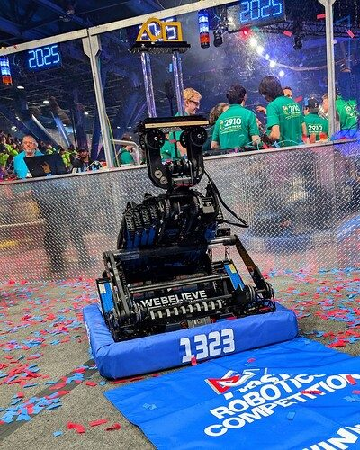

2025 team 1323 — source image from post 1 (2025-04-24). Context tags identify the discussion, not a verified component label. [Original source](https://www.chiefdelphi.com/t/500435/1). Source-linked extraction; mechanism identity not individually visually audited

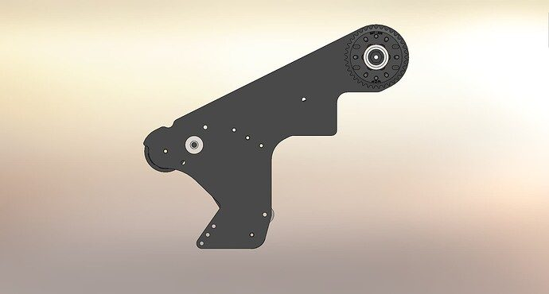

2025 team 1323 — source image from post 48 (2025-04-25). Context tags identify the discussion, not a verified component label. [Original source](https://www.chiefdelphi.com/t/500435/48). Source-linked extraction; mechanism identity not individually visually audited

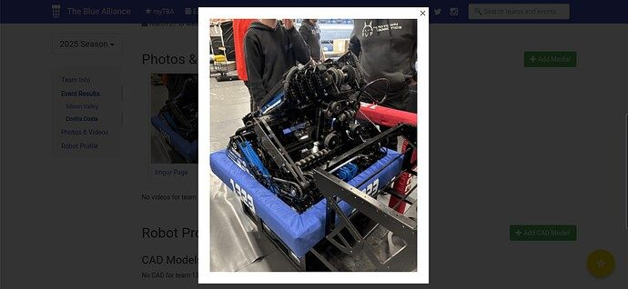

2025 team 1323 — source image from post 1 (2025-03-14). Context tags identify the discussion, not a verified component label. [Original source](https://www.chiefdelphi.com/t/495568/1). Source-linked extraction; mechanism identity not individually visually audited

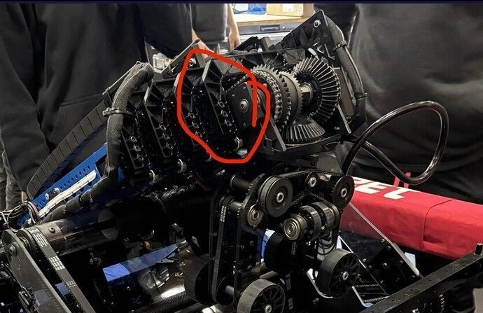

2025 team 1323 — source image from post 18 (2025-03-14). Context tags identify the discussion, not a verified component label. [Original source](https://www.chiefdelphi.com/t/495568/18). Source-linked extraction; mechanism identity not individually visually audited

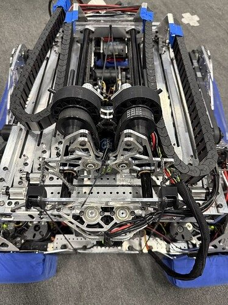

2025 team 1323 — source image from post 32 (2025-03-31). Context tags identify the discussion, not a verified component label. [Original source](https://www.chiefdelphi.com/t/495568/32). Source-linked extraction; mechanism identity not individually visually audited

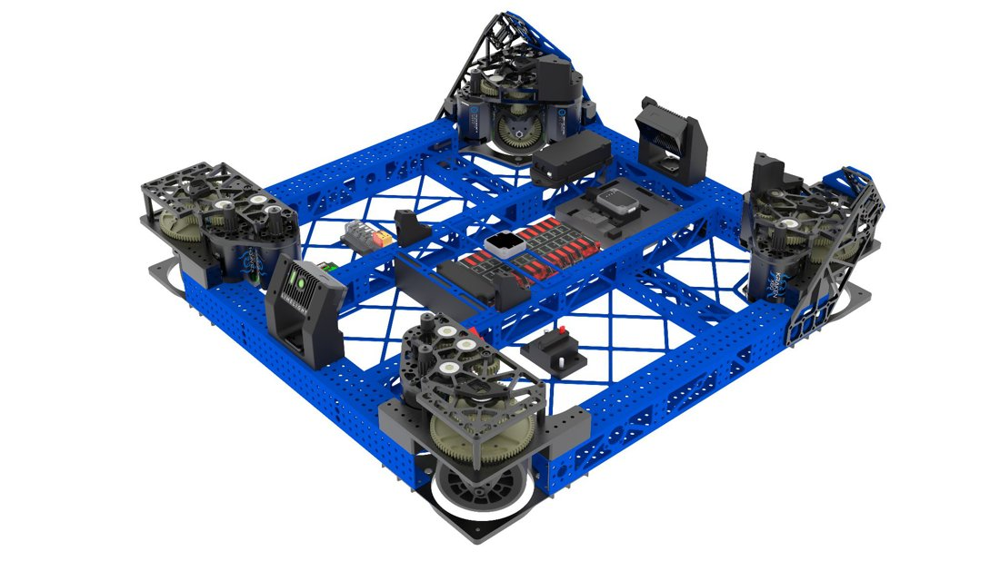

2025 team 1323 — embedded figure from technical binder, PDF page 4. Page discusses elevator. Figure identity requires the surrounding source page. [Original source](https://drive.google.com/file/d/1Y2ooTZMBNoViMZ6R4wYOkom1mhIIqF-R/view?usp=sharing). Individual embedded figure extracted; contextual page tags, not a visually verified engineering drawing

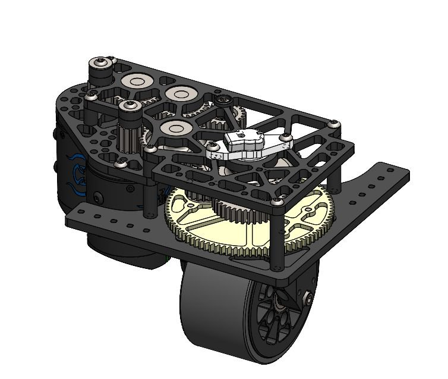

2025 team 1323 — embedded figure from technical binder, PDF page 5. Page discusses elevator, intake. Figure identity requires the surrounding source page. [Original source](https://drive.google.com/file/d/1Y2ooTZMBNoViMZ6R4wYOkom1mhIIqF-R/view?usp=sharing). Individual embedded figure extracted; contextual page tags, not a visually verified engineering drawing

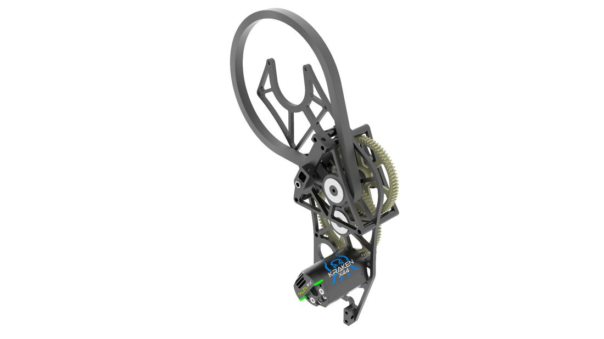

2025 team 1323 — embedded figure from technical binder, PDF page 6. Page discusses elevator, intake, pivot. Figure identity requires the surrounding source page. [Original source](https://drive.google.com/file/d/1Y2ooTZMBNoViMZ6R4wYOkom1mhIIqF-R/view?usp=sharing). Individual embedded figure extracted; contextual page tags, not a visually verified engineering drawing

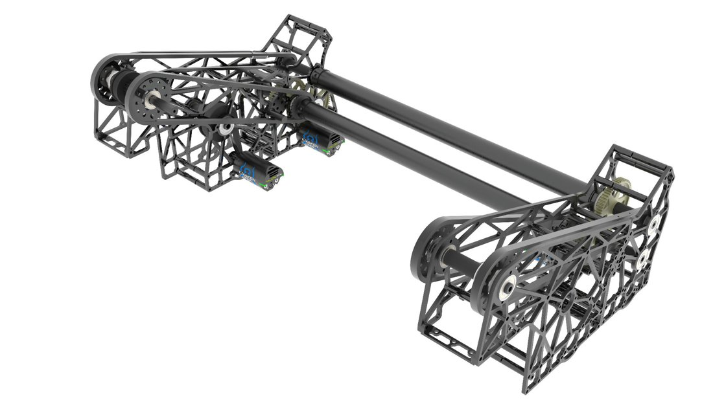

2025 team 1323 — embedded figure from technical binder, PDF page 7. Page discusses arm, intake, pivot. Figure identity requires the surrounding source page. [Original source](https://drive.google.com/file/d/1Y2ooTZMBNoViMZ6R4wYOkom1mhIIqF-R/view?usp=sharing). Individual embedded figure extracted; contextual page tags, not a visually verified engineering drawing

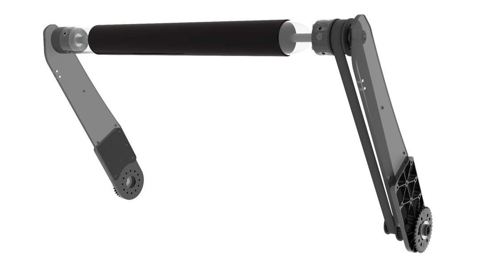

2025 team 1323 — embedded figure from technical binder, PDF page 8. Page discusses arm, climb, intake. Figure identity requires the surrounding source page. [Original source](https://drive.google.com/file/d/1Y2ooTZMBNoViMZ6R4wYOkom1mhIIqF-R/view?usp=sharing). Individual embedded figure extracted; contextual page tags, not a visually verified engineering drawing

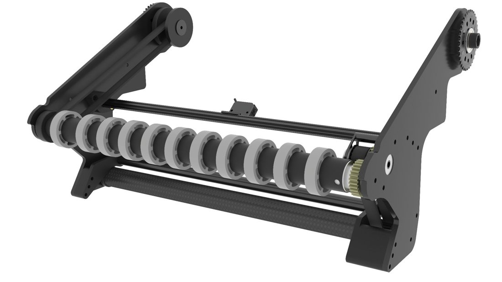

2025 team 1323 — embedded figure from technical binder, PDF page 9. Page discusses intake. Figure identity requires the surrounding source page. [Original source](https://drive.google.com/file/d/1Y2ooTZMBNoViMZ6R4wYOkom1mhIIqF-R/view?usp=sharing). Individual embedded figure extracted; contextual page tags, not a visually verified engineering drawing

## Dated research locators — navigation, not reviewed claims

A tag describes words in the source, not a validated engineering fact. Discussion replies may concern comparison robots.

- 2025-03-14 · Lotem49 · [post 4](https://www.chiefdelphi.com/t/495568/4) · elevator
- 2025-03-14 · superdude311 · [post 5](https://www.chiefdelphi.com/t/495568/5) · wrist
- 2025-03-14 · ConnorG · [post 18](https://www.chiefdelphi.com/t/495568/18) · bearing, elevator
- 2025-03-14 · ConnorG · [post 24](https://www.chiefdelphi.com/t/495568/24) · cad
- 2025-03-31 · Aaron_Li · [post 30](https://www.chiefdelphi.com/t/495568/30) · climb, elevator
- 2025-03-31 · DaiTou567 · [post 31](https://www.chiefdelphi.com/t/495568/31) · climb, intake
- 2025-03-31 · R.C · [post 32](https://www.chiefdelphi.com/t/495568/32) · intake
- 2025-04-15 · jedgar6 · [post 51](https://www.chiefdelphi.com/t/495568/51) · vision
- 2025-04-15 · jedgar6 · [post 53](https://www.chiefdelphi.com/t/495568/53) · code
- 2025-04-15 · joemost · [post 54](https://www.chiefdelphi.com/t/495568/54) · code
- 2025-04-15 · R.C · [post 55](https://www.chiefdelphi.com/t/495568/55) · code
- 2025-04-15 · rich.varone · [post 57](https://www.chiefdelphi.com/t/495568/57) · code
- 2025-04-15 · tekdemo · [post 60](https://www.chiefdelphi.com/t/495568/60) · code
- 2025-04-16 · CakeDeer6 · [post 61](https://www.chiefdelphi.com/t/495568/61) · code
- 2025-04-17 · Aaron_Li · [post 62](https://www.chiefdelphi.com/t/495568/62) · intake
- 2025-04-20 · superdude311 · [post 67](https://www.chiefdelphi.com/t/495568/67) · climb
- 2025-04-20 · Aaron_Li · [post 68](https://www.chiefdelphi.com/t/495568/68) · intake
- 2025-04-20 · v0ncent · [post 70](https://www.chiefdelphi.com/t/495568/70) · code
- 2025-04-21 · Vasista · [post 73](https://www.chiefdelphi.com/t/495568/73) · code
- 2025-04-21 · CakeDeer6 · [post 74](https://www.chiefdelphi.com/t/495568/74) · code
- 2025-04-21 · Mangos · [post 75](https://www.chiefdelphi.com/t/495568/75) · belt, elevator
- 2025-04-21 · jjsessa · [post 77](https://www.chiefdelphi.com/t/495568/77) · bearing, belt, elevator
- 2025-04-21 · cmwilson13 · [post 83](https://www.chiefdelphi.com/t/495568/83) · elevator
- 2025-04-21 · meer.com · [post 90](https://www.chiefdelphi.com/t/495568/90) · bearing
- 2025-04-21 · izachto · [post 91](https://www.chiefdelphi.com/t/495568/91) · camera
- 2025-04-21 · 1GN · [post 92](https://www.chiefdelphi.com/t/495568/92) · intake
- 2025-04-21 · pompano05 · [post 93](https://www.chiefdelphi.com/t/495568/93) · cad, shooter
- 2025-04-21 · JesseK · [post 94](https://www.chiefdelphi.com/t/495568/94) · wrist
- 2025-04-22 · cmwilson13 · [post 95](https://www.chiefdelphi.com/t/495568/95) · belt, elevator
- 2025-04-22 · DaiTou567 · [post 96](https://www.chiefdelphi.com/t/495568/96) · code
- 2025-04-22 · jedgar6 · [post 102](https://www.chiefdelphi.com/t/495568/102) · belt, intake
- 2025-04-24 · Ainesh · [post 3](https://www.chiefdelphi.com/t/500435/3) · intake
- 2025-04-24 · R.C · [post 7](https://www.chiefdelphi.com/t/500435/7) · intake
- 2025-04-24 · R.C · [post 12](https://www.chiefdelphi.com/t/500435/12) · chain, wrist
- 2025-04-24 · R.C · [post 19](https://www.chiefdelphi.com/t/500435/19) · camera
- 2025-04-24 · PatMcN · [post 21](https://www.chiefdelphi.com/t/500435/21) · intake
- 2025-04-25 · Robosquatch76 · [post 27](https://www.chiefdelphi.com/t/500435/27) · elevator
- 2025-04-25 · Robotgobrrrr · [post 28](https://www.chiefdelphi.com/t/500435/28) · climb, intake, pivot
- 2025-04-25 · CuteRedpandas · [post 30](https://www.chiefdelphi.com/t/500435/30) · arm, pivot
- 2025-04-25 · Cyntax · [post 32](https://www.chiefdelphi.com/t/500435/32) · intake
- 2025-04-25 · osofdez · [post 35](https://www.chiefdelphi.com/t/500435/35) · elevator
- 2025-04-25 · yesiconcur · [post 37](https://www.chiefdelphi.com/t/500435/37) · code
- 2025-04-25 · arjunorsmth · [post 38](https://www.chiefdelphi.com/t/500435/38) · code
- 2025-04-25 · yesiconcur · [post 39](https://www.chiefdelphi.com/t/500435/39) · code
- 2025-04-25 · R.C · [post 44](https://www.chiefdelphi.com/t/500435/44) · elevator
- 2025-04-25 · R.C · [post 45](https://www.chiefdelphi.com/t/500435/45) · intake
- 2025-04-25 · R.C · [post 48](https://www.chiefdelphi.com/t/500435/48) · intake
- 2025-04-25 · R.C · [post 50](https://www.chiefdelphi.com/t/500435/50) · bearing, chain
- 2025-04-25 · alex.richards48 · [post 51](https://www.chiefdelphi.com/t/500435/51) · cad
- 2025-04-25 · kitare102 · [post 57](https://www.chiefdelphi.com/t/500435/57) · arm
- 2025-04-25 · R.C · [post 58](https://www.chiefdelphi.com/t/500435/58) · cad
- 2025-04-25 · R.C · [post 60](https://www.chiefdelphi.com/t/500435/60) · chain, prototype
- 2025-04-25 · Akash_Rastogi · [post 61](https://www.chiefdelphi.com/t/500435/61) · cad, intake
- 2025-04-25 · R.C · [post 62](https://www.chiefdelphi.com/t/500435/62) · climb, intake
- 2025-04-25 · R.C · [post 64](https://www.chiefdelphi.com/t/500435/64) · cad
- 2025-04-25 · R.C · [post 67](https://www.chiefdelphi.com/t/500435/67) · chain, intake, wrist
- 2025-04-25 · Tinnittin · [post 68](https://www.chiefdelphi.com/t/500435/68) · elevator
- 2025-04-25 · raine1 · [post 71](https://www.chiefdelphi.com/t/500435/71) · autonomous, code, vision, wrist
- 2025-04-25 · nhos · [post 72](https://www.chiefdelphi.com/t/500435/72) · chain, intake
- 2025-04-26 · truher · [post 76](https://www.chiefdelphi.com/t/500435/76) · chain
- 2025-04-26 · rich.varone · [post 77](https://www.chiefdelphi.com/t/500435/77) · arm, chain, intake, wrist
- 2025-04-26 · SiddheshDash · [post 78](https://www.chiefdelphi.com/t/500435/78) · bearing, chain
- 2025-04-26 · DaiTou567 · [post 79](https://www.chiefdelphi.com/t/500435/79) · intake
- 2025-04-26 · truher · [post 80](https://www.chiefdelphi.com/t/500435/80) · chain
- 2025-04-26 · rich.varone · [post 81](https://www.chiefdelphi.com/t/500435/81) · chain
- 2025-04-26 · AdamHeard · [post 82](https://www.chiefdelphi.com/t/500435/82) · arm, chain
- 2025-04-26 · Lil_Lavery · [post 83](https://www.chiefdelphi.com/t/500435/83) · arm, chain, elevator
- 2025-04-26 · truher · [post 84](https://www.chiefdelphi.com/t/500435/84) · chain
- 2025-04-26 · NolanL · [post 86](https://www.chiefdelphi.com/t/500435/86) · belt, elevator
- 2025-04-26 · NolanE995 · [post 87](https://www.chiefdelphi.com/t/500435/87) · elevator
- 2025-04-26 · R.C · [post 88](https://www.chiefdelphi.com/t/500435/88) · belt
- 2025-04-26 · Tedzzy · [post 89](https://www.chiefdelphi.com/t/500435/89) · pivot
- 2025-04-26 · EvanMeltz · [post 90](https://www.chiefdelphi.com/t/500435/90) · chain, wrist
- 2025-04-27 · R.C · [post 95](https://www.chiefdelphi.com/t/500435/95) · belt, intake
- 2025-04-27 · R.C · [post 96](https://www.chiefdelphi.com/t/500435/96) · cad
- 2025-04-27 · JamesO1086 · [post 101](https://www.chiefdelphi.com/t/500435/101) · elevator
- 2025-04-29 · Eaglegrant · [post 104](https://www.chiefdelphi.com/t/500435/104) · bearing, intake
- 2025-04-30 · dannyz1177 · [post 110](https://www.chiefdelphi.com/t/500435/110) · belt
- 2025-04-30 · JamesO1086 · [post 111](https://www.chiefdelphi.com/t/500435/111) · elevator, pivot
- 2025-04-30 · dannyz1177 · [post 114](https://www.chiefdelphi.com/t/500435/114) · belt, elevator
- 2025-05-01 · EvanMeltz · [post 115](https://www.chiefdelphi.com/t/500435/115) · pivot
- 2025-05-01 · Jacob_Warnes · [post 117](https://www.chiefdelphi.com/t/500435/117) · belt
- 2025-05-01 · aven · [post 118](https://www.chiefdelphi.com/t/500435/118) · elevator
- 2025-05-02 · rsiwinski · [post 119](https://www.chiefdelphi.com/t/500435/119) · autonomous, indexer, intake, pivot
- 2025-05-02 · R.C · [post 120](https://www.chiefdelphi.com/t/500435/120) · elevator
- 2025-05-02 · R.C · [post 121](https://www.chiefdelphi.com/t/500435/121) · rebuild
- 2025-05-02 · R.C · [post 122](https://www.chiefdelphi.com/t/500435/122) · belt
- 2025-05-02 · R.C · [post 123](https://www.chiefdelphi.com/t/500435/123) · cad, intake
- 2025-05-02 · R.C · [post 125](https://www.chiefdelphi.com/t/500435/125) · bearing
- 2025-05-02 · R.C · [post 127](https://www.chiefdelphi.com/t/500435/127) · elevator
- 2025-05-02 · R.C · [post 128](https://www.chiefdelphi.com/t/500435/128) · code
- 2025-05-02 · R.C · [post 131](https://www.chiefdelphi.com/t/500435/131) · bearing, cad, indexer, intake, pivot
- 2025-05-02 · R.C · [post 133](https://www.chiefdelphi.com/t/500435/133) · cad, elevator, pivot, wrist
- 2025-05-03 · arjunorsmth · [post 135](https://www.chiefdelphi.com/t/500435/135) · cad
- 2025-05-03 · ElliotS · [post 140](https://www.chiefdelphi.com/t/500435/140) · climb
- 2025-05-11 · TFM110 · [post 148](https://www.chiefdelphi.com/t/500435/148) · cad
- 2025-05-11 · R.C · [post 150](https://www.chiefdelphi.com/t/500435/150) · cad
- 2025-05-11 · R.C · [post 152](https://www.chiefdelphi.com/t/500435/152) · intake
- 2025-05-12 · CuteRedpandas · [post 165](https://www.chiefdelphi.com/t/500435/165) · camera
- 2025-05-12 · Nifley · [post 167](https://www.chiefdelphi.com/t/500435/167) · camera, code, vision, wrist
- 2025-05-24 · SamCarlberg · [post 173](https://www.chiefdelphi.com/t/500435/173) · cad
- 2025-05-29 · therekrab · [post 186](https://www.chiefdelphi.com/t/500435/186) · arm, climb, intake, wrist
- 2025-05-29 · CakeDeer6 · [post 187](https://www.chiefdelphi.com/t/500435/187) · intake, pivot, wrist
- 2025-05-30 · R.C · [post 188](https://www.chiefdelphi.com/t/500435/188) · climb, elevator, intake, pivot
- 2025-06-09 · AlexG · [post 190](https://www.chiefdelphi.com/t/500435/190) · intake
- 2025-06-09 · R.C · [post 191](https://www.chiefdelphi.com/t/500435/191) · belt, intake
- 2025-06-09 · AlexG · [post 192](https://www.chiefdelphi.com/t/500435/192) · elevator, wrist
- 2025-06-10 · SamCarlberg · [post 194](https://www.chiefdelphi.com/t/500435/194) · bearing, belt, wrist
- 2025-06-17 · ItayKauf · [post 201](https://www.chiefdelphi.com/t/500435/201) · cad
- 2025-06-18 · PaulChen · [post 210](https://www.chiefdelphi.com/t/500435/210) · elevator
- 2025-06-20 · MakeItWork · [post 211](https://www.chiefdelphi.com/t/500435/211) · intake
- 2025-06-20 · R.C · [post 212](https://www.chiefdelphi.com/t/500435/212) · cad, intake
- 2025-06-21 · PaulChen · [post 213](https://www.chiefdelphi.com/t/500435/213) · elevator
- 2025-06-24 · ArchdukeTim · [post 215](https://www.chiefdelphi.com/t/500435/215) · wrist
- 2025-06-25 · R.C · [post 218](https://www.chiefdelphi.com/t/500435/218) · code, elevator
- 2025-06-25 · SamCarlberg · [post 219](https://www.chiefdelphi.com/t/500435/219) · encoder, wrist
- 2025-07-05 · wbzjt666 · [post 221](https://www.chiefdelphi.com/t/500435/221) · code
- 2025-07-29 · therekrab · [post 234](https://www.chiefdelphi.com/t/500435/234) · intake
- 2025-07-30 · R.C · [post 236](https://www.chiefdelphi.com/t/500435/236) · intake
- 2025-07-30 · therekrab · [post 239](https://www.chiefdelphi.com/t/500435/239) · code
- 2025-08-01 · MentorRob · [post 240](https://www.chiefdelphi.com/t/500435/240) · intake, wrist
- 2025-08-04 · RockyXRQ · [post 241](https://www.chiefdelphi.com/t/500435/241) · belt, elevator, encoder
- 2025-08-04 · R.C · [post 242](https://www.chiefdelphi.com/t/500435/242) · belt
- 2025-08-05 · Suyog9609 · [post 243](https://www.chiefdelphi.com/t/500435/243) · elevator
- 2025-08-05 · RockyXRQ · [post 245](https://www.chiefdelphi.com/t/500435/245) · belt
- 2025-08-05 · meer.com · [post 246](https://www.chiefdelphi.com/t/500435/246) · belt, encoder
- 2025-08-07 · e_bauman · [post 247](https://www.chiefdelphi.com/t/500435/247) · wrist
- 2025-08-09 · waxton · [post 249](https://www.chiefdelphi.com/t/500435/249) · belt
- 2025-08-11 · R.C · [post 250](https://www.chiefdelphi.com/t/500435/250) · belt, code
- 2025-08-14 · R.C · [post 253](https://www.chiefdelphi.com/t/500435/253) · elevator, intake
- 2025-09-02 · Hermes8942 · [post 262](https://www.chiefdelphi.com/t/500435/262) · cad
- 2025-09-03 · R.C · [post 263](https://www.chiefdelphi.com/t/500435/263) · cad
- 2025-09-03 · JamesO1086 · [post 264](https://www.chiefdelphi.com/t/500435/264) · elevator
- 2025-09-05 · R.C · [post 267](https://www.chiefdelphi.com/t/500435/267) · code
- 2025-09-05 · Indiebot · [post 268](https://www.chiefdelphi.com/t/500435/268) · cad
- 2025-09-05 · R.C · [post 269](https://www.chiefdelphi.com/t/500435/269) · cad, code
- 2025-09-06 · ben_chigi · [post 270](https://www.chiefdelphi.com/t/500435/270) · intake
- 2025-09-06 · R.C · [post 271](https://www.chiefdelphi.com/t/500435/271) · chain, pivot
- 2025-09-06 · kitare102 · [post 273](https://www.chiefdelphi.com/t/500435/273) · chain
- 2025-09-06 · s-neff · [post 275](https://www.chiefdelphi.com/t/500435/275) · chain
- 2025-09-12 · jamieji · [post 277](https://www.chiefdelphi.com/t/500435/277) · wrist
- 2025-09-12 · kitare102 · [post 278](https://www.chiefdelphi.com/t/500435/278) · wrist
- 2025-09-12 · jamieji · [post 279](https://www.chiefdelphi.com/t/500435/279) · bearing, wrist
- 2025-09-13 · R.C · [post 281](https://www.chiefdelphi.com/t/500435/281) · belt, encoder
- 2025-09-23 · R.C · [post 283](https://www.chiefdelphi.com/t/500435/283) · code, elevator, pivot, wrist
- 2025-09-23 · suPURDUEperAndy · [post 286](https://www.chiefdelphi.com/t/500435/286) · cad
- 2025-09-23 · Grumpy_Bud · [post 287](https://www.chiefdelphi.com/t/500435/287) · code
- 2025-10-05 · R.C · [post 289](https://www.chiefdelphi.com/t/500435/289) · bearing
- 2025-10-14 · Valkryy · [post 293](https://www.chiefdelphi.com/t/500435/293) · belt, elevator
- 2025-10-14 · jedgar6 · [post 294](https://www.chiefdelphi.com/t/500435/294) · elevator, pivot
- 2025-10-15 · Valkryy · [post 301](https://www.chiefdelphi.com/t/500435/301) · elevator
- 2025-10-15 · Aarav86 · [post 302](https://www.chiefdelphi.com/t/500435/302) · elevator, intake
- 2025-10-15 · R.C · [post 303](https://www.chiefdelphi.com/t/500435/303) · intake
- 2025-10-15 · Valkryy · [post 307](https://www.chiefdelphi.com/t/500435/307) · elevator
- 2025-10-16 · Valkryy · [post 311](https://www.chiefdelphi.com/t/500435/311) · belt
- 2025-11-04 · Hermes8942 · [post 317](https://www.chiefdelphi.com/t/500435/317) · bearing, elevator
- 2025-11-06 · wbzjt666 · [post 318](https://www.chiefdelphi.com/t/500435/318) · intake
- 2025-11-06 · wbzjt666 · [post 320](https://www.chiefdelphi.com/t/500435/320) · code
- 2026-01-20 · FinIce · [post 333](https://www.chiefdelphi.com/t/500435/333) · intake
- 2026-06-10 · ryan971 · [post 338](https://www.chiefdelphi.com/t/500435/338) · wrist

# 2025-1323: technical mechanisms, design reasoning and revision boundaries

These notes distinguish published construction from team-stated intent and original engineering inference. Selected numerical values are reported source data, not independently reproduced measurements. The recommended tests have not been performed. A binder snapshot does not certify every competition version.

## AURELIA: package the base around two different clearances

Version: AURELIA. [PDF p4](https://drive.google.com/file/d/1Y2ooTZMBNoViMZ6R4wYOkom1mhIIqF-R/view?usp=sharing#page=4) · [PDF p5](https://drive.google.com/file/d/1Y2ooTZMBNoViMZ6R4wYOkom1mhIIqF-R/view?usp=sharing#page=5)

**Published construction:** 28-inch square chassis; X2i elevator-side modules and X2t intake-side modules; custom lowering spacers.

**Team-stated reason or evidence boundary:** Motor protection, low chassis and intake gearbox clearance.

**Engineering analysis — original inference:** Choosing different module orientations within one drivebase is a packaging solution rather than a reason to recommend mixed modules universally. A motor placed inside can protect the elevator-side envelope while an outward placement can free an intake drive path. The lowering hardware must preserve module stiffness and ground clearance under a loaded, accelerating robot. Low mass is helpful, but the more relevant quantity for fast reef approach is the loaded center of mass and its motion as the shoulder and elevator change state. Include bumper and battery interfaces in the same model.

**Proposed validation — not a completed test:** Sweep the complete intake/elevator envelope against each module; measure clearance and wheel unloading through aggressive scoring transitions.

**Limits:** The binder is a published configuration snapshot, not an independent durability or match-rate test.

## AURELIA: separate coral and algae contacts on a shared axis

Version: AURELIA. [PDF p7](https://drive.google.com/file/d/1Y2ooTZMBNoViMZ6R4wYOkom1mhIIqF-R/view?usp=sharing#page=7) · [PDF p8](https://drive.google.com/file/d/1Y2ooTZMBNoViMZ6R4wYOkom1mhIIqF-R/view?usp=sharing#page=8) · [PDF p9](https://drive.google.com/file/d/1Y2ooTZMBNoViMZ6R4wYOkom1mhIIqF-R/view?usp=sharing#page=9) · [Team explanation](https://www.chiefdelphi.com/t/500435/131)

**Published construction:** Coaxial intake pivots; separate deployment reductions; shared roller drive; bilateral transfer tubes.

**Team-stated reason or evidence boundary:** The team explicitly ties this intake choice to horizontal L1 placement, alongside concerns about a separate centering/indexing system.

**Engineering analysis — original inference:** Sharing an axis does not make these one generic intake. Each piece needs a different contact geometry, and the dedicated L1 action depends on their relative positions. Driving both sides helps prevent an arm from twisting out of phase during asymmetric contact. A common roller drive saves a motor and packaging but couples the desired surface speeds of the two pickup functions. The useful retrieval target is the entire relative geometry and state sequence: which surface acquires, which guides, and which constrains the coral during release. A lone roller photo cannot explain the L1 performance.

**Proposed validation — not a completed test:** Film the complete L1 cycle from first floor contact through release; vary coral orientation, reef occupancy and approach angle.

**Limits:** Team reply reports difficult horizontal approaches beyond about 45 degrees, extensive practice and late-season durability work. Successful match execution is not proof of effortless any-orientation pickup.

## AURELIA: center coral before a direct handoff

Version: AURELIA. [PDF p9](https://drive.google.com/file/d/1Y2ooTZMBNoViMZ6R4wYOkom1mhIIqF-R/view?usp=sharing#page=9)

**Published construction:** Flex upper rollers, grippy lower rollers, about 0.125-inch coral compression and proximity detection.

**Team-stated reason or evidence boundary:** Center coral and hand directly into the end effector.

**Engineering analysis — original inference:** A low-compression pickup can reduce the force required to accept an awkwardly oriented tube, but it leaves less traction margin when the surfaces are dirty or the coral is wedged against another piece. Centering before transfer reduces the number of states the end effector must solve. A direct handoff avoids an intermediate tray, while demanding that the receiving geometry arrive at the right position before the piece loses its previous constraint. Sensor placement should identify the handoff state, rather than simply report that some portion of a long tube is nearby.

**Proposed validation — not a completed test:** Test slow, diagonal and multi-piece approaches; observe whether detection occurs before, during or after reliable ownership transfers.

**Limits:** The binder is a published configuration snapshot, not an independent durability or match-rate test.

## AURELIA: four-stage lift on a rotating shoulder

Version: AURELIA. [PDF p6](https://drive.google.com/file/d/1Y2ooTZMBNoViMZ6R4wYOkom1mhIIqF-R/view?usp=sharing#page=6) · [PDF p10](https://drive.google.com/file/d/1Y2ooTZMBNoViMZ6R4wYOkom1mhIIqF-R/view?usp=sharing#page=10) · [PDF p11](https://drive.google.com/file/d/1Y2ooTZMBNoViMZ6R4wYOkom1mhIIqF-R/view?usp=sharing#page=11)

**Published construction:** Shoulder-supported four-stage continuous elevator; internal HTD belts; interlocking extended-stage stops.

**Team-stated reason or evidence boundary:** Compact packaging with stiffness at scoring height.

**Engineering analysis — original inference:** The shoulder changes both the lift’s direction and its center-of-mass path. A multi-stage lift can reach high while stowing short, but introduces more interfaces that can deflect or develop play. Hard stops that engage at extension can add stiffness where the mechanism otherwise has the least overlap; they must not produce damaging impacts at operating speed. The carriage’s integrated gearbox reduces redundant structure while making belt access and service sequencing important. In the alliance role described by the user, much of the robot’s value comes from low scoring and algae, yet its high reach still supplies capability and tactical flexibility.

**Proposed validation — not a completed test:** Measure tip error and settling after shoulder/elevator transitions, including side acceleration and partial rather than only full extension.

**Limits:** The binder is a published configuration snapshot, not an independent durability or match-rate test.

## AURELIA: differential wrist and independently driven rollers

Version: AURELIA. [PDF p12](https://drive.google.com/file/d/1Y2ooTZMBNoViMZ6R4wYOkom1mhIIqF-R/view?usp=sharing#page=12) · [PDF p13](https://drive.google.com/file/d/1Y2ooTZMBNoViMZ6R4wYOkom1mhIIqF-R/view?usp=sharing#page=13)

**Published construction:** Printed bevel differential; paired 61.6:1 drives; independent coral rollers; front algae pinch wheels.

**Team-stated reason or evidence boundary:** Reorient coral while keeping the moving end effector compact.

**Engineering analysis — original inference:** A differential combines two motor coordinates into two output motions. That can package orientation control densely, but means a joint motion may require both motors and leave less authority for the other axis at the same instant. Printed bevel gears need controlled bearing alignment and a stiffness model; backlash at a small output stage becomes placement error at the coral tip. Independent roller contacts can change tube orientation before release, which is particularly valuable for intentional L1 placement and stacking. The same hardware can support very different alliance jobs, so high-level capability must be separated from the task actually assigned in a match.

**Proposed validation — not a completed test:** Command combined wrist motions under realistic piece load; measure output backlash and horizontal-coral placement consistency across L1 pile heights.

**Limits:** The binder is a published configuration snapshot, not an independent durability or match-rate test.

## AURELIA: reuse the shoulder and reposition the cage

Version: AURELIA. [PDF p8](https://drive.google.com/file/d/1Y2ooTZMBNoViMZ6R4wYOkom1mhIIqF-R/view?usp=sharing#page=8) · [PDF p14](https://drive.google.com/file/d/1Y2ooTZMBNoViMZ6R4wYOkom1mhIIqF-R/view?usp=sharing#page=14)

**Published construction:** Powered cage capture, passive latches, sliding support and shoulder-driven lifting; algae intake supplies support.

**Team-stated reason or evidence boundary:** Reuse primary joints while controlling the hanging geometry.

**Engineering analysis — original inference:** A shared-joint climb saves dedicated structure only if the primary system can react the new loads. Capturing one cage tube is different from supporting the robot after the cage rotates; the lower reaction point and position of the chain relative to the robot’s center of mass determine the motion. The sliding support permits that geometry to change rather than requiring a single fixed pivot to solve every phase. Reuse also couples faults: a damaged shoulder, end effector or intake latch can affect climb. Record the support contact explicitly instead of reducing the design to “uses its arm to climb.”

**Proposed validation — not a completed test:** Test cage swing and off-center capture, inspect every reaction contact, and verify retention after power is removed.

**Limits:** The binder is a published configuration snapshot, not an independent durability or match-rate test.

## Selected published parameters

| Component | Source parameter | Locator |
|---|---|---|
| Drive | 6.48:1; 16.1-ft/s free; X60/X44 | [Source p5](https://drive.google.com/file/d/1Y2ooTZMBNoViMZ6R4wYOkom1mhIIqF-R/view?usp=sharing#page=5) |
| Shoulder | 182.25:1 per X44 drive | [Source p6](https://drive.google.com/file/d/1Y2ooTZMBNoViMZ6R4wYOkom1mhIIqF-R/view?usp=sharing#page=6) |
| Intake deploy | algae 64:1; coral 42.67:1 | [Source p7](https://drive.google.com/file/d/1Y2ooTZMBNoViMZ6R4wYOkom1mhIIqF-R/view?usp=sharing#page=7) |
| Lift | 6.875:1; one X60; two internal 18-mm HTD belts | [Source p10](https://drive.google.com/file/d/1Y2ooTZMBNoViMZ6R4wYOkom1mhIIqF-R/view?usp=sharing#page=10) |
| Differential | 61.6:1 per drive; #25H output chain | [Source p12](https://drive.google.com/file/d/1Y2ooTZMBNoViMZ6R4wYOkom1mhIIqF-R/view?usp=sharing#page=12) |
| End rollers | vertical X44 3:1; front 3-in wheels | [Source p13](https://drive.google.com/file/d/1Y2ooTZMBNoViMZ6R4wYOkom1mhIIqF-R/view?usp=sharing#page=13) |

Ratios preserve source notation; verify driver/driven order, complete geometry and the actual version in CAD before fabrication. Figure records retain PDF page and crop bounds in `data/mechanism_images.jsonl`. Images may include rejected prototypes or whole-robot photographs; their captions preserve that distinction.

## Current strategic priority

Optimize marginal alliance work: branch coverage, L1 placement/packing, algae, supply lanes, autonomous compatibility and reliable endgame. Do not rank robot quality by coral height.
