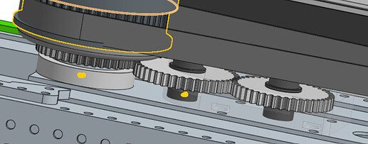
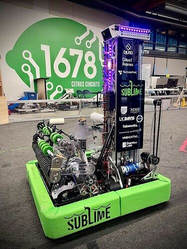
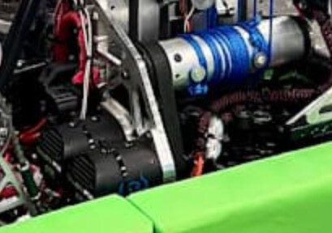
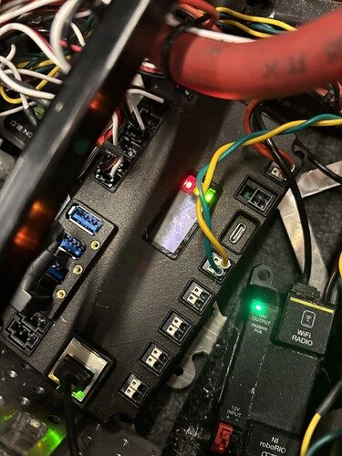
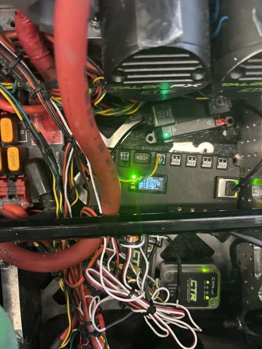

# 2025 · 1678 Citrus Circuits — SubLime

EPA rank 5, snapshot EPA 105.74. Provisional reference dossier.

Wide four-bar coral intake, compact elevator and separate algae collection.

## Drivetrain

Swerve; precise module specification not established by reviewed interview.

Coverage: partial / unresolved detail.

## Intake

Wide four-bar folds inward under frontal impact. Composite plates and roller geometry were iterated; thicker carbon followed week-5 damage.

Coverage: documented synopsis.

## Transfer

Ground pickup feeds lightweight two-sided coral/algae end effector.

Coverage: documented synopsis.

## Scoring

Two-stage continuous string elevator; low carriage hardware and adjustable bracing reduce mass and top-stage wobble.

Coverage: documented synopsis.

## Endgame

Second major climber version adds guide wings, powered cage capture and latches; reported alignment/sequence improved from about 20 to 10 seconds.

Coverage: documented synopsis.

## Controls

Two Limelights for piece/pose detection and reef alignment; autonomous detection zones preserve partner compatibility.

Coverage: documented synopsis.

## Changes and versions

- Week-5-to-Worlds intake reinforcement.
- Climber version 2 recovers late-match cycling time. Algae floor-to-net use increased once alliances filled reefs faster.

## Strategic interpretation — analyst inference

The team explicitly identifies serviceability as a weakness: some intake changes took 30–45 minutes. A strategically attractive pickup can still be expensive to maintain, and that cost should be included when borrowing the mechanism.

## Limits

- Only the reviewed published configurations are established; intermediate changes may be undocumented.

Bounded source review; exhaustive intermediate-version history not certified

## Reviewed primary source bundle

- https://youtu.be/gUJUAoHRq8I

## Season context

Read [the full 2025 game/context chapter](../docs/game_2025.md) before transferring this architecture to another role or season.

## Technical image references

Images are source-associated technical figures or robot views, not dimensionally certified drawings. Follow each source for version and figure context.

2025 team 1678 — source image from post 20 (2025-05-22). Context tags identify the discussion, not a verified component label. [Original source](https://www.chiefdelphi.com/t/502199/20). Source-linked extraction; mechanism identity not individually visually audited

2025 team 1678 — source image from post 1 (2025-02-25). Context tags identify the discussion, not a verified component label. [Original source](https://www.chiefdelphi.com/t/493150/1). Source-linked extraction; mechanism identity not individually visually audited

2025 team 1678 — source image from post 17 (2025-02-25). Context tags identify the discussion, not a verified component label. [Original source](https://www.chiefdelphi.com/t/493150/17). Source-linked extraction; mechanism identity not individually visually audited

2025 team 1678 — source image from post 1 (2025-10-03). Context tags identify the discussion, not a verified component label. [Original source](https://www.chiefdelphi.com/t/506842/1). Source-linked extraction; mechanism identity not individually visually audited

2025 team 1678 — source image from post 1 (2025-10-03). Context tags identify the discussion, not a verified component label. [Original source](https://www.chiefdelphi.com/t/506842/1). Source-linked extraction; mechanism identity not individually visually audited

## Dated research locators — navigation, not reviewed claims

A tag describes words in the source, not a validated engineering fact. Discussion replies may concern comparison robots.

- 2025-02-25 · SonofBeans · [post 9](https://www.chiefdelphi.com/t/493150/9) · intake
- 2025-02-25 · kingbrandon14 · [post 10](https://www.chiefdelphi.com/t/493150/10) · climb, elevator
- 2025-02-25 · rincrossapplesauce · [post 12](https://www.chiefdelphi.com/t/493150/12) · intake
- 2025-02-25 · Bochek · [post 17](https://www.chiefdelphi.com/t/493150/17) · elevator
- 2025-02-25 · MearBetal · [post 22](https://www.chiefdelphi.com/t/493150/22) · elevator
- 2025-02-25 · BordomBeThyName · [post 23](https://www.chiefdelphi.com/t/493150/23) · elevator
- 2025-02-25 · Tommy5104 · [post 30](https://www.chiefdelphi.com/t/493150/30) · elevator
- 2025-02-25 · BordomBeThyName · [post 36](https://www.chiefdelphi.com/t/493150/36) · elevator
- 2025-02-25 · superdude311 · [post 40](https://www.chiefdelphi.com/t/493150/40) · elevator
- 2025-02-25 · BordomBeThyName · [post 42](https://www.chiefdelphi.com/t/493150/42) · elevator
- 2025-02-25 · Paul_R · [post 45](https://www.chiefdelphi.com/t/493150/45) · elevator, wrist
- 2025-02-26 · Zatack7 · [post 52](https://www.chiefdelphi.com/t/493150/52) · elevator
- 2025-04-24 · ItayKauf · [post 63](https://www.chiefdelphi.com/t/493150/63) · cad
- 2025-04-27 · rocketbooster1000 · [post 64](https://www.chiefdelphi.com/t/493150/64) · autonomous
- 2025-04-29 · Soren_1 · [post 66](https://www.chiefdelphi.com/t/493150/66) · intake
- 2025-05-09 · Tatiman-Dev · [post 68](https://www.chiefdelphi.com/t/493150/68) · cad
- 2025-05-09 · Michael_Corsetto · [post 70](https://www.chiefdelphi.com/t/493150/70) · cad, code
- 2025-05-09 · sahilk · [post 74](https://www.chiefdelphi.com/t/493150/74) · intake
- 2025-05-22 · Michael_Corsetto · [post 1](https://www.chiefdelphi.com/t/502199/1) · cad, code
- 2025-05-22 · dinoman · [post 7](https://www.chiefdelphi.com/t/502199/7) · elevator
- 2025-05-22 · smilelsb · [post 8](https://www.chiefdelphi.com/t/502199/8) · elevator
- 2025-05-22 · Emma_Zhao · [post 9](https://www.chiefdelphi.com/t/502199/9) · elevator
- 2025-05-22 · smilelsb · [post 12](https://www.chiefdelphi.com/t/502199/12) · elevator
- 2025-05-22 · ArdaTurkmen · [post 20](https://www.chiefdelphi.com/t/502199/20) · arm, belt, encoder
- 2025-05-22 · s-neff · [post 24](https://www.chiefdelphi.com/t/502199/24) · elevator, encoder
- 2025-05-22 · Emma_Zhao · [post 25](https://www.chiefdelphi.com/t/502199/25) · indexer, pivot
- 2025-05-22 · Emma_Zhao · [post 28](https://www.chiefdelphi.com/t/502199/28) · elevator
- 2025-05-22 · Otter502 · [post 29](https://www.chiefdelphi.com/t/502199/29) · cad
- 2025-05-22 · Emma_Zhao · [post 31](https://www.chiefdelphi.com/t/502199/31) · intake
- 2025-05-22 · Emma_Zhao · [post 32](https://www.chiefdelphi.com/t/502199/32) · elevator
- 2025-05-22 · BordomBeThyName · [post 33](https://www.chiefdelphi.com/t/502199/33) · indexer, intake
- 2025-05-22 · p.mehul · [post 36](https://www.chiefdelphi.com/t/502199/36) · belt, encoder, pivot
- 2025-05-22 · SHMKPK · [post 37](https://www.chiefdelphi.com/t/502199/37) · cad, code, pivot
- 2025-05-22 · DaiTou567 · [post 39](https://www.chiefdelphi.com/t/502199/39) · code
- 2025-05-22 · Rishi_Asolkar · [post 41](https://www.chiefdelphi.com/t/502199/41) · indexer
- 2025-05-23 · aaronsit · [post 43](https://www.chiefdelphi.com/t/502199/43) · cad
- 2025-05-23 · Emma_Zhao · [post 47](https://www.chiefdelphi.com/t/502199/47) · cad
- 2025-05-24 · Emma_Zhao · [post 48](https://www.chiefdelphi.com/t/502199/48) · intake
- 2025-05-24 · R.C · [post 49](https://www.chiefdelphi.com/t/502199/49) · cad
- 2025-05-24 · Emma_Zhao · [post 50](https://www.chiefdelphi.com/t/502199/50) · intake
- 2025-05-28 · Philip_Levinsky · [post 52](https://www.chiefdelphi.com/t/502199/52) · intake
- 2025-05-28 · cmwilson13 · [post 54](https://www.chiefdelphi.com/t/502199/54) · intake
- 2025-07-29 · Squirre1Master · [post 57](https://www.chiefdelphi.com/t/502199/57) · code
- 2025-07-29 · Grumpy_Bud · [post 62](https://www.chiefdelphi.com/t/502199/62) · code
- 2025-07-29 · SarahOH · [post 66](https://www.chiefdelphi.com/t/502199/66) · indexer
- 2025-08-05 · Winter1671 · [post 73](https://www.chiefdelphi.com/t/502199/73) · climb
- 2025-08-05 · meer.com · [post 74](https://www.chiefdelphi.com/t/502199/74) · cad
- 2025-08-05 · Jimmyy · [post 75](https://www.chiefdelphi.com/t/502199/75) · cad, climb, code
- 2025-08-05 · meer.com · [post 76](https://www.chiefdelphi.com/t/502199/76) · cad
- 2025-08-07 · Soren_Reisman · [post 77](https://www.chiefdelphi.com/t/502199/77) · climb
- 2025-08-07 · Soren_Reisman · [post 78](https://www.chiefdelphi.com/t/502199/78) · cad
- 2025-08-07 · Corey_Applegate · [post 79](https://www.chiefdelphi.com/t/502199/79) · cad, elevator
- 2025-08-07 · Michael_Corsetto · [post 80](https://www.chiefdelphi.com/t/502199/80) · cad, elevator
- 2025-08-11 · Corey_Applegate · [post 81](https://www.chiefdelphi.com/t/502199/81) · bearing, intake
- 2025-08-13 · Thatotherone17 · [post 82](https://www.chiefdelphi.com/t/502199/82) · bearing
- 2025-09-12 · Jimmyy · [post 84](https://www.chiefdelphi.com/t/502199/84) · indexer
- 2025-10-03 · Ani · [post 1](https://www.chiefdelphi.com/t/506842/1) · code, indexer
- 2025-10-04 · Zaque · [post 12](https://www.chiefdelphi.com/t/506842/12) · code
- 2025-10-04 · SarahOH · [post 14](https://www.chiefdelphi.com/t/506842/14) · code
- 2025-11-12 · Michael_Corsetto · [post 47](https://www.chiefdelphi.com/t/506842/47) · autonomous, code, vision
- 2026-01-03 · SarahOH · [post 99](https://www.chiefdelphi.com/t/502199/99) · elevator
- 2026-01-03 · BordomBeThyName · [post 104](https://www.chiefdelphi.com/t/502199/104) · bearing
- 2026-01-07 · ElliotS · [post 78](https://www.chiefdelphi.com/t/493150/78) · cad
- 2026-01-07 · Michael_Corsetto · [post 79](https://www.chiefdelphi.com/t/493150/79) · cad
- 2026-02-15 · BordomBeThyName · [post 110](https://www.chiefdelphi.com/t/502199/110) · cad, code
- 2026-05-14 · DanielKirsh · [post 80](https://www.chiefdelphi.com/t/493150/80) · elevator

## Current strategic priority

Optimize marginal alliance work: branch coverage, L1 placement/packing, algae, supply lanes, autonomous compatibility and reliable endgame. Do not rank robot quality by coral height.

## Integrated focused technical study

[Construction, reasoning, failure modes and limits](../docs/research_continuation/2025-1678.md). This supplement is a focused interview/source-bundle study, not an exhaustive binder or competition-version certification.
