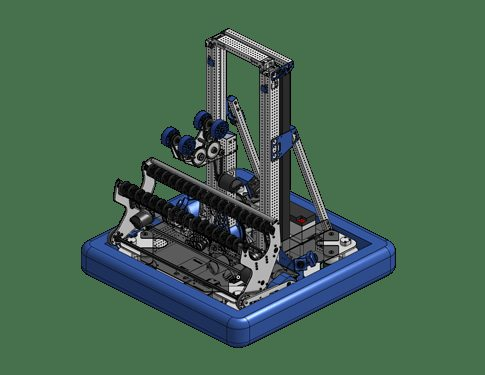
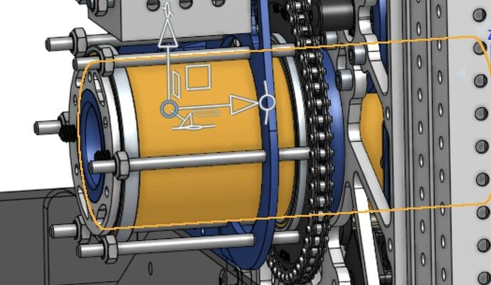
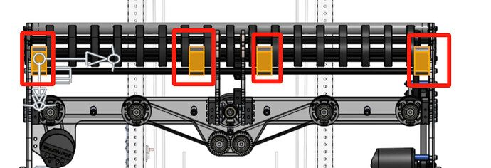

# 2025 · 1778 Chill Out — Chill Out 2025

EPA rank 16, snapshot EPA 92.98. Provisional reference dossier.

Wide ground intake and continuous elevator with bidirectional rotating arm.

## Drivetrain

Swerve; exact module variant unresolved here.

Coverage: partial / unresolved detail.

## Intake

Day-two game simulation identified unprotected-station defense; narrow ground concept replaced by a wide collector.

Coverage: documented synopsis.

## Transfer

Automatic handoff coordinated across collector, elevator, arm and rollers.

Coverage: documented synopsis.

## Scoring

Internally belted elevator informed by offseason practice and 4414 2023; arm can score toward either side.

Coverage: documented synopsis.

## Endgame

Endgame architecture is not established by the reviewed interview; no claim of absent climb is made.

Coverage: partial / unresolved detail.

## Controls

Four cameras/two Orange Pis; weighted scoring-node selection and safe angular limits. Monolithic state machine encodes permitted transitions and reef/bellypan clearance.

Coverage: documented synopsis.

## Changes and versions

- Early narrow intake rejected before this configuration.
- Offseason elevator experience reduced implementation uncertainty; later release provides CAD/code but full endgame audit remains open.

## Strategic interpretation — analyst inference

This is especially useful process evidence: field simulation changed the strategic requirement before the team committed to detailed design. The result connects a floor-feeding strategy to both pickup width and automated handoff.

## Limits

- Only the reviewed published configurations are established; intermediate changes may be undocumented.

Bounded source review; exhaustive intermediate-version history not certified

## Reviewed primary source bundle

- https://youtu.be/pStoPwcBj98
- https://www.chiefdelphi.com/t/501460
- https://github.com/FIRST1778/2025-Robot-Code-Public

## Season context

Read [the full 2025 game/context chapter](../docs/game_2025.md) before transferring this architecture to another role or season.

## Technical image references

Images are source-associated technical figures or robot views, not dimensionally certified drawings. Follow each source for version and figure context.

2025 team 1778 — source image from post 1 (2025-05-09). Context tags identify the discussion, not a verified component label. [Original source](https://www.chiefdelphi.com/t/501460/1). Source-linked extraction; mechanism identity not individually visually audited

2025 team 1778 — source image from post 24 (2025-05-13). Context tags identify the discussion, not a verified component label. [Original source](https://www.chiefdelphi.com/t/501460/24). Source-linked extraction; mechanism identity not individually visually audited

2025 team 1778 — source image from post 41 (2025-06-22). Context tags identify the discussion, not a verified component label. [Original source](https://www.chiefdelphi.com/t/501460/41). Source-linked extraction; mechanism identity not individually visually audited

## Dated research locators — navigation, not reviewed claims

A tag describes words in the source, not a validated engineering fact. Discussion replies may concern comparison robots.

- 2025-02-28 · Skyehawk · [post 4](https://www.chiefdelphi.com/t/493591/4) · intake
- 2025-02-28 · rincrossapplesauce · [post 6](https://www.chiefdelphi.com/t/493591/6) · arm, intake
- 2025-02-28 · ApolloG · [post 8](https://www.chiefdelphi.com/t/493591/8) · intake
- 2025-02-28 · Kai_Hates_Cheetos · [post 9](https://www.chiefdelphi.com/t/493591/9) · cad, intake
- 2025-02-28 · ApolloG · [post 10](https://www.chiefdelphi.com/t/493591/10) · cad
- 2025-03-03 · MSU2000 · [post 13](https://www.chiefdelphi.com/t/493591/13) · intake
- 2025-03-03 · ApolloG · [post 14](https://www.chiefdelphi.com/t/493591/14) · intake
- 2025-03-04 · Calvin-Hobbes17 · [post 17](https://www.chiefdelphi.com/t/493591/17) · intake
- 2025-03-15 · AdamHeard · [post 22](https://www.chiefdelphi.com/t/493591/22) · arm
- 2025-03-15 · ApolloG · [post 23](https://www.chiefdelphi.com/t/493591/23) · encoder
- 2025-03-15 · ApolloG · [post 25](https://www.chiefdelphi.com/t/493591/25) · arm, elevator, encoder, intake
- 2025-03-16 · MTappen · [post 26](https://www.chiefdelphi.com/t/493591/26) · intake
- 2025-04-12 · Khushvir15 · [post 28](https://www.chiefdelphi.com/t/493591/28) · intake
- 2025-04-13 · MSU2000 · [post 29](https://www.chiefdelphi.com/t/493591/29) · climb
- 2025-04-13 · ApolloG · [post 30](https://www.chiefdelphi.com/t/493591/30) · climb
- 2025-04-22 · 1piemanpie · [post 32](https://www.chiefdelphi.com/t/493591/32) · cad
- 2025-04-22 · Mechaman · [post 33](https://www.chiefdelphi.com/t/493591/33) · arm
- 2025-04-22 · ApolloG · [post 34](https://www.chiefdelphi.com/t/493591/34) · cad, code
- 2025-04-22 · ApolloG · [post 35](https://www.chiefdelphi.com/t/493591/35) · arm, cad, pivot
- 2025-05-09 · ApolloG · [post 1](https://www.chiefdelphi.com/t/501460/1) · cad, code
- 2025-05-09 · ThatChair · [post 3](https://www.chiefdelphi.com/t/501460/3) · code
- 2025-05-09 · ApolloG · [post 4](https://www.chiefdelphi.com/t/501460/4) · code
- 2025-05-09 · thevedantin · [post 5](https://www.chiefdelphi.com/t/501460/5) · encoder
- 2025-05-09 · fruits_and_pebbles · [post 7](https://www.chiefdelphi.com/t/501460/7) · arm, chain
- 2025-05-09 · gnubison · [post 8](https://www.chiefdelphi.com/t/501460/8) · arm, encoder
- 2025-05-13 · 7280-Mito-octopus · [post 24](https://www.chiefdelphi.com/t/501460/24) · arm
- 2025-05-13 · ApolloG · [post 25](https://www.chiefdelphi.com/t/501460/25) · arm
- 2025-05-29 · FiveCake · [post 26](https://www.chiefdelphi.com/t/501460/26) · arm
- 2025-05-30 · ApolloG · [post 30](https://www.chiefdelphi.com/t/501460/30) · climb, elevator
- 2025-06-02 · AmitSucher · [post 32](https://www.chiefdelphi.com/t/501460/32) · belt
- 2025-06-07 · AmitSucher · [post 34](https://www.chiefdelphi.com/t/501460/34) · intake
- 2025-06-16 · Grumpy_Bud · [post 36](https://www.chiefdelphi.com/t/501460/36) · cad
- 2025-06-16 · Grumpy_Bud · [post 37](https://www.chiefdelphi.com/t/501460/37) · cad
- 2025-06-22 · smilelsb · [post 41](https://www.chiefdelphi.com/t/501460/41) · arm, intake
- 2025-06-23 · Revision0 · [post 43](https://www.chiefdelphi.com/t/501460/43) · arm, pivot
- 2025-06-23 · Revision0 · [post 44](https://www.chiefdelphi.com/t/501460/44) · intake
- 2025-06-23 · Revision0 · [post 45](https://www.chiefdelphi.com/t/501460/45) · cad
- 2025-06-23 · Revision0 · [post 47](https://www.chiefdelphi.com/t/501460/47) · arm, cad, intake
- 2025-06-23 · olsonkarlp · [post 48](https://www.chiefdelphi.com/t/501460/48) · arm
- 2025-06-27 · smilelsb · [post 49](https://www.chiefdelphi.com/t/501460/49) · gripper
- 2025-06-28 · ApolloG · [post 50](https://www.chiefdelphi.com/t/501460/50) · arm, elevator
- 2025-06-30 · smilelsb · [post 51](https://www.chiefdelphi.com/t/501460/51) · arm, cad, code, intake
- 2025-07-02 · ApolloG · [post 52](https://www.chiefdelphi.com/t/501460/52) · arm, elevator, encoder, intake
- 2025-07-20 · FiveCake · [post 54](https://www.chiefdelphi.com/t/501460/54) · belt
- 2025-07-20 · aung · [post 55](https://www.chiefdelphi.com/t/501460/55) · belt, chain
- 2025-07-25 · g.reyna.x · [post 36](https://www.chiefdelphi.com/t/493591/36) · arm, pivot
- 2025-07-28 · ApolloG · [post 37](https://www.chiefdelphi.com/t/493591/37) · arm, pivot
- 2025-08-12 · ApolloG · [post 57](https://www.chiefdelphi.com/t/501460/57) · arm, belt
- 2025-10-12 · yigit10 · [post 58](https://www.chiefdelphi.com/t/501460/58) · camera
- 2025-10-21 · senesatka · [post 59](https://www.chiefdelphi.com/t/501460/59) · code, vision
- 2026-08-07 · YousofAl · [post 61](https://www.chiefdelphi.com/t/501460/61) · arm
- 2026-08-09 · Parin-4237 · [post 62](https://www.chiefdelphi.com/t/501460/62) · arm

## Current strategic priority

Optimize marginal alliance work: branch coverage, L1 placement/packing, algae, supply lanes, autonomous compatibility and reliable endgame. Do not rank robot quality by coral height.

## Integrated focused technical study

[Construction, reasoning, failure modes and limits](../docs/research_continuation/2025-1778.md). This supplement is a focused interview/source-bundle study, not an exhaustive binder or competition-version certification.
