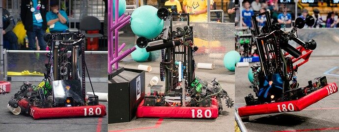
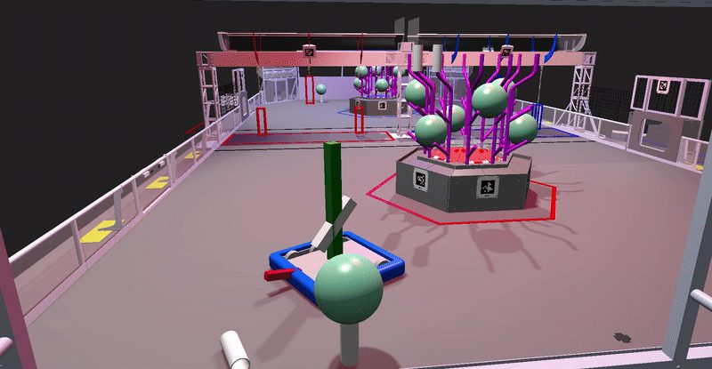

# 2025 · 180 S.P.A.M. — S.P.A.M. 2025

EPA rank 24, snapshot EPA 88.65. Provisional reference dossier.

Compliant floor pickup and rotating dual-piece effector on continuous elevator.

## Drivetrain

WCP Swerve XS; steering motor adaptation described in interview, exact model transcription unresolved.

Coverage: partial / unresolved detail.

## Intake

Compliant four-bar folds rearward; reverse roller action deploys pickup.

Coverage: documented synopsis.

## Transfer

Funnel orients coral into rotating effector.

Coverage: documented synopsis.

## Scoring

Two-stage continuous elevator; shaped algae wheels retain ball during rotation and support net launch while also manipulating coral.

Coverage: documented synopsis.

## Endgame

Recently added RI3D/Orbit-like harness and winch; deployment follows intake stow.

Coverage: documented synopsis.

## Controls

Three Limelights, tag alignment and piece localization; interview distinguishes four-coral autonomous goal from reported two/three average.

Coverage: documented synopsis.

## Changes and versions

- Climber was a recent addition at filming.
- Do not record four-piece goal as established typical autonomous output.

## Strategic interpretation — analyst inference

Set autonomous requirements as a distribution of reliable outcomes. A team reporting an average of two or three should not be indexed as an automatic four-piece robot simply because four was the target.

## Limits

- Only the reviewed published configurations are established; intermediate changes may be undocumented.

Bounded source review; exhaustive intermediate-version history not certified

## Reviewed primary source bundle

- https://www.youtube.com/watch?v=sgTeheZy33I

## Season context

Read [the full 2025 game/context chapter](../docs/game_2025.md) before transferring this architecture to another role or season.

## Technical image references

Images are source-associated technical figures or robot views, not dimensionally certified drawings. Follow each source for version and figure context.

2025 team 180 — source image from post 1 (2025-05-13). Context tags identify the discussion, not a verified component label. [Original source](https://www.chiefdelphi.com/t/501667/1). Source-linked extraction; mechanism identity not individually visually audited

2025 team 180 — source image from post 1 (2025-05-13). Context tags identify the discussion, not a verified component label. [Original source](https://www.chiefdelphi.com/t/501667/1). Source-linked extraction; mechanism identity not individually visually audited

## Dated research locators — navigation, not reviewed claims

A tag describes words in the source, not a validated engineering fact. Discussion replies may concern comparison robots.

- 2025-05-13 · Ryan_S · [post 1](https://www.chiefdelphi.com/t/501667/1) · code
- 2025-05-15 · withinfocus · [post 3](https://www.chiefdelphi.com/t/501667/3) · code
- 2025-05-15 · Ryan_S · [post 4](https://www.chiefdelphi.com/t/501667/4) · autonomous, camera, climb, code, intake, prototype, vision

## Current strategic priority

Optimize marginal alliance work: branch coverage, L1 placement/packing, algae, supply lanes, autonomous compatibility and reliable endgame. Do not rank robot quality by coral height.

## Integrated focused technical study

[Construction, reasoning, failure modes and limits](../docs/research_continuation/2025-180.md). This supplement is a focused interview/source-bundle study, not an exhaustive binder or competition-version certification.
