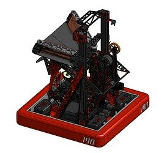
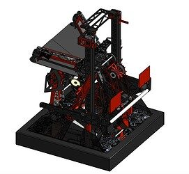
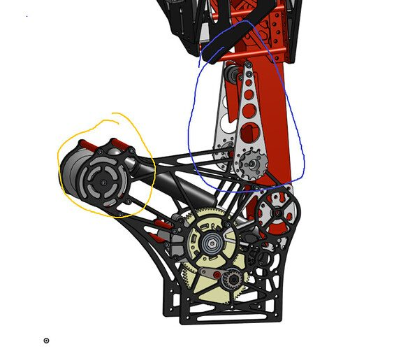

# 2025 · 190 Gompei and the HERD — Gompei 2025

EPA rank 31, snapshot EPA 85.95. Provisional reference dossier.

Station-fed scorer with deployable ground-algae intake and sensed winch climb.

## Drivetrain

Swerve; exact module variant unresolved here.

Coverage: partial / unresolved detail.

## Intake

Sensor-triggered station funnel closes after coral entry; compact extending algae roller fits around existing mechanisms.

Coverage: documented synopsis.

## Transfer

Funnel hands coral to effector; roller feeds ground algae to claw.

Coverage: documented synopsis.

## Scoring

Elevator/arm positions shared scoring assembly at L1–L4, processor and net.

Coverage: documented synopsis.

## Endgame

Gas-shock deployment, grappling hooks and forward-drive cage engagement; tipping contact activates switches before string winch lifts.

Coverage: documented synopsis.

## Controls

Three Limelight 4s; automatic reef alignment and current-aware algae holding voltage.

Coverage: documented synopsis.

## Changes and versions

- Climb geometry simplified during prototyping after observing natural cage engagement; centering was repeatedly revised.
- Interview shows NE DCMP configuration; earlier robot versions require further reconstruction.

## Strategic interpretation — analyst inference

Sensing the physical capture before winching is more valuable than assuming a nominal driver position guarantees engagement. The compact algae addition shows how extra points can be added without replacing the entire primary scorer.

## Limits

- Only the reviewed published configurations are established; intermediate changes may be undocumented.

Bounded source review; exhaustive intermediate-version history not certified

## Reviewed primary source bundle

- https://youtu.be/QgLcTDN-Lnw

## Season context

Read [the full 2025 game/context chapter](../docs/game_2025.md) before transferring this architecture to another role or season.

## Technical image references

Images are source-associated technical figures or robot views, not dimensionally certified drawings. Follow each source for version and figure context.

2025 team 190 — source image from post 1 (2025-06-19). Context tags identify the discussion, not a verified component label. [Original source](https://www.chiefdelphi.com/t/503355/1). Source-linked extraction; mechanism identity not individually visually audited

2025 team 190 — source image from post 1 (2025-06-19). Context tags identify the discussion, not a verified component label. [Original source](https://www.chiefdelphi.com/t/503355/1). Source-linked extraction; mechanism identity not individually visually audited

2025 team 190 — source image from post 5 (2025-06-19). Context tags identify the discussion, not a verified component label. [Original source](https://www.chiefdelphi.com/t/503355/5). Source-linked extraction; mechanism identity not individually visually audited

## Dated research locators — navigation, not reviewed claims

A tag describes words in the source, not a validated engineering fact. Discussion replies may concern comparison robots.

- 2025-06-19 · Grant · [post 1](https://www.chiefdelphi.com/t/503355/1) · cad
- 2025-06-19 · overclockedfyre · [post 2](https://www.chiefdelphi.com/t/503355/2) · belt, elevator, rebuild
- 2025-06-19 · Anshu · [post 4](https://www.chiefdelphi.com/t/503355/4) · elevator
- 2025-06-19 · strongalex · [post 6](https://www.chiefdelphi.com/t/503355/6) · climb, intake, rebuild
- 2025-06-19 · Grant · [post 8](https://www.chiefdelphi.com/t/503355/8) · arm, bearing, cad, pivot
- 2025-06-19 · arnara07 · [post 9](https://www.chiefdelphi.com/t/503355/9) · intake
- 2025-06-20 · strongalex · [post 10](https://www.chiefdelphi.com/t/503355/10) · belt, cad, elevator, intake
- 2025-11-15 · jai49 · [post 11](https://www.chiefdelphi.com/t/503355/11) · intake
- 2025-11-20 · CamW · [post 12](https://www.chiefdelphi.com/t/503355/12) · arm, camera, elevator, intake, pivot, vision

## Current strategic priority

Optimize marginal alliance work: branch coverage, L1 placement/packing, algae, supply lanes, autonomous compatibility and reliable endgame. Do not rank robot quality by coral height.

## Integrated focused technical study

[Construction, reasoning, failure modes and limits](../docs/research_continuation/2025-190.md). This supplement is a focused interview/source-bundle study, not an exhaustive binder or competition-version certification.
