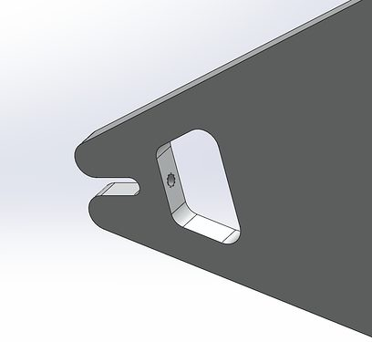
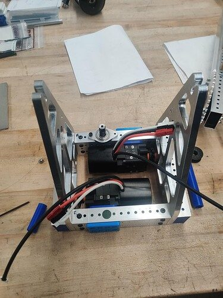

# 2025 · 2056 OP Robotics — OP Robotics 2025

EPA rank 1, snapshot EPA 120.05. Provisional reference dossier.

Ground-fed elevator scorer that can retain coral while handling algae.

## Drivetrain

Swerve; exact module specification deferred to team binder.

Coverage: partial / unresolved detail.

## Intake

Floating-front slapdown with kicker/star wheels accepts arbitrary coral orientation.

Coverage: documented synopsis.

## Transfer

Independently powered Straightenator sides use current detection and brief reversal to resolve parallel-pipe jams.

Coverage: documented synopsis.

## Scoring

Light sheet-metal shared gripper, internally belted two-motor elevator. Hybrid cycles retain coral while moving algae to reduce duplicated travel.

Coverage: documented synopsis.

## Endgame

Single-motor ratcheted hanger; horns guide a cage peg and protrusion/magnet resist cage rotation.

Coverage: documented synopsis.

## Controls

One driver, two human players. Piece detection corrects floor pickup; two tag cameras maintain reef alignment. Team describes a specific five-coral autonomous at Worlds.

Coverage: documented synopsis.

## Changes and versions

- First-piece starting angle changed after first event; continued path, handoff and alignment optimization produced the reported five-piece routine.

## Strategic interpretation — analyst inference

The architecture is a coordinated logistics system: two human players supply floor-fed coral, a wide intake removes orientation cost, and independent storage permits useful algae work during a coral route. Five-piece autonomous is the result of minimizing many delays, not just elevator speed.

## Evidence and limits

- Only the reviewed published configurations are established; intermediate changes may be undocumented.

Bounded source review; exhaustive intermediate-version history not certified

## Reviewed source bundle

- https://youtu.be/qcZ93ukPebg
- https://2056.ca/wp-content/uploads/2025/05/OPR25-2056-Technical-Binder.pdf

## Season context

Read [the full 2025 game/context chapter](../docs/game_2025.md) before transferring this architecture to another role or season.

## Technical image references

Images are source-associated technical figures or robot views, not dimensionally certified drawings. Follow each source for version and figure context.

2025 team 2056 — source image from post 23 (2025-05-30). Context tags identify the discussion, not a verified component label. [Original source](https://www.chiefdelphi.com/t/502550/23). Source-linked extraction; mechanism identity not individually visually audited

2025 team 2056 — source image from post 23 (2025-05-30). Context tags identify the discussion, not a verified component label. [Original source](https://www.chiefdelphi.com/t/502550/23). Source-linked extraction; mechanism identity not individually visually audited

## Dated research locators — navigation, not reviewed claims

A tag describes words in the source, not a validated engineering fact. Discussion replies may concern comparison robots.

- 2025-05-29 · Khalsa · [post 1](https://www.chiefdelphi.com/t/502550/1) · cad
- 2025-05-29 · Revision0 · [post 16](https://www.chiefdelphi.com/t/502550/16) · cad
- 2025-05-29 · Zaque · [post 17](https://www.chiefdelphi.com/t/502550/17) · wrist
- 2025-05-29 · aung · [post 20](https://www.chiefdelphi.com/t/502550/20) · belt, cad, chain, wrist
- 2025-05-29 · cat_food_sounds · [post 21](https://www.chiefdelphi.com/t/502550/21) · cad
- 2025-05-29 · Rocky_S · [post 22](https://www.chiefdelphi.com/t/502550/22) · cad
- 2025-05-30 · Nick.kremer · [post 23](https://www.chiefdelphi.com/t/502550/23) · arm
- 2025-05-30 · elctrilica · [post 24](https://www.chiefdelphi.com/t/502550/24) · cad
- 2025-05-30 · EricZheng · [post 26](https://www.chiefdelphi.com/t/502550/26) · cad
- 2025-05-30 · Holtzman · [post 28](https://www.chiefdelphi.com/t/502550/28) · cad
- 2025-05-30 · Khalsa · [post 30](https://www.chiefdelphi.com/t/502550/30) · cad, chain, elevator, gripper, wrist
- 2025-05-31 · Paton888 · [post 31](https://www.chiefdelphi.com/t/502550/31) · cad, gripper
- 2025-05-31 · smilelsb · [post 32](https://www.chiefdelphi.com/t/502550/32) · cad, elevator
- 2025-06-01 · AlexG · [post 34](https://www.chiefdelphi.com/t/502550/34) · belt, elevator
- 2025-06-01 · Khalsa · [post 35](https://www.chiefdelphi.com/t/502550/35) · arm, bearing, belt, cad, elevator, gripper
- 2025-06-01 · Khalsa · [post 36](https://www.chiefdelphi.com/t/502550/36) · arm, autonomous, elevator
- 2025-06-03 · smilelsb · [post 39](https://www.chiefdelphi.com/t/502550/39) · belt, cad
- 2025-06-03 · Khalsa · [post 41](https://www.chiefdelphi.com/t/502550/41) · bearing, belt, elevator, gripper
- 2025-06-05 · Liam · [post 43](https://www.chiefdelphi.com/t/502550/43) · code
- 2025-06-05 · Khalsa · [post 45](https://www.chiefdelphi.com/t/502550/45) · code
- 2025-06-07 · GearGremlin · [post 51](https://www.chiefdelphi.com/t/502550/51) · intake
- 2025-06-08 · SilasR · [post 54](https://www.chiefdelphi.com/t/502550/54) · intake
- 2025-06-08 · zerothehero · [post 55](https://www.chiefdelphi.com/t/502550/55) · arm, climb
- 2025-06-09 · Khalsa · [post 56](https://www.chiefdelphi.com/t/502550/56) · arm, bearing, climb, intake
- 2025-06-11 · ArchdukeTim · [post 58](https://www.chiefdelphi.com/t/502550/58) · vision
- 2025-06-11 · ArchdukeTim · [post 59](https://www.chiefdelphi.com/t/502550/59) · arm
- 2025-06-11 · Kaleb_Dodd · [post 60](https://www.chiefdelphi.com/t/502550/60) · vision
- 2025-06-11 · Holtzman · [post 61](https://www.chiefdelphi.com/t/502550/61) · autonomous, camera, vision
- 2025-06-11 · Khalsa · [post 64](https://www.chiefdelphi.com/t/502550/64) · arm
- 2025-06-11 · AvocadoPeel · [post 65](https://www.chiefdelphi.com/t/502550/65) · camera
- 2025-06-11 · Holtzman · [post 66](https://www.chiefdelphi.com/t/502550/66) · camera
- 2025-06-12 · Khalsa · [post 70](https://www.chiefdelphi.com/t/502550/70) · autonomous
- 2025-06-14 · smilelsb · [post 71](https://www.chiefdelphi.com/t/502550/71) · elevator
- 2025-06-15 · ArchdukeTim · [post 72](https://www.chiefdelphi.com/t/502550/72) · code, intake
- 2025-06-16 · Khalsa · [post 73](https://www.chiefdelphi.com/t/502550/73) · elevator, intake
- 2025-06-16 · Khalsa · [post 74](https://www.chiefdelphi.com/t/502550/74) · autonomous, code, intake
- 2025-06-18 · Khalsa · [post 76](https://www.chiefdelphi.com/t/502550/76) · cad, elevator
- 2025-06-19 · jxia · [post 77](https://www.chiefdelphi.com/t/502550/77) · indexer
- 2025-06-19 · jxia · [post 78](https://www.chiefdelphi.com/t/502550/78) · elevator
- 2025-06-19 · Khalsa · [post 81](https://www.chiefdelphi.com/t/502550/81) · bearing, elevator, indexer
- 2025-06-21 · smilelsb · [post 84](https://www.chiefdelphi.com/t/502550/84) · elevator, gripper
- 2025-06-23 · Khalsa · [post 85](https://www.chiefdelphi.com/t/502550/85) · belt, elevator, gripper
- 2025-07-16 · Aryan22 · [post 87](https://www.chiefdelphi.com/t/502550/87) · bearing
- 2025-07-25 · Mariohdz · [post 94](https://www.chiefdelphi.com/t/502550/94) · cad
- 2025-07-26 · DaiTou567 · [post 95](https://www.chiefdelphi.com/t/502550/95) · cad
- 2025-07-29 · Suyog9609 · [post 96](https://www.chiefdelphi.com/t/502550/96) · arm
- 2025-07-29 · aung · [post 97](https://www.chiefdelphi.com/t/502550/97) · cad
- 2025-07-30 · Nessie · [post 98](https://www.chiefdelphi.com/t/502550/98) · cad
- 2025-07-30 · Khalsa · [post 100](https://www.chiefdelphi.com/t/502550/100) · gripper
- 2025-07-31 · Aarav86 · [post 101](https://www.chiefdelphi.com/t/502550/101) · gripper
- 2025-07-31 · Khalsa · [post 103](https://www.chiefdelphi.com/t/502550/103) · arm, climb, gripper
- 2025-08-01 · Khalsa · [post 106](https://www.chiefdelphi.com/t/502550/106) · chain
- 2025-08-01 · Khalsa · [post 108](https://www.chiefdelphi.com/t/502550/108) · encoder
- 2025-08-01 · Grumpy_Bud · [post 109](https://www.chiefdelphi.com/t/502550/109) · elevator
- 2025-08-01 · Khalsa · [post 110](https://www.chiefdelphi.com/t/502550/110) · encoder
- 2025-08-05 · Suyog9609 · [post 113](https://www.chiefdelphi.com/t/502550/113) · elevator
- 2025-08-05 · Khalsa · [post 114](https://www.chiefdelphi.com/t/502550/114) · bearing
- 2025-08-06 · br.chai · [post 116](https://www.chiefdelphi.com/t/502550/116) · elevator
- 2025-08-06 · Khalsa · [post 117](https://www.chiefdelphi.com/t/502550/117) · belt
- 2025-08-11 · Khalsa · [post 118](https://www.chiefdelphi.com/t/502550/118) · arm, belt, chain, pivot
- 2025-08-14 · Khalsa · [post 120](https://www.chiefdelphi.com/t/502550/120) · intake
- 2025-08-26 · Khalsa · [post 123](https://www.chiefdelphi.com/t/502550/123) · intake
- 2025-09-25 · ArchdukeTim · [post 124](https://www.chiefdelphi.com/t/502550/124) · vision
- 2025-09-25 · Brandon_L · [post 127](https://www.chiefdelphi.com/t/502550/127) · arm, pivot
- 2025-09-25 · Holtzman · [post 130](https://www.chiefdelphi.com/t/502550/130) · pivot, wrist
- 2025-10-02 · ArchdukeTim · [post 133](https://www.chiefdelphi.com/t/502550/133) · arm, code, elevator
- 2025-10-03 · Holtzman · [post 134](https://www.chiefdelphi.com/t/502550/134) · code
- 2025-10-21 · SHMKPK · [post 135](https://www.chiefdelphi.com/t/502550/135) · cad
- 2025-10-27 · ArchdukeTim · [post 136](https://www.chiefdelphi.com/t/502550/136) · elevator, gripper
- 2025-10-27 · Khalsa · [post 138](https://www.chiefdelphi.com/t/502550/138) · camera
- 2025-10-28 · br.chai · [post 139](https://www.chiefdelphi.com/t/502550/139) · intake
- 2025-10-31 · JohnFogarty · [post 142](https://www.chiefdelphi.com/t/502550/142) · autonomous, code
- 2025-10-31 · Holtzman · [post 143](https://www.chiefdelphi.com/t/502550/143) · code
- 2025-11-06 · luq · [post 145](https://www.chiefdelphi.com/t/502550/145) · intake, pivot
- 2025-11-06 · Khalsa · [post 146](https://www.chiefdelphi.com/t/502550/146) · intake, pivot
- 2025-11-11 · gcschmit · [post 148](https://www.chiefdelphi.com/t/502550/148) · cad, chain, intake
- 2025-11-11 · Khalsa · [post 149](https://www.chiefdelphi.com/t/502550/149) · arm, belt, chain, encoder, intake, pivot
- 2025-11-12 · Daniel1464 · [post 150](https://www.chiefdelphi.com/t/502550/150) · vision
- 2025-11-12 · Khalsa · [post 151](https://www.chiefdelphi.com/t/502550/151) · autonomous, vision
- 2025-11-26 · Holtzman · [post 155](https://www.chiefdelphi.com/t/502550/155) · cad
- 2025-11-28 · Khalsa · [post 160](https://www.chiefdelphi.com/t/502550/160) · autonomous, code, intake, vision
- 2025-12-27 · olsonkarlp · [post 165](https://www.chiefdelphi.com/t/502550/165) · indexer, intake
- 2026-01-05 · Suyog9609 · [post 166](https://www.chiefdelphi.com/t/502550/166) · autonomous, cad
- 2026-01-10 · Khalsa · [post 170](https://www.chiefdelphi.com/t/502550/170) · camera
- 2026-03-19 · Khalsa · [post 176](https://www.chiefdelphi.com/t/502550/176) · arm
- 2026-06-05 · SHMKPK · [post 177](https://www.chiefdelphi.com/t/502550/177) · intake
- 2026-08-05 · Khalsa · [post 185](https://www.chiefdelphi.com/t/502550/185) · camera, encoder, rotor
- 2026-08-05 · nrglord · [post 186](https://www.chiefdelphi.com/t/502550/186) · shooter
- 2026-08-05 · Khalsa · [post 187](https://www.chiefdelphi.com/t/502550/187) · pivot, shooter
- 2026-09-30 · Khalsa · [post 194](https://www.chiefdelphi.com/t/502550/194) · cad
- 2026-10-02 · nrglord · [post 195](https://www.chiefdelphi.com/t/502550/195) · intake
- 2026-10-02 · Khalsa · [post 197](https://www.chiefdelphi.com/t/502550/197) · intake
- 2026-10-02 · Khalsa · [post 199](https://www.chiefdelphi.com/t/502550/199) · cad

# 2025-2056: technical mechanisms, design reasoning and revision boundaries

These notes distinguish published construction from team-stated intent and original engineering inference. Selected numerical values are reported source data, not independently reproduced measurements. The recommended tests have not been performed. A binder snapshot does not certify every competition version.

## OPR 2025: floating capture and protected pivot drive

Version: 2025 REEFSCAPE robot. [PDF p7](https://2056.ca/wp-content/uploads/2025/05/OPR25-2056-Technical-Binder.pdf#page=7) · [PDF p8](https://2056.ca/wp-content/uploads/2025/05/OPR25-2056-Technical-Binder.pdf#page=8)

**Published construction:** 20-inch OTB intake; coaxial roller drive; synchronized pivot sides; floating upper roller.

**Team-stated reason or evidence boundary:** Tolerant coral pickup with motors protected in the frame.

**Engineering analysis — original inference:** Coaxial power transmission lets a roller remain driven as the intake pivots without a long changing-center belt run. The floating contact accommodates an awkward tube orientation while the lower contact keeps it moving into the robot. Synchronizing both sides resists twist, but an impact can still concentrate load at the polycarbonate-to-aluminum joint. Large clamps distribute this force and retain the bearing as the plate flexes. Automatic retraction protects the collector only after the sensor has confirmed that the tube is safely inside.

**Proposed validation — not a completed test:** Test diagonal pickup, asymmetric loading and capture-triggered retraction; inspect bearing retention following a side impact.

**Limits:** The binder is a published configuration snapshot, not an independent durability or match-rate test.

## OPR 2025: independent straightening drives and staged cradle sensing

Version: 2025 REEFSCAPE robot. [PDF p9](https://2056.ca/wp-content/uploads/2025/05/OPR25-2056-Technical-Binder.pdf#page=9) · [PDF p10](https://2056.ca/wp-content/uploads/2025/05/OPR25-2056-Technical-Binder.pdf#page=10) · [PDF p11](https://2056.ca/wp-content/uploads/2025/05/OPR25-2056-Technical-Binder.pdf#page=11) · [PDF p12](https://2056.ca/wp-content/uploads/2025/05/OPR25-2056-Technical-Binder.pdf#page=12)

**Published construction:** Independently driven straightener sides; current-triggered reversal; two-sensor cradle with anti-bounce step.

**Team-stated reason or evidence boundary:** Align coral and recover jams before handoff.

**Engineering analysis — original inference:** Independent sides permit relative slip or reversal instead of forcing both ends of a tube forward at the same speed. Current sensing can identify resistance, but must distinguish a normal capture transient from a persistent jam. The cradle then changes the problem from continuous alignment to a discrete known handoff position. A stop lip and anti-bounce feature control longitudinal motion, while cutouts provide room for the receiving gripper. Excessively constraining the tube at the same time as the gripper closes can create a new jam, so the handoff sequence matters as much as the tray shape.

**Proposed validation — not a completed test:** Feed tubes at skewed angles, tune jam detection against false triggers, and test receiver clearance during an interrupted handoff.

**Limits:** The binder is a published configuration snapshot, not an independent durability or match-rate test.

## OPR 2025: reduce moving inertia without losing algae grip

Version: 2025 REEFSCAPE robot. [PDF p13](https://2056.ca/wp-content/uploads/2025/05/OPR25-2056-Technical-Binder.pdf#page=13) · [PDF p14](https://2056.ca/wp-content/uploads/2025/05/OPR25-2056-Technical-Binder.pdf#page=14)

**Published construction:** Formed-sheet arm replaced tubing; lighter geared gripper drive; remoted motor; velocity-matched coral ejection.

**Team-stated reason or evidence boundary:** Reduce mass and pivot moment while keeping functional grip.

**Engineering analysis — original inference:** Removing mass far from the pivot reduces inertia more effectively than removing the same mass near the axis. A remoted motor achieves that while adding a transmission whose backlash and compliance must be controlled. Formed sheet can provide a stiff section with low mass if the flanges and joints react the actual loads. Matching ejection to chassis motion can reduce unwanted relative velocity at release, but requires consistent roller surface speed and piece position. It is a coordinated robot motion, not a passive property of the gripper.

**Proposed validation — not a completed test:** Measure tip settling and grip under acceleration; test scoring while approaching and backing away at several speeds.

**Limits:** The binder is a published configuration snapshot, not an independent durability or match-rate test.

## OPR 2025: stiff internally belted elevator

Version: 2025 REEFSCAPE robot. [PDF p15](https://2056.ca/wp-content/uploads/2025/05/OPR25-2056-Technical-Binder.pdf#page=15) · [PDF p16](https://2056.ca/wp-content/uploads/2025/05/OPR25-2056-Technical-Binder.pdf#page=16)

**Published construction:** Two-stage continuous lift, internal 18-mm HTD belt, two X60s; reported about 0.6-second travel.

**Team-stated reason or evidence boundary:** Fast motion with lateral stiffness and camera visibility.

**Engineering analysis — original inference:** The upright supports, top bridge and bearing guidance determine how much commanded height becomes actual end-effector position. Internal belts protect the tension path but demand a practical inspection and replacement route. Integrating a wrist gearbox into the carriage removes interfaces while increasing the consequences of a carriage service problem. Cameras on both uprights can preserve tag visibility as the robot approaches different branch sides, but their structural reference must remain stable as the lift moves.

**Proposed validation — not a completed test:** Measure tip error at full and intermediate height during chassis braking; verify camera visibility and calibration on both scoring sides.

**Limits:** The binder is a published configuration snapshot, not an independent durability or match-rate test.

## OPR 2025: lightweight winch and guided cage capture

Version: 2025 REEFSCAPE robot. [PDF p17](https://2056.ca/wp-content/uploads/2025/05/OPR25-2056-Technical-Binder.pdf#page=17) · [PDF p18](https://2056.ca/wp-content/uploads/2025/05/OPR25-2056-Technical-Binder.pdf#page=18)

**Published construction:** 4.5-pound climbing package; rope winch, ratchet, sprung deployment and printed cage guides.

**Team-stated reason or evidence boundary:** Easy alignment, legal cage clearance and power-off retention.

**Engineering analysis — original inference:** A guide can enlarge the capture envelope without adding an actuator, but its shape must not let the cage rotate into the elevator or chain contact an illegal surface. Rope lifting places high local loads at the spool, attachment and pivot; these should be checked independently of motor torque. A ratchet provides a mechanical holding path after disable, while the magnet and collars manage capture and slippage. The architecture record should identify which elements guide, which retain and which actually carry the robot.

**Proposed validation — not a completed test:** Test rotating and swinging cages, inspect the rope at attachment bends, and verify chain clearance through the full lift.

**Limits:** The binder is a published configuration snapshot, not an independent durability or match-rate test.

## Selected published parameters

| Component | Source parameter | Locator |
|---|---|---|
| Intake | 4:1 roller; 51:1 deploy; 20-in mouth | [Source p7](https://2056.ca/wp-content/uploads/2025/05/OPR25-2056-Technical-Binder.pdf#page=7) |
| Straightener | separate X44 sides; 3:1 | [Source p9](https://2056.ca/wp-content/uploads/2025/05/OPR25-2056-Technical-Binder.pdf#page=9) |
| Arm/gripper | 59:1 pivot; 19.5:1 gripper | [Source p13](https://2056.ca/wp-content/uploads/2025/05/OPR25-2056-Technical-Binder.pdf#page=13) |
| Lift | 5:1; 30T pulley; two X60s; reported ~0.6 s | [Source p15](https://2056.ca/wp-content/uploads/2025/05/OPR25-2056-Technical-Binder.pdf#page=15) |
| Climb | 18:1; 3/4-in spool; 4.5 lb | [Source p17](https://2056.ca/wp-content/uploads/2025/05/OPR25-2056-Technical-Binder.pdf#page=17) |

Ratios preserve source notation; verify driver/driven order, complete geometry and the actual version in CAD before fabrication. Figure records retain PDF page and crop bounds in `data/mechanism_images.jsonl`. Images may include rejected prototypes or whole-robot photographs; their captions preserve that distinction.

## Current strategic priority

Optimize marginal alliance work: branch coverage, L1 placement/packing, algae, supply lanes, autonomous compatibility and reliable endgame. Do not rank robot quality by coral height.
