# 2025 · 254 The Cheesy Poofs — UNDERTOW

EPA rank 17, snapshot EPA 92.77. Provisional reference dossier.

Ground-fed elevator/wrist with redundant station funnel and powered cage capture.

## Drivetrain

Lowered WCP X2i chassis with wider wheels and short-cycle acceleration gearing.

Coverage: documented synopsis.

## Intake

Floating rubber-on-foam collector, compliant collapse and small belts remove dead zones.

Coverage: documented synopsis.

## Transfer

Eight flex/star wheels, wedges and beam breaks orient coral; separate steep station funnel retained as fallback after regional intake damage.

Coverage: documented synopsis.

## Scoring

Two-stage internally belted elevator, wrist and Flying-V pipe alignment. Sprung hoop allows L1 passthrough; studs and separate wheel assist algae.

Coverage: documented synopsis.

## Endgame

Gas-deployed roller claw and latch; remote winch and ratchet pull robot beneath cage.

Coverage: documented synopsis.

## Controls

Two Limelight 4s; fused range/gyro localization with selected reef-face tag filtering; modified on-the-fly path planning.

Coverage: documented synopsis.

## Changes and versions

- Binder describes prototype/AlphaBot development; only final architecture is summarized here.
- Station pickup used at Sacramento/East Bay and retained at Worlds for failure recovery.

## Strategic interpretation — analyst inference

Redundancy has concrete value when the primary intake is exposed. This architecture trades funnel mass and volume for the ability to keep scoring after a collector failure; that trade should be evaluated against the team's actual repair and defense environment.

## Evidence and limits

- Only the reviewed published configurations are established; intermediate changes may be undocumented.

Bounded source review; exhaustive intermediate-version history not certified

## Reviewed source bundle

- https://media.team254.com/2025/09/985607eb-2025-Tech-Binder-254.pdf
- https://www.chiefdelphi.com/t/506115

## Season context

Read [the full 2025 game/context chapter](../docs/game_2025.md) before transferring this architecture to another role or season.

## Technical image references

Images are source-associated technical figures or robot views, not dimensionally certified drawings. Follow each source for version and figure context.

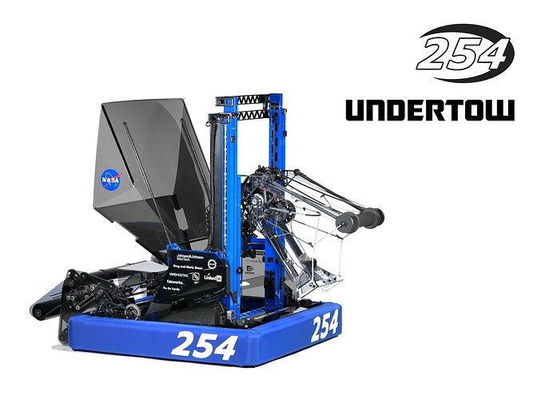

2025 team 254 — source image from post 1 (2025-09-09). Context tags identify the discussion, not a verified component label. [Original source](https://www.chiefdelphi.com/t/506115/1). Source-linked extraction; mechanism identity not individually visually audited

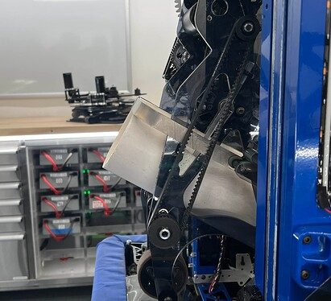

2025 team 254 — source image from post 30 (2025-09-09). Context tags identify the discussion, not a verified component label. [Original source](https://www.chiefdelphi.com/t/506115/30). Source-linked extraction; mechanism identity not individually visually audited

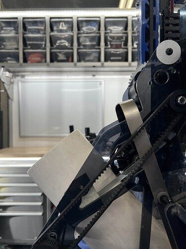

2025 team 254 — source image from post 30 (2025-09-09). Context tags identify the discussion, not a verified component label. [Original source](https://www.chiefdelphi.com/t/506115/30). Source-linked extraction; mechanism identity not individually visually audited

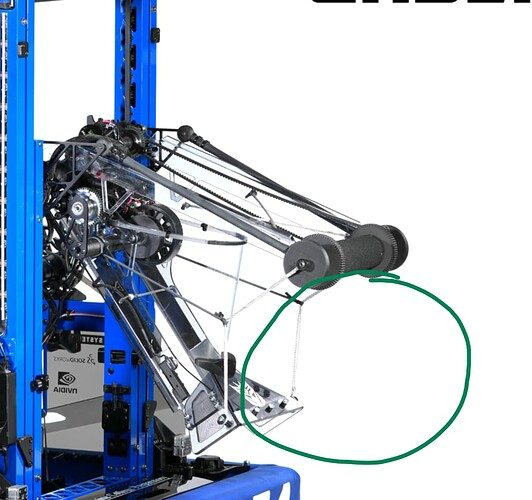

2025 team 254 — source image from post 14 (2025-03-13). Context tags identify the discussion, not a verified component label. [Original source](https://www.chiefdelphi.com/t/495497/14). Source-linked extraction; mechanism identity not individually visually audited

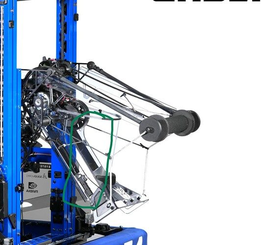

2025 team 254 — source image from post 14 (2025-03-13). Context tags identify the discussion, not a verified component label. [Original source](https://www.chiefdelphi.com/t/495497/14). Source-linked extraction; mechanism identity not individually visually audited

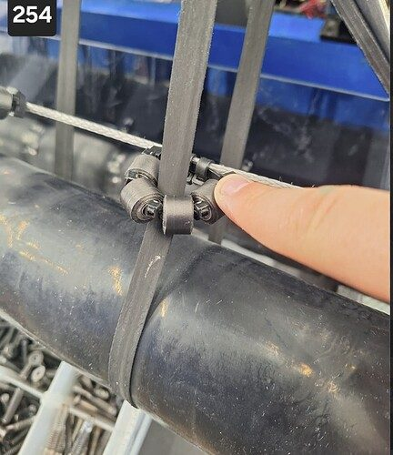

2025 team 254 — source image from post 67 (2025-05-07). Context tags identify the discussion, not a verified component label. [Original source](https://www.chiefdelphi.com/t/495497/67). Source-linked extraction; mechanism identity not individually visually audited

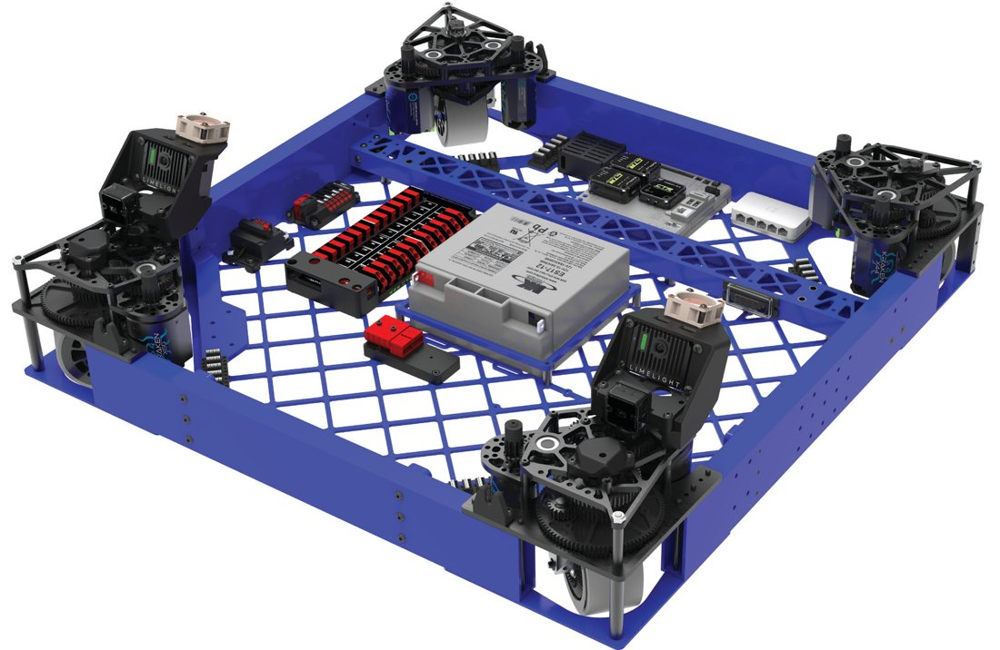

2025 team 254 — embedded figure from technical binder, PDF page 12. Page discusses elevator, intake. Figure identity requires the surrounding source page. [Original source](https://media.team254.com/2025/09/985607eb-2025-Tech-Binder-254.pdf). Individual embedded figure extracted; contextual page tags, not a visually verified engineering drawing

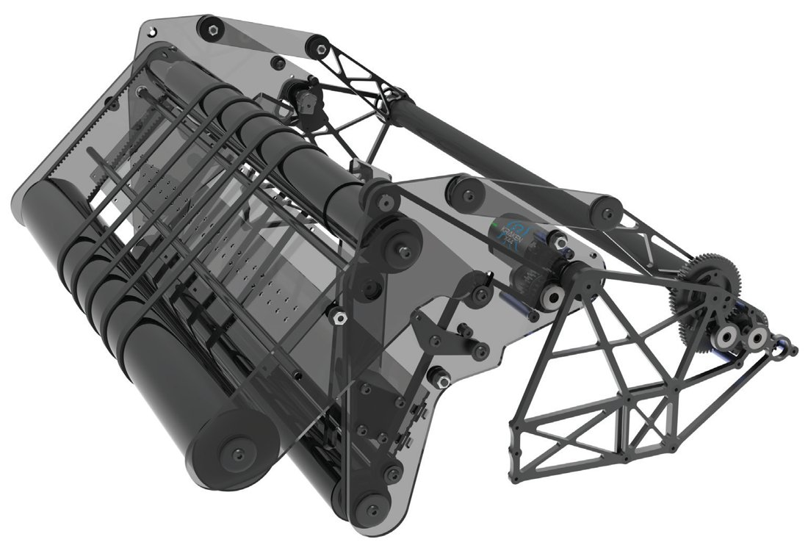

2025 team 254 — embedded figure from technical binder, PDF page 13. Page discusses indexer, intake, pivot. Figure identity requires the surrounding source page. [Original source](https://media.team254.com/2025/09/985607eb-2025-Tech-Binder-254.pdf). Individual embedded figure extracted; contextual page tags, not a visually verified engineering drawing

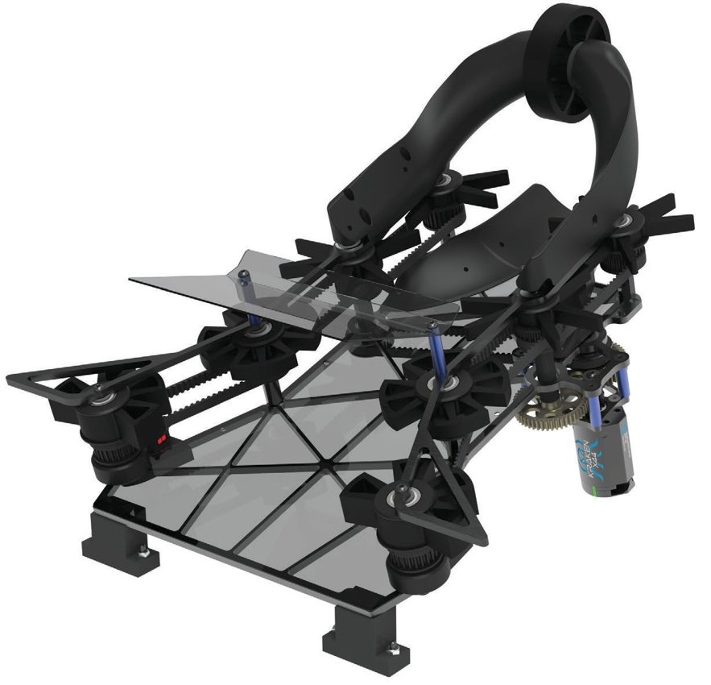

2025 team 254 — embedded figure from technical binder, PDF page 14. Page discusses indexer, intake. Figure identity requires the surrounding source page. [Original source](https://media.team254.com/2025/09/985607eb-2025-Tech-Binder-254.pdf). Individual embedded figure extracted; contextual page tags, not a visually verified engineering drawing

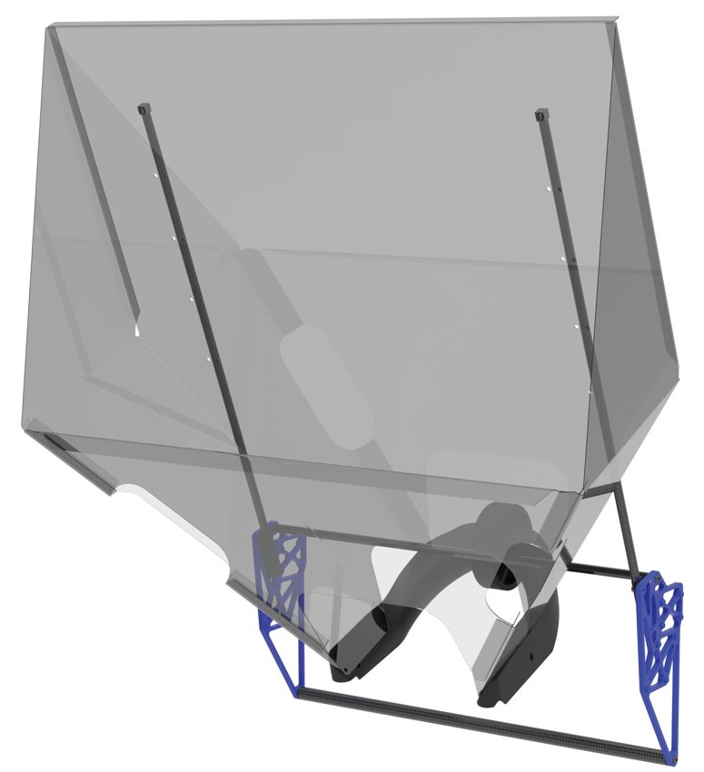

2025 team 254 — embedded figure from technical binder, PDF page 15. Page discusses elevator, indexer, intake. Figure identity requires the surrounding source page. [Original source](https://media.team254.com/2025/09/985607eb-2025-Tech-Binder-254.pdf). Individual embedded figure extracted; contextual page tags, not a visually verified engineering drawing

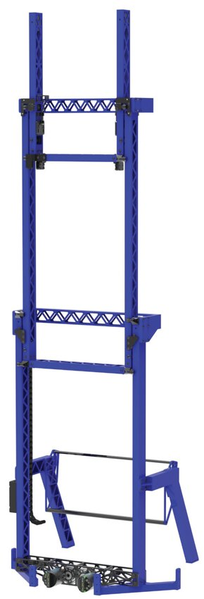

2025 team 254 — embedded figure from technical binder, PDF page 16. Page discusses climb, elevator. Figure identity requires the surrounding source page. [Original source](https://media.team254.com/2025/09/985607eb-2025-Tech-Binder-254.pdf). Individual embedded figure extracted; contextual page tags, not a visually verified engineering drawing

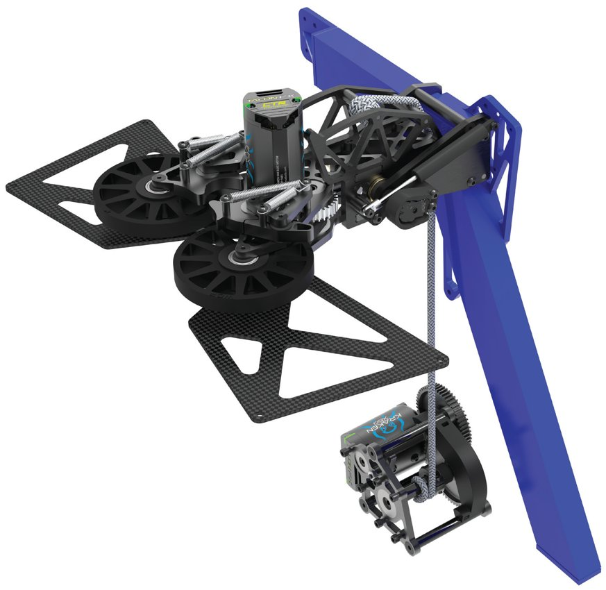

2025 team 254 — embedded figure from technical binder, PDF page 17. Page discusses climb, elevator, pivot. Figure identity requires the surrounding source page. [Original source](https://media.team254.com/2025/09/985607eb-2025-Tech-Binder-254.pdf). Individual embedded figure extracted; contextual page tags, not a visually verified engineering drawing

## Dated research locators — navigation, not reviewed claims

A tag describes words in the source, not a validated engineering fact. Discussion replies may concern comparison robots.

- 2025-03-13 · Sponge · [post 3](https://www.chiefdelphi.com/t/495497/3) · intake
- 2025-03-13 · MearBetal · [post 6](https://www.chiefdelphi.com/t/495497/6) · intake
- 2025-03-13 · dan · [post 9](https://www.chiefdelphi.com/t/495497/9) · vision
- 2025-03-13 · Sponge · [post 12](https://www.chiefdelphi.com/t/495497/12) · camera
- 2025-03-13 · Wafaffles · [post 14](https://www.chiefdelphi.com/t/495497/14) · intake
- 2025-03-13 · wolly_efendi · [post 24](https://www.chiefdelphi.com/t/495497/24) · intake
- 2025-03-13 · leo-les · [post 29](https://www.chiefdelphi.com/t/495497/29) · climb
- 2025-03-13 · jjsessa · [post 31](https://www.chiefdelphi.com/t/495497/31) · intake
- 2025-03-13 · Paul_R · [post 32](https://www.chiefdelphi.com/t/495497/32) · intake
- 2025-03-14 · waxton · [post 35](https://www.chiefdelphi.com/t/495497/35) · intake
- 2025-04-05 · egemkercek · [post 53](https://www.chiefdelphi.com/t/495497/53) · intake
- 2025-04-07 · PacoI · [post 55](https://www.chiefdelphi.com/t/495497/55) · intake
- 2025-04-07 · AmaanCADs · [post 56](https://www.chiefdelphi.com/t/495497/56) · intake
- 2025-05-07 · Jared_Russell · [post 66](https://www.chiefdelphi.com/t/495497/66) · indexer
- 2025-05-07 · Rocky_S · [post 67](https://www.chiefdelphi.com/t/495497/67) · intake
- 2025-05-07 · Aaron_Li · [post 68](https://www.chiefdelphi.com/t/495497/68) · belt
- 2025-09-07 · CloudCake8 · [post 70](https://www.chiefdelphi.com/t/495497/70) · intake
- 2025-09-07 · rsiwinski · [post 72](https://www.chiefdelphi.com/t/495497/72) · belt
- 2025-09-09 · Torrance · [post 1](https://www.chiefdelphi.com/t/506115/1) · cad, code
- 2025-09-09 · Soren_1 · [post 5](https://www.chiefdelphi.com/t/506115/5) · intake
- 2025-09-09 · rsiwinski · [post 7](https://www.chiefdelphi.com/t/506115/7) · autonomous, intake
- 2025-09-09 · Aaron_Li · [post 9](https://www.chiefdelphi.com/t/506115/9) · intake
- 2025-09-09 · rsiwinski · [post 11](https://www.chiefdelphi.com/t/506115/11) · intake, pivot
- 2025-09-09 · Jared_Russell · [post 12](https://www.chiefdelphi.com/t/506115/12) · arm, bearing, camera, code, elevator
- 2025-09-09 · isaacngkh · [post 14](https://www.chiefdelphi.com/t/506115/14) · elevator
- 2025-09-09 · kyro · [post 22](https://www.chiefdelphi.com/t/506115/22) · elevator
- 2025-09-09 · m4x · [post 27](https://www.chiefdelphi.com/t/506115/27) · camera, elevator, vision
- 2025-09-09 · e_bauman · [post 29](https://www.chiefdelphi.com/t/506115/29) · elevator
- 2025-09-09 · rsiwinski · [post 30](https://www.chiefdelphi.com/t/506115/30) · wrist
- 2025-09-09 · olsonkarlp · [post 31](https://www.chiefdelphi.com/t/506115/31) · code
- 2025-09-10 · swodeyar · [post 32](https://www.chiefdelphi.com/t/506115/32) · climb, code, elevator, indexer, intake
- 2025-09-10 · Grumpy_Bud · [post 35](https://www.chiefdelphi.com/t/506115/35) · code
- 2025-09-10 · aung · [post 37](https://www.chiefdelphi.com/t/506115/37) · intake
- 2025-09-10 · Jared_Russell · [post 39](https://www.chiefdelphi.com/t/506115/39) · intake
- 2025-09-10 · rsiwinski · [post 43](https://www.chiefdelphi.com/t/506115/43) · elevator
- 2025-09-10 · Andrew_L · [post 45](https://www.chiefdelphi.com/t/506115/45) · intake
- 2025-09-11 · arctinus · [post 48](https://www.chiefdelphi.com/t/506115/48) · autonomous, code, elevator, rebuild, vision
- 2025-09-11 · ElliotS · [post 49](https://www.chiefdelphi.com/t/506115/49) · hopper, intake
- 2025-09-11 · Torrance · [post 50](https://www.chiefdelphi.com/t/506115/50) · belt, cad, chain, climb, intake, pivot
- 2025-09-11 · Soren_1 · [post 51](https://www.chiefdelphi.com/t/506115/51) · elevator
- 2025-09-11 · rsiwinski · [post 53](https://www.chiefdelphi.com/t/506115/53) · climb, elevator
- 2025-09-11 · CynkoPlinko · [post 54](https://www.chiefdelphi.com/t/506115/54) · intake, prototype
- 2025-09-12 · rsiwinski · [post 55](https://www.chiefdelphi.com/t/506115/55) · intake, prototype
- 2025-09-13 · JohnFogarty · [post 57](https://www.chiefdelphi.com/t/506115/57) · camera, code, vision
- 2025-09-13 · rsiwinski · [post 58](https://www.chiefdelphi.com/t/506115/58) · intake
- 2025-09-15 · Jared_Russell · [post 61](https://www.chiefdelphi.com/t/506115/61) · camera, vision
- 2025-09-15 · SHMKPK · [post 63](https://www.chiefdelphi.com/t/506115/63) · elevator
- 2025-09-16 · Torrance · [post 64](https://www.chiefdelphi.com/t/506115/64) · arm, belt, camera, elevator, encoder, intake, pivot, vision
- 2025-09-16 · SHMKPK · [post 65](https://www.chiefdelphi.com/t/506115/65) · intake
- 2025-09-16 · rich.varone · [post 67](https://www.chiefdelphi.com/t/506115/67) · prototype
- 2025-09-17 · rsiwinski · [post 70](https://www.chiefdelphi.com/t/506115/70) · arm
- 2025-09-17 · Torrance · [post 72](https://www.chiefdelphi.com/t/506115/72) · camera, intake
- 2025-09-27 · SnappleBot · [post 82](https://www.chiefdelphi.com/t/506115/82) · intake
- 2025-09-28 · rsiwinski · [post 83](https://www.chiefdelphi.com/t/506115/83) · intake
- 2025-10-05 · ultimate_hecker · [post 86](https://www.chiefdelphi.com/t/506115/86) · camera
- 2025-10-07 · Torrance · [post 88](https://www.chiefdelphi.com/t/506115/88) · intake
- 2025-10-30 · rsiwinski · [post 100](https://www.chiefdelphi.com/t/506115/100) · intake
- 2025-11-06 · JacobW · [post 101](https://www.chiefdelphi.com/t/506115/101) · intake, pivot
- 2025-11-06 · Torrance · [post 102](https://www.chiefdelphi.com/t/506115/102) · intake, pivot
- 2025-11-06 · rsiwinski · [post 103](https://www.chiefdelphi.com/t/506115/103) · chain, intake, pivot
- 2025-11-06 · JohnFogarty · [post 105](https://www.chiefdelphi.com/t/506115/105) · camera, code, vision
- 2025-11-06 · Jared_Russell · [post 106](https://www.chiefdelphi.com/t/506115/106) · camera, vision
- 2025-11-06 · s-neff · [post 107](https://www.chiefdelphi.com/t/506115/107) · vision
- 2025-11-06 · Jared_Russell · [post 109](https://www.chiefdelphi.com/t/506115/109) · bearing, camera, vision
- 2025-11-16 · ultimate_hecker · [post 117](https://www.chiefdelphi.com/t/506115/117) · code
- 2025-11-16 · mikezgr · [post 118](https://www.chiefdelphi.com/t/506115/118) · elevator
- 2025-11-17 · rsiwinski · [post 119](https://www.chiefdelphi.com/t/506115/119) · belt, elevator
- 2025-11-19 · iostreaming · [post 122](https://www.chiefdelphi.com/t/506115/122) · cad, camera
- 2025-12-02 · Torrance · [post 126](https://www.chiefdelphi.com/t/506115/126) · autonomous, cad, climb, intake, rebuild, shooter
- 2025-12-09 · AlanG · [post 128](https://www.chiefdelphi.com/t/506115/128) · pivot, wrist
- 2025-12-14 · Torrance · [post 129](https://www.chiefdelphi.com/t/506115/129) · bearing, encoder, pivot, wrist
- 2025-12-15 · Torrance · [post 134](https://www.chiefdelphi.com/t/506115/134) · intake
- 2025-12-29 · truher · [post 143](https://www.chiefdelphi.com/t/506115/143) · camera
- 2025-12-30 · LaserSpaceCrow · [post 145](https://www.chiefdelphi.com/t/506115/145) · intake
- 2025-12-30 · Torrance · [post 146](https://www.chiefdelphi.com/t/506115/146) · bearing, intake
- 2025-12-31 · AllenGregoryIV · [post 147](https://www.chiefdelphi.com/t/506115/147) · intake
- 2026-02-25 · Ljman · [post 152](https://www.chiefdelphi.com/t/506115/152) · intake
- 2026-10-05 · nrglord · [post 157](https://www.chiefdelphi.com/t/506115/157) · indexer, intake

# 2025-254: technical mechanisms, design reasoning and revision boundaries

These notes distinguish published construction from team-stated intent and original engineering inference. Selected numerical values are reported source data, not independently reproduced measurements. The recommended tests have not been performed. A binder snapshot does not certify every competition version.

## UNDERTOW: short-cycle gearing and low mass placement

Version: UNDERTOW. [PDF p12](https://media.team254.com/2025/09/985607eb-2025-Tech-Binder-254.pdf#page=12)

**Published construction:** 29.5-inch square base; low 3×1 frame; X2i modules geared about 13.2 ft/s free speed.

**Team-stated reason or evidence boundary:** Favor acceleration and grip over long-run top speed.

**Engineering analysis — original inference:** For a short reef cycle, acceleration, braking and repeatable final alignment can matter more than a higher unloaded top speed. Lower gearing increases available wheel torque but does not guarantee traction; wheel compound, normal load and current limits still bound acceleration. A broad low base helps resist tipping while the elevator changes height, but occupies more traffic space. The useful comparison uses the actual route and raised mechanism state rather than a module specification on its own.

**Proposed validation — not a completed test:** Measure complete reef-to-supply cycle time, stopping error and wheel unloading with the elevator at representative positions.

**Limits:** The binder is a published configuration snapshot, not an independent durability or match-rate test.

## UNDERTOW: floating continuous rollers and four-bar deployment

Version: UNDERTOW. [PDF p13](https://media.team254.com/2025/09/985607eb-2025-Tech-Binder-254.pdf#page=13)

**Published construction:** Foam/silicone continuous rollers, floating front plate, rubber-band dead-zone belts and four-bar deployment.

**Team-stated reason or evidence boundary:** Admit longways coral and yield during collisions.

**Engineering analysis — original inference:** A continuous compliant surface can avoid the discrete kicks caused by spaced wheels, while a floating roller accommodates the changing cross-section presented by a tube approaching diagonally. Rubber bands bridge regions where neither main roller can maintain ownership. They also introduce wear, tracking and tension variables, so their role should be tested rather than treated as decorative assistance. The four-bar positions the deployed pickup without requiring its pivot at the very front of the chassis. Copy the contact geometry and trajectory together: substituting a single pivot can change both bumper clearance and handoff.

**Proposed validation — not a completed test:** Approach coral at a grid of angles, measure uninterrupted contact, and repeat after a wall impact and belt replacement.

**Limits:** The binder is a published configuration snapshot, not an independent durability or match-rate test.

## UNDERTOW: flatten and index before handing off

Version: UNDERTOW. [PDF p14](https://media.team254.com/2025/09/985607eb-2025-Tech-Binder-254.pdf#page=14) · [PDF p15](https://media.team254.com/2025/09/985607eb-2025-Tech-Binder-254.pdf#page=15)

**Published construction:** Eight compliant/star wheels; guide wedges, flattening yoke and beam breaks; separate steep station funnel.

**Team-stated reason or evidence boundary:** Create a repeatable handoff from either source.

**Engineering analysis — original inference:** Ground and station pickup arrive with different velocities and orientations. A common indexer lets the end effector see a smaller set of input states, but the funnel and pickup must not feed incompatible positions. Wedges and a flattening wheel create deliberate constraints; if they constrain too many dimensions at once, the tube can wedge rather than align. Sensors should identify the indexed state before the receiver moves. The station funnel adds redundancy and autonomous options, so its value depends on how much extra envelope and mass it costs alongside floor acquisition.

**Proposed validation — not a completed test:** Compare handoff time and jam rate from both sources with skewed and bouncing arrivals; test the full state sequence after a missed detection.

**Limits:** The binder is a published configuration snapshot, not an independent durability or match-rate test.

## UNDERTOW: fast continuous elevator

Version: UNDERTOW. [PDF p16](https://media.team254.com/2025/09/985607eb-2025-Tech-Binder-254.pdf#page=16)

**Published construction:** Two-stage internal-belt lift; two X60s; welded support frame; team reports roughly 0.3-second full travel.

**Team-stated reason or evidence boundary:** Reach scoring heights rapidly and maintain stiffness.

**Engineering analysis — original inference:** A fast travel number does not include settling, alignment or release. Internal belts protect the drive path but make access, tensioning and inspection more important. The support frame must react lateral inertia from the raised wrist as well as the elevator’s own acceleration. If the system reaches height quickly but sways outside the coral-placement tolerance, the useful cycle has not improved. A matched recommendation needs carriage mass, output stiffness, profile constraints and a maintenance plan rather than only belt width and motor count.

**Proposed validation — not a completed test:** Measure time until the coral tip enters and stays within scoring tolerance, not merely until the encoder reaches its height setpoint.

**Limits:** The binder is a published configuration snapshot, not an independent durability or match-rate test.

## UNDERTOW: Flying V compliance and an L1 pass-through

Version: UNDERTOW. [PDF p18](https://media.team254.com/2025/09/985607eb-2025-Tech-Binder-254.pdf#page=18) · [PDF p19](https://media.team254.com/2025/09/985607eb-2025-Tech-Binder-254.pdf#page=19)

**Published construction:** Wrist-mounted compliant coral roller, pipe-aligning Flying V, cam-controlled rear hoop and shared algae drive.

**Team-stated reason or evidence boundary:** Fast branch placement with controlled piece handoff.

**Engineering analysis — original inference:** Mechanical alignment can absorb residual chassis error by guiding the end effector relative to the actual pipe. It must do so without pushing the tube into a trapped configuration or transmitting a large side load into the wrist. The movable hoop illustrates why the handoff and L1 scoring states differ: a stop that is necessary to receive coral can obstruct the intended exit. Sharing a motor between piece contacts reduces moving mass but couples their speed and torque requirements. The complete mechanism includes the cam state and sensing, not just the front roller.

**Proposed validation — not a completed test:** Map tolerated lateral and angular pipe error, test handoff against L1 pass-through, and repeat with a worn wheel and occupied nearby branches.

**Limits:** The binder is a published configuration snapshot, not an independent durability or match-rate test.

## UNDERTOW: capture first, then winch the robot under the cage

Version: UNDERTOW. [PDF p17](https://media.team254.com/2025/09/985607eb-2025-Tech-Binder-254.pdf#page=17)

**Published construction:** Powered roller claw, passive latch, gas-spring deployment and low-mounted ratcheting winch.

**Team-stated reason or evidence boundary:** Acquire a cage quickly and retain suspension after disable.

**Engineering analysis — original inference:** Separating capture from lifting allows the capture wheels to optimize entry while the winch carries the robot load. The latch and cage reaction surfaces must take over reliably before the wheels stop providing traction. Remoting the winch lowers mass but lengthens the tension path and adds rope-routing concerns. A deep-climb recommendation should identify acquisition tolerance, how the cage rotates, where the chain ends relative to the robot’s center of mass, and the load path after power is removed.

**Proposed validation — not a completed test:** Test swinging-cage acquisition, transition from powered rollers to latch, and power-off retention with the actual rope routing.

**Limits:** The binder is a published configuration snapshot, not an independent durability or match-rate test.

## Selected published parameters

| Component | Source parameter | Locator |
|---|---|---|
| Intake | 3-in front; 2-in kicker; ~15-ft/s surface; reported ~0.15-s deploy | [Source p13](https://media.team254.com/2025/09/985607eb-2025-Tech-Binder-254.pdf#page=13) |
| Indexer | eight 4-in wheels; 8:48 gears; ~30-ft/s surface | [Source p14](https://media.team254.com/2025/09/985607eb-2025-Tech-Binder-254.pdf#page=14) |
| Lift | 11:50 gears; 36T pulleys; ~52-in travel; reported ~0.3 s | [Source p16](https://media.team254.com/2025/09/985607eb-2025-Tech-Binder-254.pdf#page=16) |
| Climb | 1:224 source notation; ratcheting rope winch | [Source p17](https://media.team254.com/2025/09/985607eb-2025-Tech-Binder-254.pdf#page=17) |
| Wrist | 210°; reported ~0.2 s; output CANcoder | [Source p18](https://media.team254.com/2025/09/985607eb-2025-Tech-Binder-254.pdf#page=18) |

Ratios preserve source notation; verify driver/driven order, complete geometry and the actual version in CAD before fabrication. Figure records retain PDF page and crop bounds in `data/mechanism_images.jsonl`. Images may include rejected prototypes or whole-robot photographs; their captions preserve that distinction.

## Current strategic priority

Optimize marginal alliance work: branch coverage, L1 placement/packing, algae, supply lanes, autonomous compatibility and reliable endgame. Do not rank robot quality by coral height.
