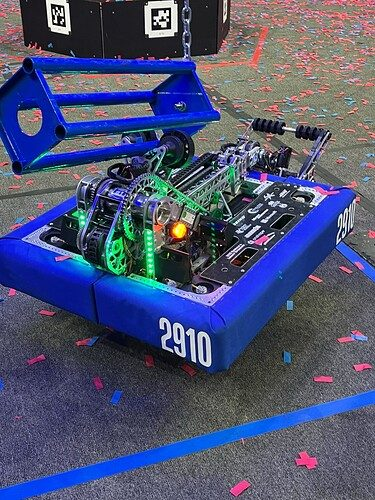
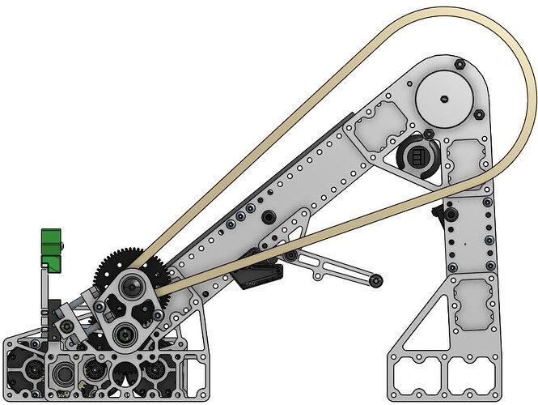
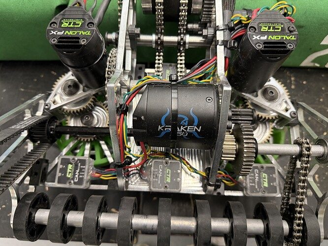
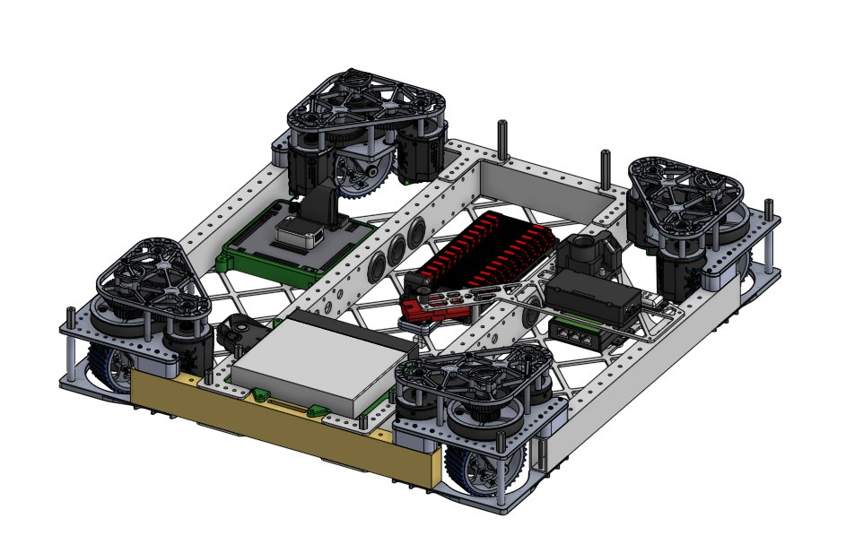
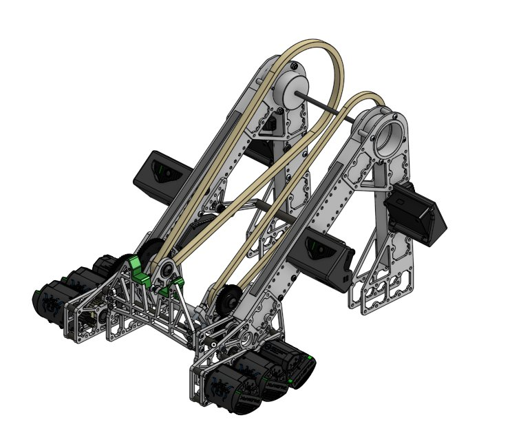
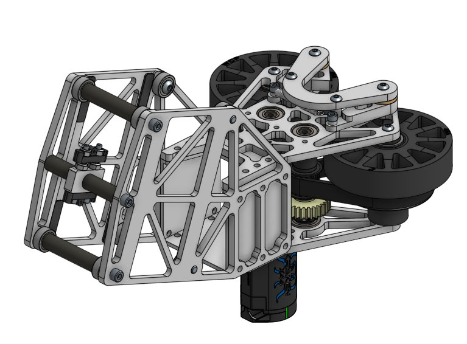
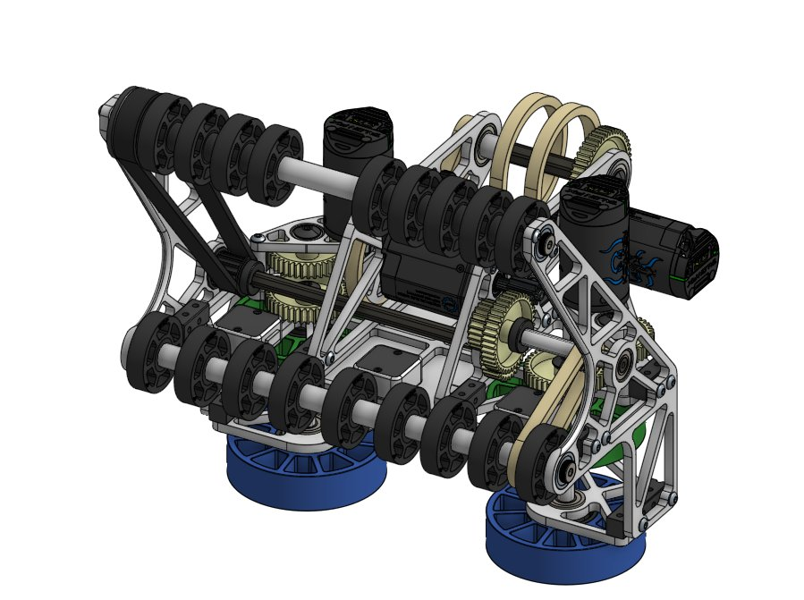
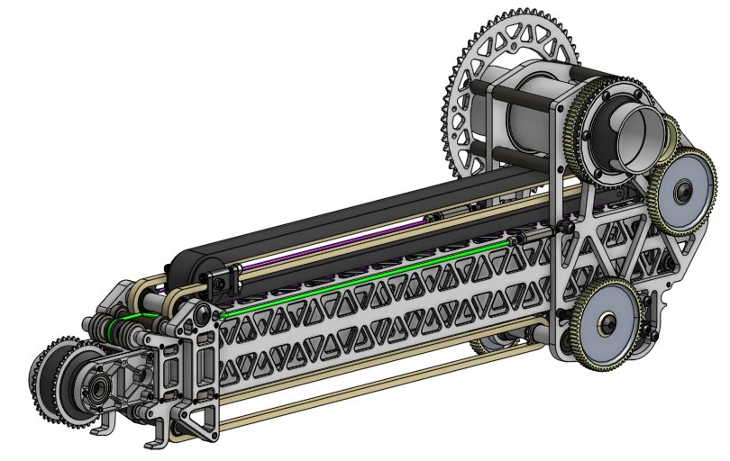

# 2025 · 2910 Jack in the Bot — Spectre

EPA rank 2, snapshot EPA 114.07. Provisional reference dossier.

Low-pivot telescoping arm with shared coral/algae intake and arm-assisted deep climb.

## Drivetrain

MK4i through PNW DCMP; prototype MK5 at Worlds. Brass ballast counters arm motion.

Coverage: documented synopsis.

## Intake

Vertical and horizontal powered rollers orient coral and collect algae; reversible wrist supports front/back scoring.

Coverage: documented synopsis.

## Transfer

Four range sensors index coral lengthwise or sideways; pass-through effector controls both piece types.

Coverage: documented synopsis.

## Scoring

Two-stage extending arm on a low offset pivot; same manipulator places all coral levels and scores algae.

Coverage: documented synopsis.

## Endgame

Powered cage collector and passive latches ride a carriage along arm; shoulder lifts robot, carriage balances CG and extension locks into bumper frame.

Coverage: documented synopsis.

## Controls

Four Limelight 4s; automated pose/rotation-selected reef alignment with driver selecting level/side.

Coverage: documented synopsis.

## Changes and versions

- Worlds module conversion replaced steering motors and recovered weight for additional low ballast. Binder requirements are targets, not independently measured success rates.

## Strategic interpretation — analyst inference

This is a reference for sharing major actuators across scoring and climbing. The cost is a tightly coupled system: arm stiffness, mass distribution and climb locking all become architecture-level requirements.

## Evidence and limits

- Only the reviewed published configurations are established; intermediate changes may be undocumented.

Bounded source review; exhaustive intermediate-version history not certified

## Reviewed source bundle

- https://drive.google.com/file/d/1bjl1LJRS1vXOiLeVq6HdaQw0rmdQOUhk/view

## Season context

Read [the full 2025 game/context chapter](../docs/game_2025.md) before transferring this architecture to another role or season.

## Technical image references

Images are source-associated technical figures or robot views, not dimensionally certified drawings. Follow each source for version and figure context.

2025 team 2910 — source image from post 1 (2025-04-23). Context tags identify the discussion, not a verified component label. [Original source](https://www.chiefdelphi.com/t/500310/1). Source-linked extraction; mechanism identity not individually visually audited

2025 team 2910 — source image from post 101 (2025-04-07). Context tags identify the discussion, not a verified component label. [Original source](https://www.chiefdelphi.com/t/494648/101). Source-linked extraction; mechanism identity not individually visually audited

2025 team 2910 — source image from post 122 (2025-04-21). Context tags identify the discussion, not a verified component label. [Original source](https://www.chiefdelphi.com/t/494648/122). Source-linked extraction; mechanism identity not individually visually audited

2025 team 2910 — embedded figure from technical binder, PDF page 5. Page discusses arm, pivot. Figure identity requires the surrounding source page. [Original source](https://drive.google.com/file/d/1bjl1LJRS1vXOiLeVq6HdaQw0rmdQOUhk/view?usp=drivesdk). Individual embedded figure extracted; contextual page tags, not a visually verified engineering drawing

2025 team 2910 — embedded figure from technical binder, PDF page 6. Page discusses arm, pivot. Figure identity requires the surrounding source page. [Original source](https://drive.google.com/file/d/1bjl1LJRS1vXOiLeVq6HdaQw0rmdQOUhk/view?usp=drivesdk). Individual embedded figure extracted; contextual page tags, not a visually verified engineering drawing

2025 team 2910 — embedded figure from technical binder, PDF page 7. Page discusses arm, climb, collector, intake, pivot. Figure identity requires the surrounding source page. [Original source](https://drive.google.com/file/d/1bjl1LJRS1vXOiLeVq6HdaQw0rmdQOUhk/view?usp=drivesdk). Individual embedded figure extracted; contextual page tags, not a visually verified engineering drawing

2025 team 2910 — embedded figure from technical binder, PDF page 8. Page discusses intake, wrist. Figure identity requires the surrounding source page. [Original source](https://drive.google.com/file/d/1bjl1LJRS1vXOiLeVq6HdaQw0rmdQOUhk/view?usp=drivesdk). Individual embedded figure extracted; contextual page tags, not a visually verified engineering drawing

2025 team 2910 — embedded figure from technical binder, PDF page 9. Page discusses arm, climb, intake, pivot. Figure identity requires the surrounding source page. [Original source](https://drive.google.com/file/d/1bjl1LJRS1vXOiLeVq6HdaQw0rmdQOUhk/view?usp=drivesdk). Individual embedded figure extracted; contextual page tags, not a visually verified engineering drawing

## Dated research locators — navigation, not reviewed claims

A tag describes words in the source, not a validated engineering fact. Discussion replies may concern comparison robots.

- 2025-03-07 · FinIce · [post 4](https://www.chiefdelphi.com/t/494648/4) · intake
- 2025-03-07 · aung · [post 7](https://www.chiefdelphi.com/t/494648/7) · climb
- 2025-03-07 · Pizzatc · [post 8](https://www.chiefdelphi.com/t/494648/8) · climb
- 2025-03-07 · PatrickW · [post 19](https://www.chiefdelphi.com/t/494648/19) · climb
- 2025-03-07 · anihtA · [post 26](https://www.chiefdelphi.com/t/494648/26) · arm, intake
- 2025-03-07 · AriMB · [post 27](https://www.chiefdelphi.com/t/494648/27) · arm, intake
- 2025-03-07 · Andrew_L · [post 34](https://www.chiefdelphi.com/t/494648/34) · arm
- 2025-03-07 · PatrickW · [post 35](https://www.chiefdelphi.com/t/494648/35) · intake
- 2025-03-07 · Lil_Lavery · [post 37](https://www.chiefdelphi.com/t/494648/37) · climb, intake
- 2025-03-07 · Nuttyman54 · [post 39](https://www.chiefdelphi.com/t/494648/39) · climb, intake
- 2025-03-07 · Paul_R · [post 40](https://www.chiefdelphi.com/t/494648/40) · arm
- 2025-03-07 · Skyehawk · [post 41](https://www.chiefdelphi.com/t/494648/41) · arm, intake, pivot
- 2025-03-07 · Nuttyman54 · [post 42](https://www.chiefdelphi.com/t/494648/42) · arm, pivot, wrist
- 2025-03-08 · MBauer · [post 43](https://www.chiefdelphi.com/t/494648/43) · intake
- 2025-03-08 · Alex_Y · [post 45](https://www.chiefdelphi.com/t/494648/45) · intake
- 2025-03-12 · JacobW · [post 48](https://www.chiefdelphi.com/t/494648/48) · intake
- 2025-03-17 · PatrickW · [post 54](https://www.chiefdelphi.com/t/494648/54) · climb, intake
- 2025-03-18 · ElliotS · [post 61](https://www.chiefdelphi.com/t/494648/61) · arm, chain, climb, pivot
- 2025-03-18 · Nuttyman54 · [post 63](https://www.chiefdelphi.com/t/494648/63) · arm, belt, chain, climb, intake, pivot, wrist
- 2025-03-18 · Alex_Y · [post 64](https://www.chiefdelphi.com/t/494648/64) · arm, belt, chain, intake
- 2025-03-18 · Nuttyman54 · [post 65](https://www.chiefdelphi.com/t/494648/65) · intake, wrist
- 2025-03-18 · Nuttyman54 · [post 66](https://www.chiefdelphi.com/t/494648/66) · belt, chain
- 2025-03-18 · PatrickW · [post 68](https://www.chiefdelphi.com/t/494648/68) · arm, belt, chain, pivot, wrist
- 2025-03-18 · superdude311 · [post 69](https://www.chiefdelphi.com/t/494648/69) · arm
- 2025-03-18 · Eliot · [post 70](https://www.chiefdelphi.com/t/494648/70) · cad
- 2025-03-18 · Nuttyman54 · [post 71](https://www.chiefdelphi.com/t/494648/71) · cad, pivot
- 2025-03-18 · superdude311 · [post 72](https://www.chiefdelphi.com/t/494648/72) · pivot
- 2025-03-18 · Nuttyman54 · [post 73](https://www.chiefdelphi.com/t/494648/73) · intake, pivot, wrist
- 2025-03-18 · superdude311 · [post 74](https://www.chiefdelphi.com/t/494648/74) · arm, cad, climb, elevator, intake, wrist
- 2025-03-18 · Eliot · [post 75](https://www.chiefdelphi.com/t/494648/75) · arm, cad, climb, elevator, intake, pivot, wrist
- 2025-03-18 · superdude311 · [post 76](https://www.chiefdelphi.com/t/494648/76) · climb, elevator, wrist
- 2025-03-18 · Nuttyman54 · [post 77](https://www.chiefdelphi.com/t/494648/77) · climb, intake, wrist
- 2025-03-19 · Michael_Corsetto · [post 78](https://www.chiefdelphi.com/t/494648/78) · arm
- 2025-03-21 · Funguy · [post 79](https://www.chiefdelphi.com/t/494648/79) · intake
- 2025-03-24 · CuteRedpandas · [post 83](https://www.chiefdelphi.com/t/494648/83) · vision
- 2025-04-03 · kingbrandon14 · [post 93](https://www.chiefdelphi.com/t/494648/93) · intake
- 2025-04-05 · Calvin-Hobbes17 · [post 95](https://www.chiefdelphi.com/t/494648/95) · chain
- 2025-04-05 · Calvin-Hobbes17 · [post 97](https://www.chiefdelphi.com/t/494648/97) · arm
- 2025-04-07 · PatrickW · [post 99](https://www.chiefdelphi.com/t/494648/99) · intake, wrist
- 2025-04-07 · Calvin-Hobbes17 · [post 100](https://www.chiefdelphi.com/t/494648/100) · chain, pivot
- 2025-04-07 · PatrickW · [post 101](https://www.chiefdelphi.com/t/494648/101) · arm, chain
- 2025-04-13 · itamar4590 · [post 102](https://www.chiefdelphi.com/t/494648/102) · chain
- 2025-04-13 · _gavin · [post 103](https://www.chiefdelphi.com/t/494648/103) · intake
- 2025-04-13 · Nuttyman54 · [post 105](https://www.chiefdelphi.com/t/494648/105) · intake
- 2025-04-14 · bmammen · [post 107](https://www.chiefdelphi.com/t/494648/107) · elevator
- 2025-04-14 · Nuttyman54 · [post 108](https://www.chiefdelphi.com/t/494648/108) · intake
- 2025-04-18 · Nuttyman54 · [post 111](https://www.chiefdelphi.com/t/494648/111) · cad
- 2025-04-20 · tvini · [post 114](https://www.chiefdelphi.com/t/494648/114) · cad
- 2025-04-20 · Nuttyman54 · [post 115](https://www.chiefdelphi.com/t/494648/115) · cad
- 2025-04-21 · PatrickW · [post 122](https://www.chiefdelphi.com/t/494648/122) · intake
- 2025-04-21 · mathum · [post 124](https://www.chiefdelphi.com/t/494648/124) · vision
- 2025-04-21 · PatrickW · [post 127](https://www.chiefdelphi.com/t/494648/127) · intake, vision
- 2025-04-21 · meer.com · [post 129](https://www.chiefdelphi.com/t/494648/129) · cad, code
- 2025-04-21 · Johnsonjer · [post 136](https://www.chiefdelphi.com/t/494648/136) · arm, pivot
- 2025-04-21 · Sudhir · [post 137](https://www.chiefdelphi.com/t/494648/137) · intake
- 2025-04-21 · meer.com · [post 142](https://www.chiefdelphi.com/t/494648/142) · intake
- 2025-04-22 · PatrickW · [post 143](https://www.chiefdelphi.com/t/494648/143) · arm, cad, pivot
- 2025-04-23 · Mattmidd630 · [post 151](https://www.chiefdelphi.com/t/494648/151) · cad, pivot
- 2025-04-23 · Nuttyman54 · [post 153](https://www.chiefdelphi.com/t/494648/153) · arm, pivot
- 2025-04-23 · Nuttyman54 · [post 154](https://www.chiefdelphi.com/t/494648/154) · arm
- 2025-04-23 · Sudhir · [post 1](https://www.chiefdelphi.com/t/500310/1) · cad
- 2025-04-23 · Timothy_M · [post 2](https://www.chiefdelphi.com/t/500310/2) · arm
- 2025-04-23 · kingbrandon14 · [post 156](https://www.chiefdelphi.com/t/494648/156) · cad
- 2025-04-23 · Akash_Rastogi · [post 3](https://www.chiefdelphi.com/t/500310/3) · pivot
- 2025-04-23 · TheRealJamesOo · [post 4](https://www.chiefdelphi.com/t/500310/4) · cad
- 2025-04-23 · Akash_Rastogi · [post 157](https://www.chiefdelphi.com/t/494648/157) · arm, pivot
- 2025-04-23 · Torrance · [post 7](https://www.chiefdelphi.com/t/500310/7) · code
- 2025-04-23 · Nuttyman54 · [post 8](https://www.chiefdelphi.com/t/500310/8) · code
- 2025-04-23 · Akash_Rastogi · [post 10](https://www.chiefdelphi.com/t/500310/10) · pivot
- 2025-04-23 · waialua359 · [post 11](https://www.chiefdelphi.com/t/500310/11) · pivot
- 2025-04-23 · Otter502 · [post 12](https://www.chiefdelphi.com/t/500310/12) · cad
- 2025-04-23 · kingbrandon14 · [post 13](https://www.chiefdelphi.com/t/500310/13) · arm, bearing, chain, pivot
- 2025-04-23 · Nuttyman54 · [post 18](https://www.chiefdelphi.com/t/500310/18) · cad
- 2025-04-23 · Sudhir · [post 20](https://www.chiefdelphi.com/t/500310/20) · climb, intake
- 2025-04-23 · PatrickW · [post 22](https://www.chiefdelphi.com/t/500310/22) · bearing
- 2025-04-23 · PatrickW · [post 23](https://www.chiefdelphi.com/t/500310/23) · cad
- 2025-04-23 · bcon · [post 25](https://www.chiefdelphi.com/t/500310/25) · elevator
- 2025-04-23 · ZCam_4415 · [post 26](https://www.chiefdelphi.com/t/500310/26) · bearing
- 2025-04-23 · ElliotS · [post 28](https://www.chiefdelphi.com/t/500310/28) · climb
- 2025-04-23 · ElliotS · [post 29](https://www.chiefdelphi.com/t/500310/29) · cad
- 2025-04-23 · Galaxy · [post 31](https://www.chiefdelphi.com/t/500310/31) · cad
- 2025-04-23 · PatrickW · [post 36](https://www.chiefdelphi.com/t/500310/36) · arm, cad
- 2025-04-23 · Nuttyman54 · [post 39](https://www.chiefdelphi.com/t/500310/39) · arm, intake, pivot, wrist
- 2025-04-23 · CuteRedpandas · [post 41](https://www.chiefdelphi.com/t/500310/41) · cad
- 2025-04-23 · AndrewCard · [post 42](https://www.chiefdelphi.com/t/500310/42) · cad
- 2025-04-23 · kingbrandon14 · [post 46](https://www.chiefdelphi.com/t/500310/46) · intake
- 2025-04-23 · Nuttyman54 · [post 47](https://www.chiefdelphi.com/t/500310/47) · intake
- 2025-04-23 · kingbrandon14 · [post 50](https://www.chiefdelphi.com/t/500310/50) · bearing, intake
- 2025-04-23 · Basuj · [post 51](https://www.chiefdelphi.com/t/500310/51) · pivot, wrist
- 2025-04-23 · Nuttyman54 · [post 52](https://www.chiefdelphi.com/t/500310/52) · chain, intake, pivot, wrist
- 2025-04-23 · PatrickW · [post 53](https://www.chiefdelphi.com/t/500310/53) · intake
- 2025-04-24 · PatrickW · [post 54](https://www.chiefdelphi.com/t/500310/54) · bearing, intake
- 2025-04-24 · waialua359 · [post 55](https://www.chiefdelphi.com/t/500310/55) · intake
- 2025-04-24 · ghiggins · [post 58](https://www.chiefdelphi.com/t/500310/58) · belt, chain, intake
- 2025-04-24 · Nuttyman54 · [post 59](https://www.chiefdelphi.com/t/500310/59) · belt, chain, intake, wrist
- 2025-04-24 · nhos · [post 60](https://www.chiefdelphi.com/t/500310/60) · arm, cad, chain
- 2025-04-24 · Andrew_N · [post 61](https://www.chiefdelphi.com/t/500310/61) · intake
- 2025-04-24 · Nuttyman54 · [post 63](https://www.chiefdelphi.com/t/500310/63) · chain
- 2025-04-24 · Funguy · [post 64](https://www.chiefdelphi.com/t/500310/64) · arm, pivot
- 2025-04-24 · Pizzatc · [post 65](https://www.chiefdelphi.com/t/500310/65) · arm, bearing
- 2025-04-24 · Hermes8942 · [post 69](https://www.chiefdelphi.com/t/500310/69) · cad
- 2025-04-24 · Mike_Schreiber · [post 70](https://www.chiefdelphi.com/t/500310/70) · arm, pivot
- 2025-04-24 · Oliver_stivers · [post 71](https://www.chiefdelphi.com/t/500310/71) · arm, encoder
- 2025-04-24 · Ainesh · [post 72](https://www.chiefdelphi.com/t/500310/72) · elevator
- 2025-04-24 · spearson23 · [post 73](https://www.chiefdelphi.com/t/500310/73) · arm, cad, code
- 2025-04-24 · Nuttyman54 · [post 77](https://www.chiefdelphi.com/t/500310/77) · arm, bearing, elevator, intake, pivot
- 2025-04-24 · Nuttyman54 · [post 78](https://www.chiefdelphi.com/t/500310/78) · arm
- 2025-04-24 · Nuttyman54 · [post 80](https://www.chiefdelphi.com/t/500310/80) · arm, bearing, belt, chain
- 2025-04-24 · ahartnet · [post 81](https://www.chiefdelphi.com/t/500310/81) · cad
- 2025-04-24 · ElliotS · [post 82](https://www.chiefdelphi.com/t/500310/82) · cad
- 2025-04-24 · Nuttyman54 · [post 83](https://www.chiefdelphi.com/t/500310/83) · intake
- 2025-04-24 · waialua359 · [post 86](https://www.chiefdelphi.com/t/500310/86) · arm
- 2025-04-24 · TanyaY · [post 87](https://www.chiefdelphi.com/t/500310/87) · arm, chain
- 2025-04-24 · waialua359 · [post 88](https://www.chiefdelphi.com/t/500310/88) · arm, belt
- 2025-04-24 · spearson23 · [post 91](https://www.chiefdelphi.com/t/500310/91) · chain, wrist
- 2025-04-24 · ElliotS · [post 93](https://www.chiefdelphi.com/t/500310/93) · cad
- 2025-04-24 · ElliotS · [post 95](https://www.chiefdelphi.com/t/500310/95) · climb
- 2025-04-24 · Nuttyman54 · [post 96](https://www.chiefdelphi.com/t/500310/96) · arm, climb
- 2025-04-24 · Sudhir · [post 98](https://www.chiefdelphi.com/t/500310/98) · code
- 2025-04-25 · SnappleBot · [post 99](https://www.chiefdelphi.com/t/500310/99) · autonomous
- 2025-04-25 · JamesO1086 · [post 101](https://www.chiefdelphi.com/t/500310/101) · chain, wrist
- 2025-04-25 · JacksonDing · [post 102](https://www.chiefdelphi.com/t/500310/102) · chain, wrist
- 2025-04-25 · HUGODANIEL09 · [post 103](https://www.chiefdelphi.com/t/500310/103) · wrist
- 2025-04-25 · TanyaY · [post 104](https://www.chiefdelphi.com/t/500310/104) · belt, chain, intake, wrist
- 2025-04-25 · meer.com · [post 105](https://www.chiefdelphi.com/t/500310/105) · chain, intake
- 2025-04-25 · TanyaY · [post 106](https://www.chiefdelphi.com/t/500310/106) · intake
- 2025-04-25 · Alon22 · [post 107](https://www.chiefdelphi.com/t/500310/107) · cad
- 2025-04-25 · TanyaY · [post 110](https://www.chiefdelphi.com/t/500310/110) · cad
- 2025-04-25 · RedLeader342 · [post 114](https://www.chiefdelphi.com/t/500310/114) · cad
- 2025-04-25 · PatrickW · [post 117](https://www.chiefdelphi.com/t/500310/117) · intake
- 2025-04-25 · Alex_Y · [post 118](https://www.chiefdelphi.com/t/500310/118) · bearing
- 2025-04-25 · Drew_B · [post 120](https://www.chiefdelphi.com/t/500310/120) · cad
- 2025-04-25 · Nuttyman54 · [post 122](https://www.chiefdelphi.com/t/500310/122) · arm, belt, chain, intake, wrist
- 2025-04-25 · Nuttyman54 · [post 124](https://www.chiefdelphi.com/t/500310/124) · cad
- 2025-04-25 · anihtA · [post 125](https://www.chiefdelphi.com/t/500310/125) · arm, intake
- 2025-04-25 · waialua359 · [post 126](https://www.chiefdelphi.com/t/500310/126) · intake
- 2025-04-25 · Nuttyman54 · [post 127](https://www.chiefdelphi.com/t/500310/127) · belt, cad, chain, intake, prototype, wrist
- 2025-04-25 · kingbrandon14 · [post 129](https://www.chiefdelphi.com/t/500310/129) · arm, chain
- 2025-04-26 · JSTN · [post 131](https://www.chiefdelphi.com/t/500310/131) · arm
- 2025-04-26 · Nuttyman54 · [post 132](https://www.chiefdelphi.com/t/500310/132) · arm, chain
- 2025-04-26 · Funguy · [post 134](https://www.chiefdelphi.com/t/500310/134) · arm, intake
- 2025-04-26 · Nuttyman54 · [post 135](https://www.chiefdelphi.com/t/500310/135) · arm, cad, intake, pivot, prototype
- 2025-04-26 · jelee231 · [post 136](https://www.chiefdelphi.com/t/500310/136) · code
- 2025-04-26 · Sudhir · [post 137](https://www.chiefdelphi.com/t/500310/137) · code
- 2025-04-27 · PatrickW · [post 139](https://www.chiefdelphi.com/t/500310/139) · camera
- 2025-04-27 · PatrickW · [post 140](https://www.chiefdelphi.com/t/500310/140) · arm, intake
- 2025-04-27 · superdude311 · [post 141](https://www.chiefdelphi.com/t/500310/141) · climb, intake, pivot
- 2025-04-27 · SHMKPK · [post 143](https://www.chiefdelphi.com/t/500310/143) · belt
- 2025-04-27 · PatrickW · [post 147](https://www.chiefdelphi.com/t/500310/147) · cad
- 2025-04-27 · PatrickW · [post 148](https://www.chiefdelphi.com/t/500310/148) · arm, bearing, pivot
- 2025-04-28 · MongooseTNM · [post 156](https://www.chiefdelphi.com/t/500310/156) · cad
- 2025-04-28 · ElliotS · [post 157](https://www.chiefdelphi.com/t/500310/157) · cad
- 2025-04-28 · Nuttyman54 · [post 158](https://www.chiefdelphi.com/t/500310/158) · cad, intake
- 2025-04-28 · robots614523429 · [post 159](https://www.chiefdelphi.com/t/500310/159) · chain, wrist
- 2025-04-28 · Nuttyman54 · [post 163](https://www.chiefdelphi.com/t/500310/163) · arm, cad, chain, intake, wrist
- 2025-04-29 · Oliver_stivers · [post 173](https://www.chiefdelphi.com/t/500310/173) · vision
- 2025-04-29 · jnesselr · [post 175](https://www.chiefdelphi.com/t/500310/175) · cad
- 2025-05-01 · Larry624 · [post 182](https://www.chiefdelphi.com/t/500310/182) · arm, elevator, pivot
- 2025-05-01 · Nuttyman54 · [post 183](https://www.chiefdelphi.com/t/500310/183) · arm, cad, elevator, pivot
- 2025-05-03 · PatrickW · [post 185](https://www.chiefdelphi.com/t/500310/185) · arm
- 2025-05-03 · pigrammer · [post 186](https://www.chiefdelphi.com/t/500310/186) · arm
- 2025-05-05 · Nuttyman54 · [post 190](https://www.chiefdelphi.com/t/500310/190) · intake
- 2025-05-06 · Nuttyman54 · [post 195](https://www.chiefdelphi.com/t/500310/195) · intake
- 2025-05-06 · Parin-4237 · [post 197](https://www.chiefdelphi.com/t/500310/197) · cad
- 2025-05-06 · JamesO1086 · [post 198](https://www.chiefdelphi.com/t/500310/198) · cad
- 2025-05-06 · Nuttyman54 · [post 200](https://www.chiefdelphi.com/t/500310/200) · cad
- 2025-05-06 · CKioxide · [post 203](https://www.chiefdelphi.com/t/500310/203) · arm, pivot
- 2025-05-07 · kingbrandon14 · [post 206](https://www.chiefdelphi.com/t/500310/206) · arm
- 2025-05-07 · FinIce · [post 209](https://www.chiefdelphi.com/t/500310/209) · arm
- 2025-05-07 · Korny · [post 210](https://www.chiefdelphi.com/t/500310/210) · arm
- 2025-05-07 · Nuttyman54 · [post 211](https://www.chiefdelphi.com/t/500310/211) · intake
- 2025-05-08 · cmoon · [post 213](https://www.chiefdelphi.com/t/500310/213) · cad, chain, intake, pivot, wrist
- 2025-05-08 · Nuttyman54 · [post 214](https://www.chiefdelphi.com/t/500310/214) · arm, cad, chain, intake, wrist
- 2025-05-09 · Soren_1 · [post 215](https://www.chiefdelphi.com/t/500310/215) · pivot, wrist
- 2025-05-09 · Nuttyman54 · [post 218](https://www.chiefdelphi.com/t/500310/218) · arm, intake, pivot, wrist
- 2025-05-10 · PatrickW · [post 164](https://www.chiefdelphi.com/t/494648/164) · cad
- 2025-05-13 · pigrammer · [post 225](https://www.chiefdelphi.com/t/500310/225) · wrist
- 2025-05-14 · qdmatheus · [post 227](https://www.chiefdelphi.com/t/500310/227) · arm, cad
- 2025-05-14 · PatrickW · [post 228](https://www.chiefdelphi.com/t/500310/228) · arm
- 2025-05-14 · itamar4590 · [post 229](https://www.chiefdelphi.com/t/500310/229) · cad
- 2025-05-14 · waialua359 · [post 231](https://www.chiefdelphi.com/t/500310/231) · arm
- 2025-05-14 · PatrickW · [post 233](https://www.chiefdelphi.com/t/500310/233) · cad
- 2025-05-14 · Nuttyman54 · [post 235](https://www.chiefdelphi.com/t/500310/235) · cad
- 2025-05-15 · PatrickW · [post 237](https://www.chiefdelphi.com/t/500310/237) · arm
- 2025-05-15 · Tinnittin · [post 238](https://www.chiefdelphi.com/t/500310/238) · arm, intake, pivot, wrist
- 2025-05-16 · robots614523429 · [post 239](https://www.chiefdelphi.com/t/500310/239) · intake
- 2025-05-16 · TheComputer314 · [post 240](https://www.chiefdelphi.com/t/500310/240) · arm, elevator, pivot
- 2025-05-28 · qdmatheus · [post 248](https://www.chiefdelphi.com/t/500310/248) · arm, bearing
- 2025-05-28 · PatrickW · [post 249](https://www.chiefdelphi.com/t/500310/249) · arm, bearing, cad
- 2025-05-31 · Calvin-Hobbes17 · [post 253](https://www.chiefdelphi.com/t/500310/253) · intake
- 2025-05-31 · CuteRedpandas · [post 254](https://www.chiefdelphi.com/t/500310/254) · cad, intake
- 2025-06-04 · Eitan2230 · [post 257](https://www.chiefdelphi.com/t/500310/257) · chain
- 2025-06-05 · Lavendry · [post 259](https://www.chiefdelphi.com/t/500310/259) · chain
- 2025-06-07 · KipodHater · [post 260](https://www.chiefdelphi.com/t/500310/260) · code
- 2025-06-09 · PatrickW · [post 261](https://www.chiefdelphi.com/t/500310/261) · chain
- 2025-06-09 · ngreen · [post 263](https://www.chiefdelphi.com/t/500310/263) · chain
- 2025-06-10 · kitare102 · [post 264](https://www.chiefdelphi.com/t/500310/264) · chain
- 2025-06-10 · anihtA · [post 267](https://www.chiefdelphi.com/t/500310/267) · arm, chain, pivot
- 2025-06-16 · BubblesOfWords · [post 269](https://www.chiefdelphi.com/t/500310/269) · arm
- 2025-06-17 · PatrickW · [post 271](https://www.chiefdelphi.com/t/500310/271) · chain, climb, pivot
- 2025-06-19 · Nuttyman54 · [post 280](https://www.chiefdelphi.com/t/500310/280) · arm, climb, pivot
- 2025-06-23 · ArchdukeTim · [post 281](https://www.chiefdelphi.com/t/500310/281) · bearing, cad
- 2025-06-23 · Sudhir · [post 283](https://www.chiefdelphi.com/t/500310/283) · code
- 2025-06-26 · p_nguyen · [post 284](https://www.chiefdelphi.com/t/500310/284) · cad
- 2025-06-26 · waialua359 · [post 285](https://www.chiefdelphi.com/t/500310/285) · code
- 2025-06-27 · PatrickW · [post 287](https://www.chiefdelphi.com/t/500310/287) · cad
- 2025-06-27 · Sudhir · [post 1](https://www.chiefdelphi.com/t/503697/1) · code
- 2025-06-27 · Sudhir · [post 290](https://www.chiefdelphi.com/t/500310/290) · code
- 2025-06-27 · therekrab · [post 2](https://www.chiefdelphi.com/t/503697/2) · code
- 2025-06-28 · Squirre1Master · [post 3](https://www.chiefdelphi.com/t/503697/3) · arm, code, vision, wrist
- 2025-06-29 · Sudhir · [post 8](https://www.chiefdelphi.com/t/503697/8) · code
- 2025-06-29 · Sudhir · [post 9](https://www.chiefdelphi.com/t/503697/9) · arm, code, vision, wrist
- 2025-06-29 · Sudhir · [post 11](https://www.chiefdelphi.com/t/503697/11) · arm, code
- 2025-06-29 · Noah1 · [post 12](https://www.chiefdelphi.com/t/503697/12) · cad
- 2025-06-29 · CakeDeer6 · [post 13](https://www.chiefdelphi.com/t/503697/13) · code
- 2025-07-01 · e_bauman · [post 14](https://www.chiefdelphi.com/t/503697/14) · vision
- 2025-07-02 · sdas · [post 15](https://www.chiefdelphi.com/t/503697/15) · camera, vision
- 2025-07-02 · Noah1 · [post 16](https://www.chiefdelphi.com/t/503697/16) · code
- 2025-07-05 · Sudhir · [post 17](https://www.chiefdelphi.com/t/503697/17) · cad
- 2025-07-05 · Sudhir · [post 19](https://www.chiefdelphi.com/t/503697/19) · camera
- 2025-07-05 · Salmon · [post 292](https://www.chiefdelphi.com/t/500310/292) · cad, chain, intake, wrist
- 2025-07-06 · PatrickW · [post 294](https://www.chiefdelphi.com/t/500310/294) · chain
- 2025-07-07 · Salmon · [post 296](https://www.chiefdelphi.com/t/500310/296) · chain
- 2025-07-07 · waialua359 · [post 297](https://www.chiefdelphi.com/t/500310/297) · cad
- 2025-07-07 · PatrickW · [post 298](https://www.chiefdelphi.com/t/500310/298) · arm, bearing, chain
- 2025-07-07 · Salmon · [post 299](https://www.chiefdelphi.com/t/500310/299) · arm
- 2025-07-07 · PatrickW · [post 300](https://www.chiefdelphi.com/t/500310/300) · arm
- 2025-07-07 · waialua359 · [post 301](https://www.chiefdelphi.com/t/500310/301) · belt
- 2025-07-07 · CuteRedpandas · [post 302](https://www.chiefdelphi.com/t/500310/302) · arm
- 2025-07-07 · CakeDeer6 · [post 303](https://www.chiefdelphi.com/t/500310/303) · arm
- 2025-07-07 · waialua359 · [post 304](https://www.chiefdelphi.com/t/500310/304) · arm, chain
- 2025-07-10 · waialua359 · [post 308](https://www.chiefdelphi.com/t/500310/308) · arm, vision
- 2025-07-12 · Salmon · [post 310](https://www.chiefdelphi.com/t/500310/310) · arm, chain
- 2025-07-14 · waialua359 · [post 311](https://www.chiefdelphi.com/t/500310/311) · arm, chain
- 2025-07-23 · Prinkle · [post 321](https://www.chiefdelphi.com/t/500310/321) · arm, chain
- 2025-07-23 · waialua359 · [post 322](https://www.chiefdelphi.com/t/500310/322) · arm
- 2025-08-01 · Grumpy_Bud · [post 20](https://www.chiefdelphi.com/t/503697/20) · arm
- 2025-08-01 · Sudhir · [post 21](https://www.chiefdelphi.com/t/503697/21) · arm
- 2025-08-01 · Grumpy_Bud · [post 22](https://www.chiefdelphi.com/t/503697/22) · encoder
- 2025-08-01 · Sudhir · [post 23](https://www.chiefdelphi.com/t/503697/23) · wrist
- 2025-08-05 · Grumpy_Bud · [post 24](https://www.chiefdelphi.com/t/503697/24) · intake, vision
- 2025-08-06 · Sudhir · [post 28](https://www.chiefdelphi.com/t/503697/28) · code
- 2025-08-08 · kreeve · [post 31](https://www.chiefdelphi.com/t/503697/31) · vision
- 2025-08-08 · PatrickW · [post 32](https://www.chiefdelphi.com/t/503697/32) · camera
- 2025-08-08 · kreeve · [post 33](https://www.chiefdelphi.com/t/503697/33) · camera
- 2025-08-08 · Nuttyman54 · [post 324](https://www.chiefdelphi.com/t/500310/324) · arm
- 2025-08-08 · olsonkarlp · [post 35](https://www.chiefdelphi.com/t/503697/35) · camera, code
- 2025-08-09 · s-neff · [post 37](https://www.chiefdelphi.com/t/503697/37) · camera
- 2025-08-10 · PatrickW · [post 42](https://www.chiefdelphi.com/t/503697/42) · camera
- 2025-08-10 · CakeDeer6 · [post 43](https://www.chiefdelphi.com/t/503697/43) · vision
- 2025-08-10 · olsonkarlp · [post 44](https://www.chiefdelphi.com/t/503697/44) · camera
- 2025-08-10 · jonahb55 · [post 47](https://www.chiefdelphi.com/t/503697/47) · vision
- 2025-08-15 · 01101000_01101001 · [post 48](https://www.chiefdelphi.com/t/503697/48) · code
- 2025-08-18 · Aryan22 · [post 326](https://www.chiefdelphi.com/t/500310/326) · cad
- 2025-08-26 · VR9450 · [post 328](https://www.chiefdelphi.com/t/500310/328) · cad
- 2025-09-05 · Suyog9609 · [post 336](https://www.chiefdelphi.com/t/500310/336) · chain, elevator
- 2025-09-07 · Nuttyman54 · [post 337](https://www.chiefdelphi.com/t/500310/337) · arm, belt, chain, elevator
- 2025-09-09 · kitare102 · [post 339](https://www.chiefdelphi.com/t/500310/339) · chain, elevator
- 2025-10-13 · Tjanik10 · [post 342](https://www.chiefdelphi.com/t/500310/342) · cad
- 2025-10-16 · PatrickW · [post 349](https://www.chiefdelphi.com/t/500310/349) · arm, code, wrist
- 2025-10-16 · joemost · [post 350](https://www.chiefdelphi.com/t/500310/350) · arm, code, elevator, encoder
- 2025-10-17 · Nuttyman54 · [post 351](https://www.chiefdelphi.com/t/500310/351) · arm, code, encoder, pivot, shooter, wrist
- 2025-10-23 · waialua359 · [post 357](https://www.chiefdelphi.com/t/500310/357) · cad
- 2025-12-02 · Nuttyman54 · [post 362](https://www.chiefdelphi.com/t/500310/362) · cad, pivot
- 2025-12-03 · Nuttyman54 · [post 365](https://www.chiefdelphi.com/t/500310/365) · arm, intake, pivot, rebuild, wrist
- 2026-01-05 · joemost · [post 170](https://www.chiefdelphi.com/t/494648/170) · intake
- 2026-04-06 · BubblesOfWords · [post 368](https://www.chiefdelphi.com/t/500310/368) · arm
- 2026-04-06 · Nuttyman54 · [post 369](https://www.chiefdelphi.com/t/500310/369) · bearing
- 2026-05-13 · idk123_3296 · [post 371](https://www.chiefdelphi.com/t/500310/371) · bearing
- 2026-05-15 · PatrickW · [post 372](https://www.chiefdelphi.com/t/500310/372) · chain, climb
- 2026-06-19 · Et7421 · [post 377](https://www.chiefdelphi.com/t/500310/377) · intake
- 2026-08-20 · DanielKirsh · [post 382](https://www.chiefdelphi.com/t/500310/382) · bearing, pivot
- 2026-08-20 · Nuttyman54 · [post 383](https://www.chiefdelphi.com/t/500310/383) · bearing
- 2026-09-09 · JamesO1086 · [post 387](https://www.chiefdelphi.com/t/500310/387) · vision
- 2026-09-30 · nrglord · [post 389](https://www.chiefdelphi.com/t/500310/389) · arm

# 2025-2910: technical mechanisms, design reasoning and revision boundaries

These notes distinguish published construction from team-stated intent and original engineering inference. Selected numerical values are reported source data, not independently reproduced measurements. The recommended tests have not been performed. A binder snapshot does not certify every competition version.

## SPECTRE: base and module revision at Championship

Version: SPECTRE. [PDF p5](https://drive.google.com/file/d/1bjl1LJRS1vXOiLeVq6HdaQw0rmdQOUhk/view#page=5)

**Published construction:** District Mk4i modules changed to prototype Mk5 at Worlds; ballast placement also changed.

**Team-stated reason or evidence boundary:** Low center of gravity and short-cycle maneuverability.

**Engineering analysis — original inference:** A module swap is a robot version, even if the scoring architecture looks unchanged. Saving module weight can be reinvested as low ballast rather than removed from the robot, changing traction and stability differently from a simple weight reduction. A wide tread and different enclosure can alter friction, debris protection and maintenance. Retuning drive and autonomous behavior is part of the mechanical change: old acceleration and feedforward assumptions should not be carried over without measurements. The database should name the competition stage associated with each configuration.

**Proposed validation — not a completed test:** Compare module slip, current and stopping repeatability before and after the change with the actual ballast and bumper package.

**Limits:** The binder is a published configuration snapshot, not an independent durability or match-rate test.

## SPECTRE: remote power at an integrated pivot

Version: SPECTRE. [PDF p6](https://drive.google.com/file/d/1bjl1LJRS1vXOiLeVq6HdaQw0rmdQOUhk/view#page=6) · [PDF p9](https://drive.google.com/file/d/1bjl1LJRS1vXOiLeVq6HdaQw0rmdQOUhk/view#page=9)

**Published construction:** Separate three-X60 shoulder and extension gearboxes; dead-axle pivot; two-stage cascade arm.

**Team-stated reason or evidence boundary:** Fast motion with a low stowed center of gravity and serviceable arm.

**Engineering analysis — original inference:** Keeping heavy actuators near the base reduces distal inertia and lets the arm respond without carrying all its drive mass at the tip. The price is a more complicated transmission across the pivot and through the telescope. A coaxial extension drive must preserve tension and alignment over the shoulder’s range. A large shared pivot can support stiffness and removal, but its clamps and end plugs become critical load interfaces. Motor count alone does not explain speed: the arm’s inertia, reduction, current limits and acceleration profile determine whether it can move quickly without rocking the chassis.

**Proposed validation — not a completed test:** Measure end-point settling after simultaneous pivot and extension; test removal/reinstallation repeatability and chain tension over the full range.

**Limits:** The binder is a published configuration snapshot, not an independent durability or match-rate test.

## SPECTRE: acquire, orient and score with one end mechanism

Version: SPECTRE. [PDF p8](https://drive.google.com/file/d/1bjl1LJRS1vXOiLeVq6HdaQw0rmdQOUhk/view#page=8)

**Published construction:** Vertical and horizontal roller sets; four CANrange sensors; reversible front/back handoff and scoring.

**Team-stated reason or evidence boundary:** Serve coral and algae tasks with the same manipulator.

**Engineering analysis — original inference:** Combining acquisition and scoring avoids a separate transfer interface, but makes the moving assembly larger and creates competing contact requirements. Coral has to be oriented differently for branches and L1; algae needs enough compliant pinch to stay captured during rapid motion. Multiple sensors can distinguish piece position and direction, provided their views remain reliable for both geometries. Front/back scoring reduces chassis rotation when the software chooses a sensible approach. The architecture should be assessed by complete cycle time and reach under defense, not by the number of available poses.

**Proposed validation — not a completed test:** Test front/back coral scoring, intentional horizontal L1 placement and algae capture with the same rollers after wear.

**Limits:** The binder is a published configuration snapshot, not an independent durability or match-rate test.

## SPECTRE: moving climb carriage manages the hanging center

Version: SPECTRE. [PDF p7](https://drive.google.com/file/d/1bjl1LJRS1vXOiLeVq6HdaQw0rmdQOUhk/view#page=7) · [PDF p9](https://drive.google.com/file/d/1bjl1LJRS1vXOiLeVq6HdaQw0rmdQOUhk/view#page=9)

**Published construction:** Powered one-bar cage capture; carriage slides along arm; shoulder lifts; extension locks to bumper structure.

**Team-stated reason or evidence boundary:** Balance under the chain while reusing the main arm.

**Engineering analysis — original inference:** The carriage is not just a convenient mount. Its translation changes where the cage pulls relative to the robot’s mass, allowing a controlled transition into suspension. The shoulder then supplies the lifting work and the arm lock supplies a post-match retention path. Those are separate functions and should be recorded separately. Reusing the arm reduces dedicated hardware but raises its required load and reliability. Any recommendation needs the actual cage contact, latch, shoulder and lock sequence rather than assuming that a strong scoring arm can safely substitute for a complete climber.

**Proposed validation — not a completed test:** Capture at several swing angles, verify carriage travel under load, and test power-off retention through the intended bumper lock.

**Limits:** The binder is a published configuration snapshot, not an independent durability or match-rate test.

## SPECTRE: automate approach choice and L1 placement

Version: SPECTRE. [PDF p10](https://drive.google.com/file/d/1bjl1LJRS1vXOiLeVq6HdaQw0rmdQOUhk/view#page=10)

**Published construction:** Automatic front/back reef choice; level/side selected by driver; distinct base/top L1 states.

**Team-stated reason or evidence boundary:** Remove repeated alignment work from the driver.

**Engineering analysis — original inference:** Choosing the nearest face or easiest orientation can save time, but the shortest geometric route is not always the least congested or the most valuable remaining target. L1 stacking creates an occupancy problem as well as a pose problem: a fixed placement height is insufficient once previous coral changes the landing surface. The driver still needs strategic control over task and side, with software handling repeatable motion. A mechanism recommendation should include the sensors, pose references and operator choices required to realize its cycle advantage.

**Proposed validation — not a completed test:** Test automatic choices near boundaries between faces and with populated L1; verify deliberate driver override and recovery after a failed release.

**Limits:** The binder is a published configuration snapshot, not an independent durability or match-rate test.

## Selected published parameters

| Component | Source parameter | Locator |
|---|---|---|
| Pivot/extension | 120.83:1 shoulder; 6.28:1 extension; three X60s each | [Source p6](https://drive.google.com/file/d/1bjl1LJRS1vXOiLeVq6HdaQw0rmdQOUhk/view#page=6) |
| Intake | one X60 horizontal; two X44 vertical; four CANrange sensors | [Source p8](https://drive.google.com/file/d/1bjl1LJRS1vXOiLeVq6HdaQw0rmdQOUhk/view#page=8) |
| Arm | two-stage cascade; #25 chains plus 3-mm UHMWPE rope | [Source p9](https://drive.google.com/file/d/1bjl1LJRS1vXOiLeVq6HdaQw0rmdQOUhk/view#page=9) |

Ratios preserve source notation; verify driver/driven order, complete geometry and the actual version in CAD before fabrication. Figure records retain PDF page and crop bounds in `data/mechanism_images.jsonl`. Images may include rejected prototypes or whole-robot photographs; their captions preserve that distinction.

## Current strategic priority

Optimize marginal alliance work: branch coverage, L1 placement/packing, algae, supply lanes, autonomous compatibility and reliable endgame. Do not rank robot quality by coral height.
