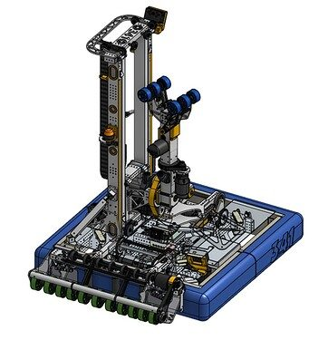
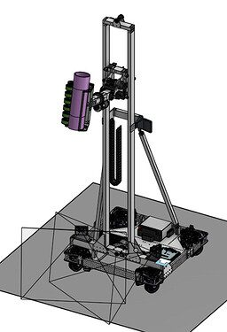
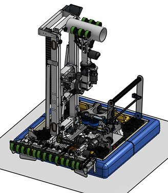

# 2025 · 341 Miss Daisy — Miss Daisy XXIII

EPA rank 20, snapshot EPA 90.62. Provisional reference dossier.

Floor-fed continuous elevator with lantern-gear shoulder, wrist and deep climb.

## Drivetrain

Swerve; exact specification in linked design binder.

Coverage: documented synopsis.

## Intake

Mock-game analysis selected floor pickup; passive roller/ramp geometry centers coral. Wrist can also receive directly from station.

Coverage: documented synopsis.

## Transfer

Controlled handoff and collision-aware manipulator states.

Coverage: documented synopsis.

## Scoring

Continuous rope elevator, low-backlash lantern shoulder and wrist. L1 wrist flip places above existing coral; coordinated algae fling.

Coverage: documented synopsis.

## Endgame

Compact sprung one-way cage latches, high-reduction motor/chain pivot; geometry aligns anchor to CG.

Coverage: documented synopsis.

## Controls

Superstructure prevents arm/elevator collisions; sensing and explicit transition clearances permit coordinated movement.

Coverage: documented synopsis.

## Changes and versions

- Binder documents concept and design process; a complete event-by-event hardware chronology has not been reconstructed.

## Strategic interpretation — analyst inference

The L1 trajectory matters once troughs become crowded. The backup station mode and low-backlash shoulder show how a broad scoring envelope depends on precise structural and control behavior, not only nominal reach.

## Evidence and limits

- Only the reviewed published configurations are established; intermediate changes may be undocumented.

Bounded source review; exhaustive intermediate-version history not certified

## Reviewed source bundle

- https://youtu.be/YW43NhN5vIA
- https://www.chiefdelphi.com/t/500739
- https://drive.google.com/file/d/1iKZZWQoEGuDlWmwzl61e7Nzo4c3IQF_k/view?usp=sharing

## Season context

Read [the full 2025 game/context chapter](../docs/game_2025.md) before transferring this architecture to another role or season.

## Technical image references

Images are source-associated technical figures or robot views, not dimensionally certified drawings. Follow each source for version and figure context.

2025 team 341 — source image from post 1 (2025-04-28). Context tags identify the discussion, not a verified component label. [Original source](https://www.chiefdelphi.com/t/500739/1). Source-linked extraction; mechanism identity not individually visually audited

2025 team 341 — source image from post 26 (2025-06-16). Context tags identify the discussion, not a verified component label. [Original source](https://www.chiefdelphi.com/t/500739/26). Source-linked extraction; mechanism identity not individually visually audited

2025 team 341 — source image from post 26 (2025-06-16). Context tags identify the discussion, not a verified component label. [Original source](https://www.chiefdelphi.com/t/500739/26). Source-linked extraction; mechanism identity not individually visually audited

## Dated research locators — navigation, not reviewed claims

A tag describes words in the source, not a validated engineering fact. Discussion replies may concern comparison robots.

- 2025-04-28 · seans341 · [post 1](https://www.chiefdelphi.com/t/500739/1) · arm, cad, code, elevator, intake, wrist
- 2025-04-28 · Sands · [post 4](https://www.chiefdelphi.com/t/500739/4) · elevator
- 2025-04-28 · seans341 · [post 7](https://www.chiefdelphi.com/t/500739/7) · elevator
- 2025-04-28 · Dan_Karol · [post 13](https://www.chiefdelphi.com/t/500739/13) · prototype
- 2025-04-28 · Karibou · [post 17](https://www.chiefdelphi.com/t/500739/17) · prototype
- 2025-06-16 · seans341 · [post 26](https://www.chiefdelphi.com/t/500739/26) · elevator, intake, wrist
- 2025-06-17 · Sands · [post 27](https://www.chiefdelphi.com/t/500739/27) · elevator
- 2025-06-17 · seans341 · [post 28](https://www.chiefdelphi.com/t/500739/28) · cad
- 2025-06-17 · alex.richards48 · [post 29](https://www.chiefdelphi.com/t/500739/29) · elevator
- 2025-06-17 · seans341 · [post 30](https://www.chiefdelphi.com/t/500739/30) · cad, elevator
- 2025-06-21 · PigTwo · [post 31](https://www.chiefdelphi.com/t/500739/31) · cad, elevator, intake, wrist
- 2025-06-23 · seans341 · [post 34](https://www.chiefdelphi.com/t/500739/34) · arm, elevator, intake, wrist
- 2025-06-26 · BenKolb2102 · [post 35](https://www.chiefdelphi.com/t/500739/35) · intake, prototype
- 2025-06-26 · seans341 · [post 36](https://www.chiefdelphi.com/t/500739/36) · cad, climb, intake, pivot, prototype
- 2025-06-26 · BenKolb2102 · [post 37](https://www.chiefdelphi.com/t/500739/37) · intake
- 2025-06-26 · seans341 · [post 38](https://www.chiefdelphi.com/t/500739/38) · intake, pivot
- 2025-07-25 · BenKolb2102 · [post 39](https://www.chiefdelphi.com/t/500739/39) · intake, prototype

# 2025-341: technical mechanisms, design reasoning and revision boundaries

These notes distinguish published construction from team-stated intent and original engineering inference. Selected numerical values are reported source data, not independently reproduced measurements. The recommended tests have not been performed. A binder snapshot does not certify every competition version.

## MISS DAISY: orient on the floor and preserve collision compliance

Version: MISS DAISY XXIII. [PDF p19](https://drive.google.com/file/d/1iKZZWQoEGuDlWmwzl61e7Nzo4c3IQF_k/view?usp=sharing#page=19) · [PDF p20](https://drive.google.com/file/d/1iKZZWQoEGuDlWmwzl61e7Nzo4c3IQF_k/view?usp=sharing#page=20) · [PDF p21](https://drive.google.com/file/d/1iKZZWQoEGuDlWmwzl61e7Nzo4c3IQF_k/view?usp=sharing#page=21) · [PDF p22](https://drive.google.com/file/d/1iKZZWQoEGuDlWmwzl61e7Nzo4c3IQF_k/view?usp=sharing#page=22) · [PDF p23](https://drive.google.com/file/d/1iKZZWQoEGuDlWmwzl61e7Nzo4c3IQF_k/view?usp=sharing#page=23)

**Published construction:** Sprung OTB rollers with ramps; later stronger front tube and round shafts.

**Team-stated reason or evidence boundary:** Broad-orientation acquisition and impact survival.

**Engineering analysis — original inference:** Orienting the tube before lifting reduces the number of uncontrolled handoff states. A wide compliant roller captures early while ramps and passive contacts bias the tube toward the desired orientation. That can fail if a ramp starts lifting one end too soon. Structural damage also changes the ball path: a bent mounting tube can turn a nominally symmetric intake into a one-sided jam. Preserve the sequence of revisions, because a successful final contact geometry may rely on the preceding stiffness fix.

**Proposed validation — not a completed test:** Film diagonal approaches from both sides before and after impacts; measure ramp and roller alignment rather than judging symmetry by eye.

**Limits:** The binder is a published configuration snapshot, not an independent durability or match-rate test.

## MISS DAISY: diagnose jams from observed contact

Version: MISS DAISY XXIII. [PDF p24](https://drive.google.com/file/d/1iKZZWQoEGuDlWmwzl61e7Nzo4c3IQF_k/view?usp=sharing#page=24)

**Published construction:** Reduced compression, relocated support shaft, changed hard stops and redesigned ramp bends.

**Team-stated reason or evidence boundary:** Slow-motion review identified different jams at successive events.

**Engineering analysis — original inference:** A jam is a geometric event, not merely insufficient motor power. A tube can press a belt into a support, climb at one end while the other end remains constrained, or stop a roller whose structure is bent. Each mode requires a different change. Moving the wheels forward changes both normal force and where the tube begins to rise. A useful agent should first ask which contacts stop moving and where the tube becomes over-constrained; recommending more torque without this observation can destroy the part that reveals the fault.

**Proposed validation — not a completed test:** Create a repeatable failed orientation, isolate the first contact that arrests motion, change one dimension and compare the failure frequency.

**Limits:** The binder is a published configuration snapshot, not an independent durability or match-rate test.

## MISS DAISY: grip algae while allowing coral release

Version: MISS DAISY XXIII. [PDF p27](https://drive.google.com/file/d/1iKZZWQoEGuDlWmwzl61e7Nzo4c3IQF_k/view?usp=sharing#page=27) · [PDF p28](https://drive.google.com/file/d/1iKZZWQoEGuDlWmwzl61e7Nzo4c3IQF_k/view?usp=sharing#page=28) · [PDF p29](https://drive.google.com/file/d/1iKZZWQoEGuDlWmwzl61e7Nzo4c3IQF_k/view?usp=sharing#page=29) · [PDF p30](https://drive.google.com/file/d/1iKZZWQoEGuDlWmwzl61e7Nzo4c3IQF_k/view?usp=sharing#page=30)

**Published construction:** Coral compression reduced to 0.375 inch; drive ratio revised; harder wheels and algae shields added.

**Team-stated reason or evidence boundary:** Improve coral release, pulley durability and algae retention.

**Engineering analysis — original inference:** The two pieces demand conflicting grip behavior. Increasing compression can improve retention but make a tube difficult to release without disturbing the target. A harder wheel can resist wear yet reduce conformity and change normal force. A larger drive pulley may reduce tooth loading and skipping while changing speed and torque. Shields can prevent a soft ball from folding around the side plates, addressing a failure that motor current alone cannot solve. These are linked empirical tradeoffs, so the record should preserve both piece types and the tested release geometry.

**Proposed validation — not a completed test:** Measure coral release force and algae retention after representative wheel wear; inspect pulley teeth during repeated high-torque captures.

**Limits:** The binder is a published configuration snapshot, not an independent durability or match-rate test.

## MISS DAISY: rope geometry and structural stiffness evolved together

Version: MISS DAISY XXIII. [PDF p31](https://drive.google.com/file/d/1iKZZWQoEGuDlWmwzl61e7Nzo4c3IQF_k/view?usp=sharing#page=31) · [PDF p32](https://drive.google.com/file/d/1iKZZWQoEGuDlWmwzl61e7Nzo4c3IQF_k/view?usp=sharing#page=32) · [PDF p33](https://drive.google.com/file/d/1iKZZWQoEGuDlWmwzl61e7Nzo4c3IQF_k/view?usp=sharing#page=33) · [PDF p34](https://drive.google.com/file/d/1iKZZWQoEGuDlWmwzl61e7Nzo4c3IQF_k/view?usp=sharing#page=34) · [PDF p35](https://drive.google.com/file/d/1iKZZWQoEGuDlWmwzl61e7Nzo4c3IQF_k/view?usp=sharing#page=35) · [PDF p36](https://drive.google.com/file/d/1iKZZWQoEGuDlWmwzl61e7Nzo4c3IQF_k/view?usp=sharing#page=36) · [PDF p37](https://drive.google.com/file/d/1iKZZWQoEGuDlWmwzl61e7Nzo4c3IQF_k/view?usp=sharing#page=37)

**Published construction:** Horizontal Dyneema spool inspired by 1678; continuous lift; later U-crossplate and rigid side support.

**Team-stated reason or evidence boundary:** Solve rope slip, poor tension and elevator lateral play.

**Engineering analysis — original inference:** A lift can have accurate motor position while its carriage moves laterally because the structure and rope system are different error sources. Rope routing should keep each run aligned as winding radius changes; overlapping wraps change effective motion per motor turn. A stiff top crosspiece limits upright splay, while a triangulated or rigid support reacts side loading without relying only on adjustable rods. These revisions show why copying the final spool alone is insufficient. The recommendation needs the complete routing, tension system and support geometry.

**Proposed validation — not a completed test:** Track carriage height versus motor position and lateral tip error independently; inspect winding over repeated full strokes under load.

**Limits:** The binder is a published configuration snapshot, not an independent durability or match-rate test.

## MISS DAISY: shoulder and wrist serve different coordinates

Version: MISS DAISY XXIII. [PDF p38](https://drive.google.com/file/d/1iKZZWQoEGuDlWmwzl61e7Nzo4c3IQF_k/view?usp=sharing#page=38) · [PDF p39](https://drive.google.com/file/d/1iKZZWQoEGuDlWmwzl61e7Nzo4c3IQF_k/view?usp=sharing#page=39) · [PDF p40](https://drive.google.com/file/d/1iKZZWQoEGuDlWmwzl61e7Nzo4c3IQF_k/view?usp=sharing#page=40)

**Published construction:** 45:1 shoulder with lantern gear; 21.4:1 wrist with about ±100° motion.

**Team-stated reason or evidence boundary:** Move between robot sides and reorient coral without collisions.

**Engineering analysis — original inference:** The shoulder changes the end effector’s position and reach, while the wrist changes the piece orientation. Those motions need not be performed serially, but simultaneous movement requires a collision-aware path. A lantern gear can place the reduction close to the output and control backlash; its performance still depends on bearing alignment and tooth/pin wear. A dead-axle wrist offers a clear reaction path, but the cantilevered mass and cable routing contribute torque and deflection. The useful model is the coral’s swept volume, not only each joint’s independent limit.

**Proposed validation — not a completed test:** Generate and physically check the coral envelope during side swaps; measure output angle repeatability under reversing load.

**Limits:** The binder is a published configuration snapshot, not an independent durability or match-rate test.

## MISS DAISY: passive harpoon over a wheeled grabber

Version: MISS DAISY XXIII. [PDF p44](https://drive.google.com/file/d/1iKZZWQoEGuDlWmwzl61e7Nzo4c3IQF_k/view?usp=sharing#page=44) · [PDF p45](https://drive.google.com/file/d/1iKZZWQoEGuDlWmwzl61e7Nzo4c3IQF_k/view?usp=sharing#page=45) · [PDF p46](https://drive.google.com/file/d/1iKZZWQoEGuDlWmwzl61e7Nzo4c3IQF_k/view?usp=sharing#page=46) · [PDF p47](https://drive.google.com/file/d/1iKZZWQoEGuDlWmwzl61e7Nzo4c3IQF_k/view?usp=sharing#page=47)

**Published construction:** Levering climber; passive sprung harpoon; 675:1 reduction; steel gears replaced inadequate aluminum gears.

**Team-stated reason or evidence boundary:** Similar capture performance with fewer vulnerable parts.

**Engineering analysis — original inference:** A high reduction can provide lifting torque, but it does not reduce the load carried by the final gear and support shaft. Material changes at that interface can therefore matter more than adding motor power. A passive hook can outperform powered acquisition when the robot’s approach already supplies sufficient engagement force and the cage geometry naturally directs the bar into the latch. That simplifies the controller while placing more importance on the approach envelope and retention geometry. Capture reliability should be assessed with swing and imperfect alignment, not only a stationary cage.

**Proposed validation — not a completed test:** Measure engagement tolerance and inspect final-stage stress after repeated climbs; test retention with the cage rotated and the robot disabled.

**Limits:** The binder is a published configuration snapshot, not an independent durability or match-rate test.

## MISS DAISY: remove a dedicated algae intake that adds no useful capability

Version: MISS DAISY XXIII. [PDF p41](https://drive.google.com/file/d/1iKZZWQoEGuDlWmwzl61e7Nzo4c3IQF_k/view?usp=sharing#page=41) · [PDF p42](https://drive.google.com/file/d/1iKZZWQoEGuDlWmwzl61e7Nzo4c3IQF_k/view?usp=sharing#page=42)

**Published construction:** A separate floor-algae collector was removed after prototype comparisons.

**Team-stated reason or evidence boundary:** It did not outperform the end effector enough to justify complexity.

**Engineering analysis — original inference:** A subsystem can satisfy its own requirements and still be a poor robot-level choice. A dedicated collector may save a little positioning time while costing envelope, sensors, wiring, maintenance and driver decisions. If the primary end effector already serves the intended algae role, the marginal gain must exceed those costs. This is the right level for an architecture agent to reason: compare complete task contribution and reliability rather than rewarding more mechanisms. Keep the removed design in the history as an evaluated alternative, not as an installed feature of the final robot.

**Proposed validation — not a completed test:** Compare complete algae cycles and failure recovery with and without the auxiliary system, including time spent switching modes.

**Limits:** The binder is a published configuration snapshot, not an independent durability or match-rate test.

## Selected published parameters

| Component | Source parameter | Locator |
|---|---|---|
| Claw | 8.125:1 final listed; 0.375-in coral compression; 4.17-lb claw | [Source p28](https://drive.google.com/file/d/1iKZZWQoEGuDlWmwzl61e7Nzo4c3IQF_k/view?usp=sharing#page=28) |
| Wheel revision | 35A → 50A; drive pulley 14T → 16T | [Source p30](https://drive.google.com/file/d/1iKZZWQoEGuDlWmwzl61e7Nzo4c3IQF_k/view?usp=sharing#page=30) |
| Lift | two X60s; 3:1; 1.5-in spool; 52-in extension | [Source p36](https://drive.google.com/file/d/1iKZZWQoEGuDlWmwzl61e7Nzo4c3IQF_k/view?usp=sharing#page=36) |
| Shoulder | 45:1 | [Source p39](https://drive.google.com/file/d/1iKZZWQoEGuDlWmwzl61e7Nzo4c3IQF_k/view?usp=sharing#page=39) |
| Wrist | 21.4:1; ±100° | [Source p40](https://drive.google.com/file/d/1iKZZWQoEGuDlWmwzl61e7Nzo4c3IQF_k/view?usp=sharing#page=40) |
| Climber | 675:1; 6.8 lb; reported 3-s climb plus acquisition | [Source p47](https://drive.google.com/file/d/1iKZZWQoEGuDlWmwzl61e7Nzo4c3IQF_k/view?usp=sharing#page=47) |

Ratios preserve source notation; verify driver/driven order, complete geometry and the actual version in CAD before fabrication. Figure records retain PDF page and crop bounds in `data/mechanism_images.jsonl`. Images may include rejected prototypes or whole-robot photographs; their captions preserve that distinction.

## Current strategic priority

Optimize marginal alliance work: branch coverage, L1 placement/packing, algae, supply lanes, autonomous compatibility and reliable endgame. Do not rank robot quality by coral height.
