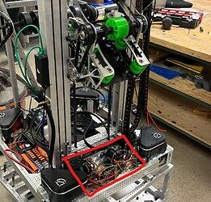

# 2025 · 3683 Team DAVE — SUZUKI

EPA rank 11, snapshot EPA 97.72. Provisional reference dossier.

Fast continuously rigged elevator with hybrid-cycle storage.

## Drivetrain

Swerve; precise module model unresolved here.

Coverage: partial / unresolved detail.

## Intake

Station ramp; post-Niagara retention changes reduce bounce-outs and accept longer-distance feeding.

Coverage: documented synopsis.

## Transfer

Two sensors detect orientation and support unjamming; ramp can retain coral while effector holds algae.

Coverage: documented synopsis.

## Scoring

Three-stage internally belted elevator, two low-mounted motors; six-roller coral carriage and pivoting algae roller. Top roller also redirects L1 coral.

Coverage: documented synopsis.

## Endgame

Original donut climb failed; team explicitly announced no climber for first event. Later endgame implementation is unresolved in reviewed sources.

Coverage: partial / unresolved detail.

## Controls

Point-to-point four-coral auto deliberately uses back reef branches to coexist with front-scoring partners.

Coverage: documented synopsis.

## Changes and versions

- Elevator changed from 5:1 to 3:1 for autonomous timing.
- Ramp bounce-out revised after Niagara; first-event no-climb statement must not be generalized to every later event.

## Strategic interpretation — analyst inference

Autonomous compatibility is a design requirement. Routing a high-output routine behind the reef can add more alliance value than a slightly faster routine that conflicts with the preferred first pick.

## Limits

- Only the reviewed published configurations are established; intermediate changes may be undocumented.

Bounded source review; exhaustive intermediate-version history not certified

## Reviewed primary source bundle

- https://youtu.be/a8JU7LOml3Q
- https://www.chiefdelphi.com/t/493251
- https://github.com/FRC3683/Dave2025Public

## Season context

Read [the full 2025 game/context chapter](../docs/game_2025.md) before transferring this architecture to another role or season.

## Technical image references

Images are source-associated technical figures or robot views, not dimensionally certified drawings. Follow each source for version and figure context.

2025 team 3683 — source image from post 7 (2025-02-26). Context tags identify the discussion, not a verified component label. [Original source](https://www.chiefdelphi.com/t/493251/7). Source-linked extraction; mechanism identity not individually visually audited

## Dated research locators — navigation, not reviewed claims

A tag describes words in the source, not a validated engineering fact. Discussion replies may concern comparison robots.

- 2025-02-26 · joaq · [post 7](https://www.chiefdelphi.com/t/493251/7) · gripper
- 2025-02-26 · Danny_Faryna · [post 8](https://www.chiefdelphi.com/t/493251/8) · camera
- 2025-02-26 · Danny_Faryna · [post 11](https://www.chiefdelphi.com/t/493251/11) · climb, elevator
- 2025-03-18 · Sean5895 · [post 12](https://www.chiefdelphi.com/t/493251/12) · elevator
- 2025-03-20 · Danny_Faryna · [post 13](https://www.chiefdelphi.com/t/493251/13) · autonomous

## Current strategic priority

Optimize marginal alliance work: branch coverage, L1 placement/packing, algae, supply lanes, autonomous compatibility and reliable endgame. Do not rank robot quality by coral height.

## Integrated focused technical study

[Construction, reasoning, failure modes and limits](../docs/research_continuation/2025-3683.md). This supplement is a focused interview/source-bundle study, not an exhaustive binder or competition-version certification.
