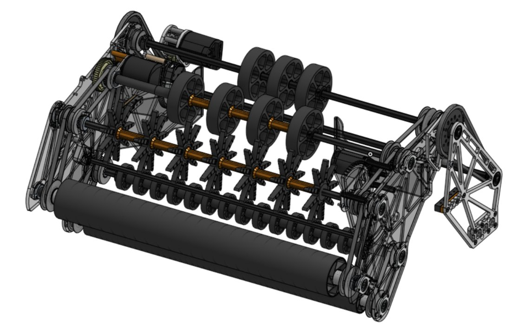
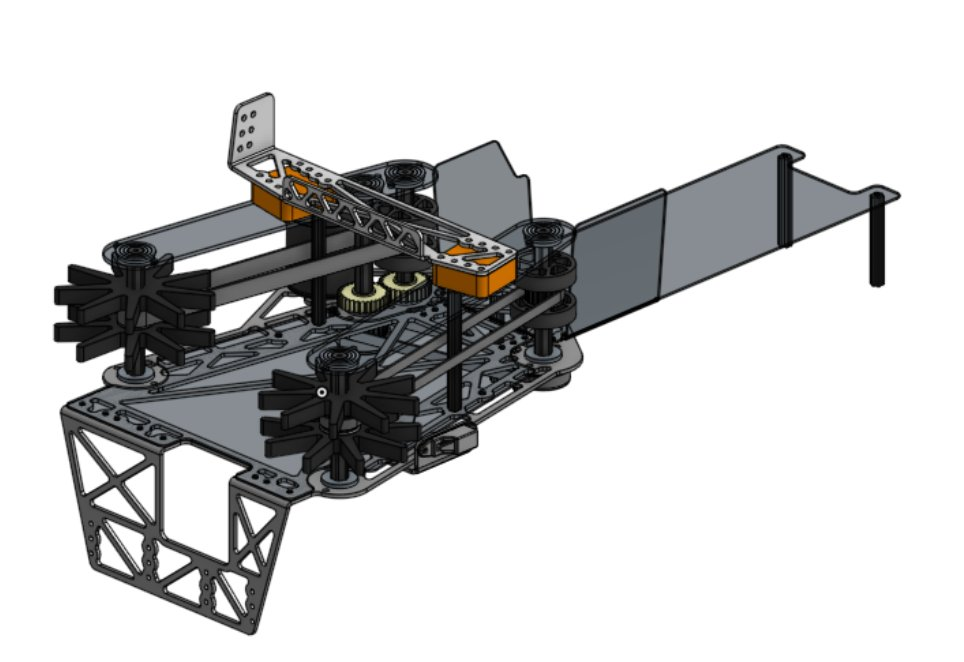
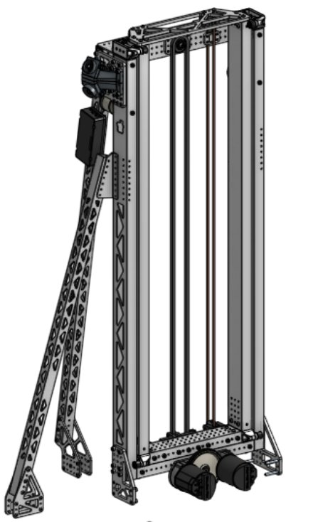
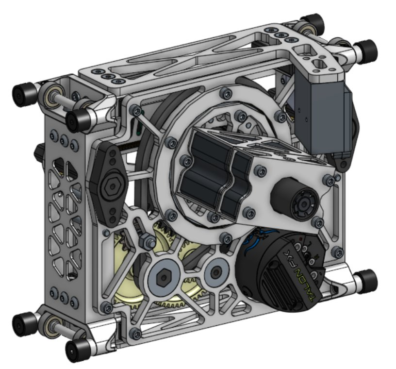
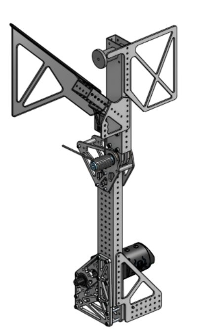

# 2025 · 5940 BREAD — BREAD 2025

EPA rank 8, snapshot EPA 98.63. Provisional reference dossier.

Dropped-swerve, wide coral intake, rapid elevator and lightweight deep-cage climb.

## Drivetrain

WCP X2i, X60 drive/X44 steer, lowered mounting; underside-accessible electronics and four-computer vision housing.

Coverage: documented synopsis.

## Intake

Floating-front full-width roller and polycarbonate wedges; separate deployed bar provides L1 placement.

Coverage: documented synopsis.

## Transfer

Star wheels, asymmetric layout and bent tray orient coral; beam break detects accidental multi-piece intake for ejection.

Coverage: documented synopsis.

## Scoring

Two-stage cascade with constant-force counterbalance; cantilever pivot and dual-purpose coral/algae effector.

Coverage: documented synopsis.

## Endgame

Approximately six-pound spear/fly-swatter capture inspired by Rusthounds Ri3D; spring deploy and string retraction, friction retention on one cage tube.

Coverage: documented synopsis.

## Controls

Module-front cameras observe reef tags; distinct pickup and scoring states coordinate handoff.

Coverage: documented synopsis.

## Changes and versions

- Binder describes a 0.5-second elevator stroke and 1.5-second lift as team-reported mechanism timings, not full cycle or alignment measurements.

## Strategic interpretation — analyst inference

The complete path matters: the floating collector tolerates orientation, the asymmetric indexer removes jams and the tray makes the handoff predictable. A very light climber preserves resources for that cycling system.

## Evidence and limits

- Only the reviewed published configurations are established; intermediate changes may be undocumented.

Bounded source review; exhaustive intermediate-version history not certified

## Reviewed source bundle

- https://drive.google.com/file/d/1_SqgJesNe7Tdq_ZP9_-2ZuEF4tBZFTFI/view

## Season context

Read [the full 2025 game/context chapter](../docs/game_2025.md) before transferring this architecture to another role or season.

## Technical image references

Images are source-associated technical figures or robot views, not dimensionally certified drawings. Follow each source for version and figure context.

2025 team 5940 — embedded figure from technical binder, PDF page 5. Page discusses intake, pivot. Figure identity requires the surrounding source page. [Original source](https://drive.google.com/file/d/1_SqgJesNe7Tdq_ZP9_-2ZuEF4tBZFTFI/view?usp=sharing). Individual embedded figure extracted; contextual page tags, not a visually verified engineering drawing

2025 team 5940 — embedded figure from technical binder, PDF page 6. Page discusses indexer, intake. Figure identity requires the surrounding source page. [Original source](https://drive.google.com/file/d/1_SqgJesNe7Tdq_ZP9_-2ZuEF4tBZFTFI/view?usp=sharing). Individual embedded figure extracted; contextual page tags, not a visually verified engineering drawing

2025 team 5940 — embedded figure from technical binder, PDF page 7. Page discusses elevator. Figure identity requires the surrounding source page. [Original source](https://drive.google.com/file/d/1_SqgJesNe7Tdq_ZP9_-2ZuEF4tBZFTFI/view?usp=sharing). Individual embedded figure extracted; contextual page tags, not a visually verified engineering drawing

2025 team 5940 — embedded figure from technical binder, PDF page 8. Page discusses pivot. Figure identity requires the surrounding source page. [Original source](https://drive.google.com/file/d/1_SqgJesNe7Tdq_ZP9_-2ZuEF4tBZFTFI/view?usp=sharing). Individual embedded figure extracted; contextual page tags, not a visually verified engineering drawing

2025 team 5940 — embedded figure from technical binder, PDF page 10. Page discusses climb. Figure identity requires the surrounding source page. [Original source](https://drive.google.com/file/d/1_SqgJesNe7Tdq_ZP9_-2ZuEF4tBZFTFI/view?usp=sharing). Individual embedded figure extracted; contextual page tags, not a visually verified engineering drawing

# 2025-5940: technical mechanisms, design reasoning and revision boundaries

These notes distinguish published construction from team-stated intent and original engineering inference. Selected numerical values are reported source data, not independently reproduced measurements. The recommended tests have not been performed. A binder snapshot does not certify every competition version.

## BREAD 2025: floating intake plus dedicated L1 restraint

Version: 2025 robot. [PDF p5](https://drive.google.com/file/d/1_SqgJesNe7Tdq_ZP9_-2ZuEF4tBZFTFI/view#page=5)

**Published construction:** Floating front roller, centering wedges and deployable L1 bar with anti-bounce hooks.

**Team-stated reason or evidence boundary:** Broad pickup and controlled L1 release.

**Engineering analysis — original inference:** A tube entering lengthwise needs space to rotate; a fixed narrow contact can eject it before alignment finishes. The floating front roller accommodates that transition. The L1 bar serves a different task: it changes the release boundary and prevents the intake from lifting or letting coral bounce away. This is a useful example for an agent because L1 capability is not merely “run the intake backward.” The intended orientation, release contact and state of the front roller determine whether coral stays where the alliance needs it.

**Proposed validation — not a completed test:** Test L1 placement at several existing pile heights and compare bounce-out with and without the restraint engaged.

**Limits:** The binder is a published configuration snapshot, not an independent durability or match-rate test.

## BREAD 2025: asymmetric star-wheel orientation

Version: 2025 robot. [PDF p6](https://drive.google.com/file/d/1_SqgJesNe7Tdq_ZP9_-2ZuEF4tBZFTFI/view#page=6)

**Published construction:** Asymmetric star-wheel indexer, beam-break extra-piece rejection and repeatable handoff tray.

**Team-stated reason or evidence boundary:** Reduce alignment jams and reject an unwanted second tube.

**Engineering analysis — original inference:** Symmetry can preserve a bad equilibrium: both ends of a skewed tube may be driven equally without ever rotating into the desired orientation. A deliberate asymmetry can break that state, but may also introduce a preferred direction and different behavior for mirror-image approaches. The extra-piece logic must distinguish a second tube from a long first tube passing multiple sensors. A tray then provides a controlled receiving state. Test these as one chain rather than optimizing the indexer’s standalone speed.

**Proposed validation — not a completed test:** Feed mirror-image diagonal tubes and closely spaced pairs; record orientation time, rejection errors and handoff repeatability.

**Limits:** The binder is a published configuration snapshot, not an independent durability or match-rate test.

## BREAD 2025: cascade lift with counterbalance and chain control

Version: 2025 robot. [PDF p7](https://drive.google.com/file/d/1_SqgJesNe7Tdq_ZP9_-2ZuEF4tBZFTFI/view#page=7) · [PDF p8](https://drive.google.com/file/d/1_SqgJesNe7Tdq_ZP9_-2ZuEF4tBZFTFI/view#page=8)

**Published construction:** Two-stage cascade; two X60s at 7:1; constant-force springs; cantilevered pivot and chain tensioner.

**Team-stated reason or evidence boundary:** Rapid lift with lower current and controlled transmission.

**Engineering analysis — original inference:** Counterbalance reduces the gravitational load the motors must supply during part of the stroke, but its force and mounting geometry affect upward and downward behavior differently. A cascade lift magnifies travel and velocity while changing the force seen by each stage. A rolling chain tensioner can manage slack during acceleration, but does not cure a misaligned sprocket or insufficient tooth engagement. The cantilevered wrist support must react both bending and overturning moments. A fast reported stroke needs a settling and placement test to establish its useful cycle value.

**Proposed validation — not a completed test:** Log lift current and tracking in both directions, inspect tension during reversals, and measure tip displacement under sideways load.

**Limits:** The binder is a published configuration snapshot, not an independent durability or match-rate test.

## BREAD 2025: shared drive for coral and algae contacts

Version: 2025 robot. [PDF p9](https://drive.google.com/file/d/1_SqgJesNe7Tdq_ZP9_-2ZuEF4tBZFTFI/view#page=9)

**Published construction:** One X60 drives distinct coral/algae contacts through different ratios and printed gear-pulley combinations.

**Team-stated reason or evidence boundary:** Handle both pieces while reducing moving mass.

**Engineering analysis — original inference:** A shared motor saves wiring and mass but ties the contact speeds to fixed ratios. The design must provide enough algae holding torque without making coral release too abrupt. Combining a gear and pulley can shorten the assembly and remove redundant hubs, while concentrating loads into the printed part and its bearing interface. Material choice, print orientation and temperature therefore belong in the durability review. A successful borrowed geometry requires matching compression and piece position, not only duplicating the nominal ratio.

**Proposed validation — not a completed test:** Measure algae retention and coral release after repeated cycles and heating; inspect printed tooth roots and bearing fits.

**Limits:** The binder is a published configuration snapshot, not an independent durability or match-rate test.

## BREAD 2025: centered single-tube cage support

Version: 2025 robot. [PDF p10](https://drive.google.com/file/d/1_SqgJesNe7Tdq_ZP9_-2ZuEF4tBZFTFI/view#page=10)

**Published construction:** Six-pound spear/flyswatter collector; spring deploy; string winch; reported 1.5-second lift.

**Team-stated reason or evidence boundary:** Center the cage and use a compact lifting package.

**Engineering analysis — original inference:** A passive centering shape can simplify acquisition while making the load path highly dependent on where the cage settles. If retention relies partly on robot weight and friction, the transition into suspension needs careful testing before full load is applied. Spring deployment saves an actively driven extension but requires a reliable latch and stow sequence. The winch reduction determines available force, while rope radius and cage lever arm determine actual robot lift. A lift-time claim should remain distinct from total acquisition-plus-settling time.

**Proposed validation — not a completed test:** Test swinging-cage entry and interrupted lifts, including a case where only one contact is initially engaged.

**Limits:** The binder is a published configuration snapshot, not an independent durability or match-rate test.

## BREAD 2025: low chassis and direct reef ranging

Version: 2025 robot. [PDF p4](https://drive.google.com/file/d/1_SqgJesNe7Tdq_ZP9_-2ZuEF4tBZFTFI/view#page=4)

**Published construction:** Dropped X2 modules, low frame and CANrange reef-distance sensing.

**Team-stated reason or evidence boundary:** Low center of gravity and repeatable approach.

**Engineering analysis — original inference:** Lowering the frame can improve stability while reducing ground clearance and access. A direct range measurement near the reef can refine the final approach, but only if the sensor sees the intended surface rather than a tube, branch or oblique panel. It should complement a known geometric model and a validated scoring tolerance. Treat a sensor as an observation with failure modes rather than proof of alignment.

**Proposed validation — not a completed test:** Map distance error over reef approach angle, piece occupancy and elevator position; check collision and service clearances.

**Limits:** The binder is a published configuration snapshot, not an independent durability or match-rate test.

## Selected published parameters

| Component | Source parameter | Locator |
|---|---|---|
| Intake | 65.33:1 deploy | [Source p5](https://drive.google.com/file/d/1_SqgJesNe7Tdq_ZP9_-2ZuEF4tBZFTFI/view#page=5) |
| Indexer | 2:1 shaft reduction | [Source p6](https://drive.google.com/file/d/1_SqgJesNe7Tdq_ZP9_-2ZuEF4tBZFTFI/view#page=6) |
| Lift | 7:1; two X60s; two 10-lbf constant-force springs | [Source p7](https://drive.google.com/file/d/1_SqgJesNe7Tdq_ZP9_-2ZuEF4tBZFTFI/view#page=7) |
| Pivot | 52.08:1; 3.5-in-ID bearing | [Source p8](https://drive.google.com/file/d/1_SqgJesNe7Tdq_ZP9_-2ZuEF4tBZFTFI/view#page=8) |
| End effector | 6.66:1 algae; 5.55:1 coral | [Source p9](https://drive.google.com/file/d/1_SqgJesNe7Tdq_ZP9_-2ZuEF4tBZFTFI/view#page=9) |
| Climb | 25:1 winch; 6 lb; reported 1.5-s lift | [Source p10](https://drive.google.com/file/d/1_SqgJesNe7Tdq_ZP9_-2ZuEF4tBZFTFI/view#page=10) |

Ratios preserve source notation; verify driver/driven order, complete geometry and the actual version in CAD before fabrication. Figure records retain PDF page and crop bounds in `data/mechanism_images.jsonl`. Images may include rejected prototypes or whole-robot photographs; their captions preserve that distinction.

## Current strategic priority

Optimize marginal alliance work: branch coverage, L1 placement/packing, algae, supply lanes, autonomous compatibility and reliable endgame. Do not rank robot quality by coral height.
