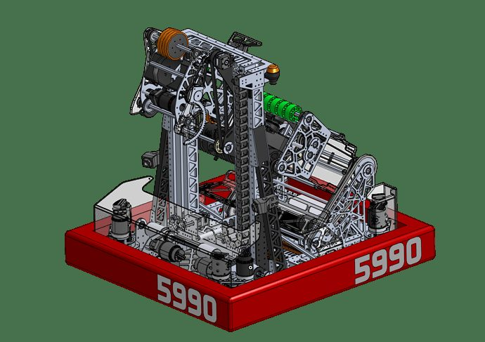

# 2025 · 5990 TRIGON — TRIGON 2025

EPA rank 28, snapshot EPA 87.23. Provisional reference dossier.

Ground-fed continuous elevator with roller manipulator and rack-driven wrist.

## Drivetrain

Swerve; exact drive variant unresolved here.

Coverage: partial / unresolved detail.

## Intake

Two-stage roller floor pickup; drive motor remains protected inside chassis.

Coverage: documented synopsis.

## Transfer

Belt and centering wheel orient coral; printed beam-break fixture retains/locates coral at handoff.

Coverage: documented synopsis.

## Scoring

Two-motor continuous elevator with ratcheted rope tensioning. Shared drive powers coral and algae roller sets; rack-and-pinion positions gripper.

Coverage: documented synopsis.

## Endgame

1690's first-hand ISR-event account explicitly identifies this configuration as having no climb. Later-season addition/absence remains unverified.

Coverage: documented synopsis.

## Controls

Two reef-facing cameras; full reef-selection panel lets operator choose a distant branch, rather than always nearest.

Coverage: documented synopsis.

## Changes and versions

- Contemporary ISR account compares consistent coral output against 2231's climb and extra algae access; this is event-specific.

## Strategic interpretation — analyst inference

A missing climb can be an intentional or tolerated trade when extra cycling compensates. That judgment must be numerical and alliance-specific; it is not permission to assume every high-EPA robot needs every scoring mode.

## Limits

- Only the reviewed published configurations are established; intermediate changes may be undocumented.

Bounded source review; exhaustive intermediate-version history not certified

## Reviewed primary source bundle

- https://www.youtube.com/watch?v=bC-SjUD3KLg
- https://www.chiefdelphi.com/t/492064?page=6

## Season context

Read [the full 2025 game/context chapter](../docs/game_2025.md) before transferring this architecture to another role or season.

## Technical image references

Images are source-associated technical figures or robot views, not dimensionally certified drawings. Follow each source for version and figure context.

2025 team 5990 — source image from post 1 (2025-04-27). Context tags identify the discussion, not a verified component label. [Original source](https://www.chiefdelphi.com/t/500664/1). Source-linked extraction; mechanism identity not individually visually audited

## Dated research locators — navigation, not reviewed claims

A tag describes words in the source, not a validated engineering fact. Discussion replies may concern comparison robots.

- 2025-02-17 · yan · [post 1](https://www.chiefdelphi.com/t/492064/1) · belt, elevator
- 2025-02-17 · Alex_Y · [post 10](https://www.chiefdelphi.com/t/492064/10) · intake
- 2025-02-17 · Gold87 · [post 11](https://www.chiefdelphi.com/t/492064/11) · arm, elevator
- 2025-02-17 · rincrossapplesauce · [post 12](https://www.chiefdelphi.com/t/492064/12) · arm
- 2025-02-17 · cmdada · [post 13](https://www.chiefdelphi.com/t/492064/13) · climb
- 2025-02-17 · waxton · [post 19](https://www.chiefdelphi.com/t/492064/19) · gripper
- 2025-02-17 · its.presto · [post 20](https://www.chiefdelphi.com/t/492064/20) · intake
- 2025-02-17 · SolidNotWorks · [post 22](https://www.chiefdelphi.com/t/492064/22) · intake
- 2025-02-17 · HDrake · [post 23](https://www.chiefdelphi.com/t/492064/23) · arm
- 2025-02-17 · banjogates · [post 26](https://www.chiefdelphi.com/t/492064/26) · arm
- 2025-02-17 · Invariant · [post 41](https://www.chiefdelphi.com/t/492064/41) · belt
- 2025-02-18 · banjogates · [post 50](https://www.chiefdelphi.com/t/492064/50) · pivot
- 2025-02-18 · CuteRedpandas · [post 51](https://www.chiefdelphi.com/t/492064/51) · intake
- 2025-02-18 · Cameron_Blue · [post 55](https://www.chiefdelphi.com/t/492064/55) · intake
- 2025-02-18 · AegisNova · [post 56](https://www.chiefdelphi.com/t/492064/56) · intake
- 2025-02-18 · Cyberphil · [post 58](https://www.chiefdelphi.com/t/492064/58) · elevator, intake
- 2025-02-18 · SolidNotWorks · [post 59](https://www.chiefdelphi.com/t/492064/59) · elevator
- 2025-02-19 · Korny · [post 68](https://www.chiefdelphi.com/t/492064/68) · belt
- 2025-02-19 · Tomker · [post 71](https://www.chiefdelphi.com/t/492064/71) · pivot
- 2025-02-19 · CuteRedpandas · [post 74](https://www.chiefdelphi.com/t/492064/74) · intake
- 2025-02-23 · Tomker · [post 78](https://www.chiefdelphi.com/t/492064/78) · intake
- 2025-03-01 · Korny · [post 79](https://www.chiefdelphi.com/t/492064/79) · arm, autonomous, belt, chain, climb, elevator, encoder, intake
- 2025-03-01 · Justin_Foss · [post 80](https://www.chiefdelphi.com/t/492064/80) · intake
- 2025-03-04 · Korny · [post 86](https://www.chiefdelphi.com/t/492064/86) · cad, intake
- 2025-03-04 · Calvin-Hobbes17 · [post 88](https://www.chiefdelphi.com/t/492064/88) · intake
- 2025-03-14 · paul_5190 · [post 93](https://www.chiefdelphi.com/t/492064/93) · intake
- 2025-03-14 · MSU2000 · [post 7](https://www.chiefdelphi.com/t/493284/7) · intake
- 2025-03-16 · Naumann · [post 94](https://www.chiefdelphi.com/t/492064/94) · autonomous
- 2025-03-17 · Korny · [post 98](https://www.chiefdelphi.com/t/492064/98) · arm, belt, chain, climb, code, elevator, encoder, indexer, intake
- 2025-03-24 · levyishai · [post 9](https://www.chiefdelphi.com/t/493284/9) · autonomous, intake
- 2025-03-29 · Korny · [post 107](https://www.chiefdelphi.com/t/492064/107) · hopper, intake
- 2025-03-31 · yan · [post 109](https://www.chiefdelphi.com/t/492064/109) · arm, camera, climb, elevator, intake
- 2025-03-31 · Tarlo · [post 110](https://www.chiefdelphi.com/t/492064/110) · intake
- 2025-04-03 · paul_5190 · [post 114](https://www.chiefdelphi.com/t/492064/114) · belt, cad
- 2025-04-03 · yan · [post 115](https://www.chiefdelphi.com/t/492064/115) · vision
- 2025-04-04 · Korny · [post 120](https://www.chiefdelphi.com/t/492064/120) · arm, autonomous, belt, climb, elevator, intake, vision
- 2025-04-15 · Chase1699 · [post 122](https://www.chiefdelphi.com/t/492064/122) · elevator
- 2025-04-16 · CakeDeer6 · [post 124](https://www.chiefdelphi.com/t/492064/124) · arm, encoder
- 2025-04-16 · Max_Morehead · [post 125](https://www.chiefdelphi.com/t/492064/125) · arm, elevator
- 2025-04-16 · Korny · [post 126](https://www.chiefdelphi.com/t/492064/126) · arm, elevator, encoder
- 2025-04-16 · Akash_Rastogi · [post 127](https://www.chiefdelphi.com/t/492064/127) · arm, elevator
- 2025-04-16 · pigrammer · [post 128](https://www.chiefdelphi.com/t/492064/128) · intake
- 2025-04-20 · Korngut · [post 129](https://www.chiefdelphi.com/t/492064/129) · gripper
- 2025-04-25 · MongooseTNM · [post 131](https://www.chiefdelphi.com/t/492064/131) · arm
- 2025-04-25 · raine1 · [post 132](https://www.chiefdelphi.com/t/492064/132) · code
- 2025-04-27 · kabla · [post 1](https://www.chiefdelphi.com/t/500664/1) · cad
- 2025-04-27 · levyishai · [post 3](https://www.chiefdelphi.com/t/500664/3) · code
- 2025-04-28 · Tottanka · [post 6](https://www.chiefdelphi.com/t/500664/6) · bearing, elevator
- 2025-04-28 · Karthik · [post 7](https://www.chiefdelphi.com/t/500664/7) · cad
- 2025-04-28 · yohay · [post 8](https://www.chiefdelphi.com/t/500664/8) · bearing
- 2025-04-28 · IdoZipori · [post 134](https://www.chiefdelphi.com/t/492064/134) · code
- 2025-04-29 · benLH · [post 137](https://www.chiefdelphi.com/t/492064/137) · bearing, elevator
- 2025-04-29 · Weldingrod1 · [post 141](https://www.chiefdelphi.com/t/492064/141) · cad
- 2025-05-01 · charlesw · [post 145](https://www.chiefdelphi.com/t/492064/145) · cad
- 2025-05-01 · Raz_Peretz · [post 146](https://www.chiefdelphi.com/t/492064/146) · arm, bearing, cad, chain, elevator
- 2025-05-07 · yan · [post 159](https://www.chiefdelphi.com/t/492064/159) · code
- 2025-05-07 · Korny · [post 160](https://www.chiefdelphi.com/t/492064/160) · belt, cad, camera, climb, elevator, intake
- 2025-05-07 · jjsessa · [post 165](https://www.chiefdelphi.com/t/492064/165) · intake
- 2025-05-11 · 9427_William · [post 169](https://www.chiefdelphi.com/t/492064/169) · autonomous
- 2025-05-11 · yan · [post 170](https://www.chiefdelphi.com/t/492064/170) · autonomous, code
- 2025-05-12 · Korngut · [post 171](https://www.chiefdelphi.com/t/492064/171) · code
- 2025-05-12 · CakeDeer6 · [post 172](https://www.chiefdelphi.com/t/492064/172) · code
- 2025-05-12 · KipodHater · [post 173](https://www.chiefdelphi.com/t/492064/173) · intake
- 2025-05-23 · Omer_Prag · [post 175](https://www.chiefdelphi.com/t/492064/175) · code, intake
- 2025-07-13 · pigrammer · [post 183](https://www.chiefdelphi.com/t/492064/183) · rebuild
- 2025-07-13 · Korny · [post 186](https://www.chiefdelphi.com/t/492064/186) · indexer, intake
- 2025-07-13 · TakeToTheSky · [post 187](https://www.chiefdelphi.com/t/492064/187) · vision
- 2025-09-10 · 9427_William · [post 207](https://www.chiefdelphi.com/t/492064/207) · code
- 2025-10-21 · HEBERT · [post 212](https://www.chiefdelphi.com/t/492064/212) · vision
- 2025-11-02 · Strflightmight · [post 213](https://www.chiefdelphi.com/t/492064/213) · intake
- 2025-11-03 · 826leoguy · [post 214](https://www.chiefdelphi.com/t/492064/214) · belt, elevator
- 2025-11-04 · MSU2000 · [post 215](https://www.chiefdelphi.com/t/492064/215) · belt
- 2025-11-17 · githubAnish · [post 217](https://www.chiefdelphi.com/t/492064/217) · code
- 2025-12-02 · Weldingrod1 · [post 221](https://www.chiefdelphi.com/t/492064/221) · arm
- 2025-12-04 · Weldingrod1 · [post 223](https://www.chiefdelphi.com/t/492064/223) · arm
- 2025-12-13 · IdoZipori · [post 225](https://www.chiefdelphi.com/t/492064/225) · intake
- 2025-12-14 · Strflightmight · [post 226](https://www.chiefdelphi.com/t/492064/226) · intake
- 2025-12-18 · IdoZipori · [post 227](https://www.chiefdelphi.com/t/492064/227) · camera, intake
- 2026-08-24 · nrglord · [post 228](https://www.chiefdelphi.com/t/492064/228) · arm, cad, intake
- 2026-08-24 · AvocadoPeel · [post 229](https://www.chiefdelphi.com/t/492064/229) · cad, intake

## Current strategic priority

Optimize marginal alliance work: branch coverage, L1 placement/packing, algae, supply lanes, autonomous compatibility and reliable endgame. Do not rank robot quality by coral height.

## Integrated focused technical study

[Construction, reasoning, failure modes and limits](../docs/research_continuation/2025-5990.md). This supplement is a focused interview/source-bundle study, not an exhaustive binder or competition-version certification.
