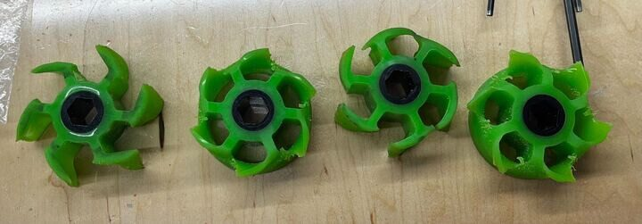

# 2025 · 694 StuyPulse — StuyPulse 2025

EPA rank 12, snapshot EPA 97.18. Provisional reference dossier.

Station-fed elevator/arm with separate multipurpose ground collector and central donut climb.

## Drivetrain

Swerve; drive module specification not established in this interview.

Coverage: partial / unresolved detail.

## Intake

Station funnel and infrared-triggered roller scorer; Froggy ground arm collects coral/algae, scores L1 and processor.

Coverage: documented synopsis.

## Transfer

Belted roller groups and treaded algae contact surfaces maintain control.

Coverage: documented synopsis.

## Scoring

Internally rigged elevator and pivoting arm; opposite-side motors counterbalance arm rather than simply minimizing motor height.

Coverage: documented synopsis.

## Endgame

Two hook pairs rotate against cage through changing leverage; hard stops and robot weight retain climb without a ratchet.

Coverage: documented synopsis.

## Controls

One driver/two human players; one-button nearest-face alignment, front/back scoring and retreat-before-stow collision protections.

Coverage: documented synopsis.

## Changes and versions

- Reinforced pivot plates and added belt tensioning.
- Cooling added to Limelights and radio after overheating. Build thread contains further version history beyond this interview summary.

## Strategic interpretation — analyst inference

The counterbalance and passive climb retention illustrate why a generic rule such as all motors must be low is insufficient. Evaluate complete torque and CG geometry, including the scoring-to-stow collision path.

## Limits

- Only the reviewed published configurations are established; intermediate changes may be undocumented.

Bounded source review; exhaustive intermediate-version history not certified

## Reviewed primary source bundle

- https://youtu.be/6-vO7mRoTBc
- https://www.chiefdelphi.com/t/477433

## Season context

Read [the full 2025 game/context chapter](../docs/game_2025.md) before transferring this architecture to another role or season.

## Technical image references

Images are source-associated technical figures or robot views, not dimensionally certified drawings. Follow each source for version and figure context.

2025 team 694 — source image from post 1 (2024-12-27). Context tags identify the discussion, not a verified component label. [Original source](https://www.chiefdelphi.com/t/477433/1). Source-linked extraction; mechanism identity not individually visually audited

## Dated research locators — navigation, not reviewed claims

A tag describes words in the source, not a validated engineering fact. Discussion replies may concern comparison robots.

- 2024-12-27 · pevvvvvvvvv · [post 1](https://www.chiefdelphi.com/t/477433/1) · autonomous, cad, code, intake, prototype, shooter
- 2025-01-06 · soriiku17 · [post 5](https://www.chiefdelphi.com/t/477433/5) · arm, climb, elevator, intake, prototype, wrist
- 2025-01-14 · jblay · [post 8](https://www.chiefdelphi.com/t/477433/8) · camera, climb, intake, prototype
- 2025-01-14 · jblay · [post 9](https://www.chiefdelphi.com/t/477433/9) · climb, prototype
- 2025-01-14 · jblay · [post 10](https://www.chiefdelphi.com/t/477433/10) · arm, climb, elevator, intake, pivot, prototype, shooter, wrist
- 2025-01-21 · elin-semicolon-D · [post 11](https://www.chiefdelphi.com/t/477433/11) · arm, belt, climb, elevator, intake, prototype, shooter
- 2025-01-23 · pevvvvvvvvv · [post 12](https://www.chiefdelphi.com/t/477433/12) · cad
- 2025-01-28 · jblay · [post 13](https://www.chiefdelphi.com/t/477433/13) · arm, belt, cad, climb, elevator, intake, pivot, prototype, shooter
- 2025-01-28 · dfacc45 · [post 14](https://www.chiefdelphi.com/t/477433/14) · intake
- 2025-02-04 · esty_besty · [post 16](https://www.chiefdelphi.com/t/477433/16) · arm, belt, cad, camera, chain, climb, code, elevator, intake, pivot, shooter, vision
- 2025-02-05 · jblay · [post 17](https://www.chiefdelphi.com/t/477433/17) · climb
- 2025-02-05 · entangledphoton · [post 19](https://www.chiefdelphi.com/t/477433/19) · climb
- 2025-02-11 · jxia · [post 26](https://www.chiefdelphi.com/t/477433/26) · arm, bearing, belt, chain, climb, elevator, intake, pivot, shooter
- 2025-02-11 · spearson23 · [post 29](https://www.chiefdelphi.com/t/477433/29) · pivot
- 2025-02-12 · jxia · [post 32](https://www.chiefdelphi.com/t/477433/32) · climb, intake, shooter
- 2025-02-18 · jopy_pulse · [post 35](https://www.chiefdelphi.com/t/477433/35) · autonomous, camera, vision
- 2025-02-19 · elin-semicolon-D · [post 37](https://www.chiefdelphi.com/t/477433/37) · arm, bearing, climb, elevator, intake, shooter
- 2025-02-19 · entangledphoton · [post 38](https://www.chiefdelphi.com/t/477433/38) · arm, climb, elevator
- 2025-02-20 · PigTwo · [post 39](https://www.chiefdelphi.com/t/477433/39) · arm, belt, cad, elevator, intake, shooter
- 2025-02-20 · Kalimul · [post 40](https://www.chiefdelphi.com/t/477433/40) · camera, code
- 2025-02-24 · PigTwo · [post 41](https://www.chiefdelphi.com/t/477433/41) · cad, vision
- 2025-02-25 · RachelKim · [post 42](https://www.chiefdelphi.com/t/477433/42) · arm, bearing, cad, chain, climb, elevator, encoder, intake, pivot, shooter
- 2025-02-25 · Kalimul · [post 43](https://www.chiefdelphi.com/t/477433/43) · arm, camera, chain, elevator, pivot, shooter, vision
- 2025-02-28 · jblay · [post 45](https://www.chiefdelphi.com/t/477433/45) · arm, chain, elevator, intake, pivot
- 2025-03-05 · Kalimul · [post 48](https://www.chiefdelphi.com/t/477433/48) · arm, elevator
- 2025-03-12 · jxia · [post 52](https://www.chiefdelphi.com/t/477433/52) · arm, bearing, chain, climb, elevator, intake, shooter
- 2025-03-15 · brenndussy · [post 55](https://www.chiefdelphi.com/t/477433/55) · climb, intake
- 2025-03-31 · entangledphoton · [post 63](https://www.chiefdelphi.com/t/477433/63) · chain, climb
- 2025-03-31 · RachelKim · [post 64](https://www.chiefdelphi.com/t/477433/64) · chain, intake, pivot
- 2025-03-31 · slxxplxss · [post 67](https://www.chiefdelphi.com/t/477433/67) · autonomous, climb, code, encoder, intake, pivot, vision
- 2025-04-01 · rui · [post 68](https://www.chiefdelphi.com/t/477433/68) · arm, climb, intake, pivot
- 2025-04-01 · Kalimul · [post 69](https://www.chiefdelphi.com/t/477433/69) · arm, code, intake, shooter, vision
- 2025-04-01 · pigrammer · [post 72](https://www.chiefdelphi.com/t/477433/72) · code
- 2025-04-28 · Philip_Levinsky · [post 78](https://www.chiefdelphi.com/t/477433/78) · cad
- 2025-05-17 · Philip_Levinsky · [post 80](https://www.chiefdelphi.com/t/477433/80) · arm
- 2025-05-23 · jblay · [post 82](https://www.chiefdelphi.com/t/477433/82) · climb
- 2025-05-28 · Kalimul · [post 89](https://www.chiefdelphi.com/t/477433/89) · arm, code, elevator, shooter
- 2025-06-05 · brenndussy · [post 93](https://www.chiefdelphi.com/t/477433/93) · chain, climb, intake, shooter
- 2025-06-07 · Life · [post 94](https://www.chiefdelphi.com/t/477433/94) · arm, belt, intake, shooter
- 2025-06-19 · PigTwo · [post 95](https://www.chiefdelphi.com/t/477433/95) · cad
- 2025-07-03 · PigTwo · [post 96](https://www.chiefdelphi.com/t/477433/96) · arm, bearing, cad, chain
- 2025-07-05 · RachelKim · [post 97](https://www.chiefdelphi.com/t/477433/97) · arm, belt, chain, encoder, wrist
- 2025-07-06 · AmitN · [post 98](https://www.chiefdelphi.com/t/477433/98) · arm
- 2025-07-08 · elin-semicolon-D · [post 99](https://www.chiefdelphi.com/t/477433/99) · arm, bearing, intake, pivot, prototype, shooter
- 2025-07-14 · jopy_pulse · [post 100](https://www.chiefdelphi.com/t/477433/100) · arm, chain, encoder, shooter, wrist
- 2025-07-15 · pevvvvvvvvv · [post 101](https://www.chiefdelphi.com/t/477433/101) · chain
- 2025-07-15 · RachelKim · [post 102](https://www.chiefdelphi.com/t/477433/102) · bearing, intake
- 2025-07-17 · pevvvvvvvvv · [post 103](https://www.chiefdelphi.com/t/477433/103) · arm, belt, cad, code, encoder, pivot, wrist
- 2025-07-17 · ElliotS · [post 105](https://www.chiefdelphi.com/t/477433/105) · pivot, shooter
- 2025-08-03 · RachelKim · [post 109](https://www.chiefdelphi.com/t/477433/109) · arm, code
- 2025-08-16 · PigTwo · [post 110](https://www.chiefdelphi.com/t/477433/110) · arm
- 2025-08-16 · AriMB · [post 111](https://www.chiefdelphi.com/t/477433/111) · chain
- 2025-08-16 · PigTwo · [post 112](https://www.chiefdelphi.com/t/477433/112) · chain
- 2025-10-06 · danman · [post 114](https://www.chiefdelphi.com/t/477433/114) · arm, climb, code, encoder, pivot
- 2025-10-21 · rui · [post 119](https://www.chiefdelphi.com/t/477433/119) · belt, elevator, shooter
- 2025-10-21 · JBF · [post 120](https://www.chiefdelphi.com/t/477433/120) · vision
- 2025-10-29 · RachelKim · [post 121](https://www.chiefdelphi.com/t/477433/121) · arm, cad, shooter, wrist
- 2025-10-29 · JamesO1086 · [post 122](https://www.chiefdelphi.com/t/477433/122) · arm
- 2025-10-29 · Rockroyal · [post 123](https://www.chiefdelphi.com/t/477433/123) · arm
- 2025-10-30 · RachelKim · [post 124](https://www.chiefdelphi.com/t/477433/124) · arm, cad
- 2025-10-30 · Kevin_Leonard · [post 125](https://www.chiefdelphi.com/t/477433/125) · arm, belt
- 2025-11-05 · rui · [post 126](https://www.chiefdelphi.com/t/477433/126) · bearing
- 2025-11-24 · JBF · [post 127](https://www.chiefdelphi.com/t/477433/127) · vision
- 2025-12-30 · RachelKim · [post 128](https://www.chiefdelphi.com/t/477433/128) · belt

## Current strategic priority

Optimize marginal alliance work: branch coverage, L1 placement/packing, algae, supply lanes, autonomous compatibility and reliable endgame. Do not rank robot quality by coral height.

## Integrated focused technical study

[Construction, reasoning, failure modes and limits](../docs/research_continuation/2025-694.md). This supplement is a focused interview/source-bundle study, not an exhaustive binder or competition-version certification.
