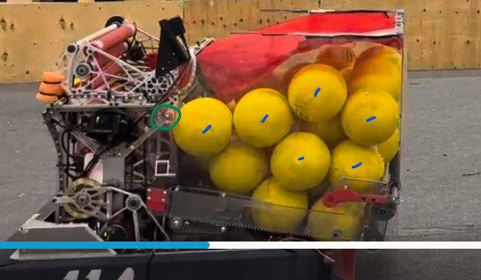

# 2026 · 1114 Simbotics — Simbot Tim

EPA rank 9, snapshot EPA 287.57. Provisional reference dossier.

Tall bump robot with large hopper, roller elevator and drum scorer.

## Drivetrain

Swerve; exact module specification in linked CAD, not fully extracted here.

Coverage: partial / unresolved detail.

## Intake

Collector/kicker now folds with hopper for bump clearance; intake iterations supported by 1678.

Coverage: documented synopsis.

## Transfer

Active floor and wall rollers plus passive side rollers reduce fuel bridging; roller elevator feeds drum.

Coverage: documented synopsis.

## Scoring

High mounted drum with limited hood travel; grip tape replaced silicone on selected surfaces for improved reported consistency.

Coverage: documented synopsis.

## Endgame

Climber installed March 1, removed by March 19 before first event due to mass. Stayed off as mass went into reliable feeding.

Coverage: documented synopsis.

## Controls

Three Limelights/odometry; variable intake agitation can also help recover from beaching.

Coverage: documented synopsis.

## Changes and versions

- Active wall added after first event, then passive side rollers.
- Team reports accuracy rising about 80% to 95–98% after surface changes; method/sample not independently audited.

## Strategic interpretation — analyst inference

The key improvement was reducing low-output interruptions rather than raising peak rate. The documented climb removal is a resource trade toward consistent scoring, and should be recorded as removed hardware rather than an available endgame.

## Limits

- Only the reviewed published configurations are established; intermediate changes may be undocumented.

Bounded source review; exhaustive intermediate-version history not certified

## Reviewed primary source bundle

- https://youtu.be/ksvuenS2gGY
- https://www.chiefdelphi.com/t/522887

## Season context

Read [the full 2026 game/context chapter](../docs/game_2026.md) before transferring this architecture to another role or season.

## Technical image references

Images are source-associated technical figures or robot views, not dimensionally certified drawings. Follow each source for version and figure context.

2026 team 1114 — source image from post 5 (2026-07-26). Context tags identify the discussion, not a verified component label. [Original source](https://www.chiefdelphi.com/t/522887/5). Source-linked extraction; mechanism identity not individually visually audited

## Dated research locators — navigation, not reviewed claims

A tag describes words in the source, not a validated engineering fact. Discussion replies may concern comparison robots.

- 2026-07-25 · NickBalyk · [post 1](https://www.chiefdelphi.com/t/522887/1) · cad, hopper, intake, prototype, shooter
- 2026-07-26 · LP3 · [post 2](https://www.chiefdelphi.com/t/522887/2) · cad
- 2026-07-26 · Kaleb_Dodd · [post 3](https://www.chiefdelphi.com/t/522887/3) · belt
- 2026-07-26 · NickBalyk · [post 5](https://www.chiefdelphi.com/t/522887/5) · hopper, intake, shooter
- 2026-07-26 · NickBalyk · [post 6](https://www.chiefdelphi.com/t/522887/6) · shooter
- 2026-07-29 · AvocadoPeel · [post 8](https://www.chiefdelphi.com/t/522887/8) · code
- 2026-08-01 · NickBalyk · [post 9](https://www.chiefdelphi.com/t/522887/9) · elevator, intake, shooter
- 2026-09-26 · Kaleb_Dodd · [post 1](https://www.chiefdelphi.com/t/524512/1) · cad, code
- 2026-09-28 · Robogram · [post 5](https://www.chiefdelphi.com/t/524512/5) · camera, vision
- 2026-09-28 · Kaleb_Dodd · [post 6](https://www.chiefdelphi.com/t/524512/6) · camera
- 2026-09-29 · AvocadoPeel · [post 7](https://www.chiefdelphi.com/t/524512/7) · intake

## Current strategic priority

Fuel acquisition, supply/denial, deliverable inventory, accurate output, route access and reliability. Climb is a low-priority exception requiring positive marginal justification.

## Integrated focused technical study

[Construction, reasoning, failure modes and limits](../docs/research_continuation/2026-1114.md). This supplement is a focused interview/source-bundle study, not an exhaustive binder or competition-version certification.
