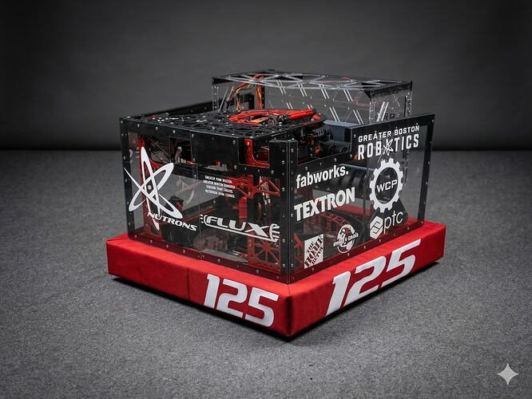
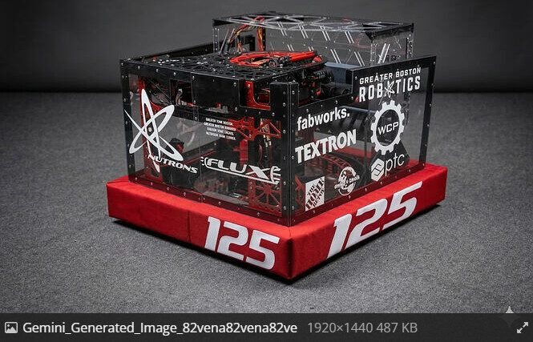
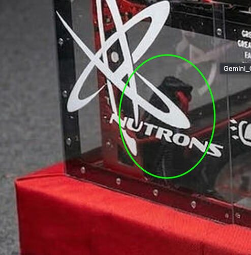

# 2026 · 125 NUTRONs — Neutrons 2026

EPA rank 10, snapshot EPA 283.42. Provisional reference dossier.

Trapezoidal chassis built around enlarged coaxial DYE Rotor-family feeder and central turret.

## Drivetrain

Front stock/rear custom-shaped X2S modules accommodate dish geometry; plate sides maximize rotor diameter.

Coverage: documented synopsis.

## Intake

Dual roller reduced to one to remove jams; compliant wheels replaced by continuous drum before Worlds.

Coverage: documented synopsis.

## Transfer

Eleven-position dish, coaxial independent hook/roller drive and doubled vertical roller sets clear central dead zone.

Coverage: documented synopsis.

## Scoring

Approximately 425-degree turret; third X44 added to main shooter for long passes/corner shots. Powered upper roller and compact ducking hood.

Coverage: documented synopsis.

## Endgame

Endgame installation not established in reviewed interview.

Coverage: partial / unresolved detail.

## Controls

Shared robot-desire controls for auto/teleop; velocity/time-of-flight aiming, hub-state timing and configurable partner-compatible auto routes.

Coverage: documented synopsis.

## Changes and versions

- Intake simplification and Worlds drum roller.
- Two-to-three shooter-motor revision accompanied revised trajectory strategy.

## Strategic interpretation — analyst inference

The team explicitly traces the mechanism to its 2017 lineage, but the 2026 dish, coaxial drive, frame and singulation changes are substantial. The architecture chooses heading-independent scoring and adaptable roles over peak multi-lane output.

## Limits

- Only the reviewed published configurations are established; intermediate changes may be undocumented.

Bounded source review; exhaustive intermediate-version history not certified

## Reviewed primary source bundle

- https://www.youtube.com/watch?v=Kzn_t-LsDB8

## Season context

Read [the full 2026 game/context chapter](../docs/game_2026.md) before transferring this architecture to another role or season.

## Technical image references

Images are source-associated technical figures or robot views, not dimensionally certified drawings. Follow each source for version and figure context.

2026 team 125 — source image from post 1 (2026-03-13). Context tags identify the discussion, not a verified component label. [Original source](https://www.chiefdelphi.com/t/516273/1). Source-linked extraction; mechanism identity not individually visually audited

2026 team 125 — source image from post 3 (2026-03-13). Context tags identify the discussion, not a verified component label. [Original source](https://www.chiefdelphi.com/t/516273/3). Source-linked extraction; mechanism identity not individually visually audited

2026 team 125 — source image from post 13 (2026-03-13). Context tags identify the discussion, not a verified component label. [Original source](https://www.chiefdelphi.com/t/516273/13). Source-linked extraction; mechanism identity not individually visually audited

## Dated research locators — navigation, not reviewed claims

A tag describes words in the source, not a validated engineering fact. Discussion replies may concern comparison robots.

- 2026-03-13 · Andrew_L · [post 3](https://www.chiefdelphi.com/t/516273/3) · rotor
- 2026-03-13 · Logandelaar · [post 13](https://www.chiefdelphi.com/t/516273/13) · hopper, rotor
- 2026-03-13 · obrienj17 · [post 15](https://www.chiefdelphi.com/t/516273/15) · hopper
- 2026-03-24 · r.arruda · [post 16](https://www.chiefdelphi.com/t/516273/16) · chain

## Current strategic priority

Fuel acquisition, supply/denial, deliverable inventory, accurate output, route access and reliability. Climb is a low-priority exception requiring positive marginal justification.

## Integrated focused technical study

[Construction, reasoning, failure modes and limits](../docs/research_continuation/2026-125.md). This supplement is a focused interview/source-bundle study, not an exhaustive binder or competition-version certification.
