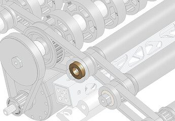
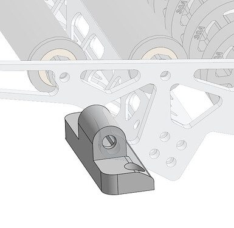
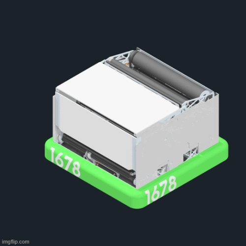

# 2026 · 1678 Citrus Circuits — Citrus Circuits 2026

EPA rank 13, snapshot EPA 279.66. Provisional reference dossier.

Expanding hopper and multi-lane drum with protected collector and integrated L1 climb.

## Drivetrain

Swerve with low hardware placement preserving a low floor; exact variant deferred to robot page.

Coverage: partial / unresolved detail.

## Intake

Two-motor active carbon roller and static kicker; crash bar protects roller, bolted module permits replacement.

Coverage: documented synopsis.

## Transfer

Live floor/J-shaped accelerating tunnel; separate entry roller controls feed. Earlier S-path changed after velocity reversal harmed consistency.

Coverage: documented synopsis.

## Scoring

Steel drum, four X60s, driven hood rollers and adjustable hood on independent low-friction pivot. Slick wooden backing controls compression.

Coverage: documented synopsis.

## Endgame

L1 mechanism integrated into hopper; reused algae-contact material grips tower. Expanding intake/hopper yields reported 75–80 capacity.

Coverage: documented synopsis.

## Controls

Added two side cameras after Half Moon Bay exposed midfield localization gaps; separate feed allows launcher spin-up before loading.

Coverage: documented synopsis.

## Changes and versions

- Early build architecture pivoted to wide drum.
- Alpha/beta two-active-roller pickup simplified; S-tunnel changed to J.
- Worlds-final detailed chronology remains incomplete; filmed interview is at Sacramento.

## Strategic interpretation — analyst inference

An expanding hopper is an interface contract: deployment, feed-floor movement, trench envelope and climb must all agree. Combine it with a different intake only after checking those motions and the full-load path, rather than treating the hopper as an independent box.

## Limits

- Only the reviewed published configurations are established; intermediate changes may be undocumented.

Bounded source review; exhaustive intermediate-version history not certified

## Reviewed primary source bundle

- https://www.youtube.com/watch?v=wsAJGi3yxSk
- https://www.citruscircuits.org/2026-robot

## Season context

Read [the full 2026 game/context chapter](../docs/game_2026.md) before transferring this architecture to another role or season.

## Technical image references

Images are source-associated technical figures or robot views, not dimensionally certified drawings. Follow each source for version and figure context.

2026 team 1678 — source image from post 8 (2026-06-02). Context tags identify the discussion, not a verified component label. [Original source](https://www.chiefdelphi.com/t/521535/8). Source-linked extraction; mechanism identity not individually visually audited

2026 team 1678 — source image from post 8 (2026-06-02). Context tags identify the discussion, not a verified component label. [Original source](https://www.chiefdelphi.com/t/521535/8). Source-linked extraction; mechanism identity not individually visually audited

2026 team 1678 — source image from post 20 (2026-06-03). Context tags identify the discussion, not a verified component label. [Original source](https://www.chiefdelphi.com/t/521535/20). Source-linked extraction; mechanism identity not individually visually audited

## Dated research locators — navigation, not reviewed claims

A tag describes words in the source, not a validated engineering fact. Discussion replies may concern comparison robots.

- 2026-03-07 · Alex_Y · [post 7](https://www.chiefdelphi.com/t/515709/7) · intake
- 2026-03-08 · jedgar6 · [post 9](https://www.chiefdelphi.com/t/515709/9) · cad
- 2026-03-09 · Bochek · [post 16](https://www.chiefdelphi.com/t/515709/16) · hopper
- 2026-03-09 · Zihe620 · [post 18](https://www.chiefdelphi.com/t/515709/18) · intake
- 2026-03-09 · Tricks1228 · [post 21](https://www.chiefdelphi.com/t/515709/21) · hopper
- 2026-03-09 · Zihe620 · [post 23](https://www.chiefdelphi.com/t/515709/23) · belt
- 2026-03-09 · Sahil · [post 26](https://www.chiefdelphi.com/t/515709/26) · intake
- 2026-03-09 · SHMKPK · [post 27](https://www.chiefdelphi.com/t/515709/27) · intake
- 2026-03-09 · Sahil · [post 28](https://www.chiefdelphi.com/t/515709/28) · prototype
- 2026-03-10 · Mahanth · [post 29](https://www.chiefdelphi.com/t/515709/29) · cad
- 2026-03-11 · JohnFogarty · [post 34](https://www.chiefdelphi.com/t/515709/34) · intake
- 2026-03-11 · Wytre · [post 35](https://www.chiefdelphi.com/t/515709/35) · shooter
- 2026-03-11 · SHMKPK · [post 36](https://www.chiefdelphi.com/t/515709/36) · rebuild
- 2026-03-11 · JohnFogarty · [post 38](https://www.chiefdelphi.com/t/515709/38) · shooter
- 2026-03-11 · Anteprefix · [post 39](https://www.chiefdelphi.com/t/515709/39) · shooter
- 2026-03-11 · Michael_Corsetto · [post 40](https://www.chiefdelphi.com/t/515709/40) · shooter
- 2026-03-13 · Ainesh · [post 45](https://www.chiefdelphi.com/t/515709/45) · belt, indexer
- 2026-03-24 · mrtommys · [post 53](https://www.chiefdelphi.com/t/515709/53) · climb, hopper
- 2026-03-29 · Squirre1Master · [post 56](https://www.chiefdelphi.com/t/515709/56) · intake
- 2026-04-01 · githubAnish · [post 58](https://www.chiefdelphi.com/t/515709/58) · hopper, intake, pivot
- 2026-04-27 · MicahMulder · [post 60](https://www.chiefdelphi.com/t/515709/60) · intake
- 2026-05-04 · Siegel6343 · [post 61](https://www.chiefdelphi.com/t/515709/61) · cad
- 2026-05-04 · Calvin-Hobbes17 · [post 62](https://www.chiefdelphi.com/t/515709/62) · elevator, hopper
- 2026-05-04 · Michael_Corsetto · [post 63](https://www.chiefdelphi.com/t/515709/63) · cad, elevator, hopper
- 2026-05-05 · Calvin-Hobbes17 · [post 66](https://www.chiefdelphi.com/t/515709/66) · cad
- 2026-05-31 · BrookOstrom · [post 67](https://www.chiefdelphi.com/t/515709/67) · cad, code
- 2026-06-02 · Michael_Corsetto · [post 1](https://www.chiefdelphi.com/t/521535/1) · cad, code
- 2026-06-02 · crummyh · [post 3](https://www.chiefdelphi.com/t/521535/3) · belt, pivot
- 2026-06-02 · Charlie_1 · [post 4](https://www.chiefdelphi.com/t/521535/4) · cad
- 2026-06-02 · Duckleny · [post 7](https://www.chiefdelphi.com/t/521535/7) · intake, pivot
- 2026-06-02 · Mstew3928 · [post 8](https://www.chiefdelphi.com/t/521535/8) · chain, intake, shooter
- 2026-06-02 · SarahOH · [post 10](https://www.chiefdelphi.com/t/521535/10) · pivot, shooter
- 2026-06-02 · Crackity · [post 12](https://www.chiefdelphi.com/t/521535/12) · chain
- 2026-06-02 · SarahOH · [post 13](https://www.chiefdelphi.com/t/521535/13) · chain
- 2026-06-03 · DanTCA · [post 19](https://www.chiefdelphi.com/t/521535/19) · code
- 2026-06-03 · CMBran · [post 20](https://www.chiefdelphi.com/t/521535/20) · cad, intake
- 2026-06-03 · Soren_Reisman · [post 21](https://www.chiefdelphi.com/t/521535/21) · bearing, belt, chain, pivot, shooter
- 2026-06-03 · Jake.Tirsch · [post 22](https://www.chiefdelphi.com/t/521535/22) · hopper
- 2026-06-03 · Ani · [post 23](https://www.chiefdelphi.com/t/521535/23) · code
- 2026-06-03 · Ani · [post 25](https://www.chiefdelphi.com/t/521535/25) · hopper, intake
- 2026-06-03 · Soren_Reisman · [post 27](https://www.chiefdelphi.com/t/521535/27) · chain, intake, pivot, wrist
- 2026-06-04 · Soren_Reisman · [post 35](https://www.chiefdelphi.com/t/521535/35) · intake
- 2026-06-05 · Soren_Reisman · [post 37](https://www.chiefdelphi.com/t/521535/37) · cad, intake, pivot, wrist
- 2026-06-05 · Parin-4237 · [post 40](https://www.chiefdelphi.com/t/521535/40) · cad
- 2026-06-06 · Ani · [post 42](https://www.chiefdelphi.com/t/521535/42) · cad, camera, vision
- 2026-06-07 · lobstotsbol · [post 45](https://www.chiefdelphi.com/t/521535/45) · cad
- 2026-06-07 · Soren_Reisman · [post 46](https://www.chiefdelphi.com/t/521535/46) · cad
- 2026-06-10 · Calvin-Hobbes17 · [post 48](https://www.chiefdelphi.com/t/521535/48) · shooter
- 2026-06-19 · Amannyyy · [post 49](https://www.chiefdelphi.com/t/521535/49) · shooter
- 2026-07-02 · LiyaMahpoda_2096 · [post 53](https://www.chiefdelphi.com/t/521535/53) · cad, shooter
- 2026-08-07 · Hari · [post 69](https://www.chiefdelphi.com/t/515709/69) · cad, rebuild
- 2026-09-05 · nrglord · [post 63](https://www.chiefdelphi.com/t/521535/63) · hopper
- 2026-10-07 · Zachalateur · [post 67](https://www.chiefdelphi.com/t/521535/67) · intake
- 2026-10-20 · Zihou · [post 68](https://www.chiefdelphi.com/t/521535/68) · shooter

## Current strategic priority

Fuel acquisition, supply/denial, deliverable inventory, accurate output, route access and reliability. Climb is a low-priority exception requiring positive marginal justification.

## Integrated focused technical study

[Construction, reasoning, failure modes and limits](../docs/research_continuation/2026-1678.md). This supplement is a focused interview/source-bundle study, not an exhaustive binder or competition-version certification.
