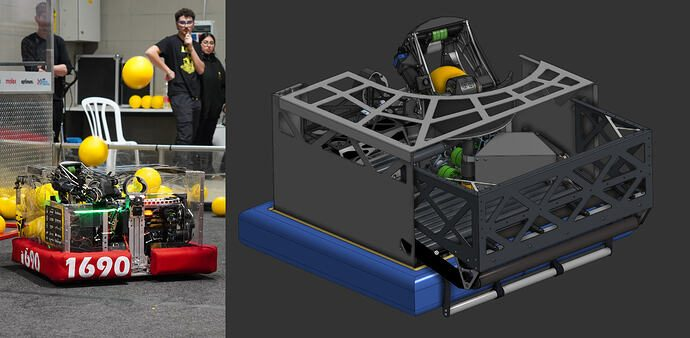
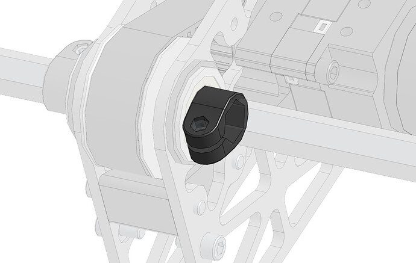

# 2026 · 1690 Orbit — Orbit 2026

EPA rank 5, snapshot EPA 302.54. Provisional reference dossier.

Trench turret with narrow swept envelope, live-bottom singulation and deliberately low drivetrain load.

## Drivetrain

29.5×24.5-inch base; custom narrow-tread modules replaced by MK5s after defense practice exposed poor resistance to pushing.

Coverage: documented synopsis.

## Intake

Impact-compliant rack/gear deploy; dynamic ramp replaced by a kicker deployed once to avoid trapping fuel.

Coverage: documented synopsis.

## Transfer

Eleven floor rollers, independently powered vertical belts and vertical anti-jam roller feed active C-shaped uptake. Ratios iterated to control congestion.

Coverage: documented synopsis.

## Scoring

Compact offset ball path within turret bearing reduces outer sweep; connected back rollers target low spin. Custom narrow cable chain permits reported 640-degree travel.

Coverage: documented synopsis.

## Endgame

Original L3 abandoned for mass/complexity; compact threaded-rod L1 substituted.

Coverage: documented synopsis.

## Controls

Turret-mounted camera plus backup Limelights; velocity-compensated aiming. Worlds was first official competition of this configuration according to interview.

Coverage: documented synopsis.

## Changes and versions

- Drive-module swap followed physical defense testing.
- Multiple feed ratios and manufacturing revisions preceded Worlds; L3-to-L1 is a distinct capability reduction.

## Strategic interpretation — analyst inference

Turret rotation range is a packaging outcome. Offsetting the ball path, compact wiring and low motors reserve hopper volume and permit defense-resistant aiming; transferring only its shooter wheel dimensions would lose that system-level benefit.

## Limits

- Only the reviewed published configurations are established; intermediate changes may be undocumented.

Bounded source review; exhaustive intermediate-version history not certified

## Reviewed primary source bundle

- https://www.youtube.com/watch?v=n5HWLSWU4eg

## Season context

Read [the full 2026 game/context chapter](../docs/game_2026.md) before transferring this architecture to another role or season.

## Technical image references

Images are source-associated technical figures or robot views, not dimensionally certified drawings. Follow each source for version and figure context.

2026 team 1690 — source image from post 1 (2026-05-12). Context tags identify the discussion, not a verified component label. [Original source](https://www.chiefdelphi.com/t/520673/1). Source-linked extraction; mechanism identity not individually visually audited

2026 team 1690 — source image from post 2 (2026-05-12). Context tags identify the discussion, not a verified component label. [Original source](https://www.chiefdelphi.com/t/520673/2). Source-linked extraction; mechanism identity not individually visually audited

## Dated research locators — navigation, not reviewed claims

A tag describes words in the source, not a validated engineering fact. Discussion replies may concern comparison robots.

- 2026-03-01 · Boxsteam · [post 7](https://www.chiefdelphi.com/t/515277/7) · climb
- 2026-03-01 · Aaron_Li · [post 10](https://www.chiefdelphi.com/t/515277/10) · climb
- 2026-03-01 · ryan971 · [post 12](https://www.chiefdelphi.com/t/515277/12) · intake
- 2026-03-01 · MSU2000 · [post 16](https://www.chiefdelphi.com/t/515277/16) · intake
- 2026-03-02 · NolanE995 · [post 22](https://www.chiefdelphi.com/t/515277/22) · belt
- 2026-03-02 · Zihe620 · [post 28](https://www.chiefdelphi.com/t/515277/28) · shooter
- 2026-03-02 · ttakashima4270 · [post 29](https://www.chiefdelphi.com/t/515277/29) · indexer
- 2026-03-02 · manash · [post 32](https://www.chiefdelphi.com/t/515277/32) · climb
- 2026-03-02 · manash · [post 33](https://www.chiefdelphi.com/t/515277/33) · intake
- 2026-03-02 · Korny · [post 42](https://www.chiefdelphi.com/t/515277/42) · autonomous, shooter
- 2026-03-02 · yolin · [post 43](https://www.chiefdelphi.com/t/515277/43) · shooter
- 2026-03-02 · githubAnish · [post 46](https://www.chiefdelphi.com/t/515277/46) · intake
- 2026-03-02 · Ainesh · [post 47](https://www.chiefdelphi.com/t/515277/47) · indexer
- 2026-03-02 · MSU2000 · [post 48](https://www.chiefdelphi.com/t/515277/48) · shooter
- 2026-03-02 · UriOrnT_3316 · [post 49](https://www.chiefdelphi.com/t/515277/49) · hopper
- 2026-03-17 · ajiteshsingh · [post 64](https://www.chiefdelphi.com/t/515277/64) · shooter
- 2026-03-27 · Korny · [post 80](https://www.chiefdelphi.com/t/515277/80) · shooter
- 2026-04-13 · githubAnish · [post 82](https://www.chiefdelphi.com/t/515277/82) · climb
- 2026-04-13 · SnappleBot · [post 84](https://www.chiefdelphi.com/t/515277/84) · spindexer
- 2026-05-06 · amsam0 · [post 86](https://www.chiefdelphi.com/t/515277/86) · camera
- 2026-05-06 · Landon_K · [post 89](https://www.chiefdelphi.com/t/515277/89) · intake
- 2026-05-06 · SobSob · [post 94](https://www.chiefdelphi.com/t/515277/94) · camera
- 2026-05-06 · JohnFogarty · [post 98](https://www.chiefdelphi.com/t/515277/98) · hopper
- 2026-05-06 · carterc13 · [post 99](https://www.chiefdelphi.com/t/515277/99) · vision
- 2026-05-10 · elctrilica · [post 107](https://www.chiefdelphi.com/t/515277/107) · shooter
- 2026-05-11 · HarelKor · [post 108](https://www.chiefdelphi.com/t/515277/108) · chain, shooter
- 2026-05-11 · HarelKor · [post 109](https://www.chiefdelphi.com/t/515277/109) · vision
- 2026-05-11 · Nessie · [post 112](https://www.chiefdelphi.com/t/515277/112) · intake, vision
- 2026-05-11 · Sean7183 · [post 113](https://www.chiefdelphi.com/t/515277/113) · chain
- 2026-05-12 · HarelKor · [post 1](https://www.chiefdelphi.com/t/520673/1) · cad
- 2026-05-12 · DavidMasin · [post 2](https://www.chiefdelphi.com/t/520673/2) · cad, intake, shooter
- 2026-05-12 · HarelKor · [post 5](https://www.chiefdelphi.com/t/520673/5) · intake
- 2026-05-12 · yuvalsuari · [post 6](https://www.chiefdelphi.com/t/520673/6) · cad
- 2026-05-12 · HarelKor · [post 7](https://www.chiefdelphi.com/t/520673/7) · intake
- 2026-05-12 · Swervebuilder · [post 8](https://www.chiefdelphi.com/t/520673/8) · intake, shooter
- 2026-05-12 · DavidMasin · [post 9](https://www.chiefdelphi.com/t/520673/9) · bearing, cad, code, shooter
- 2026-05-12 · Yedidya · [post 11](https://www.chiefdelphi.com/t/520673/11) · cad
- 2026-05-13 · HarelKor · [post 19](https://www.chiefdelphi.com/t/520673/19) · bearing, belt
- 2026-05-13 · Sylvester · [post 21](https://www.chiefdelphi.com/t/520673/21) · encoder, hopper
- 2026-05-16 · TXTaylor · [post 28](https://www.chiefdelphi.com/t/520673/28) · cad
- 2026-05-16 · Korny · [post 115](https://www.chiefdelphi.com/t/515277/115) · shooter
- 2026-05-16 · CZK · [post 30](https://www.chiefdelphi.com/t/520673/30) · cad
- 2026-05-19 · Jonathanmusli · [post 31](https://www.chiefdelphi.com/t/520673/31) · cad
- 2026-05-21 · SobSob · [post 117](https://www.chiefdelphi.com/t/515277/117) · shooter
- 2026-05-21 · Jonathanmusli · [post 33](https://www.chiefdelphi.com/t/520673/33) · bearing
- 2026-05-25 · cyanwei1109 · [post 36](https://www.chiefdelphi.com/t/520673/36) · cad, intake
- 2026-05-25 · HarelKor · [post 37](https://www.chiefdelphi.com/t/520673/37) · intake
- 2026-05-26 · Salmon · [post 38](https://www.chiefdelphi.com/t/520673/38) · encoder
- 2026-05-26 · IdoZipori · [post 39](https://www.chiefdelphi.com/t/520673/39) · chain, encoder, intake
- 2026-05-27 · CharlesChickens · [post 40](https://www.chiefdelphi.com/t/520673/40) · shooter
- 2026-05-28 · pigrammer · [post 41](https://www.chiefdelphi.com/t/520673/41) · chain, shooter
- 2026-05-28 · Bibu · [post 42](https://www.chiefdelphi.com/t/520673/42) · cad
- 2026-05-31 · HarelKor · [post 43](https://www.chiefdelphi.com/t/520673/43) · climb, intake, shooter
- 2026-06-04 · SobSob · [post 46](https://www.chiefdelphi.com/t/520673/46) · autonomous, camera, intake
- 2026-06-04 · CZK · [post 48](https://www.chiefdelphi.com/t/520673/48) · cad
- 2026-06-04 · Fionan · [post 49](https://www.chiefdelphi.com/t/520673/49) · shooter
- 2026-06-04 · Korny · [post 52](https://www.chiefdelphi.com/t/520673/52) · camera, intake, prototype, shooter
- 2026-06-06 · HarelKor · [post 54](https://www.chiefdelphi.com/t/520673/54) · cad
- 2026-06-23 · HarelKor · [post 60](https://www.chiefdelphi.com/t/520673/60) · intake
- 2026-06-30 · Robogram · [post 62](https://www.chiefdelphi.com/t/520673/62) · cad, intake
- 2026-07-09 · timothyluu · [post 65](https://www.chiefdelphi.com/t/520673/65) · indexer
- 2026-07-12 · gjqfrank · [post 67](https://www.chiefdelphi.com/t/520673/67) · belt, hopper, shooter
- 2026-07-13 · cfa · [post 68](https://www.chiefdelphi.com/t/520673/68) · intake
- 2026-07-14 · Salmon · [post 69](https://www.chiefdelphi.com/t/520673/69) · belt, hopper, shooter
- 2026-07-14 · SobSob · [post 70](https://www.chiefdelphi.com/t/520673/70) · camera
- 2026-07-14 · SobSob · [post 71](https://www.chiefdelphi.com/t/520673/71) · chain
- 2026-07-14 · NO_skcaj · [post 73](https://www.chiefdelphi.com/t/520673/73) · code
- 2026-07-15 · Soccertoad · [post 74](https://www.chiefdelphi.com/t/520673/74) · cad, code
- 2026-07-16 · SobSob · [post 75](https://www.chiefdelphi.com/t/520673/75) · belt, code, hopper, shooter
- 2026-07-21 · SobSob · [post 78](https://www.chiefdelphi.com/t/520673/78) · shooter
- 2026-08-02 · Soccertoad · [post 80](https://www.chiefdelphi.com/t/520673/80) · encoder

## Current strategic priority

Fuel acquisition, supply/denial, deliverable inventory, accurate output, route access and reliability. Climb is a low-priority exception requiring positive marginal justification.

## Integrated focused technical study

[Construction, reasoning, failure modes and limits](../docs/research_continuation/2026-1690.md). This supplement is a focused interview/source-bundle study, not an exhaustive binder or competition-version certification.
