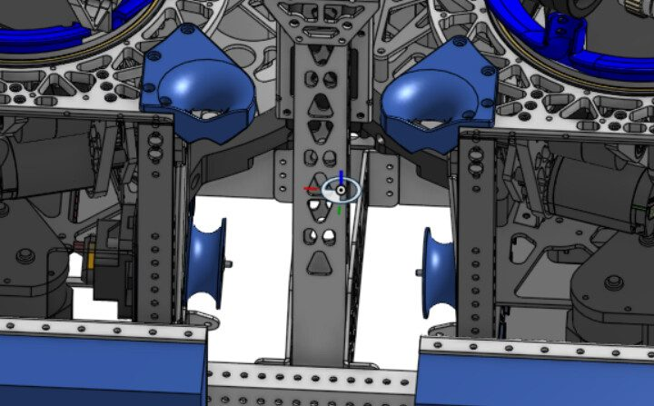
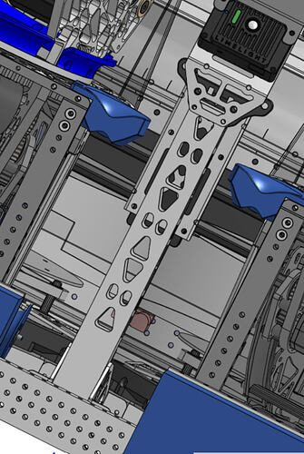
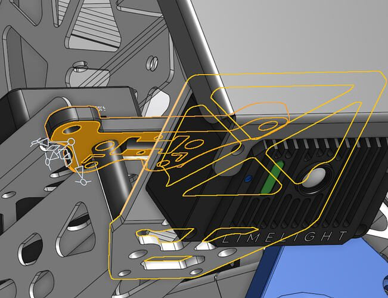

# 2026 · 1706 Ratchet Rockers — Mirage

EPA rank 27, snapshot EPA 255.98. Provisional reference dossier.

Twin turrets over dual conical spindexers, with extensible net hopper and L1 climb.

## Drivetrain

Swerve; exact module variant unresolved here.

Coverage: partial / unresolved detail.

## Intake

Intake deploy also expands hopper; commanded roller speed follows chassis speed and collector motion agitates fuel.

Coverage: documented synopsis.

## Transfer

Spinning floors and ribbed cones drive two uptake ramps. Bristles → stacked wheels → shaped cones after inadequate feed and jams.

Coverage: documented synopsis.

## Scoring

Independent turret aiming and hood control; aluminum flywheels replaced overly heavy steel trial. Separate kickers control fuel entering each shooter.

Coverage: documented synopsis.

## Endgame

L1 chosen for weight and autonomous speed; physical lift details not completely established by interview.

Coverage: partial / unresolved detail.

## Controls

Each turret has offset-corrected hub vector, interpolation and moving-shot calculation. Three Limelight 4s fuse with odometry; can shoot during climb.

Coverage: documented synopsis.

## Changes and versions

- First regional used stacked wheels; cone/rib geometry revised afterward.
- Steel flywheel trial was rejected, not final hardware.

## Strategic interpretation — analyst inference

Dual turrets trade feed complexity and mass for multiple heading-independent streams. Their value depends on both streams remaining supplied during real congestion and on the measured benefit over a simpler single turret or drum.

## Limits

- Only the reviewed published configurations are established; intermediate changes may be undocumented.

Bounded source review; exhaustive intermediate-version history not certified

## Reviewed primary source bundle

- https://www.youtube.com/watch?v=O2KMy1tlU9M

## Season context

Read [the full 2026 game/context chapter](../docs/game_2026.md) before transferring this architecture to another role or season.

## Technical image references

Images are source-associated technical figures or robot views, not dimensionally certified drawings. Follow each source for version and figure context.

2026 team 1706 — source image from post 2 (2026-07-01). Context tags identify the discussion, not a verified component label. [Original source](https://www.chiefdelphi.com/t/522276/2). Source-linked extraction; mechanism identity not individually visually audited

2026 team 1706 — source image from post 2 (2026-07-01). Context tags identify the discussion, not a verified component label. [Original source](https://www.chiefdelphi.com/t/522276/2). Source-linked extraction; mechanism identity not individually visually audited

2026 team 1706 — source image from post 2 (2026-07-01). Context tags identify the discussion, not a verified component label. [Original source](https://www.chiefdelphi.com/t/522276/2). Source-linked extraction; mechanism identity not individually visually audited

## Dated research locators — navigation, not reviewed claims

A tag describes words in the source, not a validated engineering fact. Discussion replies may concern comparison robots.

- 2026-07-01 · Emerson1706 · [post 1](https://www.chiefdelphi.com/t/522276/1) · cad
- 2026-07-01 · pigrammer · [post 2](https://www.chiefdelphi.com/t/522276/2) · shooter
- 2026-07-01 · alex.richards48 · [post 3](https://www.chiefdelphi.com/t/522276/3) · encoder, intake
- 2026-07-01 · Jaxbro151 · [post 4](https://www.chiefdelphi.com/t/522276/4) · chain, spindexer
- 2026-07-01 · Kerflappadoodle · [post 5](https://www.chiefdelphi.com/t/522276/5) · shooter
- 2026-07-01 · Jaxbro151 · [post 6](https://www.chiefdelphi.com/t/522276/6) · intake
- 2026-07-01 · Emerson1706 · [post 7](https://www.chiefdelphi.com/t/522276/7) · shooter
- 2026-07-01 · Owlias · [post 8](https://www.chiefdelphi.com/t/522276/8) · intake
- 2026-07-01 · Jaxbro151 · [post 9](https://www.chiefdelphi.com/t/522276/9) · intake, spindexer

## Current strategic priority

Fuel acquisition, supply/denial, deliverable inventory, accurate output, route access and reliability. Climb is a low-priority exception requiring positive marginal justification.

## Integrated focused technical study

[Construction, reasoning, failure modes and limits](../docs/research_continuation/2026-1706.md). This supplement is a focused interview/source-bundle study, not an exhaustive binder or competition-version certification.
