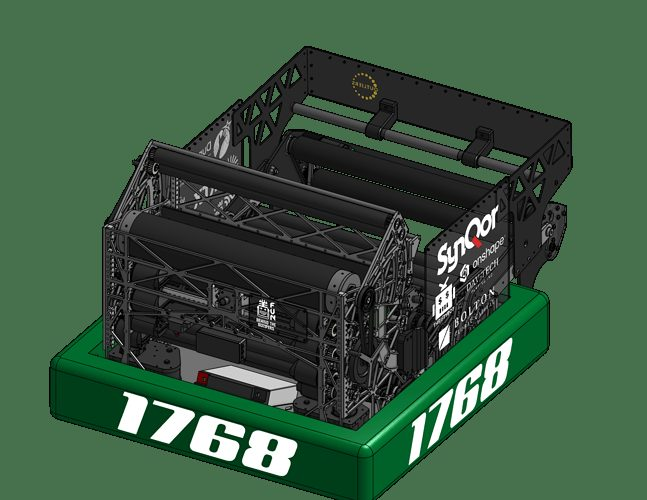
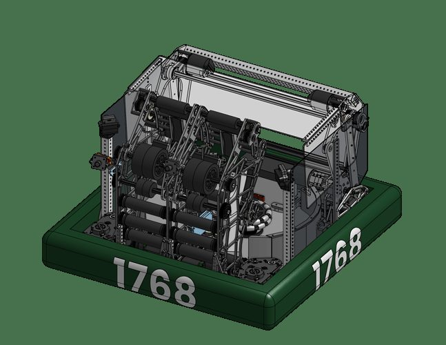
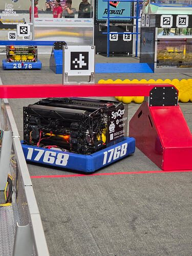
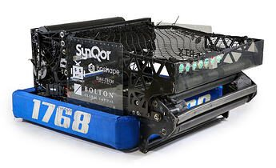
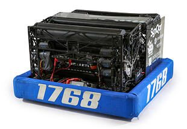
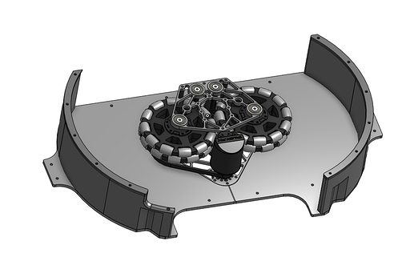
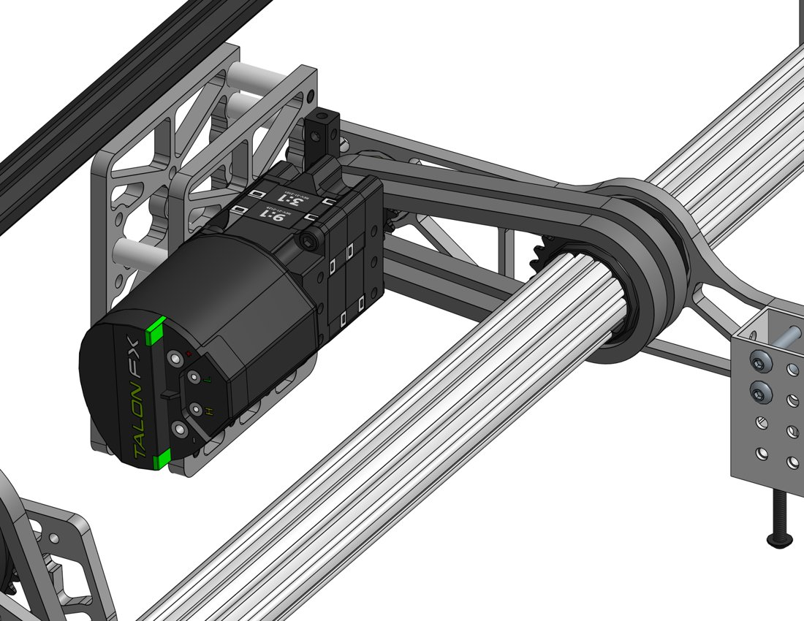
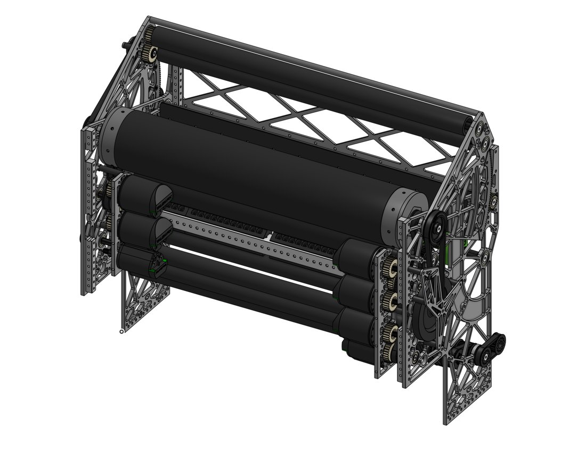

# 2026 · 1768 Nashoba Robotics — RoboChiefs 2026

EPA rank 24, snapshot EPA 259.43. Provisional reference dossier.

Four-bar collection and drum rebuild replacing divided dual shooter/spindexer.

## Drivetrain

Swerve; exact module variant unresolved here.

Coverage: partial / unresolved detail.

## Intake

Moving hopper attached to bottom four-bar link keeps folded robot beneath trench; SRPP and aluminum links improve impact survival.

Coverage: documented synopsis.

## Transfer

Dual spindexers replaced by roller floor with compliant entry. Integrated loading/shooting arrangement preserves contact.

Coverage: documented synopsis.

## Scoring

Four motors power drum/hood rollers; external hood plates and compact transmission replace former internal divider geometry. Added guide after WPI wobble.

Coverage: documented synopsis.

## Endgame

Endgame installation not established in reviewed interview.

Coverage: partial / unresolved detail.

## Controls

Three cameras and simplified driver actions emphasize repeatable autonomous and shots; reduced belt tension lowers current.

Coverage: documented synopsis.

## Changes and versions

- Divided dual shooter → drum with roller floor.
- Worlds SRPP collector and post-WPI feed stabilization are specifically described.

## Strategic interpretation — analyst inference

This illustrates the cost of widening a scorer: dividers, motor placement and hood supports must move, not simply disappear. The four-bar/hopper link choice simultaneously solves stowed height and expanding volume.

## Limits

- Only the reviewed published configurations are established; intermediate changes may be undocumented.

Bounded source review; exhaustive intermediate-version history not certified

## Reviewed primary source bundle

- https://www.youtube.com/watch?v=zxBvVSZtS3E
- https://www.chiefdelphi.com/t/525192

# 1768 in 2026: the rebuild is a sequence of decisions, not one drum photograph

This supplement uses the team’s October CAD-release replies alongside the earlier technical interview. It distinguishes the original Nightshade, the Nightshift rebuild, later onseason adjustments and offseason changes. The source is unusually useful because the team explains why mechanisms and schedule choices were coupled. A successful rebuild should not be reduced to “replace two shooters with a drum,” nor should October performance be assigned to the robot that competed at Worlds.

## The schedule establishes what the team actually proved

The team describes an eleven-day rebuild between URI in week 3 and WPI in week 5, with the new machine operational after nine days. Only the swerve modules and bellypan were retained. The reply’s timeline runs from the original robot’s final match on March 21 through CAD on March 25, stripping the old machine on March 27, mounting major subsystems on March 28 and reaching a practice field on April 2. Those are dated milestones reported by the team, not an inference that another team can repeat the schedule. [Schedule and retained hardware](https://www.chiefdelphi.com/t/525192/12). [Detailed milestones](https://www.chiefdelphi.com/t/525192/13).

The distinction matters when borrowing architecture. A mechanism whose drawings can be completed quickly may still consume the entire available interval in wiring, controls, feeding tests and driver learning. Conversely, retaining a technically mediocre but known assembly can preserve enough practice time to win more matches. The relevant rebuild calculation includes the probability of arriving with an integrated machine, not just the predicted performance of the finished CAD. An architecture recommendation should name the existing interfaces that survive, the ones that are replaced and the latest date at which a failed experiment can still be abandoned.

The team’s process reply describes student ownership of deadlines and explicit gates: if a new assembly does not meet a milestone, the original version stays. Older students handled CAD while newer students manufactured early enough to understand assembly. This is evidence about the organization that made a rapid rebuild possible. It is not a universal staffing prescription. [Process account](https://www.chiefdelphi.com/t/525192/21).

For a PCH rebuild, the transferable question is therefore not “can our team also rebuild in eleven days?” It is “which uncertainty can our actual team retire before our next event, with enough time left to integrate and practice?” A new hopper that retains the old collector, floor and mounting interfaces can be a fundamentally different risk from a new collector, hopper and feed path that must all work on their first combined test. The latter may still be justified, but the justification needs an integration plan and a fallback with a real deadline.

## The four-bar is doing more than deploying an intake

The later replies explain that the week-zero machine did not stow under the trench. On the developed machine, the hopper attaches to the lower link of the four-bar. The team describes fitting the trench envelope in both positions, satisfying the starting envelope, folding the kicker and choosing link angles that survive contact. They arrived at the geometry through iteration rather than a single independent constraint calculation. [Envelope discussion](https://www.chiefdelphi.com/t/525192/15). [Coupled geometry](https://www.chiefdelphi.com/t/525192/16).

This is exactly why “a 2910-style intake with a Citrus hopper” needs an interface analysis. The intake’s ground contact point and deployed reach are only part of the design. The moving hopper wall changes where stored fuel rests; the lower link’s motion changes the floor slope; the kicker’s folded position changes what can occupy the trench envelope. The mechanism must pass through intermediate positions while full of fuel. A configuration that clears a field element in a static CAD screenshot can still trap fuel, pull a flexible wall into a roller or require a transition that cannot be completed while moving.

The useful inspiration is the constraint-solving strategy: let one linkage carry several compatible motions, then check the consequences as a system. It is not a claim that the same link lengths fit another chassis. A receiving team should record the deployed and retracted volumes, the swept paths of rigid members and flexible walls, the lowest loaded floor point, the expected collision direction and the fuel escape routes. If any of those are unknown, the recommendation should remain an architectural candidate rather than a dimensioned solution.

## Transmission failures need local explanations

One reply separates motor-to-roller belt skipping from roller-to-roller belts that did not skip. The team changed the former to chain after Worlds, then added polycarbonate retaining flanges after the chain came off once. Their explanation involves possible motor or plate flex reducing wrap or tension around a small pulley; it is a team hypothesis about this installation. [Transmission sequence](https://www.chiefdelphi.com/t/525192/9).

That report does not establish “chain is better than belts.” It suggests tests: watch relative motor and shaft displacement under load; inspect tooth engagement through the entire torque transient; distinguish a belt climbing out of mesh from a shaft or tensioner moving; and check retention after changing the transmission type. A mechanism database should keep the failed condition, the suspected cause, the modification and the observed result as separate fields. Without that separation, an agent may copy the final component while repeating the geometry that caused the original failure.

The sliding flywheel-belt tensioner belongs to an offseason N.E.R.D. update. The team reports that high-speed slack had been damaging the belt, that the tensioner improved reported accuracy and that short testing had not yet revealed issues. They also anticipated possible creep that could be corrected by retensioning. Another reply explains the generous adjustment range and the washer arrangement around the bearing. [Tensioner report](https://www.chiefdelphi.com/t/525192/8). [Adjustment explanation](https://www.chiefdelphi.com/t/525192/11). This is promising design evidence with a limited test horizon, not a season-long reliability certification.

## Fabrication and service choices change what is feasible

The team explains choosing live axles because they were quickest to manufacture for this rebuild. They recognize advantages of stubs for width iteration, but that was not the priority. This is a concrete example of a choice that can be strategically correct despite not maximizing every engineering objective. [Axle tradeoff](https://www.chiefdelphi.com/t/525192/12).

Their hood-rack reply describes printed material supported by aluminum teeth, with print settings chosen to reduce backlash. The lesson is to document the load path and what each material contributes. A screenshot that looks like a printed rack can conceal metal reinforcement; a recommendation to “print the rack” can therefore remove the part that made it survive. [Rack construction](https://www.chiefdelphi.com/t/525192/17).

## Do not backdate the faster feeder

October replies describe an entry roller using spaced compliant wheels to create lanes, combining the entry roller and floor drive at a 1:1 ratio, and matching feeder surface speed more closely to drum speed. The team reports moving from roughly 23–26 to 28–30 balls per second. These are offseason reports, not measured Worlds match averages. [October feed changes](https://www.chiefdelphi.com/t/525192/22). [Reported result](https://www.chiefdelphi.com/t/525192/24).

The architectural implication is broader than the headline firing rate. Fuel must arrive across the useful shooter width with suitable velocity, spacing and compression. Adding lanes can change the stability of that delivery; linking drives can remove one mismatch while introducing another dependency. A team evaluating the change should compare the beginning and end of a full hopper, partly depleted operation, worn fuel, lateral acceleration and recovery after a jam. A clean burst of a few fuel does not test those conditions.

## What an agent should retrieve from this case

Retrieve 1768 when the question involves a compressed rebuild, a moving hopper carried by a four-bar, drum packaging or separating onseason and offseason transmission fixes. Pair it with 254 and 1678 for feed-contact geometry and with 2910 for a different rebuild triggered by unmet performance goals. Do not merge the named configurations into a single idealized robot. The strongest reusable lesson is that an architecture is a set of coordinated constraints, a manufacturing plan and a validated operating sequence. The remaining unresolved endgame and exact drivetrain details in the base dossier remain unresolved; these additional replies do not establish them.

## Season context

Read [the full 2026 game/context chapter](../docs/game_2026.md) before transferring this architecture to another role or season.

## Technical image references

Images are source-associated technical figures or robot views, not dimensionally certified drawings. Follow each source for version and figure context.

2026 team 1768 — source image from post 1 (2026-10-12). Context tags identify the discussion, not a verified component label. [Original source](https://www.chiefdelphi.com/t/525192/1). Source-linked extraction; mechanism identity not individually visually audited

2026 team 1768 — source image from post 1 (2026-10-12). Context tags identify the discussion, not a verified component label. [Original source](https://www.chiefdelphi.com/t/525192/1). Source-linked extraction; mechanism identity not individually visually audited

2026 team 1768 — source image from post 15 (2026-10-14). Context tags identify the discussion, not a verified component label. [Original source](https://www.chiefdelphi.com/t/525192/15). Source-linked extraction; mechanism identity not individually visually audited

2026 team 1768 — source image from post 1 (2026-04-25). Context tags identify the discussion, not a verified component label. [Original source](https://www.chiefdelphi.com/t/519386/1). Source-linked extraction; mechanism identity not individually visually audited

2026 team 1768 — source image from post 1 (2026-04-25). Context tags identify the discussion, not a verified component label. [Original source](https://www.chiefdelphi.com/t/519386/1). Source-linked extraction; mechanism identity not individually visually audited

2026 team 1768 — source image from post 7 (2026-06-17). Context tags identify the discussion, not a verified component label. [Original source](https://www.chiefdelphi.com/t/519386/7). Source-linked extraction; mechanism identity not individually visually audited

2026 team 1768 — embedded figure from technical binder, PDF page 3. Page discusses pivot. Figure identity requires the surrounding source page. [Original source](https://www.chiefdelphi.com/uploads/short-url/cSkTBJjJHHz68cz8b3rYZHDueja.pdf). Individual embedded figure extracted; contextual page tags, not a visually verified engineering drawing

2026 team 1768 — embedded figure from technical binder, PDF page 6. Page discusses pivot. Figure identity requires the surrounding source page. [Original source](https://www.chiefdelphi.com/uploads/short-url/cSkTBJjJHHz68cz8b3rYZHDueja.pdf). Individual embedded figure extracted; contextual page tags, not a visually verified engineering drawing

## Dated research locators — navigation, not reviewed claims

A tag describes words in the source, not a validated engineering fact. Discussion replies may concern comparison robots.

- 2026-04-25 · kitkat9 · [post 1](https://www.chiefdelphi.com/t/519386/1) · belt, hopper, intake, shooter
- 2026-06-17 · w1zxrd · [post 5](https://www.chiefdelphi.com/t/519386/5) · cad, rebuild
- 2026-06-17 · AaronUp · [post 7](https://www.chiefdelphi.com/t/519386/7) · shooter
- 2026-06-17 · w1zxrd · [post 8](https://www.chiefdelphi.com/t/519386/8) · cad, shooter
- 2026-06-18 · kitkat9 · [post 9](https://www.chiefdelphi.com/t/519386/9) · cad, hopper, shooter
- 2026-10-12 · Subnautical · [post 1](https://www.chiefdelphi.com/t/525192/1) · autonomous, cad
- 2026-10-14 · luq · [post 6](https://www.chiefdelphi.com/t/525192/6) · belt, chain
- 2026-10-14 · Subnautical · [post 8](https://www.chiefdelphi.com/t/525192/8) · belt
- 2026-10-14 · C_N1768 · [post 9](https://www.chiefdelphi.com/t/525192/9) · belt, chain, intake
- 2026-10-14 · C_N1768 · [post 11](https://www.chiefdelphi.com/t/525192/11) · intake
- 2026-10-14 · AaronUp · [post 12](https://www.chiefdelphi.com/t/525192/12) · intake, rebuild
- 2026-10-14 · AaronUp · [post 13](https://www.chiefdelphi.com/t/525192/13) · cad, rebuild
- 2026-10-14 · AaronUp · [post 15](https://www.chiefdelphi.com/t/525192/15) · intake
- 2026-10-14 · kitkat9 · [post 16](https://www.chiefdelphi.com/t/525192/16) · hopper, intake
- 2026-10-17 · Subnautical · [post 19](https://www.chiefdelphi.com/t/525192/19) · intake
- 2026-10-17 · w1zxrd · [post 20](https://www.chiefdelphi.com/t/525192/20) · cad
- 2026-10-17 · AaronUp · [post 21](https://www.chiefdelphi.com/t/525192/21) · cad, elevator
- 2026-10-24 · Subnautical · [post 22](https://www.chiefdelphi.com/t/525192/22) · cad, chain, shooter

## Current strategic priority

Fuel acquisition, supply/denial, deliverable inventory, accurate output, route access and reliability. Climb is a low-priority exception requiring positive marginal justification.

## Integrated focused technical study

[Construction, reasoning, failure modes and limits](../docs/research_continuation/2026-1768.md). This supplement is a focused interview/source-bundle study, not an exhaustive binder or competition-version certification.
