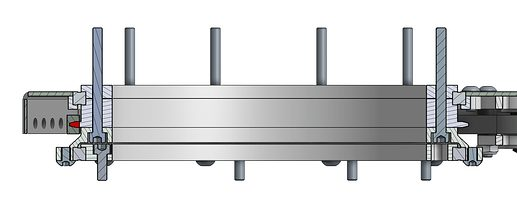
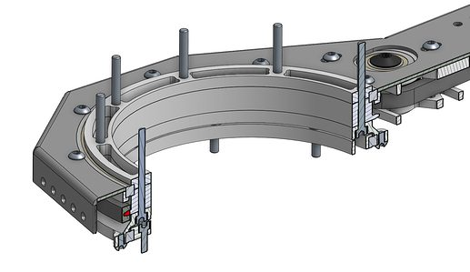
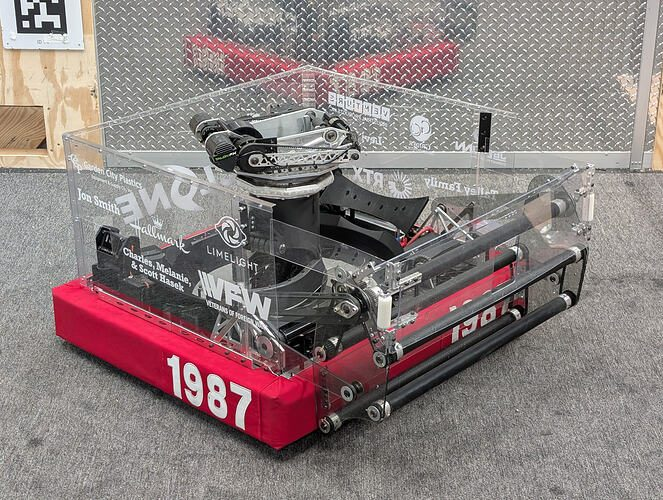
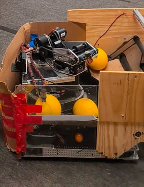
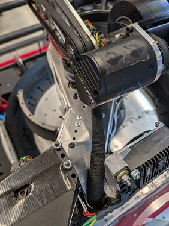

# 2026 · 1987 Broncobots — Broncobots 2026

EPA rank 25, snapshot EPA 257.92. Provisional reference dossier.

Low-profile turret on large coaxial DYE Rotor-family singulator.

## Drivetrain

Swerve; exact module specification unresolved here.

Coverage: partial / unresolved detail.

## Intake

Additional roller drives fuel deeper into hopper; metal hub caps and wall-contact Zamboni wheel resist impact damage.

Coverage: documented synopsis.

## Transfer

Large dish with thin upper hook geometry and independently driven coaxial wheel/hook chains; structure also supports turret.

Coverage: documented synopsis.

## Scoring

Low-profile two-X60 flywheel, independently controlled backspin wheels and cycloidal floating hood. Constant-force spring removes loaded hood compliance; omitted extra inertia for rapid speed changes.

Coverage: documented synopsis.

## Endgame

Endgame installation not established by reviewed interview.

Coverage: partial / unresolved detail.

## Controls

Geared absolute encoder extends turret position range; time-of-flight/velocity prediction supports moving shots.

Coverage: documented synopsis.

## Changes and versions

- V1 hood compliance led to added constant-force spring.
- Collector reinforcement followed early durability failures.

## Strategic interpretation — analyst inference

Independent spin control can expand moving-shot solutions but adds calibration burden. This architecture prioritizes rapid change in launch speed over stored inertia, contrasting usefully with large drums and heavy flywheel turrets.

## Evidence and limits

- Only the reviewed published configurations are established; intermediate changes may be undocumented.

Bounded source review; exhaustive intermediate-version history not certified

## Reviewed source bundle

- https://www.youtube.com/watch?v=FbkE2kAgKQE
- https://teambroncobots.com/robots/Technical%20Books/Technical%20Book%202026.pdf

## Season context

Read [the full 2026 game/context chapter](../docs/game_2026.md) before transferring this architecture to another role or season.

## Technical image references

Images are source-associated technical figures or robot views, not dimensionally certified drawings. Follow each source for version and figure context.

2026 team 1987 — source image from post 11 (2026-09-27). Context tags identify the discussion, not a verified component label. [Original source](https://www.chiefdelphi.com/t/524348/11). Source-linked extraction; mechanism identity not individually visually audited

2026 team 1987 — source image from post 11 (2026-09-27). Context tags identify the discussion, not a verified component label. [Original source](https://www.chiefdelphi.com/t/524348/11). Source-linked extraction; mechanism identity not individually visually audited

2026 team 1987 — source image from post 1 (2026-03-23). Context tags identify the discussion, not a verified component label. [Original source](https://www.chiefdelphi.com/t/517100/1). Source-linked extraction; mechanism identity not individually visually audited

2026 team 1987 — source image from post 6 (2026-03-24). Context tags identify the discussion, not a verified component label. [Original source](https://www.chiefdelphi.com/t/517100/6). Source-linked extraction; mechanism identity not individually visually audited

2026 team 1987 — source image from post 6 (2026-03-24). Context tags identify the discussion, not a verified component label. [Original source](https://www.chiefdelphi.com/t/517100/6). Source-linked extraction; mechanism identity not individually visually audited

## Dated research locators — navigation, not reviewed claims

A tag describes words in the source, not a validated engineering fact. Discussion replies may concern comparison robots.

- 2026-03-23 · Skyehawk · [post 3](https://www.chiefdelphi.com/t/517100/3) · rotor
- 2026-03-24 · jon.smith · [post 6](https://www.chiefdelphi.com/t/517100/6) · rotor
- 2026-03-25 · AntPoison · [post 8](https://www.chiefdelphi.com/t/517100/8) · rotor
- 2026-03-25 · jon.smith · [post 9](https://www.chiefdelphi.com/t/517100/9) · rotor
- 2026-03-25 · Zihe620 · [post 11](https://www.chiefdelphi.com/t/517100/11) · shooter
- 2026-03-26 · jon.smith · [post 12](https://www.chiefdelphi.com/t/517100/12) · shooter
- 2026-04-11 · scuyul · [post 13](https://www.chiefdelphi.com/t/517100/13) · cad, shooter
- 2026-04-12 · jgwentworth96 · [post 14](https://www.chiefdelphi.com/t/517100/14) · cad
- 2026-09-21 · jon.smith · [post 1](https://www.chiefdelphi.com/t/524348/1) · cad, code
- 2026-09-21 · Mirkwood815 · [post 2](https://www.chiefdelphi.com/t/524348/2) · hopper
- 2026-09-22 · pschreiber · [post 6](https://www.chiefdelphi.com/t/524348/6) · pivot, rotor, shooter
- 2026-09-23 · AntPoison · [post 8](https://www.chiefdelphi.com/t/524348/8) · rotor
- 2026-09-23 · jon.smith · [post 9](https://www.chiefdelphi.com/t/524348/9) · cad, hopper
- 2026-09-23 · jon.smith · [post 15](https://www.chiefdelphi.com/t/517100/15) · cad, code
- 2026-09-24 · jon.smith · [post 10](https://www.chiefdelphi.com/t/524348/10) · arm, hopper, intake, prototype, rotor, shooter, spindexer
- 2026-09-27 · jgwentworth96 · [post 11](https://www.chiefdelphi.com/t/524348/11) · chain, rotor
- 2026-09-27 · AntPoison · [post 12](https://www.chiefdelphi.com/t/524348/12) · cad, prototype, rotor
- 2026-09-28 · Levi_Madden · [post 14](https://www.chiefdelphi.com/t/524348/14) · cad, hopper, intake, prototype, rotor, shooter, spindexer
- 2026-09-29 · AntPoison · [post 16](https://www.chiefdelphi.com/t/524348/16) · rotor
- 2026-09-29 · pschreiber · [post 17](https://www.chiefdelphi.com/t/524348/17) · cad, code, intake, pivot, prototype, rotor, shooter

# 2026-1987: technical mechanisms, design reasoning and revision boundaries

These notes distinguish published construction from team-stated intent and original engineering inference. Selected numerical values are reported source data, not independently reproduced measurements. The recommended tests have not been performed. A binder snapshot does not certify every competition version.

## CYCLONE: collector and frame share the impact path

Version: CYCLONE. [PDF p8](https://teambroncobots.com/robots/Technical%20Books/Technical%20Book%202026.pdf#page=8) · [PDF p9](https://teambroncobots.com/robots/Technical%20Books/Technical%20Book%202026.pdf#page=9)

**Published construction:** Full-width linear collector; 1.125-inch rollers; load-spreading hubs and washers.

**Team-stated reason or evidence boundary:** Acquire five columns and survive contact.

**Engineering analysis — original inference:** An exposed roller’s compliance must be paired with a force path into the chassis. A small washer can concentrate force and start a crack even if the main plate is otherwise flexible. Distributing that load across a hub or a larger washer reduces local pressure, but the joint must still allow the intended movement. The collector width also has an autonomous geometry consequence: it changes which fuel columns can be reached without the chassis crossing a contested route. A width figure should be linked to the effective acquisition envelope rather than merely the distance between arms.

**Proposed validation — not a completed test:** Map acquisition success across the entire mouth with off-center hits, then repeat after controlled impact loading.

**Limits:** The binder is a published configuration snapshot, not an independent durability or match-rate test.

## CYCLONE: DYE-inspired rotor with independent feed

Version: CYCLONE. [PDF p10](https://teambroncobots.com/robots/Technical%20Books/Technical%20Book%202026.pdf#page=10)

**Published construction:** 22-inch rotor; eight-fuel ring; separate rotation/feed drives; reported 18-fuel/s feed.

**Team-stated reason or evidence boundary:** Maintain bulk-to-single-stream flow in a compact package.

**Engineering analysis — original inference:** A rotor is not just a rotating bucket. Its moving boundary, internal feed contact and exit geometry jointly determine whether fuel circulates, enters the ring, or jams. Independent feed drive lets the team tune the launch supply without requiring the whole bulk pile to turn at that speed. A lower-profile center obstruction improves the area through which fuel can enter; reversing must not turn a hook or seam into a trap. A theoretical ring count multiplied by rotation rate is only an upper bound: pockets must actually fill and discharge.

**Proposed validation — not a completed test:** Measure pocket occupancy and output variability at full, half and nearly empty loads; test reversing a deliberately bridged inlet.

**Limits:** The binder is a published configuration snapshot, not an independent durability or match-rate test.

## CYCLONE: floating hood, preload and turret support

Version: CYCLONE. [PDF p11](https://teambroncobots.com/robots/Technical%20Books/Technical%20Book%202026.pdf#page=11)

**Published construction:** Compact turret; floating hood; constant-force spring; through-bore sensing; powered hood rollers.

**Team-stated reason or evidence boundary:** Reduce backlash and preserve storage volume.

**Engineering analysis — original inference:** Spring preload can keep a reduction loaded against one tooth flank, reducing reversal uncertainty, but adds a torque that the motor must overcome in the opposite direction. Measuring the output rather than only the motor helps detect residual compliance between gearbox and hood. The feed path and turret bearing need common structural alignment; a compact height is valuable only if it does not permit the hood to deflect enough to change the exit angle. Powered hood rollers alter the spin/contact state, so their ratio belongs in the shot calibration rather than being treated as passive guidance.

**Proposed validation — not a completed test:** Measure hood angle repeatability from both approach directions and at several turret headings; compare loaded and unloaded structure.

**Limits:** The binder is a published configuration snapshot, not an independent durability or match-rate test.

## CYCLONE: moving-shot compensation and variable feed

Version: CYCLONE. [PDF p13](https://teambroncobots.com/robots/Technical%20Books/Technical%20Book%202026.pdf#page=13)

**Published construction:** Gyro latency compensation, empirical flight time and variable rotor speed are documented.

**Team-stated reason or evidence boundary:** Maintain accurate mobile firing and stable throughput.

**Engineering analysis — original inference:** A turret can cancel chassis heading only if the controller uses the correct observation time and the actual release state. A latency error grows with angular velocity and can look like a mechanical aiming bias. Rotor speed also changes shot timing and inlet loading; a firing command is not the same as a ball leaving the hood. The mechanical and control record should include this delay and its variation. Slowing the feed may improve delivered score if it reduces wheel droop or keeps the exit state within tolerance.

**Proposed validation — not a completed test:** Time-stamp vision, gyro, turret position, feeder transitions and ball release; compare miss direction against angular and translational velocity.

**Limits:** The binder is a published configuration snapshot, not an independent durability or match-rate test.

## Selected published parameters

| Component | Source parameter | Locator |
|---|---|---|
| Intake | 1.5:1 rollers; 3.6:1 deploy | [Source p9](https://teambroncobots.com/robots/Technical%20Books/Technical%20Book%202026.pdf#page=9) |
| Rotor | 22-in diameter; 20.67:1 rotation; 1:1 feed; reported 18 fuel/s | [Source p10](https://teambroncobots.com/robots/Technical%20Books/Technical%20Book%202026.pdf#page=10) |
| Shooter | 4-in 60A main; two X60s at 1.25:1; 80.5:1 hood | [Source p11](https://teambroncobots.com/robots/Technical%20Books/Technical%20Book%202026.pdf#page=11) |
| Turret | 25.6:1; 360° described range | [Source p11](https://teambroncobots.com/robots/Technical%20Books/Technical%20Book%202026.pdf#page=11) |

Ratios preserve source notation; verify driver/driven order, complete geometry and the actual version in CAD before fabrication. Figure records retain PDF page and crop bounds in `data/mechanism_images.jsonl`. Images may include rejected prototypes or whole-robot photographs; their captions preserve that distinction.

## Current strategic priority

Fuel acquisition, supply/denial, deliverable inventory, accurate output, route access and reliability. Climb is a low-priority exception requiring positive marginal justification.
