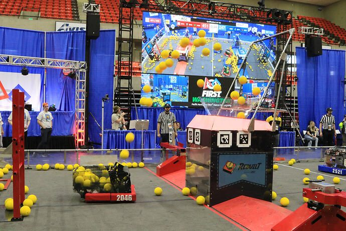
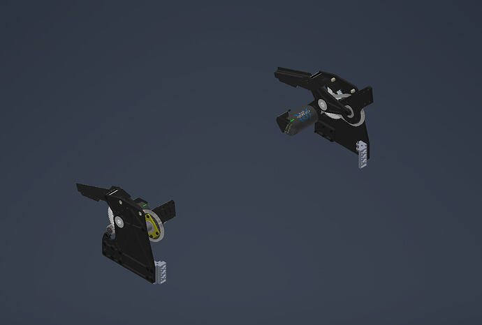
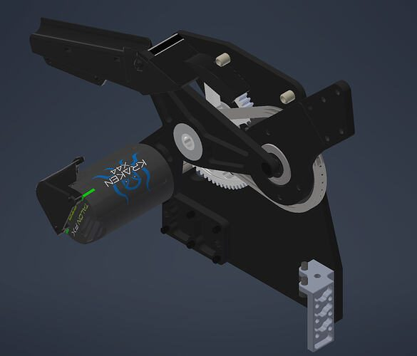

# 2026 · 2046 Bear Metal — Bearricade Mk.II

EPA rank 23, snapshot EPA 259.76. Provisional reference dossier.

Wide drum after triple/dual-channel development, with reversible local defense shot.

## Drivetrain

Swerve; exact module specification in released binder, not fully extracted here.

Coverage: partial / unresolved detail.

## Intake

Multi-roller stub-axle collector; thick polycarbonate and localized aluminum reinforcement replace heavy frontal bar. TPU retention mounts.

Coverage: documented synopsis.

## Transfer

Eleven-roller floor speeds up toward scorer; deliberately loose belts reduce current. Team retained S-path after its own J/S tests found little performance difference.

Coverage: documented synopsis.

## Scoring

Four-motor drum and adjustable passive hood without driven hood rollers; negative hood angle enables reverse shot while locked against hub.

Coverage: documented synopsis.

## Endgame

Early layouts reserved L3/L1 space; final installed endgame capability unresolved in reviewed excerpt.

Coverage: partial / unresolved detail.

## Controls

Match-by-match current diagnostics and route/log review; loaded power consumption drove multiple architecture changes.

Coverage: documented synopsis.

## Changes and versions

- Wood alpha → triple-shooter beta → dual-channel competition development → week-1 dual shooter → eight-day drum rebuild before week 3. Prototype build weeks are not event weeks.
- Later collector/indexer/shooter refinements are separately reported.

## Strategic interpretation — analyst inference

Do not turn one team's successful J-path or powered hood into a universal rule: 2046 reports a different local optimum. The test is stable exit conditions, adequate supply and manageable current, with time-to-develop included in the objective.

## Evidence and limits

- Only the reviewed published configurations are established; intermediate changes may be undocumented.

Bounded source review; exhaustive intermediate-version history not certified

## Reviewed source bundle

- https://youtu.be/HD-UhOpBiZ0
- https://www.chiefdelphi.com/t/523823
- https://drive.google.com/file/d/1YBlY312kMTiV29boVv6xRt87foDIU9lk/view?usp=sharing

## Season context

Read [the full 2026 game/context chapter](../docs/game_2026.md) before transferring this architecture to another role or season.

## Technical image references

Images are source-associated technical figures or robot views, not dimensionally certified drawings. Follow each source for version and figure context.

2026 team 2046 — source image from post 1 (2026-09-03). Context tags identify the discussion, not a verified component label. [Original source](https://www.chiefdelphi.com/t/523823/1). Source-linked extraction; mechanism identity not individually visually audited

2026 team 2046 — source image from post 11 (2026-09-04). Context tags identify the discussion, not a verified component label. [Original source](https://www.chiefdelphi.com/t/523823/11). Source-linked extraction; mechanism identity not individually visually audited

2026 team 2046 — source image from post 11 (2026-09-04). Context tags identify the discussion, not a verified component label. [Original source](https://www.chiefdelphi.com/t/523823/11). Source-linked extraction; mechanism identity not individually visually audited

## Dated research locators — navigation, not reviewed claims

A tag describes words in the source, not a validated engineering fact. Discussion replies may concern comparison robots.

- 2026-09-03 · NaitikG · [post 1](https://www.chiefdelphi.com/t/523823/1) · cad
- 2026-09-04 · Renie · [post 3](https://www.chiefdelphi.com/t/523823/3) · autonomous
- 2026-09-04 · NaitikG · [post 6](https://www.chiefdelphi.com/t/523823/6) · shooter
- 2026-09-04 · jj5ninja · [post 9](https://www.chiefdelphi.com/t/523823/9) · intake
- 2026-09-04 · Torrance · [post 10](https://www.chiefdelphi.com/t/523823/10) · intake
- 2026-09-04 · NaitikG · [post 11](https://www.chiefdelphi.com/t/523823/11) · arm, intake, pivot
- 2026-09-04 · br.chai · [post 12](https://www.chiefdelphi.com/t/523823/12) · rebuild
- 2026-09-04 · NaitikG · [post 13](https://www.chiefdelphi.com/t/523823/13) · hopper, prototype, rebuild
- 2026-09-04 · Matthaeus · [post 14](https://www.chiefdelphi.com/t/523823/14) · cad
- 2026-09-30 · nrglord · [post 17](https://www.chiefdelphi.com/t/523823/17) · cad
- 2026-10-04 · CKioxide · [post 18](https://www.chiefdelphi.com/t/523823/18) · indexer

# 2026-2046: technical mechanisms, design reasoning and revision boundaries

These notes distinguish published construction from team-stated intent and original engineering inference. Selected numerical values are reported source data, not independently reproduced measurements. The recommended tests have not been performed. A binder snapshot does not certify every competition version.

## BEARRICADE: collector evolution and impact reinforcement

Version: BEARRICADE Mk.II. [PDF p22](https://drive.google.com/file/d/1YBlY312kMTiV29boVv6xRt87foDIU9lk/view?usp=sharing#page=22) · [PDF p23](https://drive.google.com/file/d/1YBlY312kMTiV29boVv6xRt87foDIU9lk/view?usp=sharing#page=23)

**Published construction:** Three rollers; dead-axle polycarbonate tubes; later metal stub-axle reinforcement.

**Team-stated reason or evidence boundary:** Remove pickup dead zones and improve impact survival.

**Engineering analysis — original inference:** A compliant tube may survive bending while its end attachment fails. That makes the stub axle, bearing retention and local side-plate load path as important as the roller material. A lower transition roller closes the region where a single upper roller can push fuel rather than capture it. More contact points can improve acquisition, but they also add belt drag and opportunities for a ball to be over-compressed. The relevant question is whether the ball experiences a continuous forward velocity through the bumper transition, including when the robot is moving and the hopper is already full.

**Proposed validation — not a completed test:** Film pickup from the side at maximum approach speed; inspect stub-axle displacement after repeated oblique hits.

**Limits:** The binder is a published configuration snapshot, not an independent durability or match-rate test.

## BEARRICADE: linked hopper and capacity states

Version: BEARRICADE Mk.II. [PDF p24](https://drive.google.com/file/d/1YBlY312kMTiV29boVv6xRt87foDIU9lk/view?usp=sharing#page=24) · [PDF p25](https://drive.google.com/file/d/1YBlY312kMTiV29boVv6xRt87foDIU9lk/view?usp=sharing#page=25)

**Published construction:** Collector-linked sliding walls; net; reported 60 fuel under trench and 75–80 over bump.

**Team-stated reason or evidence boundary:** Increase useful storage without losing the travel state.

**Engineering analysis — original inference:** These capacity figures describe different operating envelopes, not one universally available volume. A net can retain the top layer while allowing a changing envelope, but it adds elastic forces and can push fuel into the throat or against a wall. Sliding walls need enough overlap to remain guided under a side load without creating an inward shelf. Coupling deployment to the collector saves an actuator and synchronizes the opening, but also couples hopper faults to pickup. A good borrowed implementation preserves service access and allows the robot to recover when only one side deploys correctly.

**Proposed validation — not a completed test:** Measure retained and feedable capacity after loaded bump travel, then test deployment with a damaged slide or displaced net.

**Limits:** The binder is a published configuration snapshot, not an independent durability or match-rate test.

## BEARRICADE: why the belt bed became rollers

Version: BEARRICADE Mk.II. [PDF p17](https://drive.google.com/file/d/1YBlY312kMTiV29boVv6xRt87foDIU9lk/view?usp=sharing#page=17) · [PDF p18](https://drive.google.com/file/d/1YBlY312kMTiV29boVv6xRt87foDIU9lk/view?usp=sharing#page=18) · [PDF p26](https://drive.google.com/file/d/1YBlY312kMTiV29boVv6xRt87foDIU9lk/view?usp=sharing#page=26) · [PDF p27](https://drive.google.com/file/d/1YBlY312kMTiV29boVv6xRt87foDIU9lk/view?usp=sharing#page=27)

**Published construction:** Belt bed abandoned; ten 1.25-inch rollers, successive 21:20 speed steps, two X44s.

**Team-stated reason or evidence boundary:** Belt tension and ball motion were limiting the early design.

**Engineering analysis — original inference:** A belt bed pulls continuously on its support shafts; the tension required to transmit power can bend those shafts even before fuel loading is considered. A roller floor moves that challenge into shaft spacing, surface grip and transmission design. Incrementally faster rollers can stretch spacing between balls, but only if the fuel actually follows the surface and does not simply slip. Agitation is not automatically helpful: repeated upward kicks can keep a ball from settling into the receiving contact. This is why a rate test must observe the inlet to the superstructure, not only the speed of the floor.

**Proposed validation — not a completed test:** Measure time to empty under several fill levels, compare stepped speeds against equal speeds, and count time balls spend recirculating at the inlet.

**Limits:** The binder is a published configuration snapshot, not an independent durability or match-rate test.

## BEARRICADE: integrated S-path and two-lane drum

Version: BEARRICADE Mk.II. [PDF p28](https://drive.google.com/file/d/1YBlY312kMTiV29boVv6xRt87foDIU9lk/view?usp=sharing#page=28) · [PDF p29](https://drive.google.com/file/d/1YBlY312kMTiV29boVv6xRt87foDIU9lk/view?usp=sharing#page=29) · [PDF p30](https://drive.google.com/file/d/1YBlY312kMTiV29boVv6xRt87foDIU9lk/view?usp=sharing#page=30) · [PDF p31](https://drive.google.com/file/d/1YBlY312kMTiV29boVv6xRt87foDIU9lk/view?usp=sharing#page=31)

**Published construction:** Four-inch drum; printed backing; hood range −10° to 60°; triple-lane prototype became dual.

**Team-stated reason or evidence boundary:** Match launch capacity to indexing and preserve packaging.

**Engineering analysis — original inference:** Reducing lane count can improve the robot if the extra lane forces a worse feeder, more current or a larger structure. The S-shaped path is an integration choice, not a universal superiority claim over a J-shaped route. Negative launch angles create a specific close-to-hub shot envelope; they need geometric clearance and empirical tuning, especially where the robot is braced against a field element. Integrating shooter and tower plates can remove redundant material and align contact surfaces, while increasing the consequence of damage to that shared structure. The same binder also shows a turret concept; that image alone does not prove it competed.

**Proposed validation — not a completed test:** Test near-hub reverse shots and far shots at depleted battery; inspect integrated plate deflection while the feeder is fully loaded.

**Limits:** The binder is a published configuration snapshot, not an independent durability or match-rate test.

## BEARRICADE: delete the low-value climb

Version: BEARRICADE Mk.II. [PDF p6](https://drive.google.com/file/d/1YBlY312kMTiV29boVv6xRt87foDIU9lk/view?usp=sharing#page=6) · [PDF p32](https://drive.google.com/file/d/1YBlY312kMTiV29boVv6xRt87foDIU9lk/view?usp=sharing#page=32)

**Published construction:** The team rejected a six-pound, ten-point climbing package that occupied hopper space.

**Team-stated reason or evidence boundary:** Fuel contribution outweighed the mechanism’s opportunity cost.

**Engineering analysis — original inference:** This is direct team evidence for treating climb as a low-priority 2026 architecture choice. Its cost is larger than its actuator and hook: it can remove storage, require alignment practice, complicate wiring and consume testing that could improve fuel flow. A calculation that includes only seconds spent climbing misses those development and packaging costs. Conversely, a near-free existing device could have a different marginal cost. The agent should begin with the observed fuel-dominant game, then require a specific positive marginal case before adding climb. It should not recommend one merely because the manual awards points for it.

**Proposed validation — not a completed test:** Compare scored-fuel loss from displaced volume and lost testing time against the expected climb contribution in the intended event role.

**Limits:** The binder is a published configuration snapshot, not an independent durability or match-rate test.

## Selected published parameters

| Component | Source parameter | Locator |
|---|---|---|
| Base | 27×27-in; Mk5n L1 source label | [Source p20](https://drive.google.com/file/d/1YBlY312kMTiV29boVv6xRt87foDIU9lk/view?usp=sharing#page=20) |
| Capacity | 60 under trench; 75–80 over bump; team report | [Source p25](https://drive.google.com/file/d/1YBlY312kMTiV29boVv6xRt87foDIU9lk/view?usp=sharing#page=25) |
| Floor | ten 1.25-in rollers; 21:20 successive steps; 1410→2297 RPM | [Source p27](https://drive.google.com/file/d/1YBlY312kMTiV29boVv6xRt87foDIU9lk/view?usp=sharing#page=27) |
| Shooter | 4-in drum; listed 3000 RPM; −10°–60° hood | [Source p31](https://drive.google.com/file/d/1YBlY312kMTiV29boVv6xRt87foDIU9lk/view?usp=sharing#page=31) |
| Climb deletion | 6 lb; 10-point capability; occupied hopper volume | [Source p32](https://drive.google.com/file/d/1YBlY312kMTiV29boVv6xRt87foDIU9lk/view?usp=sharing#page=32) |

Ratios preserve source notation; verify driver/driven order, complete geometry and the actual version in CAD before fabrication. Figure records retain PDF page and crop bounds in `data/mechanism_images.jsonl`. Images may include rejected prototypes or whole-robot photographs; their captions preserve that distinction.

## Current strategic priority

Fuel acquisition, supply/denial, deliverable inventory, accurate output, route access and reliability. Climb is a low-priority exception requiring positive marginal justification.
