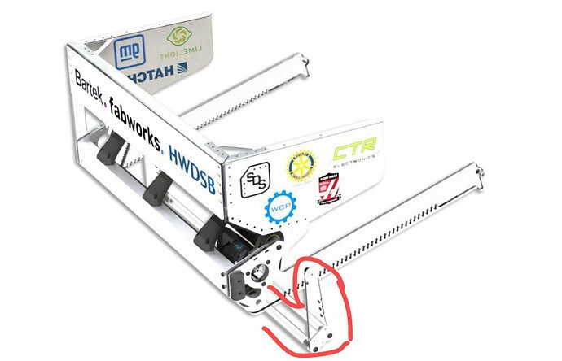
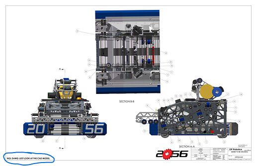
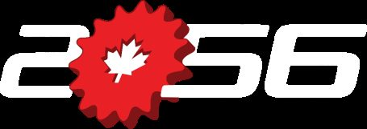

# 2026 · 2056 OP Robotics — Desperate Times / Desperate Measures

EPA rank 6, snapshot EPA 302.17. Provisional reference dossier.

Low turret scorer with compliant pickup and approximately 62-fuel net hopper.

## Drivetrain

DESPERATE MEASURES binder: Mk5n R1, 25.5×29.5-inch frame, 15-ft/s reported top speed, low shear-plate base and spike-grip tread.

Coverage: documented synopsis.

## Intake

Rubber front roller and surgical-tubing-supported kicker; tubing added after fuel trapped against bumper.

Coverage: documented synopsis.

## Transfer

Neoprene live floor ends in a slick roller to permit slip; belt conveyor and reverse anti-jam roller feed turret.

Coverage: documented synopsis.

## Scoring

Single-stream turret with approximately 370-degree cable-limited travel. Main flywheel held at fixed speed; kicker spin and hood angle vary trajectory/passing.

Coverage: documented synopsis.

## Endgame

Endgame capability not established by reviewed interview.

Coverage: partial / unresolved detail.

## Controls

Constant-flight-time scoring trajectory aims to prevent in-air collisions; controller rumble/LEDs signal brownout and states.

Coverage: documented synopsis.

## Changes and versions

- DESPERATE TIMES: initial hopperless concept; inadequate throughput for its storage tradeoff.
- DESPERATE MEASURES: three-week architecture pivot retaining turret; new hopper, intake and singulator. Orbit 1690 credited as principal redesign inspiration.
- Net enlarged before Worlds.
- Strategy evolved by Ontario provincials from primarily scoring to aggressive opponent-fuel acquisition.

## Strategic interpretation — analyst inference

The team's own account gives a key meta shift: removing fuel from the opponent can matter more than a small increase in one's firing rate. That favors maneuverability, durable acquisition and useful passing, with scoring throughput evaluated only after supply is secured.

## Evidence and limits

- Only the reviewed published configurations are established; intermediate changes may be undocumented.

Bounded source review; exhaustive intermediate-version history not certified

## Reviewed source bundle

- https://www.youtube.com/watch?v=iruLnDDMKRs
- https://2056.ca/wp-content/uploads/2026/10/OPR26-B-2056-Technical-Binder.pdf

## Season context

Read [the full 2026 game/context chapter](../docs/game_2026.md) before transferring this architecture to another role or season.

## Technical image references

Images are source-associated technical figures or robot views, not dimensionally certified drawings. Follow each source for version and figure context.

2026 team 2056 — source image from post 6 (2026-10-13). Context tags identify the discussion, not a verified component label. [Original source](https://www.chiefdelphi.com/t/525183/6). Source-linked extraction; mechanism identity not individually visually audited

2026 team 2056 — source image from post 17 (2026-10-13). Context tags identify the discussion, not a verified component label. [Original source](https://www.chiefdelphi.com/t/525183/17). Source-linked extraction; mechanism identity not individually visually audited

2026 team 2056 — embedded figure from technical binder, PDF page 14. Page discusses shooter. Figure identity requires the surrounding source page. [Original source](https://2056.ca/wp-content/uploads/2026/10/OPR26-B-2056-Technical-Binder.pdf). Individual embedded figure extracted; contextual page tags, not a visually verified engineering drawing

## Dated research locators — navigation, not reviewed claims

A tag describes words in the source, not a validated engineering fact. Discussion replies may concern comparison robots.

- 2026-10-12 · Khalsa · [post 1](https://www.chiefdelphi.com/t/525183/1) · cad, pivot
- 2026-10-12 · Khalsa · [post 2](https://www.chiefdelphi.com/t/525183/2) · encoder, pivot, shooter
- 2026-10-12 · Mike_Schreiber · [post 4](https://www.chiefdelphi.com/t/525183/4) · intake, pivot
- 2026-10-13 · LP3 · [post 6](https://www.chiefdelphi.com/t/525183/6) · intake
- 2026-10-13 · AI_orange · [post 8](https://www.chiefdelphi.com/t/525183/8) · intake
- 2026-10-13 · ArchdukeTim · [post 10](https://www.chiefdelphi.com/t/525183/10) · hopper, intake
- 2026-10-13 · Fionan · [post 11](https://www.chiefdelphi.com/t/525183/11) · intake
- 2026-10-13 · JamesO1086 · [post 13](https://www.chiefdelphi.com/t/525183/13) · cad
- 2026-10-13 · AvocadoPeel · [post 14](https://www.chiefdelphi.com/t/525183/14) · code
- 2026-10-13 · Khalsa · [post 15](https://www.chiefdelphi.com/t/525183/15) · intake, pivot
- 2026-10-13 · Khalsa · [post 16](https://www.chiefdelphi.com/t/525183/16) · cad, hopper, intake, pivot
- 2026-10-13 · Khalsa · [post 17](https://www.chiefdelphi.com/t/525183/17) · cad, hopper, intake
- 2026-10-13 · Khalsa · [post 18](https://www.chiefdelphi.com/t/525183/18) · autonomous
- 2026-10-13 · Khalsa · [post 19](https://www.chiefdelphi.com/t/525183/19) · camera
- 2026-10-13 · AlexanderLuebbert · [post 23](https://www.chiefdelphi.com/t/525183/23) · hopper
- 2026-10-13 · nrglord · [post 26](https://www.chiefdelphi.com/t/525183/26) · rebuild
- 2026-10-14 · aung · [post 28](https://www.chiefdelphi.com/t/525183/28) · rebuild
- 2026-10-14 · AvocadoPeel · [post 29](https://www.chiefdelphi.com/t/525183/29) · rotor
- 2026-10-14 · Zihe620 · [post 30](https://www.chiefdelphi.com/t/525183/30) · intake
- 2026-10-15 · Holtzman · [post 32](https://www.chiefdelphi.com/t/525183/32) · intake, rebuild, rotor
- 2026-10-19 · Holtzman · [post 34](https://www.chiefdelphi.com/t/525183/34) · bearing

# 2026-2056: technical mechanisms, design reasoning and revision boundaries

These notes distinguish published construction from team-stated intent and original engineering inference. Selected numerical values are reported source data, not independently reproduced measurements. The recommended tests have not been performed. A binder snapshot does not certify every competition version.

## DESPERATE MEASURES: linear collector as a controllable spring

Version: DESPERATE MEASURES rebuild. [PDF p8](https://2056.ca/wp-content/uploads/2026/10/OPR26-B-2056-Technical-Binder.pdf#page=8) · [PDF p9](https://2056.ca/wp-content/uploads/2026/10/OPR26-B-2056-Technical-Binder.pdf#page=9)

**Published construction:** Double-layer polycarbonate rack; two 2-inch rollers; low-stator-current deployment.

**Team-stated reason or evidence boundary:** Large acquisition area with passive impact retraction.

**Engineering analysis — original inference:** A backdrivable, current-limited rack can yield during a collision rather than make the gearbox a rigid stop. That behavior depends on friction, reduction, acceleration limits and the controller remaining enabled; it is not supplied by polycarbonate alone. Stacking a structural plate beside the rack allows the designer to distribute load without relying only on gear teeth. A paired-roller collector should preserve positive contact as fuel crosses the bumper. The matching chassis and slide must react lateral hits, because a low-current motor primarily helps the axial direction.

**Proposed validation — not a completed test:** Measure peak rack load during frontal and sideways impacts; check tooth engagement and deployment after the test.

**Limits:** The binder is a published configuration snapshot, not an independent durability or match-rate test.

## DESPERATE MEASURES: active floor and inventory policy

Version: DESPERATE MEASURES rebuild. [PDF p10](https://2056.ca/wp-content/uploads/2026/10/OPR26-B-2056-Technical-Binder.pdf#page=10) · [PDF p20](https://2056.ca/wp-content/uploads/2026/10/OPR26-B-2056-Technical-Binder.pdf#page=20)

**Published construction:** 1.5-inch powered floor rollers; net; CANrange minimum-inventory control while passing.

**Team-stated reason or evidence boundary:** Keep fuel available for the next scoring shift.

**Engineering analysis — original inference:** Inventory sensing changes the job of a passer. Passing every available ball can improve the alliance pile but leave this robot empty when the shift turns. A minimum reserve is a control policy tied to how quickly the robot can refill, return and shoot. A distance sensor sees a local surface, not a perfect total count; a sloped or bridged pile can produce the same reading at very different usable inventories. The threshold needs validation under different pile shapes and while accelerating. Reserve logic should have an operator override when alliance strategy intentionally assigns all fuel elsewhere.

**Proposed validation — not a completed test:** Compare sensor reading with deliverable inventory for uneven fills and motion; measure reserve adequacy at the start of each shift.

**Limits:** The binder is a published configuration snapshot, not an independent durability or match-rate test.

## DESPERATE MEASURES: constrained belts and collision sorting

Version: DESPERATE MEASURES rebuild. [PDF p12](https://2056.ca/wp-content/uploads/2026/10/OPR26-B-2056-Technical-Binder.pdf#page=12) · [PDF p13](https://2056.ca/wp-content/uploads/2026/10/OPR26-B-2056-Technical-Binder.pdf#page=13)

**Published construction:** Two rubber-coated conveyors, printed carryways, vertical kicker, quarter-pipe feed.

**Team-stated reason or evidence boundary:** Turn bulk fuel into a reliable stream.

**Engineering analysis — original inference:** The carryway controls the support beneath the belt so compression does not change with belt sag. The vertical kicker addresses a different failure: two balls arriving at the quarter-pipe entrance can lock each other before either is captured. That distinction matters when diagnosing a singulator. Increasing belt speed does not necessarily release an arch; changing relative contact directions or reversing one element can. The quarter-pipe must preserve contact through the bend and deliver fuel at an appropriate velocity to the turret. A compact throat earns hopper space only if it remains serviceable and can clear a hard jam.

**Proposed validation — not a completed test:** Feed deliberately paired balls and partially collapsed fuel; log current signatures before and after reversal and inspect carryway wear.

**Limits:** The binder is a published configuration snapshot, not an independent durability or match-rate test.

## DESPERATE MEASURES: compact turret and continuous hood

Version: DESPERATE MEASURES rebuild. [PDF p14](https://2056.ca/wp-content/uploads/2026/10/OPR26-B-2056-Technical-Binder.pdf#page=14) · [PDF p15](https://2056.ca/wp-content/uploads/2026/10/OPR26-B-2056-Technical-Binder.pdf#page=15)

**Published construction:** Eight-inch bearing; ±185° turret; 4-inch Fairlane wheel; separate backspin kicker; variable hood.

**Team-stated reason or evidence boundary:** Score and pass across a broad envelope.

**Engineering analysis — original inference:** The bearing and base plate must keep the launch contact aligned while the chassis accelerates and balls enter the shooter. Independent back contact permits spin tuning without changing the main wheel, but also introduces another speed and recovery condition. A range slightly greater than one turn reduces the frequency of an unwind; it does not create unlimited rotation. The cable chain must survive the worst combined hood and turret state. For a recommendation, the compact swept envelope and the singulator’s feed location are as important as the shooter’s wheel diameter.

**Proposed validation — not a completed test:** Map accuracy over turret angle and hood angle, including near both cable limits and under representative chassis acceleration.

**Limits:** The binder is a published configuration snapshot, not an independent durability or match-rate test.

## DESPERATE TIMES to DESPERATE MEASURES

Version: DESPERATE MEASURES rebuild. [PDF p2](https://2056.ca/wp-content/uploads/2026/10/OPR26-B-2056-Technical-Binder.pdf#page=2) · [PDF p24](https://2056.ca/wp-content/uploads/2026/10/OPR26-B-2056-Technical-Binder.pdf#page=24)

**Published construction:** Original hopperless four-to-two-to-one path replaced; turret reused; Orbit 1690 explicitly credited.

**Team-stated reason or evidence boundary:** Original throughput did not justify minimal storage.

**Engineering analysis — original inference:** This is a valuable negative result because it separates the concept from its execution. A narrowing conveyor can spread fuel longitudinally as it accelerates, yet still fail to maintain sufficient launch supply. Without a hopper, every interruption in acquisition becomes an interruption in scoring. Reusing the turret preserved calibrated software and known interfaces while the rest of the architecture changed. The proper historical record includes both machines and the transition; the later successful package should not be projected backward onto the initial competitions or treated as a season-long fixed architecture.

**Proposed validation — not a completed test:** For a rebuild, identify which calibrated interfaces can survive unchanged and which performance assumptions require new integrated testing.

**Limits:** The binder is a published configuration snapshot, not an independent durability or match-rate test.

## Selected published parameters

| Component | Source parameter | Locator |
|---|---|---|
| Intake | 12:30 belt; 8:40 deploy gear; 12T 8DP rack pinion | [Source p8](https://2056.ca/wp-content/uploads/2026/10/OPR26-B-2056-Technical-Binder.pdf#page=8) |
| Singulator | 12:36 feed belts; 16:28 shooter-feed gears | [Source p12](https://2056.ca/wp-content/uploads/2026/10/OPR26-B-2056-Technical-Binder.pdf#page=12) |
| Turret | ±185°; 34° hood stroke; 73.5°–39.5° release | [Source p14](https://2056.ca/wp-content/uploads/2026/10/OPR26-B-2056-Technical-Binder.pdf#page=14) |
| Launch | 4-in Fairlane; 28:34 belt; independent backspin kicker | [Source p14](https://2056.ca/wp-content/uploads/2026/10/OPR26-B-2056-Technical-Binder.pdf#page=14) |

Ratios preserve source notation; verify driver/driven order, complete geometry and the actual version in CAD before fabrication. Figure records retain PDF page and crop bounds in `data/mechanism_images.jsonl`. Images may include rejected prototypes or whole-robot photographs; their captions preserve that distinction.

## Current strategic priority

Fuel acquisition, supply/denial, deliverable inventory, accurate output, route access and reliability. Climb is a low-priority exception requiring positive marginal justification.
