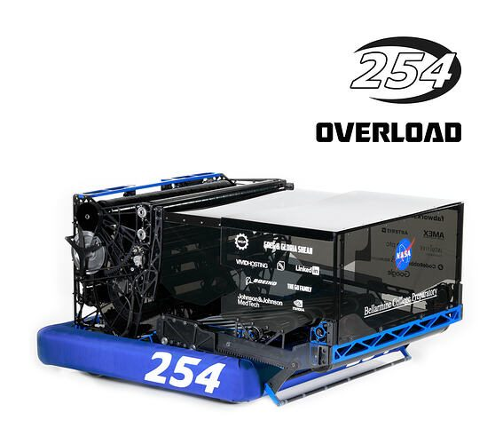
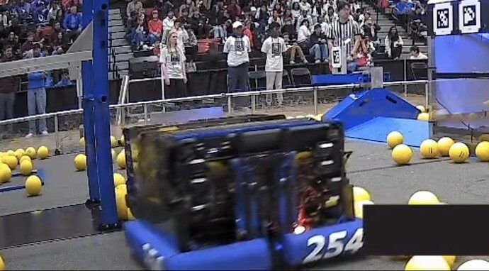
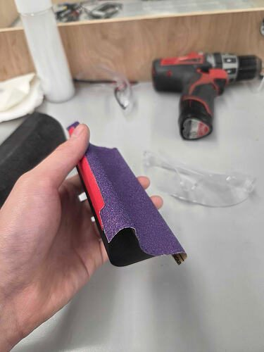

# 2026 · 254 The Cheesy Poofs — Cheesy Poofs 2026

EPA rank 2, snapshot EPA 327.82. Provisional reference dossier.

Four-wide drum, continuous ball-contact geometry and extending bumper/hopper system.

## Drivetrain

Swerve; exact module variant unresolved in this interview.

Coverage: partial / unresolved detail.

## Intake

Main roller and titanium kicker geometry; racks changed from polycarbonate/titanium teeth to SRPP/titanium laminate after failures. Additional retention roller added between second and third events.

Coverage: documented synopsis.

## Transfer

Rubber-backed belts provide continuous floor transport. Intake retraction raises linked hopper floor to clear residual fuel.

Coverage: documented synopsis.

## Scoring

Triangle of contact among drum, lower feeder and powered hood roller stabilizes ball speed/spin. External transmission packaging preserves effective width; double-sided belt reverses hood rollers.

Coverage: documented synopsis.

## Endgame

Endgame installation not established by reviewed interview.

Coverage: partial / unresolved detail.

## Controls

Four grayscale cameras, high-rate shooter-facing pair; slow-motion and internal-camera testing informed geometry and current draw.

Coverage: documented synopsis.

## Changes and versions

- Floor V1 on alpha: adjustable belt/pulley implementation; binding and shaft stiffness problems.
- Floor V2 at Silicon Valley: carbon tubes and adjustable tension; split dead axle failed, cam restraint allowed fuel underneath.
- Floor V3 at Central Valley: continuous axle; improved tension support, but lateral cam escape remained.
- Floor V4 at Worlds: fixed centers, rigid triangular supports and fully captured cam. Team reply 105 distinguishes these floor revisions; this is not a complete whole-robot revision census.
- Net raised reported capacity from about 50 to 75–80; carbon corners replaced cracking hopper corners.
- Team reports 25–28 BPS on fresh fuel; 30–35 was an architectural ceiling estimate, not a measured match average.

## Strategic interpretation — analyst inference

This is the relevant meaning of 254 shooter geometry: preacceleration, controlled contact and spin, usable width, packaging and a tuned hood. A wide drum alone does not reproduce it; neither does a bench BPS claim establish whole-match output.

## Evidence and limits

- Only the reviewed published configurations are established; intermediate changes may be undocumented.

Bounded source review; exhaustive intermediate-version history not certified

## Reviewed source bundle

- https://www.youtube.com/watch?v=TTjfNHw9jxM
- https://www.chiefdelphi.com/t/516252

## Season context

Read [the full 2026 game/context chapter](../docs/game_2026.md) before transferring this architecture to another role or season.

## Technical image references

Images are source-associated technical figures or robot views, not dimensionally certified drawings. Follow each source for version and figure context.

2026 team 254 — source image from post 1 (2026-03-12). Context tags identify the discussion, not a verified component label. [Original source](https://www.chiefdelphi.com/t/516252/1). Source-linked extraction; mechanism identity not individually visually audited

2026 team 254 — source image from post 32 (2026-03-14). Context tags identify the discussion, not a verified component label. [Original source](https://www.chiefdelphi.com/t/516252/32). Source-linked extraction; mechanism identity not individually visually audited

2026 team 254 — source image from post 64 (2026-05-29). Context tags identify the discussion, not a verified component label. [Original source](https://www.chiefdelphi.com/t/516252/64). Source-linked extraction; mechanism identity not individually visually audited

## Dated research locators — navigation, not reviewed claims

A tag describes words in the source, not a validated engineering fact. Discussion replies may concern comparison robots.

- 2026-03-12 · CuteRedpandas · [post 6](https://www.chiefdelphi.com/t/516252/6) · climb
- 2026-03-12 · Zihe620 · [post 9](https://www.chiefdelphi.com/t/516252/9) · belt, indexer
- 2026-03-12 · SnappleBot · [post 12](https://www.chiefdelphi.com/t/516252/12) · climb
- 2026-03-13 · Ainesh · [post 27](https://www.chiefdelphi.com/t/516252/27) · indexer
- 2026-03-17 · JamesO1086 · [post 36](https://www.chiefdelphi.com/t/516252/36) · intake
- 2026-03-24 · Barriviera · [post 39](https://www.chiefdelphi.com/t/516252/39) · shooter
- 2026-04-01 · githubAnish · [post 45](https://www.chiefdelphi.com/t/516252/45) · hopper, intake
- 2026-04-28 · mhr · [post 49](https://www.chiefdelphi.com/t/516252/49) · shooter
- 2026-05-08 · Nessie · [post 50](https://www.chiefdelphi.com/t/516252/50) · camera, vision
- 2026-05-08 · adhersh · [post 51](https://www.chiefdelphi.com/t/516252/51) · camera
- 2026-05-08 · JohnFogarty · [post 56](https://www.chiefdelphi.com/t/516252/56) · camera
- 2026-05-08 · rshah · [post 57](https://www.chiefdelphi.com/t/516252/57) · belt
- 2026-05-09 · FinIce · [post 59](https://www.chiefdelphi.com/t/516252/59) · elevator
- 2026-05-23 · drorta · [post 60](https://www.chiefdelphi.com/t/516252/60) · code
- 2026-05-29 · ehuang · [post 63](https://www.chiefdelphi.com/t/516252/63) · arm
- 2026-05-29 · Torrance · [post 64](https://www.chiefdelphi.com/t/516252/64) · intake
- 2026-05-29 · Torrance · [post 66](https://www.chiefdelphi.com/t/516252/66) · code
- 2026-05-29 · thaneye · [post 73](https://www.chiefdelphi.com/t/516252/73) · autonomous, intake
- 2026-07-06 · thaneye · [post 85](https://www.chiefdelphi.com/t/516252/85) · hopper, shooter
- 2026-07-13 · FiveCake · [post 88](https://www.chiefdelphi.com/t/516252/88) · hopper, intake, pivot
- 2026-07-14 · CarsonL · [post 89](https://www.chiefdelphi.com/t/516252/89) · prototype
- 2026-07-14 · Torrance · [post 90](https://www.chiefdelphi.com/t/516252/90) · cad, hopper, intake, rebuild, rotor, shooter
- 2026-07-16 · rshah · [post 91](https://www.chiefdelphi.com/t/516252/91) · bearing, hopper, intake, pivot
- 2026-07-17 · Nuttyman54 · [post 96](https://www.chiefdelphi.com/t/516252/96) · elevator
- 2026-07-17 · rshah · [post 98](https://www.chiefdelphi.com/t/516252/98) · hopper, intake, pivot
- 2026-07-20 · brennan-macaig · [post 100](https://www.chiefdelphi.com/t/516252/100) · intake, rebuild
- 2026-07-21 · chocolatte · [post 103](https://www.chiefdelphi.com/t/516252/103) · belt
- 2026-07-21 · Torrance · [post 105](https://www.chiefdelphi.com/t/516252/105) · bearing, belt, climb, hopper, intake, shooter
- 2026-07-23 · bhumm · [post 107](https://www.chiefdelphi.com/t/516252/107) · intake
- 2026-07-23 · Ainesh · [post 108](https://www.chiefdelphi.com/t/516252/108) · cad
- 2026-08-02 · FiveCake · [post 109](https://www.chiefdelphi.com/t/516252/109) · belt, hopper, intake
- 2026-08-03 · Torrance · [post 113](https://www.chiefdelphi.com/t/516252/113) · chain, hopper, intake
- 2026-08-06 · ElectricTurtle · [post 114](https://www.chiefdelphi.com/t/516252/114) · shooter
- 2026-08-07 · Hari · [post 115](https://www.chiefdelphi.com/t/516252/115) · cad, rebuild
- 2026-08-07 · Torrance · [post 116](https://www.chiefdelphi.com/t/516252/116) · hopper, prototype, shooter
- 2026-08-11 · ElectricTurtle · [post 118](https://www.chiefdelphi.com/t/516252/118) · prototype
- 2026-08-11 · Torrance · [post 119](https://www.chiefdelphi.com/t/516252/119) · cad
- 2026-08-22 · Barriviera · [post 120](https://www.chiefdelphi.com/t/516252/120) · cad
- 2026-08-22 · Torrance · [post 121](https://www.chiefdelphi.com/t/516252/121) · cad
- 2026-10-13 · JamesO1086 · [post 135](https://www.chiefdelphi.com/t/516252/135) · cad, code
- 2026-10-14 · Torrance · [post 136](https://www.chiefdelphi.com/t/516252/136) · chain, hopper, intake
- 2026-10-17 · kgzak · [post 142](https://www.chiefdelphi.com/t/516252/142) · cad
- 2026-10-19 · KH987 · [post 143](https://www.chiefdelphi.com/t/516252/143) · hopper
- 2026-10-19 · Torrance · [post 145](https://www.chiefdelphi.com/t/516252/145) · belt, hopper
- 2026-10-22 · John8866 · [post 146](https://www.chiefdelphi.com/t/516252/146) · cad
- 2026-10-23 · Torrance · [post 147](https://www.chiefdelphi.com/t/516252/147) · bearing, belt, cad, camera, hopper, intake, prototype, shooter
- 2026-10-24 · YousofAl · [post 148](https://www.chiefdelphi.com/t/516252/148) · belt

# 2026-254: technical mechanisms, design reasoning and revision boundaries

These notes distinguish published construction from team-stated intent and original engineering inference. Selected numerical values are reported source data, not independently reproduced measurements. The recommended tests have not been performed. A binder snapshot does not certify every competition version.

## OVERLOAD: floor versions change what should be copied

Version: 254 OVERLOAD first-party floor and prototype explanations. [Technical source](https://www.chiefdelphi.com/t/516252/105) · [Team explanation](https://www.chiefdelphi.com/t/516252/105)

**Published construction:** Alpha floor, SVDE split-axle floor, CVDE continuous axle and Worlds captured fixed-center floor are distinguished.

**Team-stated reason or evidence boundary:** Eliminate binding, belt escape, shaft failure and fuel trapped beneath the floor.

**Engineering analysis — original inference:** An adjustable joint can make prototyping easier while becoming a weak structural interface under a full hopper. A split axle is especially sensitive because bending, thread retention and tension adjustment meet at the same small connection. Capturing a cam follower must account for lateral deflection as well as the nominal two-dimensional motion; otherwise the follower can escape around a track that looks constrained in a sketch. Fixed centers can improve reliability once the correct tension is known, but require accurate geometry and assembly. The correct inspiration for a rebuild is a dated floor version with its failure history, not simply “254 belts.”

**Proposed validation — not a completed test:** Load the floor unevenly, push the intake backward, test lateral racking and inspect whether fuel can get underneath before copying the travel geometry.

**Limits:** The binder is a published configuration snapshot, not an independent durability or match-rate test.

## OVERLOAD: shared feeder power is a different optimization from floor tilt

Version: 254 OVERLOAD first-party floor and prototype explanations. [Technical source](https://www.chiefdelphi.com/t/516252/113) · [Team explanation](https://www.chiefdelphi.com/t/516252/113)

**Published construction:** Team says final floor tilt helped modestly; compares its output with 2910’s mechanically shared feeder/floor drives.

**Team-stated reason or evidence boundary:** Recognize the changing load distribution during discharge.

**Engineering analysis — original inference:** A hopper floor initially accelerates under a large pile load, while the downstream feeder can dominate later in the same discharge. Mechanically sharing motors can let the available power serve those changing demands instead of leaving some motors lightly loaded while another stage struggles. That benefit trades away independent control and can transmit a jam farther through the system. Extra floor tilt is a separate variable: it may improve the entry geometry without justifying a complicated cam and narrow packaging. Compare the complete energy and service cost rather than assuming every feature of the reference robot is worth retaining.

**Proposed validation — not a completed test:** Log floor and feeder torque over a full discharge; compare independently powered and shared-power layouts under identical contact geometry.

**Limits:** The binder is a published configuration snapshot, not an independent durability or match-rate test.

## OVERLOAD: a kitbot and prototypes test the architectural premise

Version: 254 OVERLOAD first-party floor and prototype explanations. [Technical source](https://www.chiefdelphi.com/t/516252/116) · [Team explanation](https://www.chiefdelphi.com/t/516252/116)

**Published construction:** Early plywood shooter and modified kitbot tested wide launch; belt and roller floors were compared before alpha integration.

**Team-stated reason or evidence boundary:** Establish piece contact and multi-ball behavior quickly.

**Engineering analysis — original inference:** A low-fidelity test should answer the uncertainty that changes the architecture. Before modeling a sophisticated drum, demonstrate that the available goal, piece and launch geometry can accept simultaneous streams without destructive interaction. The prototype then needs adjustable compression and a representative feed, not a beautifully finished chassis. If a simple kitbot already tests the relevant contact, reusing it can preserve time for the harder integration questions. Later failures in floor structure show the boundary of that early evidence: successful launch physics does not certify tensioning, impact survival or service access.

**Proposed validation — not a completed test:** Write the decision the prototype will change, test representative piece conditions, and reserve a second integrated test for load and flow.

**Limits:** The binder is a published configuration snapshot, not an independent durability or match-rate test.

## Selected published parameters

| Component | Source parameter | Locator |
|---|---|---|

Ratios preserve source notation; verify driver/driven order, complete geometry and the actual version in CAD before fabrication. Figure records retain PDF page and crop bounds in `data/mechanism_images.jsonl`. Images may include rejected prototypes or whole-robot photographs; their captions preserve that distinction.

## Current strategic priority

Fuel acquisition, supply/denial, deliverable inventory, accurate output, route access and reliability. Climb is a low-priority exception requiring positive marginal justification.
