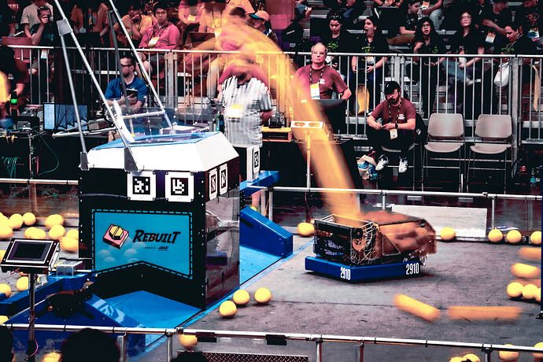
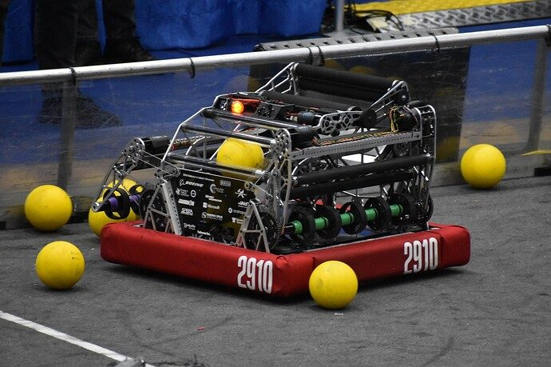
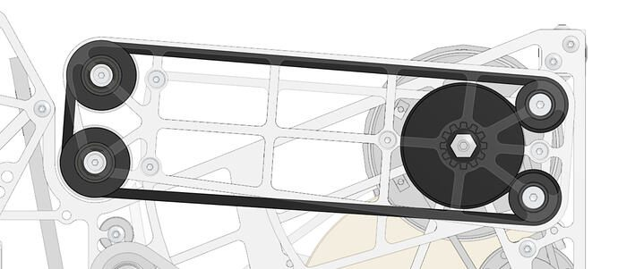
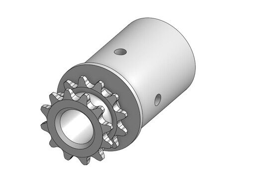

# 2026 · 2910 Jack in the Bot — Blitz → rebuild

EPA rank 12, snapshot EPA 281.69. Provisional reference dossier.

Original hopperless dual-four-bar passing robot rebuilt as RE-BLITZ: single-pivot slapdown, expanding hopper, powered wide floor and four-wide drum.

## Drivetrain

Original BLITZ: Mk5n R2. RE-BLITZ: Mk5n R1 with X60 drive and X44 steer on a 27.5×27-inch low chassis; the two briefs identify the configuration change.

Coverage: documented synopsis.

## Intake

Original BLITZ used two mirrored four-bar intakes. RE-BLITZ explicitly replaced the four-bar with a strengthened slapdown, larger deployment chain, split service plates and powered lower roller. These are distinct versions.

Coverage: documented synopsis.

## Transfer

Original serpentine, minimal-hopper passing path was replaced by a large hopper, inclined powered floor and wider feed path. The rebuild brief reports >30 fuel/s and a 34 maximum as team measurements, not match averages.

Coverage: documented synopsis.

## Scoring

Wide drum derived with explicit 254/Citrus inspiration; reported 55-ball hopper plus additional preloaded path storage.

Coverage: documented synopsis.

## Endgame

Endgame installation not established by reviewed interview.

Coverage: partial / unresolved detail.

## Controls

Finite-state-machine controls and minimal driver actions; separate hopper/path sensors coordinate loading.

Coverage: documented synopsis.

## Changes and versions

- Original BLITZ: dual four-bar collectors, minimal storage and a passing-centered serpentine path. Original technical brief pages 5, 8–9.
- RE-BLITZ: three-week rebuild between week-3 and week-6 events; slapdown, expanding hopper, powered floor and four-wide drum. Rebuild brief pages 3, 7–11.
- Original Blitz: two four-bars, serpentine path, drum, no hopper; failed week-2 performance targets.
- Post-week-2 engineering review triggered complete new robot.
- Preloading adds usable storage without enlarging hopper.

## Strategic interpretation — analyst inference

The original strategic idea—field as storage—was not sufficient when execution failed. The rebuild preserves the scoring objective while changing acquisition, storage and feed geometry; it demonstrates why architecture assumptions need tested cycle and supply models.

## Evidence and limits

- Only the reviewed published configurations are established; intermediate changes may be undocumented.

Bounded source review; exhaustive intermediate-version history not certified

## Reviewed source bundle

- https://www.youtube.com/watch?v=tKCFKqK_sXs
- https://drive.google.com/file/d/1jPf-aOGhz0dntoAgahFBgRhJiJv9rGpj/view?usp=sharing
- https://drive.google.com/file/d/1r-6zR4afbr_BpeZfWwcM5XL1N74FjScI/view?usp=sharing

## Season context

Read [the full 2026 game/context chapter](../docs/game_2026.md) before transferring this architecture to another role or season.

## Technical image references

Images are source-associated technical figures or robot views, not dimensionally certified drawings. Follow each source for version and figure context.

2026 team 2910 — source image from post 1 (2026-06-07). Context tags identify the discussion, not a verified component label. [Original source](https://www.chiefdelphi.com/t/521705/1). Source-linked extraction; mechanism identity not individually visually audited

2026 team 2910 — source image from post 1 (2026-06-07). Context tags identify the discussion, not a verified component label. [Original source](https://www.chiefdelphi.com/t/521705/1). Source-linked extraction; mechanism identity not individually visually audited

2026 team 2910 — source image from post 7 (2026-06-08). Context tags identify the discussion, not a verified component label. [Original source](https://www.chiefdelphi.com/t/521705/7). Source-linked extraction; mechanism identity not individually visually audited

2026 team 2910 — source image from post 91 (2026-05-11). Context tags identify the discussion, not a verified component label. [Original source](https://www.chiefdelphi.com/t/516325/91). Source-linked extraction; mechanism identity not individually visually audited

## Dated research locators — navigation, not reviewed claims

A tag describes words in the source, not a validated engineering fact. Discussion replies may concern comparison robots.

- 2026-03-13 · AlexanderLuebbert · [post 3](https://www.chiefdelphi.com/t/516325/3) · hopper
- 2026-03-13 · Ainesh · [post 5](https://www.chiefdelphi.com/t/516325/5) · indexer
- 2026-03-13 · Nuttyman54 · [post 6](https://www.chiefdelphi.com/t/516325/6) · intake
- 2026-03-13 · Calvin-Hobbes17 · [post 7](https://www.chiefdelphi.com/t/516325/7) · cad
- 2026-03-13 · asdtkn · [post 11](https://www.chiefdelphi.com/t/516325/11) · camera
- 2026-03-13 · Trent · [post 12](https://www.chiefdelphi.com/t/516325/12) · indexer, shooter
- 2026-03-13 · Nuttyman54 · [post 13](https://www.chiefdelphi.com/t/516325/13) · camera, shooter
- 2026-03-14 · Sudhir · [post 15](https://www.chiefdelphi.com/t/516325/15) · arm
- 2026-03-14 · jedgar6 · [post 16](https://www.chiefdelphi.com/t/516325/16) · shooter
- 2026-03-14 · BubblesOfWords · [post 17](https://www.chiefdelphi.com/t/516325/17) · hopper, indexer
- 2026-03-14 · HeroBrayden · [post 21](https://www.chiefdelphi.com/t/516325/21) · pivot
- 2026-03-14 · Lil_Lavery · [post 22](https://www.chiefdelphi.com/t/516325/22) · arm
- 2026-03-14 · OVDC · [post 23](https://www.chiefdelphi.com/t/516325/23) · arm
- 2026-03-14 · guineawheek · [post 24](https://www.chiefdelphi.com/t/516325/24) · indexer
- 2026-03-14 · Paul_R · [post 25](https://www.chiefdelphi.com/t/516325/25) · shooter
- 2026-03-14 · seans341 · [post 26](https://www.chiefdelphi.com/t/516325/26) · hopper
- 2026-03-14 · HeroBrayden · [post 28](https://www.chiefdelphi.com/t/516325/28) · climb, pivot
- 2026-03-18 · Ainesh · [post 39](https://www.chiefdelphi.com/t/516325/39) · arm, intake, pivot, shooter
- 2026-04-08 · Nuttyman54 · [post 40](https://www.chiefdelphi.com/t/516325/40) · rebuild
- 2026-04-08 · Kevin_Sheridan · [post 46](https://www.chiefdelphi.com/t/516325/46) · rebuild
- 2026-05-03 · Henrique_Schmit · [post 59](https://www.chiefdelphi.com/t/516325/59) · intake
- 2026-05-04 · waialua359 · [post 65](https://www.chiefdelphi.com/t/516325/65) · rebuild
- 2026-05-04 · Gokturk · [post 67](https://www.chiefdelphi.com/t/516325/67) · cad
- 2026-05-05 · Nuttyman54 · [post 75](https://www.chiefdelphi.com/t/516325/75) · cad, chain, hopper, intake, shooter
- 2026-05-07 · JohnFogarty · [post 79](https://www.chiefdelphi.com/t/516325/79) · shooter
- 2026-05-07 · waialua359 · [post 80](https://www.chiefdelphi.com/t/516325/80) · rebuild
- 2026-05-07 · adarsh · [post 81](https://www.chiefdelphi.com/t/516325/81) · cad
- 2026-05-07 · Nuttyman54 · [post 83](https://www.chiefdelphi.com/t/516325/83) · cad, hopper, intake, rebuild, shooter
- 2026-05-07 · Indoraptor · [post 84](https://www.chiefdelphi.com/t/516325/84) · shooter
- 2026-05-08 · Yusuf.Erdogan7536 · [post 85](https://www.chiefdelphi.com/t/516325/85) · cad
- 2026-05-11 · MSU2000 · [post 89](https://www.chiefdelphi.com/t/516325/89) · hopper, intake
- 2026-05-11 · Nuttyman54 · [post 91](https://www.chiefdelphi.com/t/516325/91) · hopper, intake, rebuild, shooter
- 2026-05-12 · Nuttyman54 · [post 96](https://www.chiefdelphi.com/t/516325/96) · bearing, hopper, intake, shooter
- 2026-05-12 · medusan31 · [post 97](https://www.chiefdelphi.com/t/516325/97) · hopper, intake
- 2026-05-12 · Nuttyman54 · [post 98](https://www.chiefdelphi.com/t/516325/98) · hopper, intake, rebuild
- 2026-05-12 · Nuttyman54 · [post 100](https://www.chiefdelphi.com/t/516325/100) · code, rebuild, shooter
- 2026-05-12 · Ekcrbe · [post 102](https://www.chiefdelphi.com/t/516325/102) · bearing
- 2026-05-13 · Nuttyman54 · [post 105](https://www.chiefdelphi.com/t/516325/105) · bearing
- 2026-05-20 · Zihe620 · [post 111](https://www.chiefdelphi.com/t/516325/111) · intake
- 2026-05-20 · _tal · [post 112](https://www.chiefdelphi.com/t/516325/112) · shooter
- 2026-05-20 · Nuttyman54 · [post 113](https://www.chiefdelphi.com/t/516325/113) · chain, intake, shooter
- 2026-05-20 · Zihe620 · [post 114](https://www.chiefdelphi.com/t/516325/114) · shooter
- 2026-05-20 · Nuttyman54 · [post 115](https://www.chiefdelphi.com/t/516325/115) · cad
- 2026-05-20 · Zihe620 · [post 116](https://www.chiefdelphi.com/t/516325/116) · hopper, intake
- 2026-05-20 · LukeElPollo · [post 117](https://www.chiefdelphi.com/t/516325/117) · hopper, intake, rebuild
- 2026-05-20 · Nuttyman54 · [post 118](https://www.chiefdelphi.com/t/516325/118) · hopper, intake, shooter
- 2026-05-20 · idk123_3296 · [post 119](https://www.chiefdelphi.com/t/516325/119) · shooter
- 2026-05-20 · Zihe620 · [post 121](https://www.chiefdelphi.com/t/516325/121) · shooter
- 2026-05-20 · Nuttyman54 · [post 122](https://www.chiefdelphi.com/t/516325/122) · intake
- 2026-05-21 · Zihe620 · [post 124](https://www.chiefdelphi.com/t/516325/124) · cad, shooter
- 2026-05-21 · Nuttyman54 · [post 125](https://www.chiefdelphi.com/t/516325/125) · cad
- 2026-05-21 · adarsh · [post 126](https://www.chiefdelphi.com/t/516325/126) · hopper, intake, shooter
- 2026-05-21 · SHMKPK · [post 127](https://www.chiefdelphi.com/t/516325/127) · intake
- 2026-05-22 · medusan31 · [post 128](https://www.chiefdelphi.com/t/516325/128) · intake
- 2026-06-05 · medusan31 · [post 129](https://www.chiefdelphi.com/t/516325/129) · cad
- 2026-06-05 · mechrookie · [post 130](https://www.chiefdelphi.com/t/516325/130) · cad
- 2026-06-07 · Kylie_Liu · [post 1](https://www.chiefdelphi.com/t/521705/1) · cad, code
- 2026-06-07 · Kylie_Liu · [post 135](https://www.chiefdelphi.com/t/516325/135) · cad
- 2026-06-08 · EthanAdler · [post 7](https://www.chiefdelphi.com/t/521705/7) · belt, chain, shooter
- 2026-06-08 · CommonII · [post 8](https://www.chiefdelphi.com/t/521705/8) · shooter
- 2026-06-08 · nrglord · [post 11](https://www.chiefdelphi.com/t/521705/11) · intake
- 2026-06-08 · TanyaY · [post 13](https://www.chiefdelphi.com/t/521705/13) · chain, hopper, shooter
- 2026-06-08 · br.chai · [post 14](https://www.chiefdelphi.com/t/521705/14) · cad, chain, rebuild
- 2026-06-08 · Kylie_Liu · [post 17](https://www.chiefdelphi.com/t/521705/17) · belt, cad, chain, hopper, intake, rebuild
- 2026-06-08 · MrFuzzypants948 · [post 20](https://www.chiefdelphi.com/t/521705/20) · indexer
- 2026-06-08 · Kylie_Liu · [post 21](https://www.chiefdelphi.com/t/521705/21) · belt, chain, hopper, intake
- 2026-06-08 · Kylie_Liu · [post 24](https://www.chiefdelphi.com/t/521705/24) · hopper, intake, pivot, shooter
- 2026-06-08 · Nuttyman54 · [post 25](https://www.chiefdelphi.com/t/521705/25) · arm, belt, chain, intake, pivot, rebuild, shooter
- 2026-06-08 · Ipad6202 · [post 27](https://www.chiefdelphi.com/t/521705/27) · code, rebuild
- 2026-06-08 · Kylie_Liu · [post 28](https://www.chiefdelphi.com/t/521705/28) · code
- 2026-06-08 · Franz_Hermann · [post 29](https://www.chiefdelphi.com/t/521705/29) · belt, chain, intake, shooter
- 2026-06-08 · Kylie_Liu · [post 30](https://www.chiefdelphi.com/t/521705/30) · belt, chain, hopper, intake, rebuild
- 2026-06-08 · Nuttyman54 · [post 32](https://www.chiefdelphi.com/t/521705/32) · belt, chain, intake, rebuild
- 2026-06-08 · Zihe620 · [post 33](https://www.chiefdelphi.com/t/521705/33) · belt, shooter
- 2026-06-08 · Nuttyman54 · [post 34](https://www.chiefdelphi.com/t/521705/34) · belt
- 2026-06-08 · Strflightmight · [post 35](https://www.chiefdelphi.com/t/521705/35) · hopper
- 2026-06-08 · Kylie_Liu · [post 36](https://www.chiefdelphi.com/t/521705/36) · hopper, intake, shooter
- 2026-06-08 · Cheesegrater · [post 37](https://www.chiefdelphi.com/t/521705/37) · shooter
- 2026-06-09 · PatrickW · [post 38](https://www.chiefdelphi.com/t/521705/38) · hopper
- 2026-06-09 · Zihe620 · [post 40](https://www.chiefdelphi.com/t/521705/40) · hopper, shooter
- 2026-06-09 · PatrickW · [post 41](https://www.chiefdelphi.com/t/521705/41) · hopper, intake, shooter
- 2026-06-09 · anihtA · [post 46](https://www.chiefdelphi.com/t/521705/46) · cad
- 2026-06-09 · PatrickW · [post 47](https://www.chiefdelphi.com/t/521705/47) · hopper
- 2026-06-09 · _tal · [post 50](https://www.chiefdelphi.com/t/521705/50) · shooter
- 2026-06-09 · Mactar · [post 51](https://www.chiefdelphi.com/t/521705/51) · cad
- 2026-06-09 · crh_redbird1 · [post 52](https://www.chiefdelphi.com/t/521705/52) · intake
- 2026-06-09 · PatrickW · [post 54](https://www.chiefdelphi.com/t/521705/54) · chain, hopper, intake
- 2026-06-09 · kingbrandon14 · [post 55](https://www.chiefdelphi.com/t/521705/55) · shooter
- 2026-06-10 · Kylie_Liu · [post 56](https://www.chiefdelphi.com/t/521705/56) · code
- 2026-06-10 · David_Prog_2910 · [post 57](https://www.chiefdelphi.com/t/521705/57) · intake
- 2026-06-12 · guineawheek · [post 58](https://www.chiefdelphi.com/t/521705/58) · rebuild, rotor
- 2026-06-12 · mgstrick · [post 59](https://www.chiefdelphi.com/t/521705/59) · cad
- 2026-06-12 · Nuttyman54 · [post 60](https://www.chiefdelphi.com/t/521705/60) · cad
- 2026-06-12 · Nuttyman54 · [post 62](https://www.chiefdelphi.com/t/521705/62) · hopper, rebuild, rotor
- 2026-06-14 · nrglord · [post 63](https://www.chiefdelphi.com/t/521705/63) · shooter
- 2026-06-15 · nrglord · [post 68](https://www.chiefdelphi.com/t/521705/68) · shooter
- 2026-06-15 · Kylie_Liu · [post 69](https://www.chiefdelphi.com/t/521705/69) · shooter
- 2026-06-16 · amsam0 · [post 71](https://www.chiefdelphi.com/t/521705/71) · rebuild
- 2026-06-19 · HarelKor · [post 73](https://www.chiefdelphi.com/t/521705/73) · intake
- 2026-06-19 · Kylie_Liu · [post 74](https://www.chiefdelphi.com/t/521705/74) · intake
- 2026-06-19 · nrglord · [post 75](https://www.chiefdelphi.com/t/521705/75) · cad
- 2026-06-20 · PatrickW · [post 77](https://www.chiefdelphi.com/t/521705/77) · cad
- 2026-06-20 · Nuttyman54 · [post 79](https://www.chiefdelphi.com/t/521705/79) · cad
- 2026-06-20 · Eliot · [post 80](https://www.chiefdelphi.com/t/521705/80) · belt, chain
- 2026-06-21 · Strflightmight · [post 82](https://www.chiefdelphi.com/t/521705/82) · shooter
- 2026-06-23 · Imakeintakes · [post 87](https://www.chiefdelphi.com/t/521705/87) · belt
- 2026-06-24 · Kylie_Liu · [post 88](https://www.chiefdelphi.com/t/521705/88) · belt
- 2026-07-02 · Kylie_Liu · [post 90](https://www.chiefdelphi.com/t/521705/90) · prototype, shooter
- 2026-07-02 · Imakeintakes · [post 91](https://www.chiefdelphi.com/t/521705/91) · cad
- 2026-07-06 · RockyXRQ · [post 96](https://www.chiefdelphi.com/t/521705/96) · hopper, indexer, shooter
- 2026-07-06 · PatrickW · [post 98](https://www.chiefdelphi.com/t/521705/98) · hopper, indexer, shooter
- 2026-07-08 · aung · [post 99](https://www.chiefdelphi.com/t/521705/99) · intake, shooter
- 2026-07-09 · Kylie_Liu · [post 101](https://www.chiefdelphi.com/t/521705/101) · intake, prototype
- 2026-07-27 · chocolatte · [post 104](https://www.chiefdelphi.com/t/521705/104) · hopper
- 2026-07-28 · Nuttyman54 · [post 105](https://www.chiefdelphi.com/t/521705/105) · hopper, shooter
- 2026-07-30 · fargus111111111 · [post 111](https://www.chiefdelphi.com/t/521705/111) · intake
- 2026-07-31 · nrglord · [post 112](https://www.chiefdelphi.com/t/521705/112) · intake
- 2026-07-31 · cct · [post 114](https://www.chiefdelphi.com/t/521705/114) · belt, shooter
- 2026-08-01 · Nuttyman54 · [post 116](https://www.chiefdelphi.com/t/521705/116) · chain, intake
- 2026-08-06 · kingbrandon14 · [post 119](https://www.chiefdelphi.com/t/521705/119) · cad, camera
- 2026-08-10 · Nuttyman54 · [post 120](https://www.chiefdelphi.com/t/521705/120) · belt, chain, code, intake, shooter
- 2026-08-11 · chocolatte · [post 121](https://www.chiefdelphi.com/t/521705/121) · pivot
- 2026-08-12 · _tal · [post 123](https://www.chiefdelphi.com/t/521705/123) · shooter
- 2026-08-13 · Nuttyman54 · [post 124](https://www.chiefdelphi.com/t/521705/124) · shooter
- 2026-08-30 · nrglord · [post 134](https://www.chiefdelphi.com/t/521705/134) · chain
- 2026-08-30 · Kylie_Liu · [post 135](https://www.chiefdelphi.com/t/521705/135) · chain
- 2026-08-31 · chirayu · [post 136](https://www.chiefdelphi.com/t/521705/136) · intake
- 2026-09-01 · Nuttyman54 · [post 137](https://www.chiefdelphi.com/t/521705/137) · intake
- 2026-09-10 · MihirW · [post 141](https://www.chiefdelphi.com/t/521705/141) · shooter
- 2026-09-10 · PatrickW · [post 142](https://www.chiefdelphi.com/t/521705/142) · shooter
- 2026-09-10 · mgstrick · [post 143](https://www.chiefdelphi.com/t/521705/143) · cad
- 2026-09-10 · Nuttyman54 · [post 144](https://www.chiefdelphi.com/t/521705/144) · cad, prototype, vision
- 2026-09-14 · Kylie_Liu · [post 148](https://www.chiefdelphi.com/t/521705/148) · shooter
- 2026-09-15 · Nuttyman54 · [post 151](https://www.chiefdelphi.com/t/521705/151) · shooter
- 2026-09-22 · David_Prog_2910 · [post 153](https://www.chiefdelphi.com/t/521705/153) · intake
- 2026-09-23 · nfjfjnfj · [post 154](https://www.chiefdelphi.com/t/521705/154) · cad, shooter
- 2026-09-23 · Nuttyman54 · [post 155](https://www.chiefdelphi.com/t/521705/155) · belt, shooter
- 2026-09-23 · PatrickW · [post 157](https://www.chiefdelphi.com/t/521705/157) · belt, shooter
- 2026-09-23 · Nuttyman54 · [post 158](https://www.chiefdelphi.com/t/521705/158) · belt, cad
- 2026-09-24 · JamesO1086 · [post 159](https://www.chiefdelphi.com/t/521705/159) · belt
- 2026-09-24 · Nuttyman54 · [post 163](https://www.chiefdelphi.com/t/521705/163) · camera, code, hopper, intake, pivot
- 2026-09-26 · nrglord · [post 164](https://www.chiefdelphi.com/t/521705/164) · hopper
- 2026-09-26 · nfjfjnfj · [post 165](https://www.chiefdelphi.com/t/521705/165) · shooter
- 2026-09-26 · Nuttyman54 · [post 166](https://www.chiefdelphi.com/t/521705/166) · shooter
- 2026-10-03 · nrglord · [post 177](https://www.chiefdelphi.com/t/521705/177) · hopper
- 2026-10-03 · PatrickW · [post 178](https://www.chiefdelphi.com/t/521705/178) · camera, hopper
- 2026-10-05 · nrglord · [post 179](https://www.chiefdelphi.com/t/521705/179) · belt
- 2026-10-05 · JohnFogarty · [post 180](https://www.chiefdelphi.com/t/521705/180) · intake
- 2026-10-05 · Nuttyman54 · [post 181](https://www.chiefdelphi.com/t/521705/181) · belt, cad, intake, shooter
- 2026-10-11 · MihirW · [post 182](https://www.chiefdelphi.com/t/521705/182) · hopper
- 2026-10-14 · Nuttyman54 · [post 185](https://www.chiefdelphi.com/t/521705/185) · cad, hopper, intake, shooter
- 2026-10-15 · Nuttyman54 · [post 187](https://www.chiefdelphi.com/t/521705/187) · hopper, vision
- 2026-10-17 · zp2974 · [post 190](https://www.chiefdelphi.com/t/521705/190) · cad
- 2026-10-17 · seb2724 · [post 191](https://www.chiefdelphi.com/t/521705/191) · bearing

# 2026-2910: technical mechanisms, design reasoning and revision boundaries

These notes distinguish published construction from team-stated intent and original engineering inference. Selected numerical values are reported source data, not independently reproduced measurements. The recommended tests have not been performed. A binder snapshot does not certify every competition version.

## Original BLITZ: two mirrored four-bar collectors

Version: BLITZ original. [PDF p5](https://drive.google.com/file/d/1jPf-aOGhz0dntoAgahFBgRhJiJv9rGpj/view?usp=sharing#page=5) · [PDF p8](https://drive.google.com/file/d/1jPf-aOGhz0dntoAgahFBgRhJiJv9rGpj/view?usp=sharing#page=8)

**Published construction:** Dual four-bars; X44 deployment at 79.37:1; separate X60 roller drives.

**Team-stated reason or evidence boundary:** Collect sideways while passing; collapse under impacts.

**Engineering analysis — original inference:** This is a coupled routing decision. Collecting on either side allows the chassis to translate across a fuel pile while its fixed shooter points toward the destination. That can recover some of the directional independence normally purchased with a turret. A four-bar can also move backward under a frontal impact, but only if the linkage, motor controller, chain and hard stops permit that motion. More joints create more wear locations, and both collectors consume the space that another architecture could use for a hopper. The second intake should therefore be evaluated by additional useful fuel delivered, rather than the visual symmetry of the mechanism.

**Proposed validation — not a completed test:** Compare opposite-side sweep paths against turning a single-intake robot, including one damaged linkage and time to replace it.

**Limits:** The binder is a published configuration snapshot, not an independent durability or match-rate test.

## Original BLITZ: serpentine inventory and passing

Version: BLITZ original. [PDF p5](https://drive.google.com/file/d/1jPf-aOGhz0dntoAgahFBgRhJiJv9rGpj/view?usp=sharing#page=5) · [PDF p9](https://drive.google.com/file/d/1jPf-aOGhz0dntoAgahFBgRhJiJv9rGpj/view?usp=sharing#page=9)

**Published construction:** Serpentine conveyor, two X60 feeder motors, three X60 shooter motors; variable hood.

**Team-stated reason or evidence boundary:** Use the alliance zone as storage for a passing-centered role.

**Engineering analysis — original inference:** The low-storage concept treats the field as an external buffer. Its success requires the alliance to recover that buffered fuel at the right time and place. Passing capacity and scoring capacity are different services even when the same launcher performs both. A continuous serpentine can constrain fuel well but adds contact length, curved transitions and friction; a well-controlled ball path may still be unable to supply enough mass flow. This original brief must be read alongside the later rebuild account: a design rationale is evidence of a hypothesis, not evidence that the hypothesis met the team’s competitive targets.

**Proposed validation — not a completed test:** Measure fuel moved to a recoverable location, residual path inventory, and scoring available after the passer returns; vary partner collection quality.

**Limits:** The brief describes a 25-fuel/s feed capability; the later account reports inadequate overall performance. Do not treat that number as an independently demonstrated match average.

## RE-BLITZ: strengthened slapdown

Version: RE-BLITZ rebuild. [PDF p7](https://drive.google.com/file/d/1r-6zR4afbr_BpeZfWwcM5XL1N74FjScI/view?usp=sharing#page=7) · [PDF p9](https://drive.google.com/file/d/1r-6zR4afbr_BpeZfWwcM5XL1N74FjScI/view?usp=sharing#page=9)

**Published construction:** Four-bar replaced by slapdown; 0.6-inch plates; #35 deployment chain; powered bottom roller.

**Team-stated reason or evidence boundary:** Strength, service access and reliable full-speed acquisition.

**Engineering analysis — original inference:** A single pivot simplifies the force path: an exposed roller loads its arms, pivot and hard stop without several moving links sharing the impact. That does not make it automatically more impact tolerant. The stronger arm and larger deployment chain need a corresponding chassis attachment and a stop that can react a collision without loading the gearbox teeth. Powering the lower contact also matters at the bumper transition: fuel can otherwise be caught between a moving upper roller and a stationary surface while the robot continues advancing. Plate stiffness and ball transport are separate improvements and should be tested separately.

**Proposed validation — not a completed test:** Test a wall hit and an oblique corner hit, then remeasure roller alignment and deployment current; test full-speed pickup of worn fuel.

**Limits:** The binder is a published configuration snapshot, not an independent durability or match-rate test.

## RE-BLITZ: preserve width through the floor and tower

Version: RE-BLITZ rebuild. [PDF p7](https://drive.google.com/file/d/1r-6zR4afbr_BpeZfWwcM5XL1N74FjScI/view?usp=sharing#page=7) · [PDF p10](https://drive.google.com/file/d/1r-6zR4afbr_BpeZfWwcM5XL1N74FjScI/view?usp=sharing#page=10)

**Published construction:** Ten inclined floor rollers; four-X60 feeder; Teflon backing; enlarged four-wide path.

**Team-stated reason or evidence boundary:** Remove restrictions between hopper and launcher.

**Engineering analysis — original inference:** Adding a fourth release lane helps only if four lanes remain supplied. A floor feeding a narrow or irregular throat produces alternating bursts and starvation even when the drum has ample power. Inclination and backing determine the normal force and the direction in which fuel escapes when multiple balls arrive together. Low-friction backing reduces the energy lost to sliding while powered rollers maintain forward contact. An open path also needs a controlled final approach: a ball entering the launch contact at a variable velocity or height changes compression and the exit state. Diagnose the last few balls separately from the first dense volley.

**Proposed validation — not a completed test:** Log feeder current, wheel speed and scored output through a full hopper; repeat with 5, 15 and 30 fuel and with deliberate asymmetric loading.

**Limits:** The binder is a published configuration snapshot, not an independent durability or match-rate test.

## RE-BLITZ: drum, hood rollers and flywheel recovery

Version: RE-BLITZ rebuild. [PDF p10](https://drive.google.com/file/d/1r-6zR4afbr_BpeZfWwcM5XL1N74FjScI/view?usp=sharing#page=10)

**Published construction:** Four-inch drum, 1.5-inch hood rollers, overdriven flywheel; team reports >30 fuel/s and a 34 maximum.

**Team-stated reason or evidence boundary:** High discharge rate with manageable shooter recovery.

**Engineering analysis — original inference:** A drum’s useful contact surface is a distributed launch interface. If fuel encounters different compression along its width, the nominally identical lanes can launch at different speeds. Flywheel energy can cover short impulses while the motors replace average energy, but a dense volley still requires sufficient sustained electrical power. Surface condition, ball wear and hood contact determine how much of the wheel’s speed becomes translation versus spin. The reported rate is valuable as a team result; it does not establish accuracy, defended performance, battery condition or an all-match average. Copy the geometry only with a plan to characterize those conditions.

**Proposed validation — not a completed test:** Measure per-lane velocity and accuracy before and after a long volley; log loaded battery voltage and recovery between successive shots.

**Limits:** The binder is a published configuration snapshot, not an independent durability or match-rate test.

## RE-BLITZ: expansion actuated by the intake

Version: RE-BLITZ rebuild. [PDF p7](https://drive.google.com/file/d/1r-6zR4afbr_BpeZfWwcM5XL1N74FjScI/view?usp=sharing#page=7) · [PDF p11](https://drive.google.com/file/d/1r-6zR4afbr_BpeZfWwcM5XL1N74FjScI/view?usp=sharing#page=11)

**Published construction:** Intake-driven hopper expansion; smooth internal sheet-metal joints; deployed one-way catchers.

**Team-stated reason or evidence boundary:** Store useful inventory and feed it back toward the shooter.

**Engineering analysis — original inference:** The expanding walls and intake form one mechanism state machine. A wall that expands independently without managing its overlap can create a ledge, trap fuel, or fight the intake during retraction. Smooth fasteners reduce snagging, while the deployed catches react loads that should not be carried continuously by the intake motor. A large hopper helps separate acquisition from discharge, giving the driver freedom to reposition. That freedom disappears if the final fuel cannot leave without a specific intake movement. The recommendation should therefore specify both the retained capacity and the emptying sequence.

**Proposed validation — not a completed test:** Interrupt deployment halfway with a full hopper; test reverse motion, ball trapping at panel overlaps, trench travel and final-fuel evacuation.

**Limits:** The binder is a published configuration snapshot, not an independent durability or match-rate test.

## RE-BLITZ: mechanism readiness and fallback operation

Version: RE-BLITZ rebuild. [PDF p12](https://drive.google.com/file/d/1r-6zR4afbr_BpeZfWwcM5XL1N74FjScI/view?usp=sharing#page=12) · [PDF p13](https://drive.google.com/file/d/1r-6zR4afbr_BpeZfWwcM5XL1N74FjScI/view?usp=sharing#page=13)

**Published construction:** Shot gates, vision-based targeting, CANrange preload sensing and fixed-position manual fallbacks.

**Team-stated reason or evidence boundary:** Coordinate feeding with the actual launch state.

**Engineering analysis — original inference:** A high mechanical ceiling can be lost to premature feed. The feeder must distinguish an intentional firing pause from a jam, an empty hopper and a shooter that has not recovered. Readiness should use measured values with hysteresis rather than one noisy threshold. Manual known-position shots preserve a useful degraded mode when localization fails, but require practiced driver cues and a stable mechanical zero. A mechanism database needs this control contract because an intake, indexer and drum borrowed from different robots may otherwise disagree about who owns the next ball.

**Proposed validation — not a completed test:** Disable one camera, introduce an empty-hopper sensor error and force a heading correction mid-volley; check the operator can recover predictably.

**Limits:** The binder is a published configuration snapshot, not an independent durability or match-rate test.

## Selected published parameters

| Component | Source parameter | Locator |
|---|---|---|
| Drive | Mk5n R2; X60 drive; X44 steer | [Source p7](https://drive.google.com/file/d/1jPf-aOGhz0dntoAgahFBgRhJiJv9rGpj/view?usp=sharing#page=7) |
| Intake | 79.37:1 deploy; mirrored four-bars | [Source p8](https://drive.google.com/file/d/1jPf-aOGhz0dntoAgahFBgRhJiJv9rGpj/view?usp=sharing#page=8) |
| Shooter | three X60 launch motors; one X44 hood | [Source p9](https://drive.google.com/file/d/1jPf-aOGhz0dntoAgahFBgRhJiJv9rGpj/view?usp=sharing#page=9) |
| Drive | 27.5×27-in frame; Mk5n R1 | [Source p8](https://drive.google.com/file/d/1r-6zR4afbr_BpeZfWwcM5XL1N74FjScI/view?usp=sharing#page=8) |
| Intake | 40:1 deploy; #35 chain; 2-in and 1.25-in rollers | [Source p9](https://drive.google.com/file/d/1r-6zR4afbr_BpeZfWwcM5XL1N74FjScI/view?usp=sharing#page=9) |
| Floor | 15° inclination; ten 1.25-in rollers; four-X60 feeder | [Source p10](https://drive.google.com/file/d/1r-6zR4afbr_BpeZfWwcM5XL1N74FjScI/view?usp=sharing#page=10) |
| Shooter | 4-in drum; 1.5-in hood rollers; 6.7:1 flywheel overdrive source description | [Source p10](https://drive.google.com/file/d/1r-6zR4afbr_BpeZfWwcM5XL1N74FjScI/view?usp=sharing#page=10) |

Ratios preserve source notation; verify driver/driven order, complete geometry and the actual version in CAD before fabrication. Figure records retain PDF page and crop bounds in `data/mechanism_images.jsonl`. Images may include rejected prototypes or whole-robot photographs; their captions preserve that distinction.

Correction: original BLITZ uses dual four-bars; RE-BLITZ replaces them with a strengthened slapdown. The two technical briefs supersede ambiguous earlier linkage descriptions.

## Current strategic priority

Fuel acquisition, supply/denial, deliverable inventory, accurate output, route access and reliability. Climb is a low-priority exception requiring positive marginal justification.
