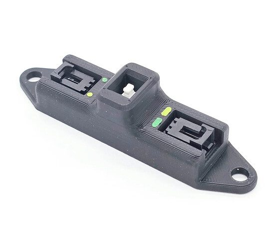
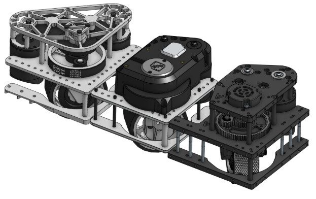

# 2026 · 3467 Windham Windup — Windham Windup 2026

EPA rank 18, snapshot EPA 266.45. Provisional reference dossier.

Four-wide drum rebuild with extensively iterated hot-dog roller feed.

## Drivetrain

Swerve; precise module variant unresolved here.

Coverage: partial / unresolved detail.

## Intake

Single griptape stub roller and spring-supported kicker; SRPP preserves impact shape.

Coverage: documented synopsis.

## Transfer

Compliant wheels plus stub rollers singulate from net hopper; rising path accelerates fuel in roughly five-percent steps.

Coverage: documented synopsis.

## Scoring

Original single stream grew to independent dual streams, then post-week-1/2 rebuild to wide drum. Separate belt loops replaced poorly controlled continuous tensioned loop.

Coverage: documented synopsis.

## Endgame

Endgame installation not established by reviewed interview.

Coverage: partial / unresolved detail.

## Controls

Camera/computer failures led to Jetson-based C2 vision; resilient trajectory follower pauses feedforward when far off path then resumes after recovery.

Coverage: documented synopsis.

## Changes and versions

- Competed weeks 1, 2 and 5; major rebuild occurred between weeks 2 and 5.
- Around 30 indexer development revisions are reported, not 30 competed configurations.

## Strategic interpretation — analyst inference

The rate-limiting subsystem and reliability problem changed together: a wider scorer needed stable feed and pose estimates. Architecture reuse should include diagnostics and recovery paths, not just nominal autonomous routes.

## Evidence and limits

- Only the reviewed published configurations are established; intermediate changes may be undocumented.

Bounded source review; exhaustive intermediate-version history not certified

## Reviewed source bundle

- https://youtu.be/XXEyiGw7u54
- https://www.chiefdelphi.com/uploads/short-url/lbtPppphC5xWP1sMBjDA1Xwhlhl.pdf

## Season context

Read [the full 2026 game/context chapter](../docs/game_2026.md) before transferring this architecture to another role or season.

## Technical image references

Images are source-associated technical figures or robot views, not dimensionally certified drawings. Follow each source for version and figure context.

2026 team 3467 — source image from post 1 (2025-11-21). Context tags identify the discussion, not a verified component label. [Original source](https://www.chiefdelphi.com/t/508474/1). Source-linked extraction; mechanism identity not individually visually audited

2026 team 3467 — source image from post 1 (2025-11-21). Context tags identify the discussion, not a verified component label. [Original source](https://www.chiefdelphi.com/t/508474/1). Source-linked extraction; mechanism identity not individually visually audited

## Dated research locators — navigation, not reviewed claims

A tag describes words in the source, not a validated engineering fact. Discussion replies may concern comparison robots.

- 2025-11-21 · Kevin_Leonard · [post 1](https://www.chiefdelphi.com/t/508474/1) · autonomous, intake
- 2026-01-15 · Kevin_Leonard · [post 19](https://www.chiefdelphi.com/t/508474/19) · prototype, shooter
- 2026-01-15 · w1zxrd · [post 20](https://www.chiefdelphi.com/t/508474/20) · prototype
- 2026-01-15 · Kevin_Leonard · [post 21](https://www.chiefdelphi.com/t/508474/21) · prototype
- 2026-01-15 · vargoose84 · [post 22](https://www.chiefdelphi.com/t/508474/22) · shooter, spindexer
- 2026-01-15 · credard · [post 23](https://www.chiefdelphi.com/t/508474/23) · prototype, spindexer
- 2026-01-15 · arjun1721 · [post 24](https://www.chiefdelphi.com/t/508474/24) · shooter
- 2026-01-15 · Kevin_Leonard · [post 25](https://www.chiefdelphi.com/t/508474/25) · shooter
- 2026-01-15 · jibby · [post 30](https://www.chiefdelphi.com/t/508474/30) · shooter
- 2026-01-17 · Casey_Gormley · [post 34](https://www.chiefdelphi.com/t/508474/34) · prototype, shooter
- 2026-01-18 · credard · [post 35](https://www.chiefdelphi.com/t/508474/35) · hopper, prototype, shooter, spindexer
- 2026-01-19 · nvixty · [post 36](https://www.chiefdelphi.com/t/508474/36) · cad, shooter
- 2026-01-19 · credard · [post 37](https://www.chiefdelphi.com/t/508474/37) · cad, shooter
- 2026-01-19 · masongish · [post 38](https://www.chiefdelphi.com/t/508474/38) · spindexer
- 2026-01-20 · Kevin_Leonard · [post 40](https://www.chiefdelphi.com/t/508474/40) · intake, shooter
- 2026-01-20 · BrendanB · [post 41](https://www.chiefdelphi.com/t/508474/41) · shooter
- 2026-01-20 · jibby · [post 42](https://www.chiefdelphi.com/t/508474/42) · cad, shooter
- 2026-01-20 · Kevin_Leonard · [post 45](https://www.chiefdelphi.com/t/508474/45) · cad, prototype, shooter
- 2026-01-20 · Reis · [post 51](https://www.chiefdelphi.com/t/508474/51) · intake, shooter
- 2026-01-20 · Techery · [post 53](https://www.chiefdelphi.com/t/508474/53) · cad
- 2026-01-21 · BrendanG3739 · [post 55](https://www.chiefdelphi.com/t/508474/55) · code
- 2026-01-21 · ilker_sahin · [post 56](https://www.chiefdelphi.com/t/508474/56) · cad, prototype
- 2026-01-21 · Kevin_Leonard · [post 57](https://www.chiefdelphi.com/t/508474/57) · indexer, prototype, shooter
- 2026-01-21 · Bryson_Halsey · [post 58](https://www.chiefdelphi.com/t/508474/58) · code
- 2026-01-21 · ilker_sahin · [post 59](https://www.chiefdelphi.com/t/508474/59) · prototype
- 2026-01-22 · nvixty · [post 61](https://www.chiefdelphi.com/t/508474/61) · cad
- 2026-01-25 · cad321 · [post 62](https://www.chiefdelphi.com/t/508474/62) · cad, shooter
- 2026-01-25 · Shai6 · [post 64](https://www.chiefdelphi.com/t/508474/64) · intake, shooter
- 2026-01-25 · Kevin_Leonard · [post 65](https://www.chiefdelphi.com/t/508474/65) · intake, launcher
- 2026-01-25 · JamesO1086 · [post 68](https://www.chiefdelphi.com/t/508474/68) · shooter
- 2026-01-27 · Kevin_Leonard · [post 75](https://www.chiefdelphi.com/t/508474/75) · indexer
- 2026-01-27 · bupersob · [post 76](https://www.chiefdelphi.com/t/508474/76) · intake
- 2026-01-27 · scimn27 · [post 77](https://www.chiefdelphi.com/t/508474/77) · intake, shooter
- 2026-01-27 · JamesCH95 · [post 78](https://www.chiefdelphi.com/t/508474/78) · launcher
- 2026-01-27 · Kevin_Leonard · [post 80](https://www.chiefdelphi.com/t/508474/80) · hopper, intake, shooter
- 2026-01-27 · pmattin5459 · [post 81](https://www.chiefdelphi.com/t/508474/81) · hopper
- 2026-01-27 · w1zxrd · [post 83](https://www.chiefdelphi.com/t/508474/83) · indexer, shooter
- 2026-01-27 · Kevin_Leonard · [post 84](https://www.chiefdelphi.com/t/508474/84) · indexer, prototype, shooter
- 2026-01-27 · cdbre · [post 94](https://www.chiefdelphi.com/t/508474/94) · belt, indexer
- 2026-01-27 · credard · [post 96](https://www.chiefdelphi.com/t/508474/96) · prototype
- 2026-01-27 · Kevin_Leonard · [post 97](https://www.chiefdelphi.com/t/508474/97) · indexer, spindexer
- 2026-01-27 · joaq · [post 98](https://www.chiefdelphi.com/t/508474/98) · camera, hopper
- 2026-01-27 · Bryson_Halsey · [post 99](https://www.chiefdelphi.com/t/508474/99) · hopper, shooter
- 2026-01-28 · ilker_sahin · [post 100](https://www.chiefdelphi.com/t/508474/100) · shooter
- 2026-01-28 · w1zxrd · [post 101](https://www.chiefdelphi.com/t/508474/101) · shooter
- 2026-01-30 · credard · [post 108](https://www.chiefdelphi.com/t/508474/108) · prototype
- 2026-02-01 · Zook · [post 112](https://www.chiefdelphi.com/t/508474/112) · cad
- 2026-02-04 · Matthew3 · [post 116](https://www.chiefdelphi.com/t/508474/116) · prototype
- 2026-02-04 · Kevin_Leonard · [post 117](https://www.chiefdelphi.com/t/508474/117) · cad, indexer, intake, shooter
- 2026-02-04 · BenKolb2102 · [post 119](https://www.chiefdelphi.com/t/508474/119) · hopper
- 2026-02-04 · JoashJ1710 · [post 120](https://www.chiefdelphi.com/t/508474/120) · hopper
- 2026-02-04 · joaq · [post 122](https://www.chiefdelphi.com/t/508474/122) · cad, camera
- 2026-02-04 · OmP · [post 123](https://www.chiefdelphi.com/t/508474/123) · camera, intake, shooter
- 2026-02-04 · bupersob · [post 124](https://www.chiefdelphi.com/t/508474/124) · camera, intake
- 2026-02-04 · OmP · [post 125](https://www.chiefdelphi.com/t/508474/125) · shooter
- 2026-02-05 · Duckleny · [post 126](https://www.chiefdelphi.com/t/508474/126) · shooter
- 2026-02-09 · joyfuldays · [post 129](https://www.chiefdelphi.com/t/508474/129) · intake
- 2026-02-11 · Bryson_Halsey · [post 130](https://www.chiefdelphi.com/t/508474/130) · code, encoder
- 2026-02-18 · Kevin_Leonard · [post 132](https://www.chiefdelphi.com/t/508474/132) · autonomous, code, shooter, vision
- 2026-02-20 · paulonis · [post 134](https://www.chiefdelphi.com/t/508474/134) · cad
- 2026-02-20 · BrendanB · [post 135](https://www.chiefdelphi.com/t/508474/135) · cad
- 2026-03-02 · Wilk · [post 137](https://www.chiefdelphi.com/t/508474/137) · intake
- 2026-03-09 · stefanilic · [post 140](https://www.chiefdelphi.com/t/508474/140) · intake
- 2026-03-09 · paulonis · [post 142](https://www.chiefdelphi.com/t/508474/142) · intake
- 2026-03-10 · Mstew3928 · [post 144](https://www.chiefdelphi.com/t/508474/144) · intake
- 2026-03-12 · Kevin_Leonard · [post 147](https://www.chiefdelphi.com/t/508474/147) · intake, prototype, vision
- 2026-03-12 · credard · [post 149](https://www.chiefdelphi.com/t/508474/149) · belt, cad, indexer, intake, pivot, shooter
- 2026-03-12 · JohnFogarty · [post 150](https://www.chiefdelphi.com/t/508474/150) · shooter
- 2026-03-16 · Chris_J · [post 151](https://www.chiefdelphi.com/t/508474/151) · cad, camera, vision
- 2026-03-17 · Mehmet1 · [post 152](https://www.chiefdelphi.com/t/508474/152) · cad, camera
- 2026-03-17 · Wilk · [post 153](https://www.chiefdelphi.com/t/508474/153) · cad
- 2026-03-17 · JamieS · [post 154](https://www.chiefdelphi.com/t/508474/154) · chain, intake
- 2026-03-17 · credard · [post 155](https://www.chiefdelphi.com/t/508474/155) · chain, indexer, intake
- 2026-03-17 · credard · [post 156](https://www.chiefdelphi.com/t/508474/156) · shooter
- 2026-03-21 · Kevin_Leonard · [post 157](https://www.chiefdelphi.com/t/508474/157) · autonomous, camera, climb, code, hopper, intake, pivot, shooter, vision
- 2026-03-22 · SHMKPK · [post 161](https://www.chiefdelphi.com/t/508474/161) · cad, rebuild
- 2026-03-22 · allenthealien · [post 164](https://www.chiefdelphi.com/t/508474/164) · shooter
- 2026-03-22 · OmP · [post 165](https://www.chiefdelphi.com/t/508474/165) · rebuild, shooter
- 2026-03-22 · credard · [post 166](https://www.chiefdelphi.com/t/508474/166) · cad, rebuild
- 2026-03-22 · arjunorsmth · [post 167](https://www.chiefdelphi.com/t/508474/167) · shooter
- 2026-03-22 · jtrv · [post 168](https://www.chiefdelphi.com/t/508474/168) · code, indexer, intake, launcher
- 2026-03-23 · arjunorsmth · [post 170](https://www.chiefdelphi.com/t/508474/170) · cad, indexer
- 2026-03-24 · Kevin_Leonard · [post 172](https://www.chiefdelphi.com/t/508474/172) · autonomous, code
- 2026-03-25 · RedRackham · [post 173](https://www.chiefdelphi.com/t/508474/173) · shooter
- 2026-04-12 · Kevin_Leonard · [post 178](https://www.chiefdelphi.com/t/508474/178) · autonomous, camera, hopper, indexer, intake, shooter, vision
- 2026-04-12 · SamCarlberg · [post 179](https://www.chiefdelphi.com/t/508474/179) · autonomous, code, hopper
- 2026-04-12 · Alex_Y · [post 180](https://www.chiefdelphi.com/t/508474/180) · autonomous, hopper
- 2026-04-12 · w1zxrd · [post 182](https://www.chiefdelphi.com/t/508474/182) · rebuild, vision
- 2026-04-12 · MSU2000 · [post 183](https://www.chiefdelphi.com/t/508474/183) · hopper, indexer, intake, shooter
- 2026-04-12 · OmP · [post 184](https://www.chiefdelphi.com/t/508474/184) · indexer, shooter
- 2026-04-22 · Bryson_Halsey · [post 188](https://www.chiefdelphi.com/t/508474/188) · vision
- 2026-04-22 · Kevin_Leonard · [post 189](https://www.chiefdelphi.com/t/508474/189) · autonomous, hopper, intake, shooter
- 2026-04-22 · AaronUp · [post 190](https://www.chiefdelphi.com/t/508474/190) · camera
- 2026-04-22 · w1zxrd · [post 191](https://www.chiefdelphi.com/t/508474/191) · intake
- 2026-04-22 · Akash_Rastogi · [post 192](https://www.chiefdelphi.com/t/508474/192) · autonomous, intake
- 2026-04-23 · veg · [post 197](https://www.chiefdelphi.com/t/508474/197) · autonomous, intake
- 2026-04-28 · chrisfloberg · [post 198](https://www.chiefdelphi.com/t/508474/198) · hopper
- 2026-04-29 · OmP · [post 201](https://www.chiefdelphi.com/t/508474/201) · indexer
- 2026-05-07 · credard · [post 202](https://www.chiefdelphi.com/t/508474/202) · cad, hopper, intake, shooter
- 2026-05-07 · Bryson_Halsey · [post 204](https://www.chiefdelphi.com/t/508474/204) · code
- 2026-05-15 · Kevin_Leonard · [post 205](https://www.chiefdelphi.com/t/508474/205) · autonomous, climb, rebuild

# 2026-3467: technical mechanisms, design reasoning and revision boundaries

These notes distinguish published construction from team-stated intent and original engineering inference. Selected numerical values are reported source data, not independently reproduced measurements. The recommended tests have not been performed. A binder snapshot does not certify every competition version.

## 3467: redundant rack support and expanding walls

Version: 2026 dual shooter. [PDF p9](https://www.chiefdelphi.com/uploads/short-url/lbtPppphC5xWP1sMBjDA1Xwhlhl.pdf#page=9) · [PDF p10](https://www.chiefdelphi.com/uploads/short-url/lbtPppphC5xWP1sMBjDA1Xwhlhl.pdf#page=10)

**Published construction:** Double polycarbonate rack plates; powered and idler pinions; walls move with intake.

**Team-stated reason or evidence boundary:** Impact tolerance, tooth engagement and more storage.

**Engineering analysis — original inference:** Supporting a rack at more than one point reduces its tendency to peel away from the drive pinion under load. Two rack plates can distribute stress, but only if their tooth timing and guidance are aligned; otherwise they can fight each other. Moving the walls with the collector creates agitation as well as extra volume. Agitation may improve flow near the floor but can also throw a top layer out unless the lid and wall overlap control it. A side load remains a separate case from a frontal collapse.

**Proposed validation — not a completed test:** Test rack deflection, skipping and skew with a side hit; observe fuel near moving wall seams during repeated deploy/retract cycles.

**Limits:** The binder is a published configuration snapshot, not an independent durability or match-rate test.

## 3467: active centering into two launch streams

Version: 2026 dual shooter. [PDF p11](https://www.chiefdelphi.com/uploads/short-url/lbtPppphC5xWP1sMBjDA1Xwhlhl.pdf#page=11) · [PDF p12](https://www.chiefdelphi.com/uploads/short-url/lbtPppphC5xWP1sMBjDA1Xwhlhl.pdf#page=12)

**Published construction:** Ten floor rollers; powered stacked-belt side wedges; central divider; live-axle tower roller.

**Team-stated reason or evidence boundary:** Center fuel while limiting tower oscillation.

**Engineering analysis — original inference:** Active side contact can rotate or translate fuel away from a bottleneck rather than relying on gravity against a fixed wall. Its surface direction has to agree with the desired stream; excessive inward force can create an arch at the divider. The live-axle tower roller is a structural answer to rapidly changing multi-ball loads, reducing a source of compression variation. The useful comparison is not simply belts versus rollers: it is whether the particular contact geometry establishes two repeatable, supplied paths through the entire range of hopper fill.

**Proposed validation — not a completed test:** Feed off-center piles, log each stream separately, and compare tower deflection under single-ball and paired-ball arrivals.

**Limits:** The binder is a published configuration snapshot, not an independent durability or match-rate test.

## 3467: two independent launchers and stored energy

Version: 2026 dual shooter. [PDF p13](https://www.chiefdelphi.com/uploads/short-url/lbtPppphC5xWP1sMBjDA1Xwhlhl.pdf#page=13) · [PDF p14](https://www.chiefdelphi.com/uploads/short-url/lbtPppphC5xWP1sMBjDA1Xwhlhl.pdf#page=14)

**Published construction:** Two launchers; four 3-inch 45A wheels per launcher with inertia kits; adjustable hood.

**Team-stated reason or evidence boundary:** High rate with controllable exit conditions.

**Engineering analysis — original inference:** Independent launch drives can compensate for asymmetric supply, but increase the number of conditions that must be measured. Added inertia can reduce transient speed droop while consuming mass and spin-up time. A soft wheel increases compliance and contact duration, but changes compression as it wears or heats. Hood range should be translated into a validated scoring and passing envelope, rather than assuming every geometric angle produces a useful trajectory. The desired test is a full stream of representative fuel, not a single ideal ball launched repeatedly.

**Proposed validation — not a completed test:** Compare both streams’ exit speed distributions and accuracy through a long volley, at fresh and worn surface conditions.

**Limits:** The binder is a published configuration snapshot, not an independent durability or match-rate test.

## 3467: camera structure and predictive trench ducking

Version: 2026 dual shooter. [PDF p15](https://www.chiefdelphi.com/uploads/short-url/lbtPppphC5xWP1sMBjDA1Xwhlhl.pdf#page=15) · [PDF p19](https://www.chiefdelphi.com/uploads/short-url/lbtPppphC5xWP1sMBjDA1Xwhlhl.pdf#page=19) · [PDF p20](https://www.chiefdelphi.com/uploads/short-url/lbtPppphC5xWP1sMBjDA1Xwhlhl.pdf#page=20)

**Published construction:** Braced camera towers; measured shot gates; future-pose hood retraction for trench entry.

**Team-stated reason or evidence boundary:** Preserve localization and avoid hood collisions.

**Engineering analysis — original inference:** Camera vibration produces an apparent pose error even if the vision algorithm is otherwise correct. Bracing the mount to the shooter can stiffen it, but also transmits shooter vibration; the net effect should be measured. Trench protection is a dynamic clearance problem: retracting at the boundary is too late when the mechanism takes time to move. The lookahead should include speed, control delay, deceleration and an uncertainty margin, with a safe fallback if localization becomes invalid. This is a control requirement created by the mechanism’s envelope.

**Proposed validation — not a completed test:** Run approach tests at several speeds and headings with degraded pose data; verify the hood clears before the physical entry plane.

**Limits:** The binder is a published configuration snapshot, not an independent durability or match-rate test.

## Selected published parameters

| Component | Source parameter | Locator |
|---|---|---|
| Intake | 3.5:1 deploy; 10T 10DP; 2-in roller at 2:1 | [Source p10](https://www.chiefdelphi.com/uploads/short-url/lbtPppphC5xWP1sMBjDA1Xwhlhl.pdf#page=10) |
| Indexer | 1.5:1 floor; 21-ft/s surface; 2.5:1 live wedges | [Source p12](https://www.chiefdelphi.com/uploads/short-url/lbtPppphC5xWP1sMBjDA1Xwhlhl.pdf#page=12) |
| Shooter | four 3-in 45A wheels per stream; 1:1.11 source ratio; 56.23:1 hood | [Source p14](https://www.chiefdelphi.com/uploads/short-url/lbtPppphC5xWP1sMBjDA1Xwhlhl.pdf#page=14) |
| Feeder | 2-in 45A; 3:1 | [Source p14](https://www.chiefdelphi.com/uploads/short-url/lbtPppphC5xWP1sMBjDA1Xwhlhl.pdf#page=14) |

Ratios preserve source notation; verify driver/driven order, complete geometry and the actual version in CAD before fabrication. Figure records retain PDF page and crop bounds in `data/mechanism_images.jsonl`. Images may include rejected prototypes or whole-robot photographs; their captions preserve that distinction.

## Current strategic priority

Fuel acquisition, supply/denial, deliverable inventory, accurate output, route access and reliability. Climb is a low-priority exception requiring positive marginal justification.
