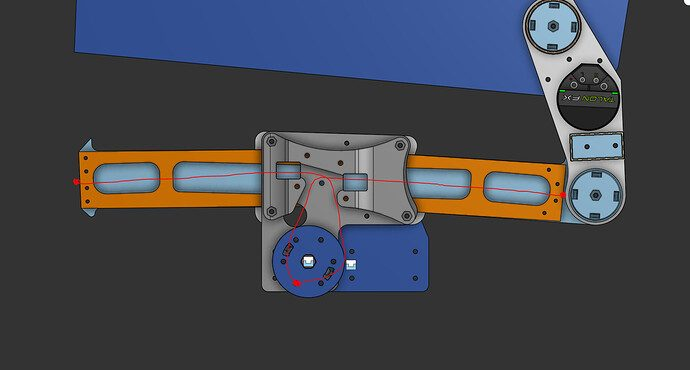
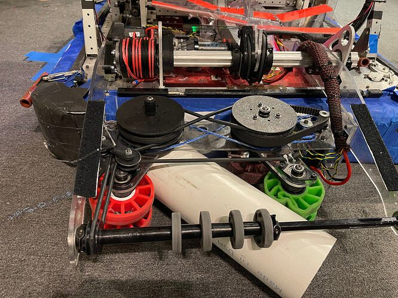
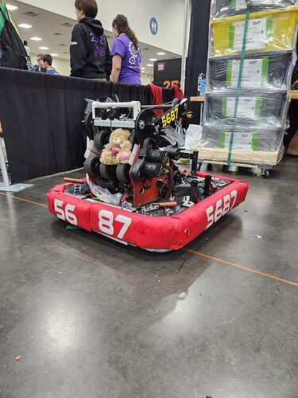

# 2026 · 5687 The Outliers — Glenn

EPA rank 11, snapshot EPA 282.69. Provisional reference dossier.

High-inertia drum dumper with low-compression collection and revised belt floor.

## Drivetrain

30×24-inch swerve frame; exact module variant unresolved here.

Coverage: partial / unresolved detail.

## Intake

Two upper rollers and lower kicker share rolling-floor power. Rack deploy replaced by capstan after URI tooth damage.

Coverage: documented synopsis.

## Transfer

Roller floor changed to belts between URI and UVM; lane formation reduced spinning-in-place and shortened shot timers.

Coverage: documented synopsis.

## Scoring

Urethane-coated six-inch aluminum drum with substantial stored inertia; adjustable hood. Team reports difficult coating/balancing process.

Coverage: documented synopsis.

## Endgame

Endgame installation not established by reviewed technical replies.

Coverage: partial / unresolved detail.

## Controls

C++ release, high-rate odometry and interpolated velocity-compensated shot calculator. Team explicitly says shoot-on-move implementation was not used in matches.

Coverage: documented synopsis.

## Changes and versions

- URI-to-UVM belt-floor and capstan changes.
- Power-consumption problems required event troubleshooting. Offseason LifeBot code is not treated as this onseason robot.

## Strategic interpretation — analyst inference

A high-inertia drum can reduce speed droop but requires energy and careful balancing. The public account is especially useful for distinguishing implemented software from actually fielded capabilities.

## Limits

- Only the reviewed published configurations are established; intermediate changes may be undocumented.

Bounded source review; exhaustive intermediate-version history not certified

## Reviewed primary source bundle

- https://www.chiefdelphi.com/t/515683
- https://www.chiefdelphi.com/t/524737

## Season context

Read [the full 2026 game/context chapter](../docs/game_2026.md) before transferring this architecture to another role or season.

## Technical image references

Images are source-associated technical figures or robot views, not dimensionally certified drawings. Follow each source for version and figure context.

2026 team 5687 — source image from post 40 (2026-10-03). Context tags identify the discussion, not a verified component label. [Original source](https://www.chiefdelphi.com/t/515683/40). Source-linked extraction; mechanism identity not individually visually audited

2026 team 5687 — source image from post 44 (2026-10-05). Context tags identify the discussion, not a verified component label. [Original source](https://www.chiefdelphi.com/t/515683/44). Source-linked extraction; mechanism identity not individually visually audited

2026 team 5687 — source image from post 46 (2026-10-06). Context tags identify the discussion, not a verified component label. [Original source](https://www.chiefdelphi.com/t/515683/46). Source-linked extraction; mechanism identity not individually visually audited

## Dated research locators — navigation, not reviewed claims

A tag describes words in the source, not a validated engineering fact. Discussion replies may concern comparison robots.

- 2026-03-08 · Armaan5411 · [post 6](https://www.chiefdelphi.com/t/515683/6) · intake
- 2026-03-08 · w1zxrd · [post 7](https://www.chiefdelphi.com/t/515683/7) · rebuild
- 2026-03-09 · TJP1699 · [post 9](https://www.chiefdelphi.com/t/515683/9) · intake, shooter
- 2026-03-14 · Aiedail · [post 13](https://www.chiefdelphi.com/t/515683/13) · intake
- 2026-03-14 · Aiedail · [post 15](https://www.chiefdelphi.com/t/515683/15) · intake
- 2026-03-16 · Jamory · [post 16](https://www.chiefdelphi.com/t/515683/16) · intake
- 2026-04-09 · D.Slobodzian · [post 23](https://www.chiefdelphi.com/t/515683/23) · intake
- 2026-10-01 · D.Slobodzian · [post 1](https://www.chiefdelphi.com/t/524737/1) · code
- 2026-10-03 · D.Slobodzian · [post 38](https://www.chiefdelphi.com/t/515683/38) · belt
- 2026-10-03 · nrglord · [post 39](https://www.chiefdelphi.com/t/515683/39) · elevator
- 2026-10-03 · Tobyr · [post 40](https://www.chiefdelphi.com/t/515683/40) · belt, cad, elevator, intake
- 2026-10-04 · samuelchen · [post 41](https://www.chiefdelphi.com/t/515683/41) · intake
- 2026-10-04 · Tobyr · [post 42](https://www.chiefdelphi.com/t/515683/42) · intake, prototype
- 2026-10-05 · D.Slobodzian · [post 44](https://www.chiefdelphi.com/t/515683/44) · intake, pivot
- 2026-10-06 · Tobyr · [post 46](https://www.chiefdelphi.com/t/515683/46) · arm, intake, pivot, shooter
- 2026-10-09 · Tobyr · [post 47](https://www.chiefdelphi.com/t/515683/47) · intake

## Current strategic priority

Fuel acquisition, supply/denial, deliverable inventory, accurate output, route access and reliability. Climb is a low-priority exception requiring positive marginal justification.

## Integrated focused technical study

[Construction, reasoning, failure modes and limits](../docs/research_continuation/2026-5687.md). This supplement is a focused interview/source-bundle study, not an exhaustive binder or competition-version certification.
