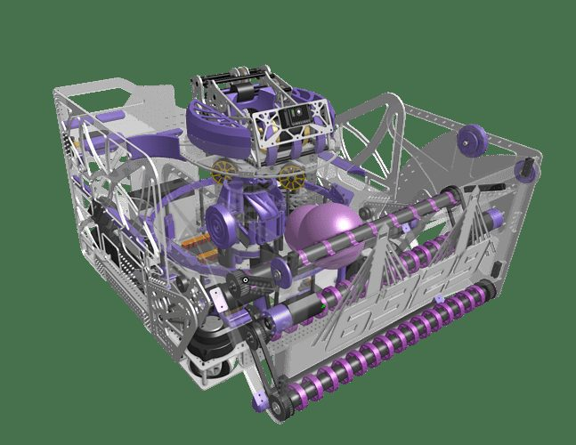
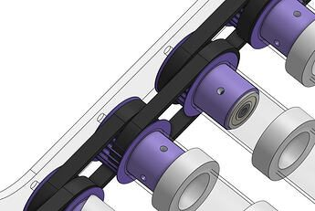
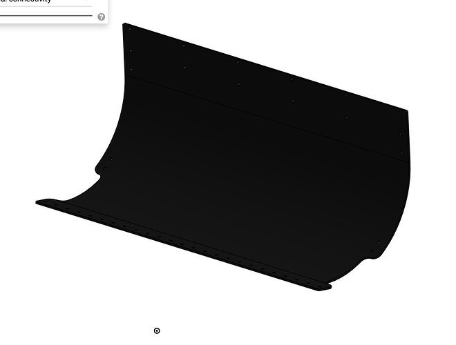

# 2026 · 6329 The Bucks' Wrath — Roman I → Roman II

EPA rank 22, snapshot EPA 260.04. Provisional reference dossier.

Rebuild from spindexer/turret to wide drum, retaining impact-folding four-bar collection.

## Drivetrain

Swerve; exact module specification unresolved here.

Coverage: partial / unresolved detail.

## Intake

Long-arm four-bar folds under impact; revised compact links, stub rollers and cast compliant wheels.

Coverage: documented synopsis.

## Transfer

Roman I spindexer and cantilevered uptake; Roman II full-width roller floor pivots about intake dead shaft for service. Low-compression UHMW feed plate.

Coverage: documented synopsis.

## Scoring

Roman I turret roughly 8 BPS; Roman II drum roughly 23 BPS per interview. Protected transmission and adjustable hood.

Coverage: documented synopsis.

## Endgame

Endgame installation not established in reviewed sources.

Coverage: partial / unresolved detail.

## Controls

Third shooter-facing Limelight supplements side cameras; independent pose/range control.

Coverage: documented synopsis.

## Changes and versions

- Roman I and II have separately released CAD/binders.
- Net/rebuild increases reported storage from about 35 to 60–70.
- Team notes four-bar stow was worse for trench autonomous but fit their experience/manufacturing.

## Strategic interpretation — analyst inference

This is a strong example of choosing a feasible architecture over a nominally optimal one. The team accepted a route disadvantage to get a robust, manufacturable robot working early enough for practice and power validation.

## Limits

- Only the reviewed published configurations are established; intermediate changes may be undocumented.

Bounded source review; exhaustive intermediate-version history not certified

## Reviewed primary source bundle

- https://youtu.be/GMLfgvYYfnU
- https://www.chiefdelphi.com/t/515342

## Season context

Read [the full 2026 game/context chapter](../docs/game_2026.md) before transferring this architecture to another role or season.

## Technical image references

Images are source-associated technical figures or robot views, not dimensionally certified drawings. Follow each source for version and figure context.

2026 team 6329 — source image from post 1 (2026-03-02). Context tags identify the discussion, not a verified component label. [Original source](https://www.chiefdelphi.com/t/515342/1). Source-linked extraction; mechanism identity not individually visually audited

2026 team 6329 — source image from post 20 (2026-05-22). Context tags identify the discussion, not a verified component label. [Original source](https://www.chiefdelphi.com/t/515342/20). Source-linked extraction; mechanism identity not individually visually audited

2026 team 6329 — source image from post 20 (2026-05-22). Context tags identify the discussion, not a verified component label. [Original source](https://www.chiefdelphi.com/t/515342/20). Source-linked extraction; mechanism identity not individually visually audited

## Dated research locators — navigation, not reviewed claims

A tag describes words in the source, not a validated engineering fact. Discussion replies may concern comparison robots.

- 2026-03-02 · schaefbl · [post 2](https://www.chiefdelphi.com/t/515342/2) · spindexer
- 2026-03-09 · Ace-H121 · [post 5](https://www.chiefdelphi.com/t/515342/5) · spindexer
- 2026-05-04 · jboynton6329 · [post 10](https://www.chiefdelphi.com/t/515342/10) · hopper
- 2026-05-04 · Big_frc_fan · [post 11](https://www.chiefdelphi.com/t/515342/11) · hopper
- 2026-05-07 · Drew_B · [post 13](https://www.chiefdelphi.com/t/515342/13) · bearing, cad, intake, pivot, shooter, spindexer
- 2026-05-17 · Techery · [post 18](https://www.chiefdelphi.com/t/515342/18) · indexer, intake
- 2026-05-18 · jboynton6329 · [post 19](https://www.chiefdelphi.com/t/515342/19) · intake, shooter
- 2026-05-22 · w1zxrd · [post 20](https://www.chiefdelphi.com/t/515342/20) · cad, hopper, intake
- 2026-08-06 · mukiewukie · [post 21](https://www.chiefdelphi.com/t/515342/21) · hopper
- 2026-08-25 · Judet · [post 22](https://www.chiefdelphi.com/t/515342/22) · belt, intake
- 2026-08-25 · Drew_B · [post 23](https://www.chiefdelphi.com/t/515342/23) · arm, autonomous, cad, intake, rebuild

## Current strategic priority

Fuel acquisition, supply/denial, deliverable inventory, accurate output, route access and reliability. Climb is a low-priority exception requiring positive marginal justification.

## Integrated focused technical study

[Construction, reasoning, failure modes and limits](../docs/research_continuation/2026-6329.md). This supplement is a focused interview/source-bundle study, not an exhaustive binder or competition-version certification.
