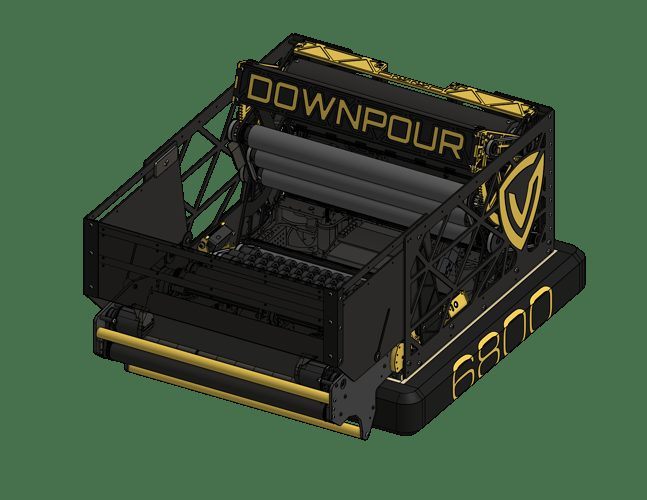
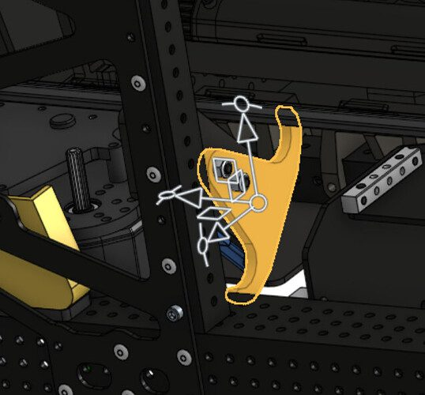
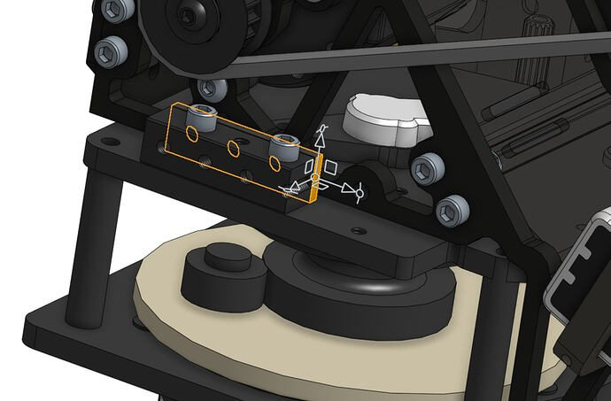
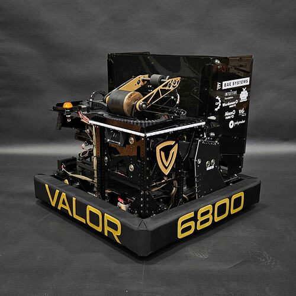
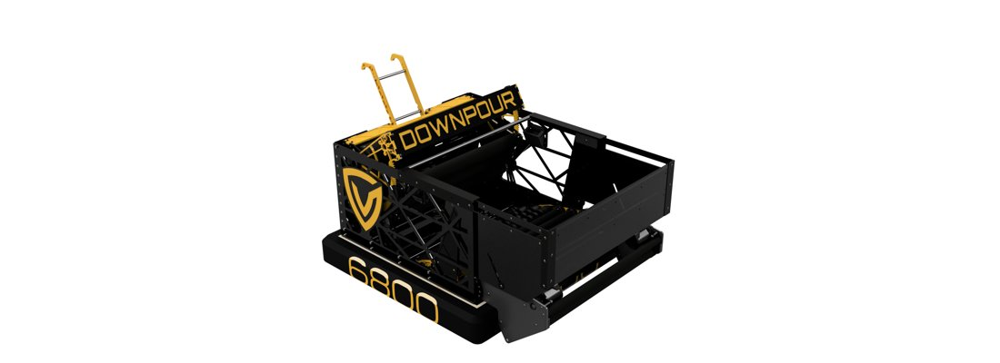
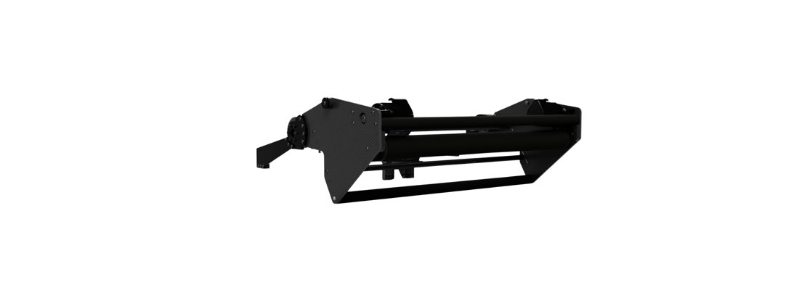
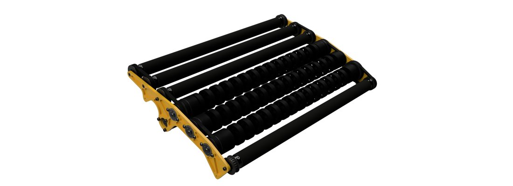
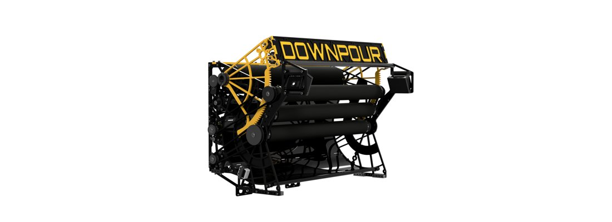

# 2026 · 6800 Valor — Valor 2026

EPA rank 17, snapshot EPA 267.49. Provisional reference dossier.

Low-inertia drum rebuild with simplified collector and increasing-speed floor.

## Drivetrain

Swerve; module variant unresolved here.

Coverage: partial / unresolved detail.

## Intake

Linear rack intake replaced by compact slapdown after tooth damage and hopper-volume penalty; four active rollers simplified to one over season.

Coverage: documented synopsis.

## Transfer

Four-fastener floor provides electronics access; rollers speed up toward shooter. Net increases reported capacity to about 75.

Coverage: documented synopsis.

## Scoring

Three-motor aluminum drum without substantial added inertia; team reports fast spin-up. Hood can expose reverse firing, about 50% accurate at filming and still being tuned.

Coverage: documented synopsis.

## Endgame

Endgame installation not established in reviewed interview.

Coverage: partial / unresolved detail.

## Controls

Valkyrie library, torque-FOC motor control and detailed logging support tuning.

Coverage: documented synopsis.

## Changes and versions

- Original DOWNPOUR: linear intake, linked expanding hopper, serpentine and turret. Earlier telescope climber did not compete at districts.
- DCMP DOWNPOUR: single-pivot intake, wide drum and matching floor/feeder; later compact pivot-hook climber documented.
- Turret-to-drum architecture pivot.
- Eight intake iterations reported.
- Reverse shot is an experimental defense escape, not equivalent to the main scored-shot capability.

## Strategic interpretation — analyst inference

This is a counterexample to copying added flywheel mass indiscriminately. Low inertia trades stored-energy buffering for responsive closed-loop recovery; compare actual burst speed droop, spin-up energy and battery behavior.

## Evidence and limits

- Only the reviewed published configurations are established; intermediate changes may be undocumented.

Bounded source review; exhaustive intermediate-version history not certified

## Reviewed source bundle

- https://youtu.be/mPNj9xn-3dk
- https://www.chiefdelphi.com/uploads/short-url/aiIYU0Pv6kleLK5yW5mDDAaE2n9.pdf
- https://drive.google.com/file/d/11rQrMwCIseY18JbKFytGLXSd__x1JP1S/view?usp=sharing

## Season context

Read [the full 2026 game/context chapter](../docs/game_2026.md) before transferring this architecture to another role or season.

## Technical image references

Images are source-associated technical figures or robot views, not dimensionally certified drawings. Follow each source for version and figure context.

2026 team 6800 — source image from post 1 (2026-05-13). Context tags identify the discussion, not a verified component label. [Original source](https://www.chiefdelphi.com/t/520715/1). Source-linked extraction; mechanism identity not individually visually audited

2026 team 6800 — source image from post 12 (2026-05-13). Context tags identify the discussion, not a verified component label. [Original source](https://www.chiefdelphi.com/t/520715/12). Source-linked extraction; mechanism identity not individually visually audited

2026 team 6800 — source image from post 12 (2026-05-13). Context tags identify the discussion, not a verified component label. [Original source](https://www.chiefdelphi.com/t/520715/12). Source-linked extraction; mechanism identity not individually visually audited

2026 team 6800 — source image from post 1 (2026-03-07). Context tags identify the discussion, not a verified component label. [Original source](https://www.chiefdelphi.com/t/515759/1). Source-linked extraction; mechanism identity not individually visually audited

2026 team 6800 — embedded figure from technical binder, PDF page 2. Page discusses climb, indexer, intake, shooter. Figure identity requires the surrounding source page. [Original source](https://drive.google.com/file/d/11rQrMwCIseY18JbKFytGLXSd__x1JP1S/view). Individual embedded figure extracted; contextual page tags, not a visually verified engineering drawing

2026 team 6800 — embedded figure from technical binder, PDF page 4. Page discusses intake, pivot. Figure identity requires the surrounding source page. [Original source](https://drive.google.com/file/d/11rQrMwCIseY18JbKFytGLXSd__x1JP1S/view). Individual embedded figure extracted; contextual page tags, not a visually verified engineering drawing

2026 team 6800 — embedded figure from technical binder, PDF page 5. Page discusses hopper, intake, shooter. Figure identity requires the surrounding source page. [Original source](https://drive.google.com/file/d/11rQrMwCIseY18JbKFytGLXSd__x1JP1S/view). Individual embedded figure extracted; contextual page tags, not a visually verified engineering drawing

2026 team 6800 — embedded figure from technical binder, PDF page 6. Page discusses hopper, indexer, intake, shooter. Figure identity requires the surrounding source page. [Original source](https://drive.google.com/file/d/11rQrMwCIseY18JbKFytGLXSd__x1JP1S/view). Individual embedded figure extracted; contextual page tags, not a visually verified engineering drawing

2026 team 6800 — embedded figure from technical binder, PDF page 7. Page discusses shooter. Figure identity requires the surrounding source page. [Original source](https://drive.google.com/file/d/11rQrMwCIseY18JbKFytGLXSd__x1JP1S/view). Individual embedded figure extracted; contextual page tags, not a visually verified engineering drawing

2026 team 6800 — embedded figure from technical binder, PDF page 8. Page discusses climb, pivot. Figure identity requires the surrounding source page. [Original source](https://drive.google.com/file/d/11rQrMwCIseY18JbKFytGLXSd__x1JP1S/view). Individual embedded figure extracted; contextual page tags, not a visually verified engineering drawing

## Dated research locators — navigation, not reviewed claims

A tag describes words in the source, not a validated engineering fact. Discussion replies may concern comparison robots.

- 2026-05-13 · nik_olsen · [post 1](https://www.chiefdelphi.com/t/520715/1) · cad
- 2026-05-13 · luq · [post 2](https://www.chiefdelphi.com/t/520715/2) · cad
- 2026-05-13 · Hadia13 · [post 8](https://www.chiefdelphi.com/t/520715/8) · cad
- 2026-05-13 · 1156_Nunes_14391 · [post 11](https://www.chiefdelphi.com/t/520715/11) · shooter
- 2026-05-13 · TheIsaacMurrin · [post 12](https://www.chiefdelphi.com/t/520715/12) · shooter
- 2026-05-13 · Magnus · [post 14](https://www.chiefdelphi.com/t/520715/14) · shooter
- 2026-05-15 · jstorm · [post 18](https://www.chiefdelphi.com/t/520715/18) · code
- 2026-05-15 · Ainesh · [post 20](https://www.chiefdelphi.com/t/520715/20) · cad
- 2026-05-15 · mray190 · [post 24](https://www.chiefdelphi.com/t/520715/24) · code
- 2026-05-15 · Magnus · [post 42](https://www.chiefdelphi.com/t/520715/42) · code
- 2026-09-09 · Torrance · [post 49](https://www.chiefdelphi.com/t/520715/49) · belt, cad, intake
- 2026-09-09 · nik_olsen · [post 50](https://www.chiefdelphi.com/t/520715/50) · arm, belt, intake, pivot

# 2026-6800: technical mechanisms, design reasoning and revision boundaries

These notes distinguish published construction from team-stated intent and original engineering inference. Selected numerical values are reported source data, not independently reproduced measurements. The recommended tests have not been performed. A binder snapshot does not certify every competition version.

## DOWNPOUR original: linear collection and linked hopper

Version: DOWNPOUR original turret. [PDF p11](https://www.chiefdelphi.com/uploads/short-url/aiIYU0Pv6kleLK5yW5mDDAaE2n9.pdf#page=11) · [PDF p12](https://www.chiefdelphi.com/uploads/short-url/aiIYU0Pv6kleLK5yW5mDDAaE2n9.pdf#page=12)

**Published construction:** Rack deployment, multiple powered rollers, pin-slot hopper extension.

**Team-stated reason or evidence boundary:** Compact stow and broad acquisition.

**Engineering analysis — original inference:** The intake and expanding wall are physically linked, so their travel, friction and alignment cannot be optimized independently. A pin-slot joint can accommodate different trajectories but may create a high local pressure at the end of travel. A multirotor pickup needs enough overlap to avoid an uncontrolled interval as fuel crosses the bumper. If the linkage binds, commanding more motor torque can damage the rack before solving the wall alignment. The architecture should retain a way to inspect and replace the joint without disassembling the whole fuel path.

**Proposed validation — not a completed test:** Cycle the linkage under hopper side loading and inspect slot wear; test an interrupted deployment and recovery.

**Limits:** The binder is a published configuration snapshot, not an independent durability or match-rate test.

## DOWNPOUR original: serpentine and turret feed

Version: DOWNPOUR original turret. [PDF p13](https://www.chiefdelphi.com/uploads/short-url/aiIYU0Pv6kleLK5yW5mDDAaE2n9.pdf#page=13) · [PDF p14](https://www.chiefdelphi.com/uploads/short-url/aiIYU0Pv6kleLK5yW5mDDAaE2n9.pdf#page=14) · [PDF p15](https://www.chiefdelphi.com/uploads/short-url/aiIYU0Pv6kleLK5yW5mDDAaE2n9.pdf#page=15)

**Published construction:** Belt serpentine; curved backing replaces interfering upper wheels; 400° turret.

**Team-stated reason or evidence boundary:** Compact routing with controlled feed and independent aim.

**Engineering analysis — original inference:** Removing a wheel can improve a mechanism when the wheel occupies the same space needed by another moving assembly. Curved backing trades active contact for sliding contact and must keep fuel captured through the bend. The turret’s rotation range is a cable-management specification as much as an aiming specification. The original design and its later replacement are separate records: a successful collection system does not prove the single-stream scorer met the team’s later competitive needs. Prototype targets must remain labeled targets even when the surrounding prose sounds confident.

**Proposed validation — not a completed test:** Sweep the full turret range while feeding deliberately varied fuel, and compare useful output with the original target under realistic voltage.

**Limits:** The binder is a published configuration snapshot, not an independent durability or match-rate test.

## DOWNPOUR DCMP: repair the collision path

Version: DOWNPOUR DCMP drum. [PDF p4](https://drive.google.com/file/d/11rQrMwCIseY18JbKFytGLXSd__x1JP1S/view?usp=sharing#page=4)

**Published construction:** Single-pivot intake; higher round bash bar; extra motor-plate bracing; passive lower bar.

**Team-stated reason or evidence boundary:** Stop bar deflection from stalling rollers; save power and weight.

**Engineering analysis — original inference:** A bash bar can become the failure if it bends into the very roller it protects. Moving the reaction member above the rotating contact changes that failure geometry. Reverting a powered element to a passive surface is an important counterexample to the rule that more powered contacts always help: the added drive may cost current without improving capture in the tested geometry. This result should not be transferred blindly to another bumper gap or approach speed. It supports testing the actual bottleneck and force path before adding a motor.

**Proposed validation — not a completed test:** Measure bar-to-roller clearance after impact; compare capture probability and current with powered and passive lower contact.

**Limits:** The binder is a published configuration snapshot, not an independent durability or match-rate test.

## DOWNPOUR DCMP: net, trench access and electrical relocation

Version: DOWNPOUR DCMP drum. [PDF p3](https://drive.google.com/file/d/11rQrMwCIseY18JbKFytGLXSd__x1JP1S/view?usp=sharing#page=3) · [PDF p5](https://drive.google.com/file/d/11rQrMwCIseY18JbKFytGLXSd__x1JP1S/view?usp=sharing#page=5)

**Published construction:** Net-topped storage; bumper-mounted panels; electrical panel flipped upward.

**Team-stated reason or evidence boundary:** Retain fuel, use trench routes and protect electronics.

**Engineering analysis — original inference:** A bumper-mounted wall can simplify robot mass allocation but introduces a service interface: removing or shifting the bumper can change hopper alignment and expose a gap. The net adds a travel envelope that depends on fuel loading and deformation. Flipping the electrical panel exchanges one exposure for another, so the skid plate, drainage and access plan must be considered with the new layout. The correct capacity test measures fuel retained after the actual route and then delivered to the shooter, rather than the empty CAD volume.

**Proposed validation — not a completed test:** Remove and reinstall bumpers repeatedly, inspect wall alignment, then run full-load trench and bump routes followed by complete discharge.

**Limits:** The binder is a published configuration snapshot, not an independent durability or match-rate test.

## DOWNPOUR DCMP: single-stream turret to four-wide drum

Version: DOWNPOUR DCMP drum. [PDF p2](https://drive.google.com/file/d/11rQrMwCIseY18JbKFytGLXSd__x1JP1S/view?usp=sharing#page=2) · [PDF p6](https://drive.google.com/file/d/11rQrMwCIseY18JbKFytGLXSd__x1JP1S/view?usp=sharing#page=6) · [PDF p7](https://drive.google.com/file/d/11rQrMwCIseY18JbKFytGLXSd__x1JP1S/view?usp=sharing#page=7)

**Published construction:** Four-wide transfer; mixed-diameter rollers; three X60 shooter drives and two feeder drives.

**Team-stated reason or evidence boundary:** Original single stream was too slow for the intended competition level.

**Engineering analysis — original inference:** The rebuild changes both the launcher and the supply path. Wider discharge without wider feeding would preserve the original restriction. Gradually accelerating fuel can reduce crowding before launch, but it must preserve contact and avoid forcing balls against a stationary roof. The strategic claim is specific to this team’s execution and operating conditions; it does not invalidate compact turrets that achieve a different combination of capacity, sustained firing and maneuverability. Preserve the original development and the district-to-DCMP transition so a recommendation can learn from the pivot rather than only its final appearance.

**Proposed validation — not a completed test:** Compare complete cycle score against the original under the same fuel supply, defense and active-window timing.

**Limits:** The binder is a published configuration snapshot, not an independent durability or match-rate test.

## DOWNPOUR: proposed telescope and later compact hooks

Version: DOWNPOUR DCMP drum. [PDF p8](https://drive.google.com/file/d/11rQrMwCIseY18JbKFytGLXSd__x1JP1S/view?usp=sharing#page=8)

**Published construction:** Original telescope did not compete at districts; later pivoting hooks replaced it.

**Team-stated reason or evidence boundary:** Weight, space and scoring priorities displaced the initial climb.

**Engineering analysis — original inference:** The presence of a climber CAD image in an early binder is not proof it was installed or used. The later brief supplies a useful version boundary by explicitly saying the earlier mechanism did not compete. The new hook package should be recorded as a compact capability, not evidence that climbing became strategically central. In a fuel-dominant game, retain the opportunity cost in storage, mechanism power, alignment and testing. A low-mass hook can still be a poor choice if it blocks a valuable fuel route.

**Proposed validation — not a completed test:** Audit actual installation and match use separately from prototype drawings; calculate lost usable fuel volume before selecting a climbing package.

**Limits:** The binder is a published configuration snapshot, not an independent durability or match-rate test.

## Selected published parameters

| Component | Source parameter | Locator |
|---|---|---|
| Hopper | 13.5×22×27-in stowed; 21×22×27-in extended; source dimensions | [Source p12](https://www.chiefdelphi.com/uploads/short-url/aiIYU0Pv6kleLK5yW5mDDAaE2n9.pdf#page=12) |
| Turret | 400°; 7-in X-contact bearing | [Source p15](https://www.chiefdelphi.com/uploads/short-url/aiIYU0Pv6kleLK5yW5mDDAaE2n9.pdf#page=15) |
| Climber prototype | 23:1 cycloidal; 18.625→29.7-in telescope; not competed at districts | [Source p16](https://www.chiefdelphi.com/uploads/short-url/aiIYU0Pv6kleLK5yW5mDDAaE2n9.pdf#page=16) |
| Intake | 25.5-in mouth; 1.23:1 rollers; 69:1 deploy | [Source p4](https://drive.google.com/file/d/11rQrMwCIseY18JbKFytGLXSd__x1JP1S/view?usp=sharing#page=4) |
| Indexer | two X44s; 2.5:1 | [Source p6](https://drive.google.com/file/d/11rQrMwCIseY18JbKFytGLXSd__x1JP1S/view?usp=sharing#page=6) |
| Shooter | 3:2 shooter; 20:9 feeder; 1580:21 hood; 80° hood travel | [Source p7](https://drive.google.com/file/d/11rQrMwCIseY18JbKFytGLXSd__x1JP1S/view?usp=sharing#page=7) |
| Climber | 74.1:1 total; 3/8-in aluminum hooks | [Source p8](https://drive.google.com/file/d/11rQrMwCIseY18JbKFytGLXSd__x1JP1S/view?usp=sharing#page=8) |

Ratios preserve source notation; verify driver/driven order, complete geometry and the actual version in CAD before fabrication. Figure records retain PDF page and crop bounds in `data/mechanism_images.jsonl`. Images may include rejected prototypes or whole-robot photographs; their captions preserve that distinction.

## Current strategic priority

Fuel acquisition, supply/denial, deliverable inventory, accurate output, route access and reliability. Climb is a low-priority exception requiring positive marginal justification.
