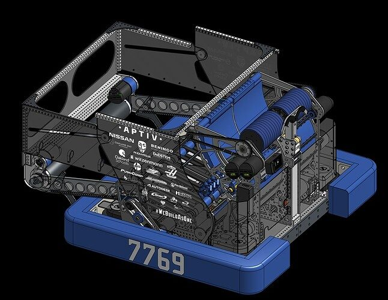
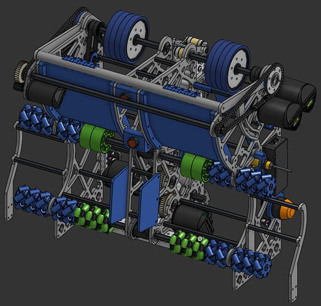
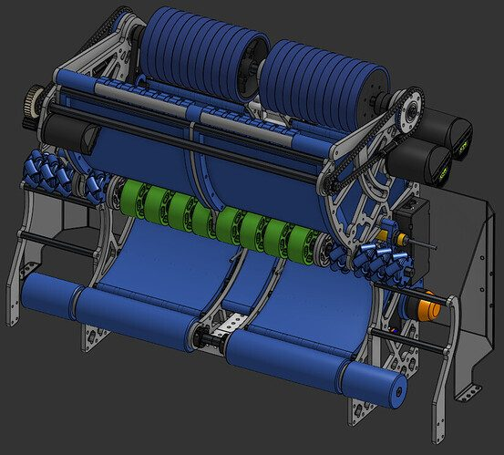

# 2026 · 7769 The CREW — The CREW 2026

EPA rank 4, snapshot EPA 309.29. Provisional reference dossier.

Large-capacity drum robot with roller-fed expanding net hopper.

## Drivetrain

Swerve; exact module specification unresolved here.

Coverage: partial / unresolved detail.

## Intake

Rack-driven collector; damaged rack teeth were repaired using sections of spares during championship-level defense.

Coverage: documented synopsis.

## Transfer

Belt floor and eight compliant wheels feed an S-shaped path; access panel lifts for electronics service.

Coverage: documented synopsis.

## Scoring

Originally separate large shooters jammed; central obstruction removed for one continuous drum. Four shooter motors and adjustable hood.

Coverage: documented synopsis.

## Endgame

Front flippy-hook concept conflicted with shooter; side harpoon used with vision alignment, but removed for the filmed event circumstances because net could catch. Team would climb when useful for RP.

Coverage: documented synopsis.

## Controls

Second Limelight repurposed for climb after competing pose estimates caused aiming trouble.

Coverage: documented synopsis.

## Changes and versions

- Dual shooters changed to continuous drum.
- Filmed at state championship before Worlds; reported 65–70 capacity belongs to this configuration.

## Strategic interpretation — analyst inference

The high-capacity route needs a maintenance plan for racks, a dependable bump crossing and explicit net/climber clearance. The presence of a climb in CAD is different from choosing to install and use it in a particular match.

## Limits

- Only the reviewed published configurations are established; intermediate changes may be undocumented.

Bounded source review; exhaustive intermediate-version history not certified

## Reviewed primary source bundle

- https://www.youtube.com/watch?v=6BrndIrOmgU

## Season context

Read [the full 2026 game/context chapter](../docs/game_2026.md) before transferring this architecture to another role or season.

## Technical image references

Images are source-associated technical figures or robot views, not dimensionally certified drawings. Follow each source for version and figure context.

2026 team 7769 — source image from post 1 (2026-05-18). Context tags identify the discussion, not a verified component label. [Original source](https://www.chiefdelphi.com/t/521008/1). Source-linked extraction; mechanism identity not individually visually audited

2026 team 7769 — source image from post 8 (2026-05-21). Context tags identify the discussion, not a verified component label. [Original source](https://www.chiefdelphi.com/t/521008/8). Source-linked extraction; mechanism identity not individually visually audited

2026 team 7769 — source image from post 8 (2026-05-21). Context tags identify the discussion, not a verified component label. [Original source](https://www.chiefdelphi.com/t/521008/8). Source-linked extraction; mechanism identity not individually visually audited

## Dated research locators — navigation, not reviewed claims

A tag describes words in the source, not a validated engineering fact. Discussion replies may concern comparison robots.

- 2026-05-18 · Smitka · [post 1](https://www.chiefdelphi.com/t/521008/1) · cad, hopper, shooter
- 2026-05-18 · Smitka · [post 2](https://www.chiefdelphi.com/t/521008/2) · cad
- 2026-05-20 · Coach-Cal · [post 5](https://www.chiefdelphi.com/t/521008/5) · belt
- 2026-05-20 · Yusuf.Erdogan7536 · [post 6](https://www.chiefdelphi.com/t/521008/6) · belt
- 2026-05-21 · Mullen · [post 7](https://www.chiefdelphi.com/t/521008/7) · cad, hopper, intake
- 2026-05-21 · Coach-Cal · [post 8](https://www.chiefdelphi.com/t/521008/8) · indexer, rebuild, shooter
- 2026-05-22 · Coach-Cal · [post 11](https://www.chiefdelphi.com/t/521008/11) · belt
- 2026-05-22 · Coach-Cal · [post 13](https://www.chiefdelphi.com/t/521008/13) · intake
- 2026-06-01 · ilker_sahin · [post 14](https://www.chiefdelphi.com/t/521008/14) · chain, intake
- 2026-06-01 · Coach-Cal · [post 15](https://www.chiefdelphi.com/t/521008/15) · arm, chain, collector, intake
- 2026-06-01 · slxxplxss · [post 16](https://www.chiefdelphi.com/t/521008/16) · cad
- 2026-06-02 · SonofBeans · [post 18](https://www.chiefdelphi.com/t/521008/18) · intake
- 2026-06-02 · ilker_sahin · [post 19](https://www.chiefdelphi.com/t/521008/19) · chain
- 2026-06-02 · Coach-Cal · [post 20](https://www.chiefdelphi.com/t/521008/20) · intake
- 2026-06-02 · Coach-Cal · [post 21](https://www.chiefdelphi.com/t/521008/21) · chain, intake

## Current strategic priority

Fuel acquisition, supply/denial, deliverable inventory, accurate output, route access and reliability. Climb is a low-priority exception requiring positive marginal justification.

## Integrated focused technical study

[Construction, reasoning, failure modes and limits](../docs/research_continuation/2026-7769.md). This supplement is a focused interview/source-bundle study, not an exhaustive binder or competition-version certification.

## 1833 design-transfer update, 2026-10-26

Chassis-aimed non-turret scorer: an initially divided shooter revised to a wider 2.75-width arrangement, belt-floor feed and expanding hopper. Team distinguishes almost 70 nominal capacity from typical 50–60 in play; useful throughput, not nominal storage alone, is the optimization reference.

Read [the optimization study](../docs/context/1833-reference-2026-7769.md) and the binding no-support/no-turret owner mandate in `docs/1833_DESIGN_DOCTRINE.md` from corpus root. Historical configurations remain references, not a recommendation to copy every mechanism.
