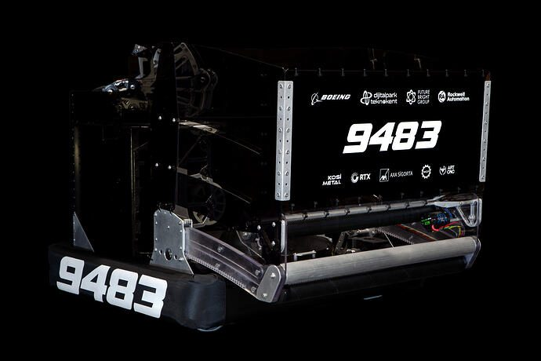
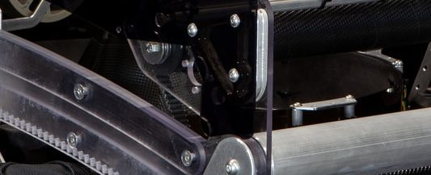
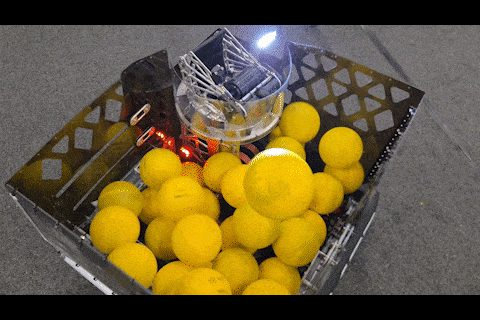

# 2026 · 9483 Overcharge — Enigma

EPA rank 21, snapshot EPA 261.31. Provisional reference dossier.

Compact turret fed by rotating floor/conical spindexer and curved-rack collection.

## Drivetrain

Swerve; exact module specification unresolved in reviewed team replies.

Coverage: partial / unresolved detail.

## Intake

Third collector version adds kicker and articulated secondary kicker; curved rack stays low in stow to preserve capacity.

Coverage: documented synopsis.

## Transfer

Cone and rotating floor; separate X44s power spindexer and uptake. Ratios and feeder wheels revised repeatedly; automated recovery clears intermittent jams.

Coverage: documented synopsis.

## Scoring

Three-X44 flywheel, no powered top roller; compact turret and hood. Team identifies light printed wheel plus supplemental inertia kit.

Coverage: documented synopsis.

## Endgame

Endgame installation not established in reviewed release.

Coverage: partial / unresolved detail.

## Controls

Empirically tuned tables plus iterative physics solution compensate motion and spin; local floodlight helps close-range tag shadows, not distant detection.

Coverage: documented synopsis.

## Changes and versions

- At least three intake configurations; feed-wheel changes reported seven/eight times.
- Do not treat speculative third-party explanations in thread as team-confirmed geometry.

## Strategic interpretation — analyst inference

A conical spindexer is a different singulation family from a pocketed DYE Rotor. Curved deployment preserves low internal volume; contact friction, congestion and turret interference remain the transfer-critical variables.

## Limits

- Only the reviewed published configurations are established; intermediate changes may be undocumented.

Bounded source review; exhaustive intermediate-version history not certified

## Reviewed primary source bundle

- https://www.chiefdelphi.com/t/515383

## Season context

Read [the full 2026 game/context chapter](../docs/game_2026.md) before transferring this architecture to another role or season.

## Technical image references

Images are source-associated technical figures or robot views, not dimensionally certified drawings. Follow each source for version and figure context.

2026 team 9483 — source image from post 1 (2026-03-02). Context tags identify the discussion, not a verified component label. [Original source](https://www.chiefdelphi.com/t/515383/1). Source-linked extraction; mechanism identity not individually visually audited

2026 team 9483 — source image from post 8 (2026-03-03). Context tags identify the discussion, not a verified component label. [Original source](https://www.chiefdelphi.com/t/515383/8). Source-linked extraction; mechanism identity not individually visually audited

2026 team 9483 — source image from post 35 (2026-05-12). Context tags identify the discussion, not a verified component label. [Original source](https://www.chiefdelphi.com/t/515383/35). Source-linked extraction; mechanism identity not individually visually audited

## Dated research locators — navigation, not reviewed claims

A tag describes words in the source, not a validated engineering fact. Discussion replies may concern comparison robots.

- 2026-03-02 · MARS_James · [post 4](https://www.chiefdelphi.com/t/515383/4) · spindexer
- 2026-03-03 · goatoush · [post 7](https://www.chiefdelphi.com/t/515383/7) · intake
- 2026-03-03 · ArchdukeTim · [post 8](https://www.chiefdelphi.com/t/515383/8) · spindexer
- 2026-03-03 · Ltk1 · [post 10](https://www.chiefdelphi.com/t/515383/10) · spindexer
- 2026-03-04 · SilasR · [post 12](https://www.chiefdelphi.com/t/515383/12) · spindexer
- 2026-03-15 · Prince · [post 25](https://www.chiefdelphi.com/t/515383/25) · indexer, spindexer
- 2026-03-15 · togicmnp · [post 26](https://www.chiefdelphi.com/t/515383/26) · indexer, spindexer
- 2026-03-15 · osofdez · [post 27](https://www.chiefdelphi.com/t/515383/27) · indexer, spindexer
- 2026-03-18 · RedRackham · [post 28](https://www.chiefdelphi.com/t/515383/28) · hopper, shooter, spindexer
- 2026-03-22 · MertSuntur · [post 31](https://www.chiefdelphi.com/t/515383/31) · spindexer
- 2026-04-11 · 9427_William · [post 32](https://www.chiefdelphi.com/t/515383/32) · camera, vision
- 2026-05-12 · oguzozgur · [post 35](https://www.chiefdelphi.com/t/515383/35) · hopper, indexer, intake, shooter, spindexer
- 2026-05-15 · AvocadoPeel · [post 40](https://www.chiefdelphi.com/t/515383/40) · spindexer
- 2026-05-20 · kaganunsal_1 · [post 41](https://www.chiefdelphi.com/t/515383/41) · intake
- 2026-07-03 · Robogram · [post 44](https://www.chiefdelphi.com/t/515383/44) · cad, climb, hopper, intake, spindexer
- 2026-07-11 · cfa · [post 45](https://www.chiefdelphi.com/t/515383/45) · intake
- 2026-09-24 · JamesO1086 · [post 46](https://www.chiefdelphi.com/t/515383/46) · camera
- 2026-09-24 · togicmnp · [post 47](https://www.chiefdelphi.com/t/515383/47) · camera

## Current strategic priority

Fuel acquisition, supply/denial, deliverable inventory, accurate output, route access and reliability. Climb is a low-priority exception requiring positive marginal justification.

## Integrated focused technical study

[Construction, reasoning, failure modes and limits](../docs/research_continuation/2026-9483.md). This supplement is a focused interview/source-bundle study, not an exhaustive binder or competition-version certification.
