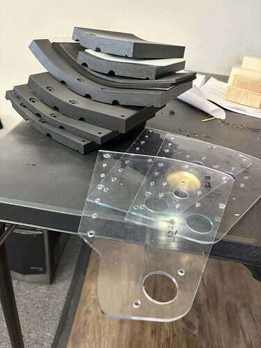
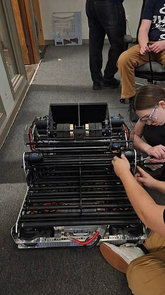
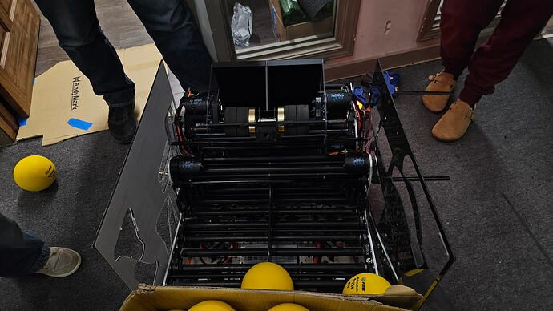

# 2026 · 9496 LYNK — Matterhorn

EPA rank 28, snapshot EPA 253.19. Provisional reference dossier.

Fixed-geometry drum with passively deploying intake/hopper and simple range control.

## Drivetrain

Swerve; exact module variant unresolved here.

Coverage: partial / unresolved detail.

## Intake

Fourth/fifth intake iteration; passive autonomous maneuver deploys collector and sliding hopper. Kicker draws explicit 254 inspiration.

Coverage: documented synopsis.

## Transfer

Roller floor references 254 2017; two motors drive floor and separate indexer feeds launcher. Intake motion agitates fuel.

Coverage: documented synopsis.

## Scoring

Four-X60 drum with supplemental brass inertia; fixed hood/no separate adjustable kicker. Distance changes through wheel speed and chassis aim.

Coverage: documented synopsis.

## Endgame

Endgame installation not established by reviewed interview/build-log excerpts.

Coverage: partial / unresolved detail.

## Controls

Two pose cameras, automatic heading and manual fallback; LEDs count down active shifts.

Coverage: documented synopsis.

## Changes and versions

- Fourth hopper and multiple collector revisions; net improves retention during faster pickup.
- Interview filmed at third event before NC DCMP; later version audit remains open.

## Strategic interpretation — analyst inference

This is a lower-complexity reference for a rebuild team. A constrained shot envelope can still support strong output when route and orientation are planned; compare maintenance and development time as well as peak scoring range.

## Limits

- Only the reviewed published configurations are established; intermediate changes may be undocumented.

Bounded source review; exhaustive intermediate-version history not certified

## Reviewed primary source bundle

- https://youtu.be/FEDqE4uE8Dg
- https://www.chiefdelphi.com/t/511797

## Season context

Read [the full 2026 game/context chapter](../docs/game_2026.md) before transferring this architecture to another role or season.

## Technical image references

Images are source-associated technical figures or robot views, not dimensionally certified drawings. Follow each source for version and figure context.

2026 team 9496 — source image from post 25 (2026-01-22). Context tags identify the discussion, not a verified component label. [Original source](https://www.chiefdelphi.com/t/511797/25). Source-linked extraction; mechanism identity not individually visually audited

2026 team 9496 — source image from post 31 (2026-02-08). Context tags identify the discussion, not a verified component label. [Original source](https://www.chiefdelphi.com/t/511797/31). Source-linked extraction; mechanism identity not individually visually audited

2026 team 9496 — source image from post 31 (2026-02-08). Context tags identify the discussion, not a verified component label. [Original source](https://www.chiefdelphi.com/t/511797/31). Source-linked extraction; mechanism identity not individually visually audited

## Dated research locators — navigation, not reviewed claims

A tag describes words in the source, not a validated engineering fact. Discussion replies may concern comparison robots.

- 2026-01-16 · cad321 · [post 5](https://www.chiefdelphi.com/t/511797/5) · prototype
- 2026-01-16 · D.Allred · [post 12](https://www.chiefdelphi.com/t/511797/12) · shooter
- 2026-01-17 · shuki · [post 14](https://www.chiefdelphi.com/t/511797/14) · shooter
- 2026-01-21 · ExplorerRobotics · [post 24](https://www.chiefdelphi.com/t/511797/24) · shooter
- 2026-01-22 · Flightbudz · [post 25](https://www.chiefdelphi.com/t/511797/25) · cad, shooter
- 2026-02-08 · Shai6 · [post 30](https://www.chiefdelphi.com/t/511797/30) · indexer
- 2026-02-08 · Jimmyy · [post 31](https://www.chiefdelphi.com/t/511797/31) · indexer, shooter
- 2026-02-08 · JohnFogarty · [post 33](https://www.chiefdelphi.com/t/511797/33) · shooter
- 2026-02-08 · Jimmyy · [post 35](https://www.chiefdelphi.com/t/511797/35) · indexer
- 2026-02-08 · Krreilly78 · [post 37](https://www.chiefdelphi.com/t/511797/37) · shooter
- 2026-02-08 · JohnFogarty · [post 39](https://www.chiefdelphi.com/t/511797/39) · code
- 2026-02-12 · Ganden5 · [post 48](https://www.chiefdelphi.com/t/511797/48) · arm
- 2026-02-14 · Jimmyy · [post 51](https://www.chiefdelphi.com/t/511797/51) · shooter
- 2026-02-16 · mikezgr · [post 54](https://www.chiefdelphi.com/t/511797/54) · shooter
- 2026-02-17 · Brycel307 · [post 55](https://www.chiefdelphi.com/t/511797/55) · intake
- 2026-02-18 · Jimmyy · [post 56](https://www.chiefdelphi.com/t/511797/56) · shooter
- 2026-02-18 · Banders · [post 57](https://www.chiefdelphi.com/t/511797/57) · hopper
- 2026-02-18 · jibby · [post 58](https://www.chiefdelphi.com/t/511797/58) · shooter
- 2026-02-20 · Jimmyy · [post 63](https://www.chiefdelphi.com/t/511797/63) · chain
- 2026-02-22 · Norse · [post 65](https://www.chiefdelphi.com/t/511797/65) · hopper
- 2026-02-25 · Jimmyy · [post 71](https://www.chiefdelphi.com/t/511797/71) · indexer, shooter
- 2026-02-26 · Beimanitai · [post 80](https://www.chiefdelphi.com/t/511797/80) · shooter
- 2026-02-26 · Jimmyy · [post 81](https://www.chiefdelphi.com/t/511797/81) · shooter
- 2026-02-26 · Barnav · [post 83](https://www.chiefdelphi.com/t/511797/83) · shooter
- 2026-02-26 · syfer · [post 86](https://www.chiefdelphi.com/t/511797/86) · indexer, shooter
- 2026-02-26 · davepowers · [post 88](https://www.chiefdelphi.com/t/511797/88) · shooter
- 2026-02-27 · Smartypants0506 · [post 90](https://www.chiefdelphi.com/t/511797/90) · belt, shooter
- 2026-02-28 · shuki · [post 91](https://www.chiefdelphi.com/t/511797/91) · belt
- 2026-03-02 · AjayPath · [post 98](https://www.chiefdelphi.com/t/511797/98) · shooter
- 2026-03-02 · Jimmyy · [post 99](https://www.chiefdelphi.com/t/511797/99) · shooter
- 2026-03-03 · Shai6 · [post 101](https://www.chiefdelphi.com/t/511797/101) · hopper
- 2026-03-03 · Barnav · [post 102](https://www.chiefdelphi.com/t/511797/102) · shooter
- 2026-03-05 · JackIannucci · [post 106](https://www.chiefdelphi.com/t/511797/106) · intake
- 2026-03-05 · rjbell4 · [post 111](https://www.chiefdelphi.com/t/511797/111) · hopper, intake
- 2026-03-06 · syfer · [post 116](https://www.chiefdelphi.com/t/511797/116) · intake
- 2026-03-07 · Flightbudz · [post 119](https://www.chiefdelphi.com/t/511797/119) · shooter
- 2026-03-07 · PacoI · [post 122](https://www.chiefdelphi.com/t/511797/122) · hopper, shooter
- 2026-03-07 · rjbell4 · [post 123](https://www.chiefdelphi.com/t/511797/123) · shooter
- 2026-03-08 · Banders · [post 124](https://www.chiefdelphi.com/t/511797/124) · shooter
- 2026-03-09 · IHateTuningPID · [post 126](https://www.chiefdelphi.com/t/511797/126) · code
- 2026-03-09 · joaq · [post 128](https://www.chiefdelphi.com/t/511797/128) · camera
- 2026-03-09 · rjbell4 · [post 129](https://www.chiefdelphi.com/t/511797/129) · camera
- 2026-03-12 · Michael_Kaurich · [post 131](https://www.chiefdelphi.com/t/511797/131) · shooter
- 2026-03-12 · w1zxrd · [post 133](https://www.chiefdelphi.com/t/511797/133) · shooter
- 2026-03-22 · allenthealien · [post 136](https://www.chiefdelphi.com/t/511797/136) · cad, rebuild, shooter
- 2026-03-22 · shuki · [post 137](https://www.chiefdelphi.com/t/511797/137) · cad, rebuild, shooter
- 2026-03-23 · AjayPath · [post 138](https://www.chiefdelphi.com/t/511797/138) · shooter
- 2026-03-23 · Zihe620 · [post 139](https://www.chiefdelphi.com/t/511797/139) · intake
- 2026-03-24 · ShadowSal · [post 141](https://www.chiefdelphi.com/t/511797/141) · shooter
- 2026-03-24 · rjbell4 · [post 142](https://www.chiefdelphi.com/t/511797/142) · shooter
- 2026-03-30 · AjayPath · [post 143](https://www.chiefdelphi.com/t/511797/143) · camera, hopper
- 2026-03-30 · rjbell4 · [post 144](https://www.chiefdelphi.com/t/511797/144) · camera, code, hopper, indexer, intake, shooter
- 2026-04-02 · Clover · [post 146](https://www.chiefdelphi.com/t/511797/146) · intake
- 2026-05-31 · IndianJones · [post 150](https://www.chiefdelphi.com/t/511797/150) · cad
- 2026-06-22 · shuki · [post 152](https://www.chiefdelphi.com/t/511797/152) · cad
- 2026-06-22 · guineawheek · [post 156](https://www.chiefdelphi.com/t/511797/156) · cad, shooter
- 2026-06-22 · w1zxrd · [post 157](https://www.chiefdelphi.com/t/511797/157) · intake
- 2026-06-22 · amsam0 · [post 159](https://www.chiefdelphi.com/t/511797/159) · indexer, intake
- 2026-06-22 · Jimmyy · [post 160](https://www.chiefdelphi.com/t/511797/160) · chain, elevator, intake
- 2026-06-23 · sticky_1629 · [post 161](https://www.chiefdelphi.com/t/511797/161) · hopper
- 2026-06-23 · Usteen95 · [post 164](https://www.chiefdelphi.com/t/511797/164) · vision
- 2026-06-24 · Squirre1Master · [post 167](https://www.chiefdelphi.com/t/511797/167) · code
- 2026-06-24 · Jimmyy · [post 168](https://www.chiefdelphi.com/t/511797/168) · vision
- 2026-06-27 · RedLeader342 · [post 173](https://www.chiefdelphi.com/t/511797/173) · shooter
- 2026-10-02 · nrglord · [post 175](https://www.chiefdelphi.com/t/511797/175) · shooter

## Current strategic priority

Fuel acquisition, supply/denial, deliverable inventory, accurate output, route access and reliability. Climb is a low-priority exception requiring positive marginal justification.

## Integrated focused technical study

[Construction, reasoning, failure modes and limits](../docs/research_continuation/2026-9496.md). This supplement is a focused interview/source-bundle study, not an exhaustive binder or competition-version certification.
